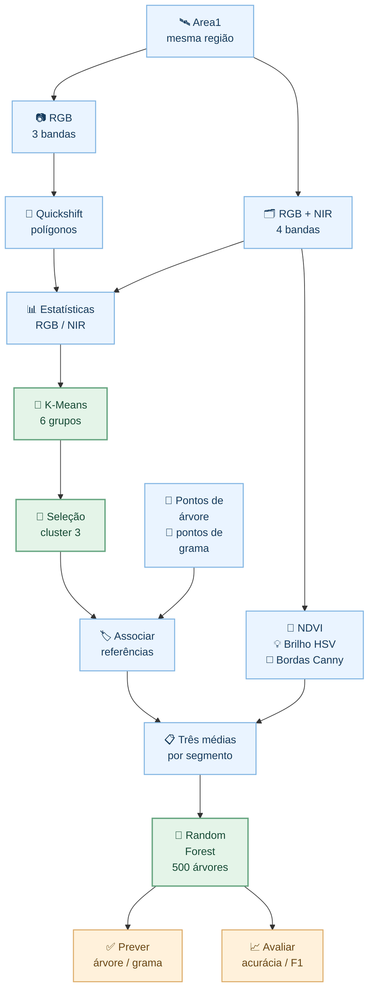
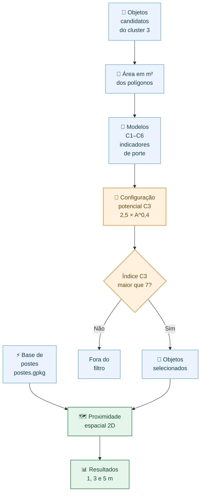
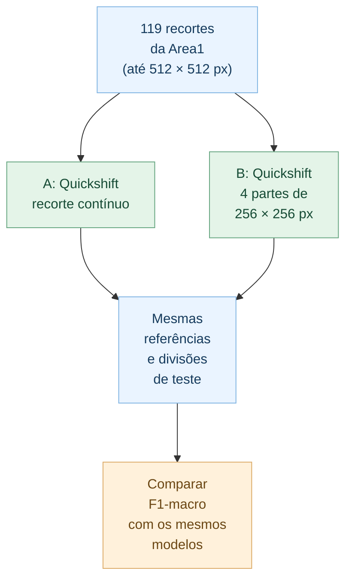
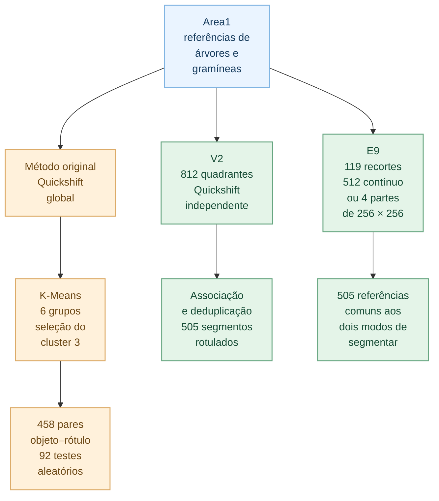
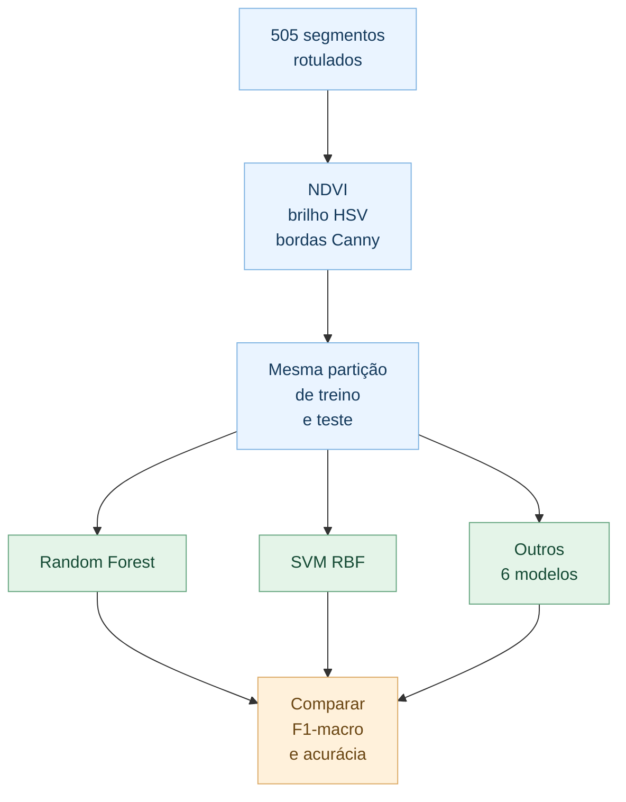

# Projeto de mestrado para detecção de árvores urbanas e avaliação de proximidade com linhas de energia utilizando brilho, bordas, NDVI e imagens aéreas.

**Pesquisa de mestrado — Breno Braga Galvão | Em desenvolvimento**

Esta pesquisa investiga duas propostas complementares a partir de **uma única área de estudo (Area1)** em Caxias do Sul (RS):

| Proposta | Pergunta central | Resultado buscado |
|---|---|---|
| **🌳 Proposta 1 — Identificação da vegetação** | Como distinguir **árvores e gramíneas** por características de imagens de satélite? | Objetos classificados como árvore ou gramínea. |
| **⚡ Proposta 2 — Porte e proximidade de postes** | Quais objetos candidatos apresentam **indicador empírico de porte** acima do limiar e ficam próximos de postes? | Seleção exploratória e distâncias 2D a postes, **sem comprovação de risco elétrico**. |

**Roteiro de leitura:** dados → **Proposta 1** → resultados históricos → **Proposta 2** → imagem completa das 17 etapas → documentação. **Todas as comparações dos experimentos novos aparecem no final do README.**

## 1. Área de estudo e dados utilizados

A Area1 utiliza **dois arquivos raster referentes essencialmente à mesma região**, e não duas áreas de estudo:

| Arquivo raster | Bandas | O que o código faz com ele |
|---|---|---|
| `AOI_RGB_NEW.tif` | **RGB — 3 bandas** (vermelho, verde, azul) | Alimenta o **Quickshift** para criar regiões/polígonos. |
| `AOI_NEW_MULTI.tif` | **RGB + NIR — 4 bandas** | Fornece estatísticas RGB/NIR, NDVI, brilho HSV e bordas Canny. |

**Os arquivos têm papéis diferentes:** o RGB é usado para a segmentação; o RGB + NIR fornece atributos que descrevem os segmentos. As grades possuem um pequeno deslocamento entre suas origens, relevante para o alinhamento espacial.

### Dimensões e cobertura — imagem completa × área de estudo (AOI)

| Área / arquivo | Dimensões da grade (largura × altura) | Pixels na área | Área no terreno |
|---|---|---:|---:|
| **Imagem RGB completa** (`AOI_RGB_NEW.tif`) | **6.942 × 7.294 pixels** | **50.634.948** | **12,658737 km²** (≈ 12,66 km²) |
| **Imagem RGB + NIR completa** (`AOI_NEW_MULTI.tif`) | **6.942 × 7.294 pixels** | **50.634.948** | **12,658737 km²** (≈ 12,66 km²) |
| **Polígono AOI sobre o RGB** (área efetiva de estudo) | **6.942 × 7.294 pixels** (mesma grade) | **48.548.811** | **≈ 12,1372 km²** (≈ 12,14 km²) |
| **Polígono AOI sobre o RGB + NIR** (mesma área de estudo) | **6.942 × 7.294 pixels** (mesma grade) | **48.548.645** | **≈ 12,1372 km²** (≈ 12,14 km²) |

**Observação:** a **AOI usa a mesma grade de 6.942 × 7.294 pixels** das imagens. Como o polígono da área de estudo é irregular, **nem todos os pixels da grade pertencem à AOI**; por isso, a quantidade de pixels incluídos e a área em km² são menores.

### Resolução espacial e referência geográfica

| Característica | Valor |
|---|---|
| **Região da imagem** | **Caxias do Sul — Rio Grande do Sul, Brasil** |
| **Satélite atribuído na documentação** | **JL1KF01B** |
| **Disponibilização das imagens (conforme documentação da pesquisa)** | **CPFL** |
| **Dimensão de cada pixel no terreno** | **0,50 × 0,50 m** (50 × 50 cm) |
| **Área representada por pixel** | **0,25 m²** |
| **Dimensões do retângulo raster no terreno** | **3.471 m de largura × 3.647 m de altura** |
| **Sistema de coordenadas dos rasters** | **EPSG:31982** |

**Arquivos vetoriais de apoio:**

| Arquivo | Finalidade |
|---|---|
| `AOI_new.shp` e auxiliares | Polígono da área de interesse |
| `Arvores.gpkg` | **257 pontos de referência de árvores** |
| `Grama.gpkg` | **253 pontos de referência de gramíneas** |
| `postes.gpkg` | Localização dos postes |

Portanto, existem **510 pontos de referência**. Isso **não significa 510 objetos ou 510 registros de treinamento**: o Quickshift cria segmentos, que depois são associados aos pontos conhecidos.

Os dez arquivos originais permanecem no [Google Drive — Area1](https://drive.google.com/drive/folders/1asqPz9xFr7dlnK1ggvrwftXEbkhvwjg6). Veja o [detalhamento dos arquivos e coordenadas](data/README.md).

---

## 2. 🌳 Proposta 1 — Identificação de árvores e gramíneas

**Objetivo:** classificar objetos vegetados em **árvore** ou **gramínea**, combinando NDVI, brilho HSV e bordas Canny.

### Como o código original realiza essa proposta

**Leitura do fluxo:** o **RGB** produz os polígonos; o **RGB + NIR** fornece os atributos; as referências identificam os exemplos; o **Random Forest** gera as previsões e as métricas.

**O que está acontecendo:** o Quickshift divide a imagem RGB em segmentos; o K-Means utiliza **quatro médias e quatro desvios-padrão RGB/NIR** e seleciona os objetos do **cluster 3**. Os pontos conhecidos identificam exemplos de árvores e gramíneas. O Random Forest recebe **três valores médios por objeto** — **brilho HSV, bordas Canny e NDVI** — para aprender a distinguir as duas classes.

**Parâmetros do método original:**

| Etapa | Configuração |
|---|---|
| Quickshift sobre o RGB completo | `kernel_size=3`, `max_dist=5`, `ratio=0.04` |
| K-Means | **6 clusters**, `random_state=42`, `n_init=10`; escolha do **cluster 3** |
| Random Forest | **500 árvores**, `random_state=42` |
| Treino/teste | Aleatório **80%/20%**, `random_state=42`, sem estratificação |

O método **não utiliza 50 milhões de pixels como 50 milhões de registros independentes**. Também não havia deduplicação explícita nem separação espacial entre treino e teste.

### Resultados históricos da Proposta 1

Os valores abaixo foram **registrados em execuções anteriores**, não recalculados por uma nova execução integral comprovada.

| Indicador | Experimento inicial | Experimento com área maior |
|---|---:|---:|
| Pares objeto–rótulo | **133** | **458** |
| Treinamento | 106 | 366 |
| Teste | 27 | 92 |
| **Acurácia** | **0,81** | **0,87** |
| F1 — árvores | 0,80 | 0,85 |
| F1 — gramíneas | 0,83 | 0,88 |

**Por que são 510 pontos de referência, mas 458 registros na rodada maior?** O código mantém apenas objetos do **cluster 3** e os associa espacialmente aos pontos conhecidos. O resultado é uma tabela de **pares objeto–rótulo**: um ponto pode não ter candidato e um segmento pode gerar mais de uma associação. Portanto, **não podemos concluir que 52 pontos foram descartados** sem auditar a execução histórica.

Os **458 registros** geraram **366 exemplos de treinamento e 92 de teste**. A acurácia de **0,87** corresponde a esse conjunto de 92 testes. A primeira rodada de **133 registros** utilizou outras amostras; o aumento de **0,81 para 0,87** é descritivo e não comprova, sozinho, um ganho causado pelo tamanho da área.

---

## 3. ⚡ Proposta 2 — Indicador de porte e proximidade com postes

**Objetivo:** calcular um indicador experimental de porte dos objetos e verificar sua **proximidade horizontal** aos postes da Area1.

### Como o código original realiza essa proposta

**Leitura do fluxo:** o índice **C3** é calculado a partir da área dos candidatos; apenas quem passa pelo limiar entra na análise de **distâncias aos postes**. A fórmula e os detalhes do filtro aparecem abaixo.

**No fluxograma, a “Base de postes” é o arquivo `postes.gpkg`**, utilizado como entrada independente para calcular a proximidade dos objetos selecionados.

O código calcula a área dos polígonos, testa **seis configurações empíricas (C1–C6)** nas formas potencial e linear e usa o índice potencial **C3** na seleção:

$$
\widehat{H}_{C3} = 2{,}5 \cdot A^{0{,}4}
$$

Nessa expressão, **A** é a área projetada do polígono, em **m²**. No código, o cálculo é escrito como `2.5 * (area ** 0.4)`.

Depois aplica o filtro `Power_tree_size_C3 > 7` e calcula a proximidade dos objetos selecionados a **1, 3 e 5 metros dos pontos dos postes**, usando `sjoin_nearest`.

**Ponto importante para a banca:** a Proposta 2 usa os **candidatos do cluster 3**, e o código histórico **não exige `predicted_classe == 'arvore'`** nesse filtro. Portanto, os objetos selecionados **não são necessariamente apenas árvores previstas pelo Random Forest**.

**Limites científicos:** o índice C3 **não é altura real validada**, as distâncias são **2D até postes** e a Area1 **não possui a geometria dos cabos**. Não se pode interpretar esse resultado como **interferência em fios ou risco elétrico comprovado**. [Ver as fórmulas C1–C6 e suas limitações](docs/allometria.md).

---

**Sobre os fluxogramas:** ambos estão em **código Mermaid**, como originalmente, com descrições completas, cores e espaçamento ampliado dentro das caixas para evitar cortes no GitHub. Eles representam o método original; a comparação da V2 está ao final do documento.

---

## 4. Imagem completa — as 17 etapas do código original

A ilustração horizontal abaixo apresenta as **17 etapas do código original**, com a **Proposta 1** (classificação) e a **Proposta 2** (índice de porte e proximidade com postes) identificadas. Os resultados exibidos na etapa 12 são os valores **históricos da rodada maior**: acurácia **0,87** e F1 de árvores **0,85**.

  

**Para visualizar a imagem ampliada:** clique no infográfico para abrir em tamanho original. No README, ele ocupa a largura disponível da página.

[**Abrir o infográfico horizontal ampliado (17 etapas)**](docs/fluxo_17_etapas_horizontal_corrigido.png)

Este esquema representa o **notebook original**. Os experimentos posteriores da V2, com segmentação em quadrantes, têm protocolos próprios e estão explicados **na última seção**.

## 5. Código e documentação técnica

| Material | Conteúdo |
|---|---|
| [Notebook original](Segmentacao_area_completa.ipynb) | Quickshift global, K-Means, Random Forest e proximidade |
| [Notebook V2](Segmentacao_area_completa_v2_experimentos.ipynb) | Auditoria de amostras, comparação de modelos, validação espacial, atributos, segmentação, porte e proximidade com postes |
| [Dados Area1](data/README.md) | Arquivos, coordenadas e estrutura do Drive |
| [Registro do método original](docs/experimento_area_completa_2026-10-29.md) | Parâmetros, resultados históricos e limitações |
| [Classificadores e protocolos de avaliação](docs/harmonizacao_protocolos_2026-11-01.md) | Comparações de modelos e validação espacial |
| [Comparação das segmentações de 512 e 256 pixels](docs/comparacao_controlada_segmentacao_512_vs_256_2026-11-01.md) | Comparação pareada da segmentação |
| [Estimativas C1–C6](docs/allometria.md) | Fórmulas exploratórias de porte |

Os arquivos da Area1 ficam no **Google Drive**, e o notebook original foi preparado para **Google Colab**. O processamento global consome muita memória; **uma nova execução completa e bem-sucedida não está comprovada**. As baterias da V2 têm evidências documentadas separadamente, mas nem todas as saídas estão salvas no próprio notebook publicado.

---

## 6. Avaliação científica — da imagem aos resultados

Esta seção apresenta os experimentos em uma sequência única: **de onde vieram os dados, como formamos as amostras, como separamos treino e teste, quais métodos comparamos e o que podemos concluir**. Assim, as diferentes divisões da imagem não são confundidas com as diferentes formas de avaliação.

> **Ponto de partida:** o método original registrou **0,87 de acurácia em 92 testes**. A V2 ampliou as análises, mas **ainda não há comparação integral e controlada entre os dois pipelines**. Os resultados abaixo descrevem experimentos específicos, sobretudo na base derivada dos dados existentes; não comprovam uma execução completa da V2 sobre todo o raster.

### 6.1. O que queremos investigar?

O propósito não é simplesmente encontrar um número maior que 0,87, mas entender **quais escolhas metodológicas mudam os resultados** e se o desempenho se mantém em condições de avaliação mais rigorosas.

| Pergunta científica | Como investigamos |
|---|---|
| **1. O tamanho das janelas de segmentação modifica as previsões?** | Os mesmos 119 recortes são segmentados em 512 × 512 pixels ou em quatro partes de 256 × 256 pixels |
| **2. Quais atributos da imagem ajudam a identificar árvores e gramíneas?** | Comparamos NDVI, brilho HSV e bordas Canny isolados e combinados |
| **3. A forma de avaliar influencia o resultado?** | Avaliação aleatória versus separação espacial por blocos de 250 m e 500 m |
| **4. Qual classificador funciona melhor nas mesmas condições?** | Comparamos oito modelos, incluindo Random Forest, SVM e regressão logística |

Além dessas perguntas, os experimentos verificam a qualidade dos rótulos, parâmetros de Quickshift e K-Means, proximidade de segmentos a postes, extrapolação dos atributos e sensibilidade de indicadores empíricos de porte. **Não há validação de altura real nem de risco elétrico.**

### 6.2. Primeiro, a imagem: o que foi processado?

A imagem RGB completa da **Area1** possui **6.942 × 7.294 pixels** e resolução espacial aproximada de **0,5 metro por pixel**. O **polígono AOI**, de formato irregular, delimita a área efetiva de estudo dentro da grade retangular.

O projeto utiliza a mesma fonte de dados para **três caminhos de processamento** — e cada caminho responde a uma pergunta diferente:

| Caminho | O que acontece com a imagem? | Para qual finalidade? |
|---|---|---|
| **Método original** | Quickshift executado **globalmente no raster RGB completo**; posteriormente, os segmentos são recortados pela AOI | Reproduzir o método histórico com K-Means (seis grupos e seleção do cluster 3) e Random Forest |
| **V2 — comparação de classificadores** | O raster retangular completo é percorrido por **812 quadrantes de até 256 × 256 pixels**, cada um segmentado separadamente | Formar a base de segmentos que alimenta os testes de classificação |
| **V2 — experimento E9** | **119 regiões de até 512 × 512 pixels**, escolhidas por conter referências conhecidas, são segmentadas de duas maneiras | Comparar os efeitos de processar uma janela inteira ou subdividi-la em quatro janelas |

**Por que 812 quadrantes?** A largura exige **28 colunas** e a altura, **29 linhas**; portanto, **28 × 29 = 812**. As janelas nas bordas são menores: a última coluna possui 30 pixels de largura e a última linha, 126 pixels de altura. Essa grade percorre **toda a extensão retangular**, inclusive trechos fora do polígono AOI.

A figura abaixo mostra a **imagem real da Area1**, a cobertura dos **812 quadrantes** e os **119 recortes** utilizados no E9. As dimensões devem ser lidas assim:

| Painel | Dimensão em pixels | Significado |
|---|---|---|
| **1 — Imagem original** | **6.942 × 7.294 px** | Tamanho do raster RGB completo |
| **2 — 812 quadrantes** | **256 × 256 px por quadrante** | Janelas de processamento (as bordas são menores) |
| **3 — 119 recortes do E9** | **512 × 512 px por recorte nominal** | Janelas selecionadas para comparar duas formas de segmentação (recortes de borda podem ser menores) |

A figura é uma visualização do procedimento, e as grades ilustrativas não reproduzem necessariamente os limites georreferenciados exatos.

  

[**Abrir a imagem ampliada — raster, 812 quadrantes e 119 recortes**](docs/infografico_area1_812_quadrantes_119_recortes_final.webp)

**Como ler a figura:** os 119 contornos amarelos indicam somente as regiões selecionadas no **E9**. Eles **não** mostram os únicos locais processados na bateria de 812 quadrantes, que percorreu o raster inteiro. Áreas escuras ou pretas são parte da representação da imagem e, por si sós, não indicam falhas ou omissões. Grades e marcações são ilustrativas; os limites dos recortes estão nos registros do experimento.

### 6.3. Segmentação: por que comparar 512 pixels com quatro quadrantes de 256? (E9)

Depois de conhecer a imagem original e as janelas de processamento, investigamos a primeira escolha metodológica: **a segmentação muda quando o Quickshift processa uma região inteira em vez de subdividi-la?** Esse é o objetivo do E9. Seus resultados também usam modelos e divisões de teste, detalhados adiante.

Para isso, escolhemos **119 recortes que contêm pontos conhecidos de árvores e gramíneas**. Cada região de **até 512 × 512 pixels** foi analisada das duas formas, **sobre os mesmos pixels**:

**Exemplo:** um recorte de **512 × 512 = 262.144 pixels** pode ser processado de uma vez ou em **quatro quadrantes de 256 × 256 = 65.536 pixels cada**. Somados, os quatro quadrantes abrangem **os mesmos pixels**. Não são novas imagens nem houve redução de resolução. Como cada execução do Quickshift pode criar limites diferentes, **os segmentos e suas médias de atributos podem mudar**.

Os **119 recortes não cobrem necessariamente toda a AOI** e podem ter bordas menores ou sobreposições; suas áreas não devem ser simplesmente somadas para inferir a cobertura única do polígono.

Na comparação pareada, mantiveram-se os **505 pontos de referência compartilhados**, os rasters e mapas de NDVI/brilho/Canny, os modelos e as partições de teste (a lógica da separação espacial é explicada na seção 6.6). O protocolo teve **cinco divisões por escala espacial de 250/500 m**, com **embargo de 25 m entre os pontos de referência** — **não** o embargo entre geometrias completas utilizado na comparação de classificadores. Foram **320 avaliações**.

**F1-macro médio das duas formas de segmentar:**

| Blocos espaciais de teste | Modelo | 512 contínuo | Quatro 256 |
|---|---|---:|---:|
| 250 m | Random Forest | **0,8906** | 0,8835 |
| 250 m | SVM RBF | 0,9157 | **0,9341** |
| 500 m | Random Forest | **0,8657** | 0,8566 |
| 500 m | SVM RBF | 0,8518 | **0,8641** |

O **Random Forest teve maior média com 512 contínuo** nos resultados exibidos, enquanto o **SVM teve maior média com quatro quadrantes de 256**. Portanto, o efeito da escala de segmentação **dependeu do classificador**.

**Não confundir:** os **512 e 256** desta subseção são medidas **em pixels para segmentação**. Já os **250 e 500 m** da tabela são medidas **geográficas para dividir treino e teste**. Além disso, **Quickshift em 512 pixels locais não equivale ao Quickshift global do método original**, e o E9 não reproduz o filtro histórico do cluster 3.

### 6.4. Das segmentações às amostras: por que aparecem 458 e 505?

**Dividir o raster em janelas não significa criar uma amostra rotulada por pixel.** Primeiro, o Quickshift gera segmentos; depois, suas características são calculadas e as referências conhecidas de árvores e gramíneas são associadas aos objetos candidatos.

Os mesmos **510 pontos de referência existentes** foram usados como ponto de partida, mas os caminhos de processamento **não produzem bases idênticas**:

| Base / experimento | Registros empregados | Avaliação documentada |
|---|---|---|
| **Original — rodada inicial** | **133 pares objeto–rótulo** | 27 testes aleatórios; recorte inicial não reconstruído integralmente |
| **Original — rodada ampliada** | **458 pares objeto–rótulo** | 92 testes aleatórios; acurácia histórica de **0,87** |
| **V2 — classificadores** | **505 segmentos únicos rotulados**: 257 árvores e 248 gramíneas | Divisões aleatórias e espaciais |
| **V2 — E9 (segmentação)** | **505 referências comuns** às duas formas de segmentar os 119 recortes | Testes espaciais pareados entre as alternativas |

A diferença de **458 para 505** não significa que encontramos 47 novas árvores ou gramíneas. No método original, os registros eram **associações objeto–rótulo após o filtro do cluster 3**; na base de classificadores da V2, os **505 são segmentos distintos após deduplicação**, sem aplicar aquele mesmo filtro. Os 505 do E9 também não significam que seus segmentos sejam necessariamente os mesmos 505 da comparação de classificadores.

**Consequência:** usar os mesmos arquivos e pontos de origem **não garante equivalência entre bases**. Por isso, não é correto confrontar diretamente a acurácia original de 0,87 com a média de outro experimento da V2.

### 6.5. Quais atributos da imagem ajudam a identificar árvores e gramíneas?

Depois de segmentar a imagem e associar os objetos às referências de árvores e gramíneas, precisamos **descrever os segmentos por características numéricas**. Foram investigados três grupos de atributos: **NDVI** (relacionado à resposta espectral da vegetação), **brilho HSV** e **bordas Canny**. Essas medidas são calculadas a partir das imagens disponíveis e resumidas para os objetos segmentados.

Na comparação de atributos (E4), as características foram avaliadas **isoladamente e em combinações**. Entre as combinações examinadas, **NDVI + brilho HSV + bordas Canny** apresentou o maior F1-macro médio nas condições documentadas. Isso **não prova** que a mesma combinação seja ótima em qualquer área ou com outro protocolo. A segmentação também afeta as médias calculadas por objeto, como mostrou o E9.

A análise de sensibilidade (E5) também variou parâmetros de **Quickshift e K-Means**. A métrica *silhouette* do K-Means mede a estrutura dos agrupamentos e **não deve ser confundida com acurácia de classificação**.

### 6.6. Como avaliamos: sorteio aleatório ou blocos geográficos?

Depois de formar os **505 segmentos rotulados da base de classificadores**, precisamos decidir **quais exemplos entram no treinamento e quais ficam reservados para teste**. Foram investigadas duas estratégias:

- **Divisão aleatória 80/20:** sorteia exemplos; objetos próximos geograficamente podem aparecer nos dois conjuntos, tornando a estimativa mais otimista.
- **Divisão espacial:** agrupa amostras por coordenadas em quadrados de **250 × 250 metros** ou **500 × 500 metros**; determinados blocos são reservados para teste. Na comparação de classificadores, também se aplica um **embargo de 25 m das geometrias de teste** para excluir objetos de treino muito próximos.

**Essa divisão por metros não é um segundo recorte físico dos 812 arquivos/janelas.** Os 812 quadrantes são a **etapa de processamento em pixels**; os blocos geográficos organizam **amostras já extraídas**, de acordo com sua localização.

A imagem abaixo mostra, sobre uma visualização da Area1, as **três grades distintas**:

  

[**Abrir a comparação ampliada — 256 px, 250 m e 500 m**](docs/area1_grades_processamento_validacao_espacial.svg)

| Grade | Unidade | Função |
|---|---|---|
| **812 quadrantes** | Até **256 × 256 pixels** | Executar Quickshift por janelas e extrair segmentos da imagem |
| **Blocos de 250 m** | **250 × 250 metros** | Separar amostras rotuladas para uma avaliação espacial |
| **Blocos de 500 m** | **500 × 500 metros** | Repetir a separação das mesmas amostras em escala geográfica maior |

Com resolução aproximada de **0,5 m/pixel**, 250 m equivalem a cerca de **500 pixels** de extensão e 500 m, a cerca de **1.000 pixels**. É **apenas uma equivalência de distância**: a segmentação da V2 não foi refeita em quadrantes de 500 ou 1.000 pixels. As grades de validação desenhadas na figura são **didáticas**, não os limites georreferenciados exatos das partições, e não mostram o embargo de 25 m.

**O que mudou no Random Forest usando as mesmas 505 amostras de origem?**

| Protocolo de avaliação | Acurácia média | F1-macro médio |
|---|---:|---:|
| **Aleatório 80/20** | **0,8832** | **0,8827** |
| **Espacial 250 m**, embargo de 25 m | 0,8697 | 0,8656 |
| **Espacial 500 m**, embargo de 25 m | 0,8591 | 0,8530 |

As médias espaciais são menores nesse conjunto de resultados, mas **isso não comprova por si só overfitting ou que apenas o embargo causou a diferença**: as partições aleatórias e espaciais não testam exatamente os mesmos objetos. Ambas avaliam a **mesma área geográfica geral**, não a transferência para outra cidade.

Também repetimos a **configuração histórica** do Random Forest (500 árvores, sorteio 80/20 e semente 42) **sobre a nova base de 505 segmentos**: **404 exemplos de treino, 101 de teste**, acurácia **0,9010** e F1-macro **0,9009**. Esse resultado **não reproduz o 0,87 original**, pois a amostra avaliada não é a mesma.

### 6.7. Qual classificador teve melhor resultado nas mesmas condições?

A partir da base derivada de **505 segmentos**, testamos **oito classificadores**. Em cada partição, os modelos receberam **os mesmos exemplos, as mesmas características e a mesma divisão de treino e teste**. Alterou-se o algoritmo de classificação, para tornar a comparação válida *dentro do protocolo*.

A tabela apresenta o **F1-macro médio em cinco divisões espaciais por escala**, com **embargo de 25 m em relação às geometrias de teste**:

| Modelo | Blocos de 250 m | Blocos de 500 m |
|---|---:|---:|
| **SVM RBF** | **0,8987** | **0,8668** |
| Regressão logística | 0,8928 | 0,8664 |
| KNN (7) | 0,8874 | 0,8502 |
| Extra Trees | 0,8790 | 0,8629 |
| **Random Forest** | **0,8656** | **0,8530** |
| HistGradientBoosting | 0,8556 | 0,8524 |
| Gaussian Naive Bayes | 0,8555 | 0,8398 |
| Dummy (referência simples) | 0,2980 | 0,2799 |

**Como interpretar:** com blocos de 250 m, o SVM apresentou F1-macro médio de **0,8987**, frente a **0,8656** do Random Forest. O SVM liderou **nessas condições**; isso não demonstra superioridade estatística universal nem desempenho superior em outras áreas.

Os três atributos considerados aqui — NDVI, brilho HSV e bordas Canny — e os testes de sua contribuição foram apresentados na **seção 6.5**. Nesta comparação, o que muda entre os modelos é **o classificador**, mantendo as condições de cada partição.

A harmonização documentou **40 novos ajustes aleatórios** (oito modelos × cinco divisões) e **240 resultados espaciais reutilizados e verificados** — **não 280 ajustes totalmente novos**.

### 6.8. O que os resultados permitem — e não permitem — concluir?

Uma comparação é mais forte quando mantém **as mesmas referências de teste, os mesmos atributos, a mesma métrica e as demais condições controladas**. O fato de dois testes virem da mesma imagem não basta.

| Comparação | Interpretação adequada | Por quê? |
|---|---|---|
| **Original: 0,81 × 0,87** | Evolução histórica **descritiva** | Rodadas e testes diferentes; não estabelece causa do aumento |
| **Original: acurácia 0,87 × V2: F1 0,8656** | **Não comparar como se fossem a mesma nota** | Acurácia e F1-macro são métricas distintas; bases e protocolos também diferem |
| **Original: acurácia 0,87 × V2: acurácia 0,8697** | **Não concluir equivalência ou melhoria direta** | Mesmo nome de métrica, mas objetos e divisões de teste diferentes |
| **RF × SVM na mesma divisão da V2** | Comparação **interna válida** | Mesmos exemplos, atributos e métricas em cada rodada |
| **512 contínuo × quatro 256 no E9** | Comparação **pareada válida nesses recortes** | Mesmas referências e avaliações dentro do E9 |
| **Pipeline original inteiro × pipeline V2 inteiro** | **Ainda pendente** | Falta uma reprodução integral controlada sob condições comuns |

**Acurácia** é a proporção de acertos. **F1-macro** faz a média do F1 calculado separadamente para árvore e gramínea, dando o mesmo peso às classes. Por isso, **0,87 de acurácia não é a mesma medida que 0,8656 de F1-macro**.

Os testes espaciais avaliam a generalização **entre regiões da Area1**, com as limitações da amostragem existente. Eles **não garantem ausência de overfitting** nem demonstram generalização para outras cidades.

### 6.9. O que já foi feito e o que falta?

**Já documentamos:** auditoria dos rótulos e duplicações; comparação de oito classificadores; validação aleatória e espacial; testes de atributos; sensibilidade de Quickshift/K-Means; proximidade a postes; extrapolação de atributos; sensibilidade dos indicadores de porte; e E9 com segmentações pareadas em recortes equivalentes.

**A prioridade científica seguinte é uma comparação ponta a ponta:** executar novamente o **Quickshift global**, o **K-Means com seis grupos**, a **seleção do cluster 3** e o restante do método original; determinar quais referências são comparáveis entre os pipelines; usar **partições comuns e as mesmas métricas**; e separar a **cobertura dos candidatos** da **qualidade da classificação**. A execução integral atual da V2 sobre os aproximadamente **50,6 milhões de pixels do raster** ainda não está comprovada.

**Limitações permanentes desta base:** não temos alturas verdadeiras medidas, geometria dos cabos elétricos nem rótulos completos do fundo urbano. Assim, **não se pode afirmar altura real, risco elétrico efetivo nem generalização para outras cidades**. Proximidade planimétrica de postes e estimativas empíricas de porte são análises exploratórias.

**Síntese para a defesa:**

> “O método original obteve 0,87 de acurácia em 92 testes, com uma base diferente da usada na V2. Na ampliação, comparei classificadores sob partições equivalentes, avaliei a sensibilidade à separação espacial e confrontei formas de segmentação nos mesmos recortes. Essas evidências permitem interpretar cada protocolo, mas ainda não demonstram superioridade do pipeline completo da V2 sobre o original.”

### 6.10. Onde localizar cada experimento?

Os códigos **E1, E2, E3, E8h, E9** etc. identificam partes do notebook, **não algoritmos ou métricas**. Este guia serve para localizar os testes, sem interromper a explicação metodológica anterior.

| Investigação | Código |
|---|---|
| Auditoria de amostras, duplicações e rótulos | E1 |
| Validação espacial por blocos geográficos | E2 |
| Comparação de classificadores | E3 / E3c |
| Contribuição de NDVI, HSV e Canny | E4 |
| Sensibilidade de Quickshift e K-Means | E5 |
| Proximidade a postes; extrapolação de atributos | E6 / E6c |
| Sensibilidade de indicadores empíricos de porte | E7 |
| Consolidação científica e revisão bibliográfica | E8 |
| Harmonização da avaliação aleatória e espacial | E8h |
| Segmentação de 512 contínuo versus quatro 256 | E9 |

Os detalhes para reprodução estão em [protocolos de classificadores e avaliação aleatória/espacial](docs/harmonizacao_protocolos_2026-11-01.md) e [comparação pareada de segmentação 512 × 256](docs/comparacao_controlada_segmentacao_512_vs_256_2026-11-01.md).
