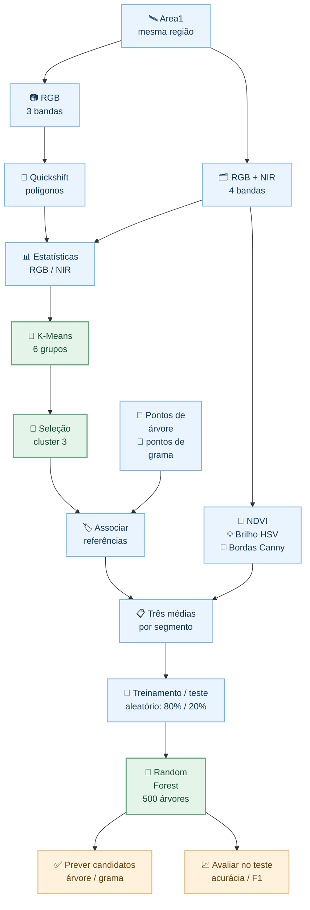
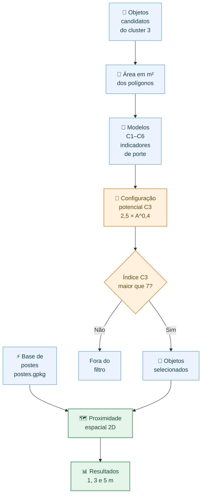
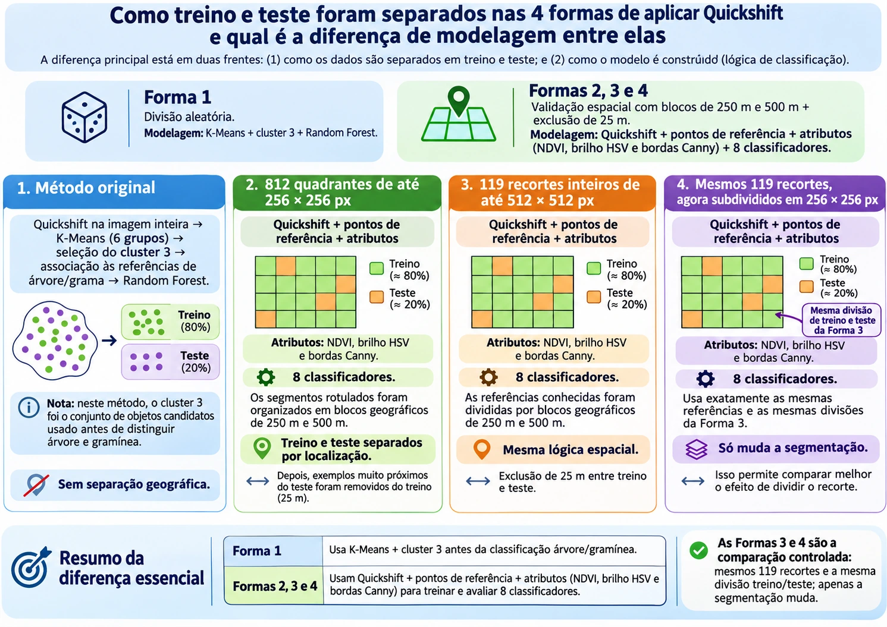
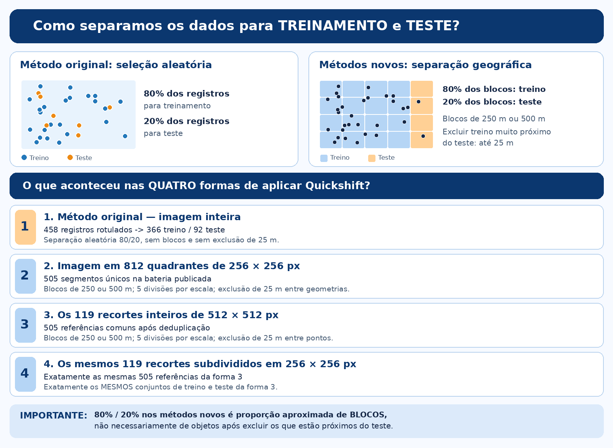
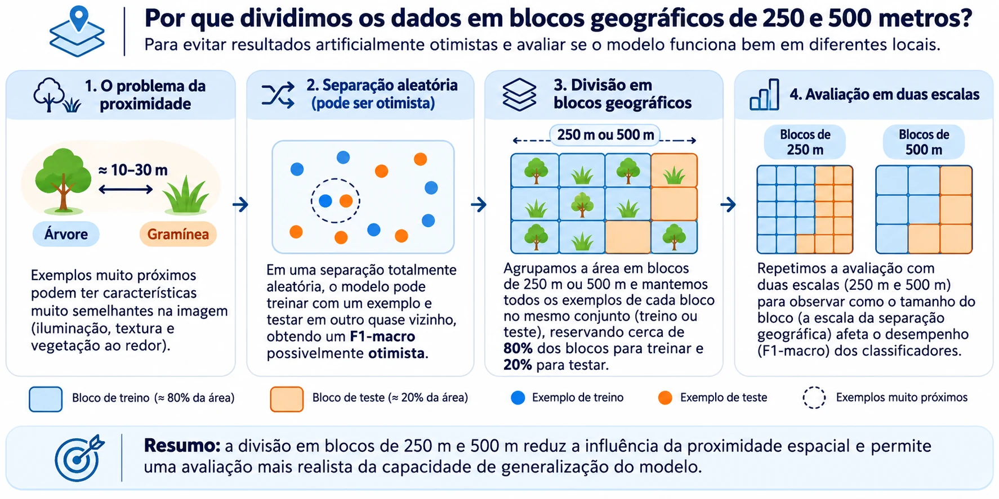
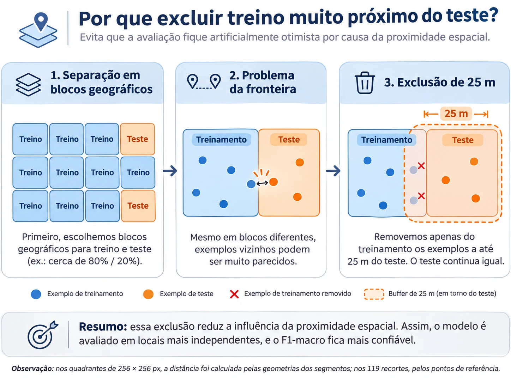
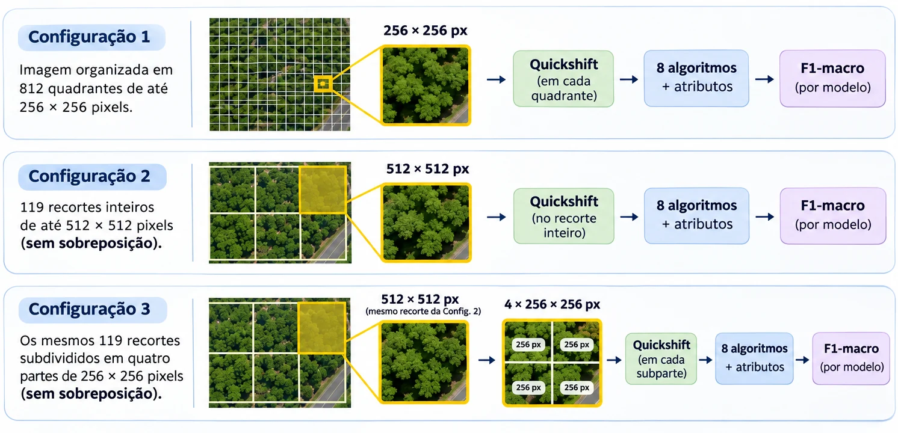
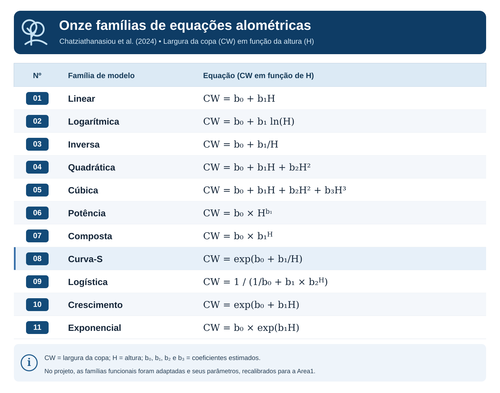

# Projeto de mestrado: Combinação de Características de Brilho, Bordas e NDVI para Detecção de Árvores Urbanas e Avaliação de Proximidade com Linhas de Energia

**Portal interativo da pesquisa:** [**Acessar o site do mestrado**](https://brenobragagalvao.github.io/mestrado-arvores-urbanas/) · [código do portal](docs/index.html) · [documentação do site](docs/mestrado-site/README.md). Navegação lateral por capítulos e subtópicos do README, gráficos de classificação e alometria e consulta aos 257 pontos, sem alterar notebooks ou dados.

**Pesquisa de mestrado — Breno Braga Galvão | Em desenvolvimento**

Esta pesquisa investiga duas propostas complementares a partir de **uma única área de estudo (Area1)** em Caxias do Sul (RS):

| Proposta | Pergunta central | Resultado buscado |
|---|---|---|
| **🌳 Proposta 1 — Identificação da vegetação** | Como distinguir **árvores e gramíneas** por características de imagens de satélite? | Objetos classificados como árvore ou gramínea. |
| **⚡ Proposta 2 — Porte e proximidade de postes** | Quais objetos candidatos apresentam **indicador empírico de porte** acima do limiar e ficam próximos de postes? | Seleção exploratória e distâncias 2D a postes, **sem comprovação de risco elétrico**. |

## Por que mudamos o método? A memória RAM foi o limite

**Primeiro, o método original:** aplicamos **Quickshift à imagem RGB inteira**, seguido de **K-Means (seis grupos, com seleção do cluster 3)** e **Random Forest (500 árvores)**. A execução histórica alcançou **acurácia de 0,87 em 92 exemplos de teste**, com um consumo de **5,42 GiB de memória RAM**, valor superior aos **4 GiB disponíveis** no ambiente atual, o que motivou a adoção de uma nova estratégia de processamento com janelas menores.

**Depois, tentamos repetir o Quickshift global** para comparar outros algoritmos nas mesmas condições. A imagem tem **6.942 × 7.294 pixels (50.634.948 pixels)**. Em um ambiente com **4 GiB de RAM**, a tentativa **não concluiu**: houve `MemoryError` quando o Quickshift precisou alocar **mais 1,13 GiB** para uma matriz temporária. Como o erro ocorreu **durante a segmentação**, essa nova tentativa **nem chegou ao K-Means ou ao Random Forest**.

### Quanto de memória foi necessário ou observado?

| Situação | Memória RAM | O que esse número significa? |
|---|---:|---|
| **Método original completo: Quickshift + K-Means + Random Forest** | **5,42 GiB** | **Memória de 5,42 GiB**, valor adotado como referência para o processamento da imagem completa pelo método original. |
| **Nova tentativa do Quickshift global** | **1,13 GiB adicionais solicitados; falhou** | A tentativa **não concluiu**: houve `MemoryError` quando o Quickshift precisou alocar **mais 1,13 GiB** para uma matriz temporária. |
| **Quickshift em um recorte de 2.048 × 2.048 pixels** | **Cerca de 687 MB de pico** | Medição em um recorte maior, que conseguiu concluir; não equivale à imagem inteira. |
| **119 recortes de até 512 × 512 pixels, um após o outro** | **467,19 MiB de pico** | Medição do processo na comparação entre tamanhos de janela. |
| **Os mesmos 119 recortes divididos em até quatro partes de 256 × 256** | **456,80 MiB de pico** | Medição do mesmo tipo de processo; redução observada de **10,38 MiB (2,22%)**. |

**Decisão:** em vez de insistir no Quickshift global, passamos a **dividir a imagem em janelas menores, sem reduzir a resolução dos pixels**. Isso viabilizou comparar oito classificadores com exemplos e testes equivalentes **dentro de cada novo experimento**. Não significa que reproduzimos o método global original.

## Índice de tópicos e subtópicos

Clique no título para abrir diretamente a seção correspondente.

| Tópico / subtópico | O que apresenta |
|---|---|
| [Por que mudamos o método?](#intro-ram) | Limitação da RAM e motivo para processar em partes. |
| [Medições de memória](#intro-memoria) | RAM observada nas diferentes tentativas. |
| [1. Área de estudo e dados](#sec-1) | Fontes de dados e características da Area1. |
| [Dimensões e cobertura](#sec-1-dimensoes) | Tamanho das imagens e área efetiva de estudo. |
| [Resolução e coordenadas](#sec-1-resolucao) | Resolução espacial e referência geográfica. |
| [2. Metodologia original](#sec-2) | Procedimentos originais e duas propostas. |
| [2.1. Proposta 1 — Vegetação](#sec-2-1) | Identificação de árvores e gramíneas. |
| [2.1. Fluxo original](#sec-2-1-fluxo) | Quickshift, K-Means, cluster 3 e Random Forest. |
| [2.1. Resultados originais](#sec-2-1-resultados) | Acurácia e métricas históricas da classificação. |
| [2.2. Proposta 2 — Porte e postes](#sec-2-2) | Porte exploratório e proximidade de postes. |
| [2.2. Fluxo de porte e postes](#sec-2-2-fluxo) | Área dos segmentos, equações C1–C6 e distância. |
| [2.3. Pipeline original](#sec-2-3) | Infográfico com as 17 etapas do código original. |
| [3. Evolução metodológica](#sec-3) | Três novas configurações e oito classificadores. |
| [3.1. Processamento em partes](#sec-3-1) | Por que não repetimos o Quickshift global. |
| [3.2. Seleção dos 119 recortes](#sec-3-2) | Como os pontos conhecidos definiram as regiões. |
| [3.3. Quickshift, rótulos e atributos](#sec-3-3) | Como os segmentos se tornam exemplos rotulados. |
| [3.4. Treinamento e teste](#sec-3-4) | Divisão aleatória versus validação espacial. |
| [3.5. NDVI, HSV e Canny](#sec-3-5) | Contribuição dos atributos para o F1-macro. |
| [3.6. Oito classificadores](#sec-3-6) | Resultados gerais nas três configurações. |
| [3.6.1. Configuração 1](#sec-3-6-1) | 812 quadrantes de até 256 × 256 pixels. |
| [3.6.2. Configuração 2](#sec-3-6-2) | 119 recortes inteiros de até 512 × 512 pixels. |
| [3.6.3. Configuração 3](#sec-3-6-3) | 119 recortes subdivididos em partes de 256 × 256 pixels. |
| [3.7. Memória RAM](#sec-3-7) | Comparação dos picos de memória. |
| [3.8. Auditoria de overfitting e regularização](#sec-3-8) | Resultados E2, E3A, E3B, limites científicos e reprodução no notebook V2. |
| [4. Alometria, Meta/WRI e espécies locais](#sec-4) | Contexto regional, fontes e resultados da V3. |
| [4.1. Fonte das alturas Meta/WRI](#sec-4-1) | Raster original, resolução, método e precisão publicada. |
| [4.2. Inventário e espécies de Caxias do Sul](#sec-4-2) | PDAU municipal, referências de porte e limites. |
| [4.3. Alturas nos 257 pontos](#sec-4-3) | Meta pixel, Meta 5 m e valores zero. |
| [4.4. Famílias do artigo e C1–C6](#sec-4-4) | Distinção entre as 11 famílias adaptadas e as 12 expressões originais: seis potenciais e seis lineares. |
| [4.5. Comparação das 15 primeiras árvores](#sec-4-4-tabela-257) | Meta pixel e 5 m, logarítmica, inversa, curva-S, cúbica e índices C1/C3 potenciais. |
| [4.6. Documentação e dados](#sec-4-5) | Links dos artigos, raster, notebook, CSVs e relatório. |
| [5. Conclusão](#sec-5) | Principais resultados e limites científicos. |
| [6. Código e documentação técnica](#sec-6) | Notebooks, scripts, CSVs e documentação. |

---

## 1. Área de estudo e dados utilizados

A Area1 utiliza **dois arquivos raster referentes essencialmente à mesma região**, e não duas áreas de estudo:

| Arquivo raster | Bandas | O que o código faz com ele |
|---|---|---|
| `AOI_RGB_NEW.tif` | **RGB — 3 bandas** (vermelho, verde, azul) | Alimenta o **Quickshift** para criar regiões/polígonos. |
| `AOI_NEW_MULTI.tif` | **RGB + NIR — 4 bandas** | Fornece estatísticas RGB/NIR, NDVI, brilho HSV e bordas Canny. |

**Os arquivos têm papéis diferentes:** o RGB é usado para a segmentação; o RGB + NIR fornece atributos que descrevem os segmentos. As grades possuem um pequeno deslocamento entre suas origens, relevante para o alinhamento espacial.

### Dimensões e cobertura — imagem completa × área de estudo (AOI)

| Área / arquivo | Dimensões da grade (largura × altura) | Pixels na área | Área no terreno |
|---|---|---:|---:|
| **Imagem RGB completa** (`AOI_RGB_NEW.tif`) | **6.942 × 7.294 pixels** | **50.634.948** | **12,658737 km²** (≈ 12,66 km²) |
| **Imagem RGB + NIR completa** (`AOI_NEW_MULTI.tif`) | **6.942 × 7.294 pixels** | **50.634.948** | **12,658737 km²** (≈ 12,66 km²) |
| **Polígono AOI sobre o RGB** (área efetiva de estudo) | **6.942 × 7.294 pixels** (mesma grade) | **48.548.811** | **≈ 12,1372 km²** (≈ 12,14 km²) |
| **Polígono AOI sobre o RGB + NIR** (mesma área de estudo) | **6.942 × 7.294 pixels** (mesma grade) | **48.548.645** | **≈ 12,1372 km²** (≈ 12,14 km²) |

**Observação:** a **AOI usa a mesma grade de 6.942 × 7.294 pixels** das imagens. Como o polígono da área de estudo é irregular, **nem todos os pixels da grade pertencem à AOI**; por isso, a quantidade de pixels incluídos e a área em km² são menores.

### Resolução espacial e referência geográfica

| Característica | Valor |
|---|---|
| **Região da imagem** | **Caxias do Sul — Rio Grande do Sul, Brasil** |
| **Satélite atribuído na documentação** | **JL1KF01B** |
| **Disponibilização das imagens (conforme documentação da pesquisa)** | **CPFL** |
| **Dimensão de cada pixel no terreno** | **0,50 × 0,50 m** (50 × 50 cm) |
| **Área representada por pixel** | **0,25 m²** |
| **Dimensões do retângulo raster no terreno** | **3.471 m de largura × 3.647 m de altura** |
| **Sistema de coordenadas dos rasters** | **EPSG:31982** |

**Arquivos vetoriais de apoio:**

| Arquivo | Finalidade |
|---|---|
| `AOI_new.shp` e auxiliares | Polígono da área de interesse |
| `Arvores.gpkg` | **257 pontos de referência de árvores** |
| `Grama.gpkg` | **253 pontos de referência de gramíneas** |
| `postes.gpkg` | Localização dos postes |

Portanto, existem **510 pontos de referência**. Isso **não significa 510 objetos ou 510 registros de treinamento**: o Quickshift cria segmentos, que depois são associados aos pontos conhecidos.

**Esses pontos são dados originais da Area1:** já existiam nos arquivos `Arvores.gpkg` e `Grama.gpkg` e também foram utilizados no estudo inicial. Na V2 **reutilizamos somente a localização e a classe conhecida desses pontos**, não os segmentos escolhidos pelo K-Means, o Random Forest treinado, as previsões nem a acurácia de 0,87 do estudo inicial.

Os dez arquivos originais permanecem no [Google Drive — Area1](https://drive.google.com/drive/folders/1asqPz9xFr7dlnK1ggvrwftXEbkhvwjg6). Veja o [detalhamento dos arquivos e coordenadas](data/README.md).

---

## 2. Metodologia original — Quickshift + K-Means + Random Forest

### 2.1. 🌳 Proposta 1 — Identificação de árvores e gramíneas

**Objetivo:** classificar objetos vegetados em **árvore** ou **gramínea**, combinando NDVI, brilho HSV e bordas Canny.

#### Como o código original realiza essa proposta

**Leitura do fluxo:** o **Quickshift** segmenta o RGB, e os segmentos são convertidos em polígonos. As bandas **RGB + NIR** fornecem as características, e as referências identificam os exemplos de árvores e gramíneas. Depois de calcular as **três médias por segmento** (NDVI, brilho HSV e bordas Canny), o código separa aleatoriamente os dados rotulados em **80% para treinamento e 20% para teste** (`random_state=42`). O **Random Forest com 500 árvores** é treinado apenas com o conjunto de treinamento, **avaliado no conjunto de teste** (acurácia e F1) e, em seguida, aplicado para prever as classes dos objetos candidatos do **cluster 3**.

**O que está acontecendo:** o Quickshift divide a imagem RGB em segmentos; o K-Means utiliza **quatro médias e quatro desvios-padrão RGB/NIR** e seleciona os objetos do **cluster 3**. Os pontos conhecidos identificam exemplos de árvores e gramíneas. O Random Forest recebe **três valores médios por objeto** — **brilho HSV, bordas Canny e NDVI** — para aprender a distinguir as duas classes.

**Parâmetros do método original:**

| Etapa | Configuração |
|---|---|
| Quickshift sobre o RGB completo | `kernel_size=3`, `max_dist=5`, `ratio=0.04` |
| K-Means | **6 clusters**, `random_state=42`, `n_init=10`; escolha do **cluster 3** |
| Random Forest | **500 árvores**, `random_state=42` |
| Treino/teste | Aleatório **80%/20%**, `random_state=42`, sem estratificação |

O método original processa aproximadamente 50 milhões de pixels, agrupando-os em segmentos por meio do Quickshift. A classificação pelo Random Forest utiliza características desses segmentos, e não os pixels individualmente. Na execução histórica, foram utilizados 458 registros rotulados, divididos aleatoriamente entre treinamento (366) e teste (92). Entretanto, o código não separava geograficamente os exemplos de treinamento e teste, o que pode influenciar a avaliação do desempenho do modelo.

#### Resultados da Proposta 1

Os valores abaixo foram **registrados em execuções anteriores**:

| Indicador | Experimento inicial | Experimento com área maior |
|---|---:|---:|
| Pares objeto–rótulo | **133** | **458** |
| Treinamento | 106 | 366 |
| Teste | 27 | 92 |
| **Acurácia** | **0,81** | **0,87** |
| F1 — árvores | 0,80 | 0,85 |
| F1 — gramíneas | 0,83 | 0,88 |
| **F1-macro (aproximado)** | **≈ 0,815** | **≈ 0,865** |

*O F1-macro foi aproximado pela média dos F1 das duas classes, que já estão arredondados na tabela. Os valores exatos exigem as métricas originais sem arredondamento.*

**Por que são 510 pontos de referência, mas 458 registros na rodada maior?** O código mantém apenas objetos do **cluster 3** e os associa espacialmente aos pontos conhecidos. O resultado é uma tabela de **pares objeto–rótulo**: um ponto pode não ter candidato e um segmento pode gerar mais de uma associação.

Os **458 registros** geraram **366 exemplos de treinamento e 92 de teste**. A acurácia de **0,87** corresponde a esse conjunto de 92 testes. A primeira rodada de **133 registros** utilizou outras amostras; o aumento de **0,81 para 0,87**.

---

### 2.2. ⚡ Proposta 2 — Indicador de porte e proximidade com postes

**Objetivo:** calcular um indicador experimental de porte dos objetos e verificar sua **proximidade horizontal** aos postes da Area1.

#### Como o código original realiza essa proposta

**Leitura do fluxo:** o índice **C3** é calculado a partir da área dos candidatos; apenas quem passa pelo limiar entra na análise de **distâncias aos postes**. A fórmula e os detalhes do filtro aparecem abaixo.

**No fluxograma, a “Base de postes” é o arquivo `postes.gpkg`**, utilizado como entrada independente para calcular a proximidade dos objetos selecionados.

O código calcula a área dos polígonos, testa **seis configurações empíricas (C1–C6)** nas formas potencial e linear e usa o índice potencial **C3** na seleção:

$$
\widehat{H}_{C3} = 2{,}5 \cdot A^{0{,}4}
$$

Nessa expressão, **A** é a área projetada do polígono, em **m²**. No código, o cálculo é escrito como `2.5 * (area ** 0.4)`.

Depois aplica o filtro `Power_tree_size_C3 > 7` e calcula a proximidade dos objetos selecionados a **1, 3 e 5 metros dos pontos dos postes**, usando `sjoin_nearest`.

**Ponto importante para a banca:** a Proposta 2 usa os **candidatos do cluster 3**, e o código histórico **não exige `predicted_classe == 'arvore'`** nesse filtro. Portanto, os objetos selecionados **não são necessariamente apenas árvores previstas pelo Random Forest**.

**Limites científicos:** o índice C3 **não é altura real validada**, as distâncias são **2D até postes** e a Area1 **não possui a geometria dos cabos**. Não se pode interpretar esse resultado como **interferência em fios ou risco elétrico comprovado**. [Ver as fórmulas C1–C6 e suas limitações](docs/allometria.md).

---

### 2.3. Pipeline completo da metodologia original

A ilustração horizontal abaixo apresenta as **17 etapas do código original**, com a **Proposta 1** (classificação) e a **Proposta 2** (índice de porte e proximidade com postes) identificadas. Os resultados exibidos na etapa 12 são os valores **históricos da aplicação inicial**: acurácia **0,87** e F1 de árvores **0,85**.

  

**Para visualizar a imagem ampliada:** clique no infográfico para abrir em tamanho original. No README, ele ocupa a largura disponível da página.

[**Abrir o infográfico horizontal ampliado (17 etapas)**](docs/fluxo_17_etapas_horizontal_corrigido.png)

Este esquema representa o **notebook original**. Os experimentos posteriores da V2, com segmentação em quadrantes, têm protocolos próprios e estão explicados **na seção 3**.

## 3. Evolução metodológica — três novas configurações de processamento

Partimos da **imagem original da Area1 (6.942 × 7.294 pixels)** e dos **510 pontos georreferenciados** já conhecidos: **257 árvores** (`Arvores.gpkg`) e **253 gramíneas** (`Grama.gpkg`). A imagem inteira exigia muita memória RAM para repetir o Quickshift global; por isso, organizamos **quatro formas de processamento**, com objetivos complementares:

1. **Método original — imagem inteira:** Quickshift global → K-Means (seis grupos, seleção do cluster 3) → Random Forest. **Por quê?** Estabelecer o resultado inicial da classificação de árvores e gramíneas.
2. **Quadrantes de 256 × 256 pixels — área completa:** a imagem é organizada em **812 quadrantes**, com Quickshift por quadrante e extração de NDVI, brilho HSV e bordas Canny. **Por quê?** Reduzir a demanda de RAM e investigar **oito classificadores**, combinações de atributos e **F1-macro** com validação espacial.
3. **Recortes inteiros de 512 × 512 pixels — 119 regiões:** entre **210 janelas possíveis**, selecionamos as **119 que contêm pontos de referência conhecidos** e aplicamos Quickshift em cada recorte inteiro. **Por quê?** Avaliar os oito classificadores pelo **F1-macro** nessa escala de segmentação.
4. **Os mesmos 119 recortes subdivididos em 256 × 256 pixels:** dividimos cada recorte em até quatro partes e aplicamos Quickshift separadamente, avaliando os mesmos oito classificadores. **Por quê?** Comparar diretamente com a forma 3 o **F1-macro** e o consumo de memória RAM, mantendo os mesmos pontos e divisões espaciais de treino e teste.

**Importante:** as formas **3 e 4 são os dois testes de uma mesma comparação controlada**. Nos experimentos novos, reutilizamos **a imagem e os pontos originais**, mas não os segmentos do K-Means, o Random Forest treinado ou suas previsões. Os **119 recortes foram escolhidos pelas coordenadas das referências**, nunca pelos acertos do modelo. Há resultados documentados para baterias derivadas de quadrantes de 256 pixels; isso não comprova a conclusão de uma nova execução integral da rotina progressiva dos 812 quadrantes na V2.

  

*Figura — Visão geral dos três experimentos da Area1: método original, processamento por 812 quadrantes de 256 × 256 pixels e comparação controlada dos 119 recortes de até 512 × 512 pixels, também segmentados em partes de 256 × 256 pixels.*

**Perguntas que orientaram os testes**

| Pergunta | Como investigamos? |
|---|---|
| **1. Por que dividimos a imagem?** | Tentamos repetir o Quickshift global com limite de **4 GiB de RAM**, mas faltou memória. Passamos a processar partes menores, preservando os pixels originais. |
| **2. Por que escolhemos exatamente 119 recortes?** | Reutilizamos as **coordenadas dos 510 pontos de referência originais** (arquivos `Arvores.gpkg` e `Grama.gpkg`), **não as previsões do K-Means ou do Random Forest**. Na grade de até **512 × 512 pixels**, esses pontos ocupam **119 janelas distintas**, onde podemos avaliar a classificação. |
| **3. Qual algoritmo classifica melhor?** | Comparamos **oito classificadores**: **(1)** Random Forest; **(2)** SVM com kernel RBF; **(3)** regressão logística; **(4)** Extra Trees; **(5)** KNN (7 vizinhos); **(6)** HistGradientBoosting; **(7)** Gaussian Naive Bayes; e **(8)** Dummy (modelo de referência simples). Todos foram avaliados com os **mesmos exemplos, atributos e divisões espaciais de treinamento e teste**, permitindo comparar o desempenho pelo **F1-macro**. |
| **4. Dividir cada recorte em quatro partes muda os resultados ou a memória?** | Usamos as **mesmas 119 regiões** para descobrir se o tamanho da janela influencia os resultados. Primeiro, aplicamos o Quickshift nos recortes inteiros de **até 512 × 512 pixels**; depois, dividimos esses mesmos recortes em até quatro partes de **256 × 256 pixels**. Assim, podemos verificar **qual estratégia oferece melhor F1-macro para os oito classificadores e qual consome menos memória RAM**, mantendo as mesmas referências e condições de avaliação. |
| **5. NDVI, brilho HSV e bordas Canny funcionam melhor juntos?** | Comparamos **sete combinações** dos três atributos: **(1)** apenas NDVI; **(2)** apenas brilho HSV; **(3)** apenas bordas Canny; **(4)** NDVI + brilho HSV; **(5)** NDVI + bordas Canny; **(6)** brilho HSV + bordas Canny; e **(7)** NDVI + brilho HSV + bordas Canny. Todas as combinações foram avaliadas com os mesmos classificadores e as mesmas divisões espaciais de treinamento e teste, para identificar quais características proporcionam melhores resultados na classificação de árvores e gramíneas. |

### 3.1. Por que deixamos de processar a imagem inteira?

**No método original**, aplicamos **Quickshift na imagem inteira → K-Means (6 grupos, cluster 3) → Random Forest**, obtendo **F1 de 0,85 para árvores e F1-macro aproximado de 0,865**.

**Por que mudamos?** Ao tentar repetir a segmentação global, faltou memória RAM antes das etapas de K-Means e Random Forest. O erro indicou uma tentativa de alocação **adicional de 1,13 GiB** — **não** o consumo total do método. Como a imagem tem cerca de **50,6 milhões de pixels**, passamos a executar o Quickshift em partes menores, **sem reduzir a resolução dos pixels**.

Na **V2**, investigamos três configurações de segmentação:

| Configuração | Área processada | Objetivo |
|---|---|---|
| **Quadrantes de até 256 × 256 px** | **812 quadrantes** (28 × 29), cobrindo a imagem inteira | Processar progressivamente com menos demanda de RAM e comparar **oito classificadores** e combinações de atributos. |
| **Recortes inteiros de até 512 × 512 px** | **119 recortes com referências**, selecionados entre **210 janelas possíveis** (14 × 15) | Calcular o **F1-macro dos oito classificadores** com Quickshift aplicado ao recorte inteiro. |
| **Os mesmos recortes, subdivididos em até quatro partes de 256 × 256 px** | As **mesmas 119 regiões e referências** da linha anterior | Verificar como a subdivisão altera o **F1-macro** e o **pico de memória RAM**. |

**A diferença essencial:** os **812 quadrantes cobrem toda a imagem**; já os **119 recortes** são apenas as regiões da grade de 512 px que contêm pontos de referência conhecidos. As duas últimas configurações formam **uma comparação controlada**.

  

### 3.2. Por que selecionamos exatamente 119 recortes?

O número de **119 recortes não foi definido previamente**. Ele surgiu a partir da localização dos **510 pontos de referência já conhecidos** da Area1, sendo **257 árvores** (`Arvores.gpkg`) e **253 gramíneas** (`Grama.gpkg`), utilizados também no método original.

Para entender como chegamos a esse número, seguimos cinco etapas:

1. **Dividimos a imagem em uma grade de 512 × 512 pixels**, formando **210 janelas possíveis** (14 colunas × 15 linhas). As janelas nas bordas podem ter dimensões menores.
2. **Localizamos os 510 pontos de referência** nessa grade, identificando em qual janela cada árvore ou gramínea estava. Uma mesma janela pode conter vários pontos.
3. **Selecionamos somente as janelas que continham pelo menos um ponto conhecido.** Das 210 janelas possíveis, **119 tinham referências** e as outras 91 não tinham pontos rotulados para avaliar os classificadores.
4. **Processamos os 119 recortes inteiros**, aplicando Quickshift em janelas de até **512 × 512 pixels** e avaliando o **F1-macro dos oito classificadores**.
5. **Processamos novamente as mesmas 119 regiões**, mas dividindo cada recorte em até quatro partes de **256 × 256 pixels**, para comparar o **F1-macro e o consumo de memória RAM** com a estratégia anterior.

**Por que isso é importante?** Porque utilizamos **as mesmas regiões, os mesmos pontos conhecidos e as mesmas condições de avaliação** nas duas estratégias. Assim, conseguimos investigar se **alterar o tamanho da janela de segmentação influencia a qualidade da classificação e o consumo de memória**, sem confundir essa diferença com mudanças na região analisada.

### 3.3. Como Quickshift, pontos de referência e atributos permitem classificar árvores e gramíneas?

**Nos experimentos novos, não classificamos um bloco inteiro de 250 ou 500 metros como árvore ou gramínea.** Um mesmo bloco pode conter árvores, gramíneas, casas e ruas. A classificação é feita a partir dos **segmentos criados pelo Quickshift**, associados aos **pontos de referência já conhecidos**.

  

| Etapa | O que acontece? |
|---|---|
| **1. Quickshift — criar os segmentos** | Divide a imagem RGB em objetos menores. Nos experimentos novos, o Quickshift é aplicado em janelas de até **256 × 256** ou **512 × 512 pixels**. **O Quickshift não decide** se o segmento é árvore ou gramínea. |
| **2. Pontos de referência — informar a classe conhecida** | Utilizamos os **510 pontos existentes** da Area1 (**257 árvores e 253 gramíneas**) para associar rótulos aos segmentos correspondentes. **Nem todos os segmentos da imagem possuem um ponto conhecido.** |
| **3. Atributos — descrever cada segmento** | **Antes de treinar os classificadores**, calculamos para os segmentos características como **NDVI** (vermelho + infravermelho próximo), **brilho HSV** e **bordas Canny**. Seus valores médios descrevem cada segmento e, junto dos rótulos conhecidos, formam os exemplos usados pelos modelos. |
| **4. Separação geográfica — definir treino e teste** | Organizamos os **exemplos rotulados** em blocos de **250 ou 500 metros** para escolher os grupos de treinamento e teste; aplicamos também a exclusão espacial de **25 metros**. **Esses blocos não são segmentos e não recebem uma classe única.** |
| **5. Oito classificadores — treinar e avaliar** | Cada algoritmo é avaliado **separadamente**, usando os mesmos exemplos e divisões dentro do respectivo experimento. **Sete modelos aprendem com os atributos e rótulos do treinamento**; o **Dummy** serve como referência simples. Depois, comparamos as previsões com os rótulos reservados para teste usando o **F1-macro**. |

**Exemplo:** se um bloco geográfico contém três árvores, duas áreas de gramínea e várias casas, as árvores e gramíneas **que possuem pontos de referência** podem fornecer exemplos rotulados para a avaliação. **As casas não passam a ser uma terceira classe automaticamente**. Como não temos exemplos rotulados de **fundo urbano**, os resultados demonstram a distinção entre árvore e gramínea **nos exemplos avaliados**, mas não comprovam o reconhecimento correto de todas as estruturas da imagem.

**Diferença em relação ao método original:** antes, o **K-Means agrupava os segmentos em seis clusters** e selecionávamos o **cluster 3** como conjunto de candidatos, antes de associar as referências e treinar o Random Forest. **Nos experimentos novos, a comparação dos oito classificadores não depende dessa seleção do cluster 3**: os pontos conhecidos fornecem os rótulos dos segmentos produzidos pelo Quickshift.

**Ordem do processamento:** Quickshift cria os segmentos → os pontos conhecidos fornecem os rótulos → calculamos os atributos dos segmentos → separamos os exemplos geograficamente para treino e teste → treinamos e avaliamos os classificadores. **A comparação das combinações de atributos aparece na seção 3.5**, antes dos resultados gerais dos oito classificadores na seção 3.6, porque constitui uma análise experimental do desempenho, e não uma etapa anterior à classificação.

### 3.4. Como separamos treinamento e teste nas quatro formas de aplicar Quickshift?

**Primeiro, uma distinção:** os **256 × 256 e 512 × 512 pixels** indicam o tamanho das janelas usadas na **segmentação da imagem**. Já o treinamento e o teste são separados **depois**, a partir dos exemplos rotulados associados aos pontos conhecidos de árvores e gramíneas. Nas avaliações mais recentes, usamos também a localização geográfica desses exemplos para reduzir a influência da proximidade espacial.

  

| Forma de processamento | Exemplos usados para avaliar | Como separamos treinamento e teste? |
|---|---|---|
| **1. Método original: Quickshift na imagem inteira + K-Means + Random Forest** | **458 pares objeto–rótulo**, derivados da seleção do cluster 3 e da associação com as referências. | Divisão **aleatória de 80% para treinamento e 20% para teste**: **366 registros de treino e 92 de teste**, com semente fixa (`random_state=42`). **Não houve separação por localização geográfica** nem exclusão de 25 m. |
| **2. Quadrantes de até 256 × 256 pixels (grade de 812)** | **505 segmentos rotulados únicos** na bateria de resultados já documentada. | **Validação espacial:** agrupamos os exemplos em blocos geográficos de **250 m** e, separadamente, **500 m**. Em cada escala, realizamos **cinco divisões**, destinando aproximadamente **80% dos grupos ao treino e 20% ao teste**. Excluímos do treinamento objetos a até **25 m das geometrias de teste**. |
| **3. Os 119 recortes inteiros de até 512 × 512 pixels** | **505 referências comuns**, após eliminar associações repetidas entre os dois modos de segmentação. | **Validação espacial:** cinco divisões com blocos de **250 m** e cinco com blocos de **500 m**, reservando cerca de **20% dos grupos para teste**. Aplicamos exclusão de **25 m entre os pontos de treino e teste**. |
| **4. Os mesmos 119 recortes subdivididos em até quatro partes de 256 × 256 pixels** | **As mesmas 505 referências** da forma 3. | **Exatamente as mesmas divisões geográficas e os mesmos exemplos de treino e teste da forma 3**, com exclusão de 25 m entre pontos. Assim, o que muda entre as formas 3 e 4 é **a segmentação**, não a seleção dos exemplos. |

**Por que dividimos os dados em blocos geográficos de 250 e 500 metros?** Porque **árvores e gramíneas próximas podem apresentar características muito semelhantes** na imagem, como iluminação, textura e vegetação ao redor. Em uma separação totalmente aleatória, o classificador poderia aprender com exemplos de um local e ser testado em exemplos quase vizinhos, obtendo um **F1-macro possivelmente otimista** sem demonstrar que funciona igualmente bem em outros locais. Para reduzir esse problema, **mantivemos os exemplos de cada bloco no mesmo conjunto** (treinamento ou teste), reservando aproximadamente **80% dos blocos para treinar e 20% para testar**. Repetimos a avaliação com blocos de **250 m e 500 m** para observar como a escala da separação geográfica afeta os resultados. **Essas medidas são distâncias no terreno; não são os tamanhos das janelas do Quickshift em pixels.**

  

**Por que também excluímos exemplos de treinamento a até 25 metros do teste?** Porque **dois blocos diferentes podem fazer fronteira**, deixando um exemplo de treinamento muito perto de um exemplo de teste. Nesse caso, a semelhança entre os locais ainda poderia facilitar artificialmente a previsão. Por isso, **depois de definir os blocos de teste, removemos apenas do treinamento os exemplos situados a até 25 m deles**; os exemplos de teste permaneceram os mesmos. Essa faixa de exclusão busca diminuir a influência da proximidade espacial, mas **não garante independência completa** entre os dados. Nos testes com **quadrantes de 256 × 256 pixels**, calculamos a distância considerando as **geometrias dos segmentos**; na comparação dos **119 recortes inteiros e subdivididos**, consideramos os **pontos de referência**. Como alguns exemplos são removidos do treinamento, a proporção final de objetos pode não ser exatamente 80%/20%: essa proporção se refere à seleção inicial dos **blocos geográficos**.

  

**O que podemos comparar diretamente?** Os **oito classificadores** usam as mesmas divisões de treinamento e teste **dentro de cada avaliação**. Porém, somente as **formas 3 e 4** (os mesmos 119 recortes, inteiros ou subdivididos) compartilham exatamente as referências e divisões entre as duas formas de segmentação. Assim, podemos analisar mais diretamente o efeito de dividir os recortes, sem trocar também os locais de teste. A **forma 1**, do método original, usou divisão aleatória e outra métrica, portanto não é diretamente comparável aos F1-macro atuais. Os resultados documentados da **forma 2** vieram de uma bateria anterior: **a execução integral da rotina progressiva atual dos 812 quadrantes no Notebook V2 ainda não foi confirmada**, e essa rotina usa distâncias entre **centroides**, em vez de geometrias completas.

### 3.5. Qual é a contribuição do NDVI, brilho HSV e bordas Canny para o desempenho dos classificadores?

Os atributos descritos na **seção 3.3 são calculados antes do treinamento**. Nesta seção, **antes da comparação geral das três configurações de processamento**, analisamos **como a escolha dos atributos influencia o F1-macro dos classificadores**. Para verificar se **NDVI** realmente acrescenta informação, comparamos duas condições **fixas**: **(A) brilho HSV + bordas Canny** e **(B) NDVI + brilho HSV + bordas Canny**. Os mesmos segmentos rotulados, os mesmos classificadores e as mesmas partições de treino e teste foram utilizados em cada comparação. Portanto, **"HSV + Canny" é a dupla escolhida para comparação, e não necessariamente a melhor dupla entre todas as opções**.

**O que representa cada atributo?**

- **NDVI (`mean_ndvi`):** índice espectral calculado a partir do vermelho e do infravermelho próximo (NIR), relacionado à resposta da vegetação.
- **Brilho HSV (`mean_intensity`):** medida média de intensidade/valor da cor no segmento.
- **Bordas Canny (`mean_edges`):** média do mapa de bordas detectadas, relacionada às transições locais de intensidade/contorno.

A comparação E4b foi realizada a partir da **bateria derivada de 812 quadrantes de 256 × 256 pixels**. Ela reutiliza a base já rotulada de **505 segmentos únicos**, formada a partir dos **510 pontos de referência existentes** da Area1. Foram realizados **900 ajustes de validação interna** para escolha da regularização e **160 avaliações externas pareadas** (8 modelos × 2 conjuntos de atributos × 2 escalas espaciais × 5 divisões), com blocos de **250 m e 500 m** e **embargo espacial de 25 m entre as geometrias de teste e os objetos de treinamento**. As médias abaixo são de **F1-macro**, dando o mesmo peso a árvores e gramíneas.

**Controle do sobreajuste:** em cada combinação de atributos, a regularização foi selecionada separadamente, usando três divisões internas formadas exclusivamente com o treinamento. Foram mantidos os mesmos exemplos, classificadores, divisões externas e critérios da seção 3.6.1. Assim, o ganho atribuído à inclusão do NDVI compara *pipelines* ajustados pelo mesmo procedimento, não necessariamente com os mesmos hiperparâmetros.

**Blocos espaciais de 250 m — média de cinco divisões**

| Classificador | HSV + Canny | NDVI + HSV + Canny | Ganho ao acrescentar NDVI |
|---|---:|---:|---:|
| **KNN (25/35)** | 0,7474 | **0,8931** | **+0,1457** |
| SVM RBF | 0,7464 | 0,8908 | +0,1444 |
| Regressão logística | 0,7557 | 0,8879 | +0,1323 |
| HistGradientBoosting | 0,7608 | 0,8325 | +0,0717 |
| Extra Trees | 0,7369 | 0,8266 | +0,0897 |
| Random Forest | 0,7522 | 0,8220 | +0,0699 |
| Gaussian Naive Bayes | 0,7122 | 0,7986 | +0,0864 |
| Dummy (maioria) | 0,2980 | 0,2980 | 0,0000 |

**Ordem dos modelos:** F1-macro médio decrescente da combinação **NDVI + HSV + Canny** nos blocos de 250 m. A dupla HSV + Canny permanece fixa para comparação.

**Blocos espaciais de 500 m — média de cinco divisões**

| Classificador | HSV + Canny | NDVI + HSV + Canny | Ganho ao acrescentar NDVI |
|---|---:|---:|---:|
| **Regressão logística** | 0,7909 | **0,8666** | **+0,0758** |
| SVM RBF | 0,7900 | 0,8619 | +0,0719 |
| KNN (25/35) | 0,7835 | 0,8481 | +0,0646 |
| Extra Trees | 0,7822 | 0,8335 | +0,0514 |
| HistGradientBoosting | 0,7805 | 0,8246 | +0,0441 |
| Random Forest | 0,7743 | 0,8240 | +0,0498 |
| Gaussian Naive Bayes | 0,7256 | 0,7400 | +0,0144 |
| Dummy (maioria) | 0,2799 | 0,2799 | 0,0000 |

**Ordem dos modelos:** F1-macro médio decrescente da combinação **NDVI + HSV + Canny** nos blocos de 500 m.

### 3.6. Resultados dos oito classificadores nas três configurações

As tabelas apresentam o **F1-macro médio** dos oito classificadores: quanto maior o valor, melhor o equilíbrio entre as classes árvore e gramínea. Em cada configuração, usamos **cinco divisões espaciais** com blocos de **250 m e 500 m** e **embargo de 25 m**. **Esses metros definem a separação geográfica entre treino e teste; não são os tamanhos dos recortes em pixels.**

  

  

#### 3.6.1. Configuração 1 — imagem organizada em 812 quadrantes de até 256 × 256 pixels

Os resultados abaixo vêm da **bateria já documentada com Quickshift por quadrantes de 256 px**, usando **505 segmentos rotulados únicos**, os três atributos **NDVI + brilho HSV + bordas Canny** e embargo espacial por **geometrias**. Essa bateria é derivada da grade de 812 quadrantes, mas **não comprova uma nova execução integral da rota progressiva atual do Notebook V2**.

| Classificador | F1-macro — blocos de 250 m | F1-macro — blocos de 500 m |
|---|---:|---:|
| Regressão logística | 0,8879 | **0,8666** |
| SVM RBF | 0,8908 | 0,8619 |
| KNN (25/35) | **0,8931** | 0,8481 |
| Extra Trees | 0,8266 | 0,8335 |
| HistGradientBoosting | 0,8325 | 0,8246 |
| Random Forest | 0,8220 | 0,8240 |
| Gaussian Naive Bayes | 0,7986 | 0,7400 |
| Dummy (referência simples) | 0,2980 | 0,2799 |

**Resultado:** o **KNN (25/35)** teve o maior F1-macro médio nos blocos de **250 m (0,8931)**, enquanto a **regressão logística** liderou nos blocos de **500 m (0,8666)**.

#### 3.6.2. Configuração 2 — 119 recortes inteiros de até 512 × 512 pixels

Selecionamos as **119 regiões com pontos de referência**, entre as 210 janelas possíveis, e aplicamos **Quickshift em cada recorte inteiro**. Os valores abaixo vêm da comparação controlada E9, com **505 referências comuns** após deduplicação e embargo de **25 m entre pontos**.

| Classificador | F1-macro — blocos de 250 m | F1-macro — blocos de 500 m |
|---|---:|---:|
| Regressão logística | **0,9111** | 0,8546 |
| SVM RBF | 0,9055 | **0,8572** |
| KNN (25/35) | 0,9012 | 0,8390 |
| Random Forest | 0,8415 | 0,8393 |
| Extra Trees | 0,8454 | 0,8195 |
| HistGradientBoosting | 0,8352 | 0,8214 |
| Gaussian Naive Bayes | 0,8234 | 0,7472 |
| Dummy | 0,2847 | 0,2791 |

#### 3.6.3. Configuração 3 — os mesmos 119 recortes subdivididos em até quatro partes de 256 × 256 pixels

Processamos **exatamente as mesmas regiões** da configuração 2, agora com Quickshift independente em cada parte. Usamos os **mesmos 505 exemplos e as mesmas divisões de treino e teste**, mudando somente a forma de segmentar.

| Classificador | F1-macro — blocos de 250 m | F1-macro — blocos de 500 m |
|---|---:|---:|
| Regressão logística | **0,9198** | **0,8688** |
| SVM RBF | 0,9179 | 0,8621 |
| KNN (25/35) | 0,9170 | 0,8551 |
| Extra Trees | 0,8577 | 0,8352 |
| HistGradientBoosting | 0,8610 | 0,8194 |
| Random Forest | 0,8356 | 0,8286 |
| Gaussian Naive Bayes | 0,8251 | 0,7514 |
| Dummy | 0,2847 | 0,2791 |

**Como interpretar os resultados?** Em cada configuração, os oito classificadores estão organizados pela média do F1-macro nos blocos espaciais de 250 e 500 metros. Essa média serve apenas para ordenar a tabela; os melhores valores de cada coluna estão destacados em negrito.

**O que descobrimos?** Na comparação dos mesmos 119 recortes, os resultados variaram conforme o tamanho da segmentação e o classificador. Com blocos de **250 m**, o melhor resultado foi da **regressão logística com recortes subdivididos em 256 × 256 pixels (F1-macro = 0,9198)**. Com blocos de **500 m**, destacou-se a **regressão logística com recortes subdivididos em 256 × 256 pixels (F1-macro = 0,8688)**. Portanto, **não existe uma única estratégia superior em todas as condições**.

**Quais resultados podemos comparar diretamente?** As configurações **2 e 3** utilizam as mesmas 119 regiões, os mesmos pontos de referência, atributos e divisões de treinamento e teste. Assim, permitem avaliar especificamente o efeito do tamanho da segmentação. Já a **configuração 1** utiliza outro protocolo experimental, e seus resultados devem ser analisados separadamente.

### 3.7. Qual configuração consome menos memória RAM?

A comparação controlada E9 mediu o **pico de memória RAM (RSS)** durante o processamento sequencial dos **mesmos 119 recortes** nas duas estratégias:

| Estratégia de segmentação | Pico de memória RAM |
|---|---:|
| **119 recortes inteiros de até 512 × 512 px** | **467,19 MiB** |
| **Mesmos 119 recortes, subdivididos em até quatro partes de 256 × 256 px** | **456,80 MiB** |

**Resultado:** subdividir os recortes reduziu o pico registrado em aproximadamente **10,38 MiB (2,22%)**. Essa economia foi **pequena** no pico total do processo; a subdivisão também alterou o F1-macro, mas **não melhorou todos os classificadores** (veja a seção 3.6).

**Limite da medição:** esses números representam o **pico total de RAM dos processos que trataram os 119 recortes em sequência**, não a memória necessária para executar o Quickshift global original. **Não há medição diretamente equivalente publicada para a execução integral dos 812 quadrantes pela rota progressiva atual da V2.**

### 3.8. Como controlamos o overfitting na avaliação dos classificadores?

**O que é overfitting?** É o sobreajuste: um classificador aprende características muito específicas dos exemplos utilizados no treinamento e pode apresentar desempenho inferior nos exemplos reservados para avaliação. O objetivo do protocolo foi **reduzir esse risco**, sem confundir um F1 elevado no treinamento com comprovação de generalização.

**Quais cuidados utilizamos para gerar os dados atuais da seção 3.6?**

1. **Deduplicação e controle das partições:** mantivemos **505 exemplos rotulados por configuração** e verificamos a ausência de IDs coincidentes entre treinamento e teste nas 30 divisões espaciais avaliadas.
2. **Separação espacial e embargo:** utilizamos cinco divisões com blocos de **250 m** e cinco com blocos de **500 m**, por configuração, com exclusão de **25 m**. Em E2, o embargo dos resultados publicados foi verificado entre **geometrias dos segmentos**; em E3A e E3B, entre **pontos de referência**. Isso reduz a influência de amostras vizinhas, sem tornar todos os exemplos independentes.
3. **Regularização e seleção somente no treinamento:** comparamos receitas **moderada e forte** nas **três divisões internas** de cada treinamento externo. Escolhemos os parâmetros pelo **F1-macro médio de validação interna**, reajustamos o classificador usando o treinamento externo e só depois calculamos seu desempenho no teste reservado. O Dummy foi mantido como referência. Os modelos com padronização utilizam `Pipeline`, que aprende a escala somente com os dados de treino.
4. **Auditoria de desempenho:** foram realizadas **1.350 avaliações internas** e **240 avaliações externas**, que originaram as **48 médias** apresentadas nas três tabelas da seção 3.6. Mantivemos os resultados de treino e teste, inclusive nos casos em que a regularização não produziu o mesmo desempenho.

#### 3.8.1. O que os resultados mostram?

A tabela apresenta o **F1-macro médio do treinamento e do teste** de quatro classificadores representativos em E2, E3A e E3B. Cada linha corresponde à média de dez divisões espaciais. A diferença positiva treino–teste é um **indicador de possível sobreajuste**, mas não constitui, isoladamente, um teste estatístico definitivo.

| Experimento | Classificador | F1 treino | F1 teste | Diferença |
|---|---|---:|---:|---:|
| **E2** | Regressão logística | 0,9011 | 0,8773 | +0,0239 |
| **E2** | SVM RBF | 0,9110 | 0,8764 | +0,0347 |
| **E2** | Random Forest | 0,8861 | 0,8230 | +0,0630 |
| **E2** | HistGradientBoosting | 0,8998 | 0,8286 | +0,0712 |
| **E3A** | Regressão logística | 0,8945 | 0,8828 | +0,0117 |
| **E3A** | SVM RBF | 0,9059 | 0,8814 | +0,0245 |
| **E3A** | Random Forest | 0,8864 | 0,8404 | +0,0460 |
| **E3A** | HistGradientBoosting | 0,8922 | 0,8283 | +0,0639 |
| **E3B** | Regressão logística | 0,9004 | 0,8943 | +0,0061 |
| **E3B** | SVM RBF | 0,9085 | 0,8900 | +0,0185 |
| **E3B** | Random Forest | 0,8888 | 0,8321 | +0,0568 |
| **E3B** | HistGradientBoosting | 0,8955 | 0,8402 | +0,0552 |

**Interpretação:** a **regressão logística** e o **SVM RBF** tiveram diferenças médias relativamente pequenas em diversas condições. Por outro lado, **Random Forest** e **HistGradientBoosting** ainda apresentam diferenças maiores, mesmo com regularização. Assim, as medidas adotadas **reduzem o risco de sobreajuste**, mas os resultados **não permitem afirmar que os oito classificadores estão completamente livres de overfitting**.

**O que a auditoria confirmou?** Não foram identificados **IDs compartilhados entre treino e teste, compartilhamento de blocos nem violações do embargo previsto** nas divisões verificadas. Além disso, a escolha dos parâmetros de cada rodada foi feita exclusivamente dentro do treinamento externo. Isso é evidência de **separação correta dos exemplos na rodada**, e não prova de ausência absoluta de sobreajuste.

**Por que essa distinção é importante?** Os 505 exemplos de cada configuração pertencem à **mesma imagem da Area1**, e os conjuntos de teste externos já foram analisados em etapas anteriores do projeto. Portanto, os F1 apresentados medem **generalização espacial interna**, não desempenho comprovado numa imagem de outra região. A seleção retrospectiva de modelos com base em testes já conhecidos pode introduzir viés de seleção.

**Reprodução:** a reexecução supervisionada dos oito classificadores está incorporada ao [notebook V2](Segmentacao_area_completa_v2_experimentos.ipynb) e ao script [`experimentos/reexecutar_tabelas_aninhadas_v2.py`](experimentos/reexecutar_tabelas_aninhadas_v2.py). O **Quickshift e as características extraídas não foram recalculados nesta rodada**. A comparação de atributos da **seção 3.5** foi reexecutada com o mesmo protocolo supervisionado da configuração E2 na **seção 3.6.1**; os demais dados da pesquisa foram preservados. A rota `--modo v2` calcula o embargo de E2 por **centroides** e pode produzir valores diferentes dos resultados publicados, que utilizaram **geometrias completas**.

---

## 4. Alometria em Caxias do Sul — Meta/WRI, espécies locais e testes das equações

Durante a qualificação foi sugerido investigar se as alturas estimadas para árvores de **Caxias do Sul (RS)** são plausíveis diante do porte das espécies da região. Para responder à observação da banca, a versão [`Alometria_caxias_v3.ipynb`](Alometria_caxias_v3.ipynb) reúne: **(i)** uma referência externa de altura da vegetação, **(ii)** espécies e faixas de porte documentadas pelo município, **(iii)** testes das **11 famílias de regressão do artigo Chatziathanasiou et al. (2024)** e **(iv)** comparações para os **257 pontos de árvores existentes na Area1**.

**Limite da pesquisa:** não possuímos alturas medidas em campo nem identificação das espécies dos 257 pontos. Assim, os valores da Meta são **previsões de altura do dossel**, não a altura comprovada de cada árvore. Os modelos testados procuram aproximar essas previsões, e **não validam altura real**.

### 4.1. Meta/WRI CHMv2 — de onde foram retiradas as alturas?

A única fonte externa de altura utilizada na V3 é o **Meta/WRI Canopy Height Map v2 (CHMv2)**, publicado em **2026** por Meta e World Resources Institute. O produto fornece **altura estimada do dossel, em metros**, com resolução espacial nominal de aproximadamente **1 metro**. Foi produzido por um modelo de inteligência artificial baseado em **DINOv3**, com imagens ópticas de alta resolução **Vantor/Maxar** e referências de altura provenientes de **LiDAR aerotransportado**. O raster de altura não permite identificar qual satélite específico originou cada pixel da Area1; os mosaicos de entrada podem combinar datas diferentes.

| Informação | Fonte ou descrição |
|---|---|
| **Arquivo original efetivamente consultado na Area1** | [GeoTIFF `2103121330.tif` — abrir raster de altura](https://dataforgood-fb-data.s3.us-east-1.amazonaws.com/forests/v2/global/dinov3_global_chm_v2_ml3/chm/2103121330.tif) |
| **Distribuição oficial do conjunto CHMv2** | [Meta/WRI — catálogo AWS Open Data](https://registry.opendata.aws/dataforgood-fb-forestsv2/) |
| **Artigo de apresentação e avaliação** | [Brandt et al. (2026), *CHMv2: Improvements in Global Canopy Height Mapping using DINOv3*](https://doi.org/10.1038/s41597-026-07882-0) |
| **Código usado para extrair as alturas da Area1** | [`experimentos/v3_amostrar_altura_publica.py`](experimentos/v3_amostrar_altura_publica.py) |
| **Resolução espacial nominal** | Aproximadamente **1 m por pixel**, o que não corresponde a erro vertical de 1 m |

**Precisão publicada:** Brandt et al. (2026) relatam aproximadamente **3,0 m de erro absoluto médio (MAE)** e **R² ≈ 0,86** em uma avaliação com referência LiDAR externa (**SatLidar v2**). Esses indicadores se referem à avaliação do produto em outros locais e **não estabelecem uma precisão de ±3 m para cada árvore de Caxias do Sul**.

### 4.2. Inventário e espécies de árvores documentadas para Caxias do Sul

A fonte regional consultada foi o **[Plano Diretor de Arborização Urbana — PDAU de Caxias do Sul](https://caxias.rs.gov.br/servicos/meio-ambiente/plano-diretor-de-arborizacao-urbana-pdau)**, estabelecido em 2020, elaborado com base em inventários do município, inclusive levantamentos associados à conservação da Mata Atlântica. Seu **[Anexo 1 — Espécies arbóreas para uso na arborização urbana](https://gcpstorage.caxias.rs.gov.br/documents/2020/09/c2d2ec2b-dfb4-4646-aadd-01eced79a722.pdf)** apresenta nomes, características e faixas de porte. Como referência adicional sobre a organização do inventário local, ver [Rech e Martins, *Desenvolvimento de um sistema de gerenciamento de arborização urbana para o município de Caxias do Sul*](https://doi.org/10.5380/revsbau.v11i4.63473).

**Exemplos documentados no PDAU (não são um ranking das espécies mais abundantes):**

| Espécie (nome comum e científico) | Altura de referência no PDAU | Localização no Anexo 1 |
|---|---:|---|
| **Pitangueira** — *Eugenia uniflora* | **6–12 m** | pág. 30/81 |
| **Araucária** — *Araucaria angustifolia* | **20–50 m** | pág. 6/81 |
| **Quaresmeira** — *Tibouchina sellowiana* | **4–15 m**; no município raramente acima de **8 m** | pág. 77/81 |
| **Caroba** — *Jacaranda micrantha* | **10–25 m** | pág. 41/81 |
| **Ácer-negundo** — *Acer negundo* | **8–12 m** | pág. 2/81 |
| **Magnólia-branca** — *Magnolia grandiflora* | **12–15 m**, podendo atingir **30 m** | pág. 48/81 |
| **Abrunheiro-de-jardim** — *Prunus cerasifera* | **4–6 m** | pág. 65/81 |

As últimas três espécies também são estudadas no artigo de Chatziathanasiou et al. (2024). **Isso não significa que os 257 pontos correspondam a essas espécies**: não possuímos identificação botânica ponto a ponto. As alturas do PDAU são **faixas gerais de porte de espécies**, e não alturas medidas dos indivíduos da Area1. Portanto, servem para discutir a plausibilidade regional e orientar futuras validações, mas **não podem ser usadas como verdade de campo**.

### 4.3. O que a Meta/WRI estimou nos 257 pontos da Area1?

Consultamos o GeoTIFF nas coordenadas dos **257 pontos de `Arvores.gpkg`**, registrando duas formas de amostragem **do mesmo produto**:

- **Meta pixel:** altura estimada exatamente no pixel correspondente à coordenada do ponto;
- **Meta 5 m:** maior altura estimada em uma vizinhança de **5 metros** em torno do ponto; este máximo **pode pertencer à copa de outra árvore**.

| Indicador | Resultado |
|---|---:|
| Pontos consultados na Meta | **257/257** |
| **Mediana da altura estimada no pixel** | **2 m** |
| **Mediana do máximo estimado no raio de 5 m** | **6 m** |
| Pixels exatos com valor zero | **107 (41,6%)** |
| Pontos com valor zero em todo o raio de 5 m | **42 (16,3%)** |
| Maior valor estimado na vizinhança de 5 m | **30 m** |

O valor **zero** em um pixel pode refletir solo, sombra, copa fora da coordenada, diferenças temporais ou vegetação não detectada; **não prova que a árvore do cadastro inexista**. Esses aspectos precisam ser considerados ao interpretar os modelos alométricos.

### 4.4. Onze famílias do artigo e equações potenciais e lineares C1–C6

**Artigo utilizado como referência:** **`Chatziathanasiou et al. (2024).pdf`**, correspondente a [Chatziathanasiou, Kitikidou e Milios (2024), *Crown Width–Tree Height Models for Magnolia grandiflora, Prunus cerasifera, and Acer negundo Growing in Cities in Northeastern Greece*](https://doi.org/10.3390/land13101579), publicado em *Land*, vol. 13, artigo 1579. A **Tabela 1** do artigo reúne **11 famílias de regressão** relacionando a **largura da copa (`CW`) em função da altura (`H`)**, com medições em árvores de cidades gregas. Existe uma [**correção publicada em 2026**](https://doi.org/10.3390/land15030473), que deve acompanhar a citação científica dessas equações.

**As onze famílias matemáticas retiradas do artigo e testadas foram:** **linear, logarítmica, inversa, quadrática, cúbica, potencial, composta, curva-S, logística, crescimento e exponencial**.

**O que realmente foi executado:** o artigo ajusta `CW = f(H)` com medidas de copa e altura de campo; nós **adaptamos as mesmas famílias funcionais para `H_Meta = g(D_eq)`**, com **`D_eq = 2 × √(A/π)`**, em que `A` é a área de um **superpixel Quickshift**, não a área confirmada de uma copa individual. Os **coeficientes foram ajustados nos pontos de treino da Area1**. Portanto, as famílias de regressão vieram do artigo, mas **não reproduzimos literalmente as equações com os coeficientes das espécies gregas** e **não podemos alegar validação local de altura real**. Além disso, composta, crescimento e exponencial representam parametrizações equivalentes de uma família exponencial.

**Como as configurações C1–C6 do notebook original se relacionam com essas famílias?** São **seis configurações experimentais**, com pares diferentes de coeficientes `a` e `b`. **Todas as seis expressões C1–C6 mostradas originalmente na tabela pertencem à mesma família matemática: a potencial**, definida por `I = a × A^b`. Portanto, **C1, C2, C3, C4, C5 e C6 não são seis famílias de regressão diferentes**.

Entretanto, como confirma o código de `Segmentacao_area_completa.ipynb`, **cada configuração também foi implementada na forma linear** `I = a + b × A`. Assim, o método original contém **12 expressões ao todo: seis potenciais e seis lineares**, usando os mesmos pares de coeficientes. Na tabela, `A` representa a área do segmento analisado, em m², e `I` representa um **índice exploratório**, não uma altura individual validada em metros.

| Configuração original | a | b | Expressão potencial (`I = a × A^b`) | Expressão linear (`I = a + b × A`) |
|---|---:|---:|---|---|
| C1 | 0,5 | 0,7 | `I = 0,5 × A^0,7` | `I = 0,5 + 0,7 × A` |
| C2 | 0,6 | 0,8 | `I = 0,6 × A^0,8` | `I = 0,6 + 0,8 × A` |
| C3 | 2,5 | 0,4 | `I = 2,5 × A^0,4` | `I = 2,5 + 0,4 × A` |
| C4 | 4,0 | 0,5 | `I = 4,0 × A^0,5` | `I = 4,0 + 0,5 × A` |
| C5 | 0,4 | 0,9 | `I = 0,4 × A^0,9` | `I = 0,4 + 0,9 × A` |
| C6 | 1,35 | 0,72 | `I = 1,35 × A^0,72` | `I = 1,35 + 0,72 × A` |

**Origem e interpretação:** os coeficientes de C1–C6 são parâmetros experimentais do projeto, **não foram extraídos do artigo de Chatziathanasiou et al. (2024)**. As **11 famílias apresentadas na figura abaixo** vêm do artigo e foram posteriormente adaptadas e recalibradas para a Area1; elas constituem uma investigação **distinta** das 12 expressões C1–C6 do método original. Em particular, a família **potencial** do artigo e as seis configurações **C1–C6 potenciais** compartilham uma estrutura matemática, mas **não correspondem aos mesmos ajustes e coeficientes**.

**Como comparamos:** as 11 famílias adaptadas foram ajustadas nos **257 pontos** e avaliadas com **cinco divisões espaciais**, em blocos de **250 m e 500 m**, mantendo **25 m de exclusão entre os pontos de treino e teste**. Foram avaliadas separadamente as referências Meta pixel e Meta 5 m. As previsões usadas para medir o erro são **fora do treinamento (OOF)**. O critério é **MAE, em metros, em relação às alturas modeladas pela Meta/WRI**, e não MAE contra alturas reais.

  

Foram avaliadas **onze famílias de equações matemáticas** para estimar alturas de árvores. As equações **curva-S, cúbica e inversa** apresentaram os menores erros médios absolutos (MAE) em diferentes testes, mas nenhuma demonstrou boa capacidade de reproduzir as alturas estimadas pela **Meta/WRI**.

Os resultados indicam que **a área dos segmentos, isoladamente, não é suficiente para estimar adequadamente as alturas das árvores**. As comparações utilizaram a Meta/WRI como referência, sem validação com alturas reais medidas em campo.

### 4.5. Tabela comparativa — primeiras 15 árvores

A tabela apresenta as **15 primeiras árvores na ordem original**, sem selecionar exemplos pelos resultados. As **três primeiras colunas** são a contagem, a **Meta pixel** e a **Meta 5 m**; depois vêm as previsões da **logarítmica, inversa, curva-S e cúbica** em blocos de **250 m** e os índices históricos **C1 potencial e C3 potencial** (as versões `I = a × A^b` do notebook original). As previsões das quatro famílias são **OOF (teste espacial)**; C1 e C3 **não são alturas calibradas em metros** e não representam as variantes lineares.

| Árvore | **Meta pixel (m)** | **Meta 5 m (m)** | Log. pixel (m) | Log. 5 m (m) | Inversa pixel (m) | Inversa 5 m (m) | Curva-S pixel (m) | Curva-S 5 m (m) | Cúbica pixel (m) | Cúbica 5 m (m) | C1 potencial (índice) | C3 potencial (índice) |
|---:|---:|---:|---:|---:|---:|---:|---:|---:|---:|---:|---:|---:|
| 1 | 16,00 | 17,00 | 3,02 | 5,97 | 2,98 | 5,97 | 2,98 | 5,97 | 3,21 | 5,97 | 23,95 | 22,81 |
| 2 | 0,00 | 6,00 | 3,02 | 5,97 | 2,98 | 5,97 | 2,98 | 5,97 | 3,24 | 5,97 | 24,62 | 23,17 |
| 3 | 10,00 | 13,00 | 3,40 | 6,50 | 3,56 | 6,58 | 3,46 | 6,57 | 3,25 | 6,39 | 9,66 | 13,58 |
| 4 | 19,00 | 20,00 | 3,04 | 5,97 | 2,98 | 5,97 | 2,98 | 5,97 | 3,51 | 5,97 | 31,34 | 26,60 |
| 5 | 0,00 | 2,00 | 3,86 | 6,87 | 3,87 | 6,89 | 3,87 | 6,89 | 3,66 | 6,72 | 15,13 | 17,55 |
| 6 | 0,00 | 2,00 | 2,93 | 6,11 | 3,11 | 6,13 | 2,94 | 6,13 | 3,08 | 6,26 | 6,02 | 10,36 |
| 7 | 0,00 | 0,00 | 3,98 | 6,98 | 3,93 | 6,96 | 3,97 | 6,96 | 3,87 | 6,89 | 17,15 | 18,84 |
| 8 | 0,00 | 0,00 | 3,98 | 6,97 | 3,93 | 6,96 | 3,97 | 6,96 | 3,86 | 6,88 | 17,09 | 18,81 |
| 9 | 3,00 | 6,00 | 4,17 | 7,13 | 4,03 | 7,05 | 4,11 | 7,06 | 4,30 | 7,23 | 20,65 | 20,96 |
| 10 | 6,00 | 9,00 | 3,73 | 6,77 | 3,79 | 6,82 | 3,77 | 6,81 | 3,51 | 6,60 | 13,38 | 16,36 |
| 11 | 0,00 | 3,00 | 4,14 | 7,11 | 4,01 | 7,04 | 4,09 | 7,05 | 4,21 | 7,16 | 19,99 | 20,57 |
| 12 | 5,00 | 6,00 | 3,35 | 6,45 | 3,52 | 6,54 | 3,41 | 6,53 | 3,22 | 6,37 | 9,14 | 13,15 |
| 13 | 10,00 | 10,00 | 2,15 | 5,14 | 2,24 | 5,13 | 2,17 | 5,13 | 2,22 | 5,33 | 5,72 | 10,06 |
| 14 | 1,00 | 8,00 | 2,39 | 5,40 | 2,50 | 5,47 | 2,44 | 5,46 | 2,29 | 5,39 | 8,13 | 12,31 |
| 15 | 6,00 | 9,00 | 2,77 | 5,83 | 2,79 | 5,86 | 2,79 | 5,85 | 2,60 | 5,67 | 14,23 | 16,94 |

**Resultados completos:** A tabela acima apresenta as 15 primeiras árvores. Para consultar os **257 pontos avaliados e os resultados de todos os modelos**, incluindo os testes com blocos espaciais de 250 m e 500 m, acesse a [**tabela completa — 257 pontos e 74 colunas**](docs/v3_alturas_publicas/v3_todos_modelos_meta_257_completo.csv).

Por exemplo, na **árvore 1**, a Meta indica **16 m no pixel e 17 m no raio de 5 m**, enquanto os modelos logarítmico, inverso, curva-S e cúbico retornam valores bastante inferiores nos testes espaciais. Isso mostra que, apesar de terem sido testadas diversas famílias, **os modelos ainda não recuperam de forma confiável a variação individual das alturas modeladas pela Meta**. Os índices **C1 potencial** e **C3 potencial** apresentam valores maiores, mas não equivalem automaticamente a metros de altura real; as variantes lineares existem no notebook original e não são as colunas desta tabela.

### 4.6. Documentação, arquivos para reprodução e limites

| Material | Link |
|---|---|
| **Fonte Meta/WRI CHMv2** | [Raster `2103121330.tif`](https://dataforgood-fb-data.s3.us-east-1.amazonaws.com/forests/v2/global/dinov3_global_chm_v2_ml3/chm/2103121330.tif) · [Catálogo AWS](https://registry.opendata.aws/dataforgood-fb-forestsv2/) · [Artigo de Brandt et al. (2026)](https://doi.org/10.1038/s41597-026-07882-0) |
| **Fonte regional de espécies e porte** | [PDAU de Caxias do Sul](https://caxias.rs.gov.br/servicos/meio-ambiente/plano-diretor-de-arborizacao-urbana-pdau) · [Anexo 1 do PDAU](https://gcpstorage.caxias.rs.gov.br/documents/2020/09/c2d2ec2b-dfb4-4646-aadd-01eced79a722.pdf) |
| **Artigo das 11 famílias alométricas** | [Chatziathanasiou et al. (2024)](https://doi.org/10.3390/land13101579) · [Correção (2026)](https://doi.org/10.3390/land15030473) |
| **Código central da V3** | [`Alometria_caxias_v3.ipynb`](Alometria_caxias_v3.ipynb) |
| **Código do teste das 11 famílias** | [`experimentos/v3_testar_11_modelos_artigo_meta.py`](experimentos/v3_testar_11_modelos_artigo_meta.py) |
| **Resultados consolidados dos 11 modelos** | [Relatório completo](docs/v3_alturas_publicas/v3_11_familias_meta_relatorio.md) · [métricas CSV](docs/v3_alturas_publicas/v3_11_familias_meta_resumo.csv) · [previsões para os 257 pontos](docs/v3_alturas_publicas/v3_11_familias_meta_257_previsoes.csv) |
| **Tabela final de todos os modelos** | [Tabela Markdown das 257 árvores](docs/v3_alturas_publicas/v3_todos_modelos_meta_257_tabela.md) · [CSV completo](docs/v3_alturas_publicas/v3_todos_modelos_meta_257_completo.csv) |

**Conclusão e limitação central:** o PDAU documenta **faixas plausíveis de altura para espécies da cidade**, a Meta fornece **previsões externas de dossel** e as onze famílias fornecem **modelos experimentais de aproximação**. Nenhum desses elementos identifica as espécies ou mede a altura real das 257 árvores da Area1. Como a área do **superpixel Quickshift não representa necessariamente a copa de cada indivíduo**, os resultados atuais **não permitem afirmar qual equação alométrica estima melhor a altura real das árvores de Caxias do Sul**. A análise de proximidade a postes continua exploratória e não comprova risco elétrico.

---

## 5. Conclusão — O que podemos concluir e o que não podemos?

**Quais classificadores apresentaram os melhores resultados?** Avaliamos **oito algoritmos** e observamos que o desempenho depende tanto do modelo quanto da forma de segmentar a imagem. Na comparação entre os **mesmos 119 recortes**, o maior F1-macro com blocos espaciais de **250 m** foi do **SVM RBF**, utilizando partes de **256 × 256 pixels (0,9341)**. Com blocos de **500 m**, o melhor resultado foi do **Extra Trees**, utilizando recortes inteiros de **512 × 512 pixels (0,8747)**. Portanto, **nenhuma das duas formas de segmentação foi superior em todas as condições**.

**Usar NDVI, brilho HSV e bordas Canny juntos faz diferença?** **Sim, nos testes realizados.** Ao acrescentar o NDVI à combinação de brilho HSV e bordas Canny, o **F1-macro médio aumentou para os sete classificadores que utilizam os atributos**, tanto nos blocos de 250 m quanto nos de 500 m. O classificador Dummy permaneceu igual, pois não utiliza essas características para aprender. Em outra análise, testamos **as sete combinações possíveis** desses três atributos com **SVM RBF, Random Forest e regressão logística**; a combinação dos três alcançou a melhor média entre as alternativas avaliadas, nas duas escalas espaciais. **São análises complementares, realizadas com divisões de treino e teste diferentes**, e não devem ter suas médias misturadas.

**Dividir a imagem ajudou a economizar memória?** O processamento em partes menores permitiu trabalhar com a imagem sem repetir o Quickshift global, que havia apresentado erro por falta de RAM. Nos testes com os **119 recortes**, o pico de memória caiu de **467,19 MiB**, com recortes inteiros de 512 pixels, para **456,80 MiB**, com subdivisões de 256 pixels: uma redução de aproximadamente **2,22%**. A economia foi pequena nessa medição e **não representa o consumo do método original na imagem inteira**.

**A nova metodologia tornou a avaliação mais rigorosa?** No método original, utilizamos uma divisão aleatória de **80% dos dados para treinamento e 20% para teste**. Nos novos experimentos, adotamos uma **validação espacial com blocos de 250 e 500 metros e exclusão de 25 metros** entre exemplos de treinamento e teste. Essa estratégia busca reduzir a influência da proximidade geográfica, evitando avaliações excessivamente otimistas e permitindo testar os classificadores em locais espacialmente separados.

**Quais comparações são cientificamente válidas?** As configurações **2 e 3 podem ser comparadas diretamente**, pois usam as mesmas regiões, referências, atributos e divisões de treino e teste, mudando a forma de segmentação. A configuração **1 utiliza outro protocolo de avaliação** e seus valores não devem ser tratados como uma comparação controlada com as demais. Da mesma forma, **não podemos afirmar que a V2 superou o método original**: no experimento histórico, a acurácia foi **0,87**, enquanto as tabelas atuais apresentam **F1-macro** e foram produzidas com segmentos e estratégias de validação diferentes.

**O que ainda precisa ser validado?** Os resultados foram obtidos exclusivamente na **Area1**, sendo necessária a realização de testes em outras regiões para verificar se os modelos apresentam desempenho semelhante em diferentes áreas de estudo.

**O que podemos concluir sobre a alometria das árvores?** Foram analisados **257 pontos**, considerando os índices exploratórios **C1–C6** e onze famílias de equações alométricas adaptadas. As equações **curva-S, cúbica e inversa** apresentaram os menores erros em diferentes testes, mas **nenhuma superou o controle constante**. Os resultados indicam que **a área dos segmentos, isoladamente, não foi suficiente para estimar de forma confiável as alturas das árvores**. As comparações utilizaram as estimativas da **Meta/WRI**, sem validação com medições reais em campo.

**E quanto ao porte das árvores e à proximidade de postes?** Essas análises são **exploratórias**. Sem medições reais de altura, geometria dos cabos e validação adicional, **não é possível concluir que exista risco elétrico**.

**Onde consultar os resultados e reproduzir os testes?** Os arquivos de resultados, as comparações metodológicas e os códigos estão organizados na [seção 6 — Código e documentação técnica](#sec-6).

---

## 6. Código e documentação técnica

| Material | Conteúdo |
|---|---|
| [Notebook V3 — alometria, calibração e altura Meta/WRI](Alometria_caxias_v3.ipynb) | Calcula os índices **C1–C6** originais e apresenta a **comparação C1–C3 nas formas potencial e linear**, além de cinco modelos invertidos de [Chatziathanasiou et al. (2024)](https://doi.org/10.3390/land13101579), com as 257 previsões **Meta/WRI**, além de calibração de coeficientes e validação espacial. [Código de comparação](experimentos/v3_comparar_c1_c3_meta_e_artigo.py) · [Resultados](docs/v3_alturas_publicas/v3_c1_c3_meta_relatorio.md). |
| [V3 — comparação dos índices alométricos C1–C3 com Meta/WRI](docs/v3_alturas_publicas/v3_c1_c3_meta_relatorio.md) | **Análise executada nos 257 pontos**: [6 fórmulas originais e 5 inversões do artigo](docs/v3_alturas_publicas/v3_c1_c3_meta_resumo_comparativo.csv) com diferenças numéricas, correlações e limitações. A única referência externa de altura é **Meta/WRI CHMv2**; **não são alturas medidas em campo**. |
| [V3 — código de avaliação das 11 famílias alométricas](experimentos/v3_testar_11_modelos_artigo_meta.py) | Executa a comparação das **11 famílias de curvas** adaptadas ao problema `H_Meta = g(D_eq)`, com validação espacial; usa a **área de superpixel**, não medições de copas ou alturas em campo. |
| [V3 — resultados completos da alometria: 257 pontos e 74 colunas](docs/v3_alturas_publicas/v3_todos_modelos_meta_257_completo.csv) | **Tabela única com todos os modelos e resultados por ponto**: Meta/WRI pixel e raio de 5 m, índices **C1–C6 potenciais e lineares**, ajustes complementares, onze famílias de regressão e controles, incluindo avaliações com blocos espaciais de **250 m e 500 m**. |
| [V3 — relatório dos modelos alométricos](docs/v3_alturas_publicas/v3_11_familias_meta_relatorio.md) | Interpretação dos resultados, limitações e comparação dos erros das 11 famílias com a **Meta/WRI**. As métricas por modelo estão no [resumo CSV](docs/v3_alturas_publicas/v3_11_familias_meta_resumo.csv), e o [relatório de calibração e validação espacial](docs/v3_alturas_publicas/v3_meta_calibracao_validacao_espacial.csv) reúne indicadores dos ajustes. **Não corresponde à validação com alturas medidas em campo.** |
| [Notebook original](Segmentacao_area_completa.ipynb) | Quickshift global, K-Means, Random Forest e proximidade |
| [Notebook V2](https://github.com/BrenoBragaGalvao/mestrado-arvores-urbanas/blob/main/Segmentacao_area_completa_v2_experimentos.ipynb) | **Versão experimental com três configurações de processamento**, todas usando a imagem e os pontos de referência originais, **sem reduzir a resolução dos pixels**:    **(1) Área completa em 812 quadrantes de até 256 × 256 pixels:** aplica Quickshift por quadrante, em lotes com resultados intermediários salvos para controlar o consumo de memória RAM; depois permite avaliar **oito classificadores pelo F1-macro** e investigar combinações de **NDVI, brilho HSV e bordas Canny**.    **(2) Os 119 recortes de até 512 × 512 pixels:** entre 210 janelas possíveis, seleciona as 119 com pontos conhecidos, aplica Quickshift ao recorte inteiro e avalia **o F1-macro dos oito classificadores**.    **(3) Os mesmos 119 recortes subdivididos em até quatro partes de 256 × 256 pixels:** aplica Quickshift separadamente em cada parte e avalia novamente **os oito classificadores**, para comparar **F1-macro e pico de memória RAM** com a configuração 2, usando as mesmas referências e divisões espaciais de treino/teste.    **Organização no notebook:** a configuração 1 é um caminho progressivo independente; as configurações 2 e 3 são os dois testes de uma mesma comparação controlada. A rota progressiva oferece ainda análises opcionais de porte e proximidade com postes. **O código está implementado, mas a publicação do notebook não comprova uma nova execução integral dos 812 quadrantes.** O método original com Quickshift global permanece preservado em outro notebook. |
| [Dados Area1](data/README.md) | Arquivos, coordenadas e estrutura do Drive |
| [Registro do método original](docs/experimento_area_completa.md) | Parâmetros, resultados históricos e limitações |
| [Detalhes da tentativa com imagem completa](docs/e10_teste_execucao_local.md) | Execução do Quickshift global e erro por insuficiência de memória |
| [Classificadores e protocolos de avaliação](docs/harmonizacao_protocolos.md) | Comparações de modelos e validação espacial |
| [Comparação das segmentações de 512 e 256 pixels](docs/comparacao_controlada_segmentacao_512_vs_256.md) | Comparação pareada da segmentação |
| [Medição real dos recortes](docs/e9_medicao_memoria.md) | Pico de memória observado nos 119 recortes, com janelas de 512 e 256 pixels |
| [Resultados das sete combinações de atributos](docs/E4_resumo_ablacao_812_quadrantes_2026-11-01.csv) | Planilha CSV com o desempenho das combinações de NDVI, brilho HSV e bordas Canny |
| [Comparação de dois e três atributos nos oito modelos](docs/E4b_oito_modelos_HSV_Canny_vs_tres_2026-11-02.csv) | Resumo CSV dos resultados dos oito classificadores |
| [Resultados por divisão espacial](docs/E4b_oito_modelos_resultados_por_particao_2026-11-02.csv) | Avaliações individuais e resultados por partição |
| [Código reprodutível da comparação 512 × 512 versus 256 × 256](experimentos/e9_reproduzir_512_256.py) | Script Python para reexecutar a comparação das duas formas de segmentação |
| [Estimativas C1–C6](docs/allometria.md) | Fórmulas exploratórias de porte |
