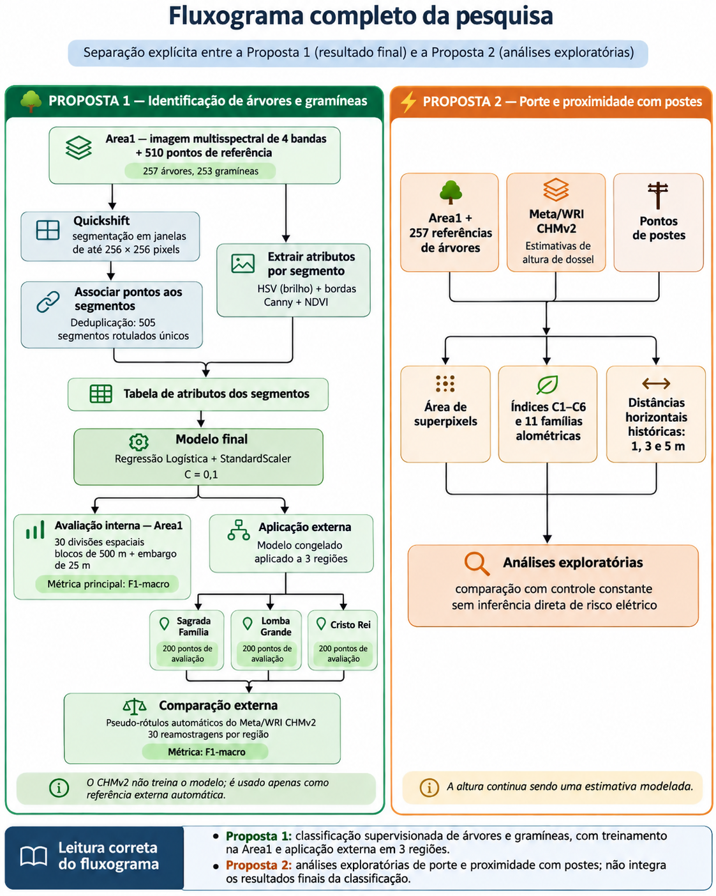
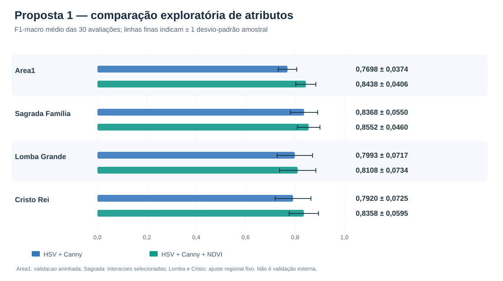
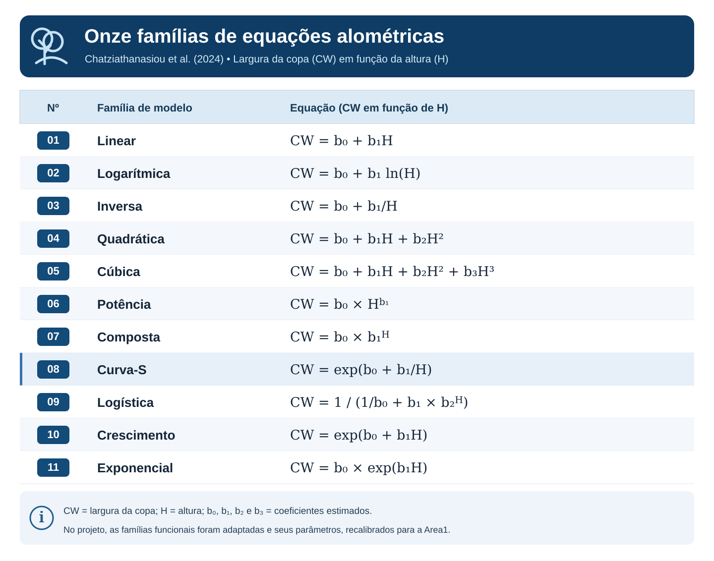

# Projeto de Mestrado — Identificação de Árvores Urbanas e Análise Exploratória de Porte e Proximidade com a Rede Elétrica

**Pesquisador:** Breno Braga Galvão  
**Área de treinamento:** Area1, Caxias do Sul (RS)  
**Repositório:** `BrenoBragaGalvao/mestrado-arvores-urbanas`  
**Documento:** apresentação científica do projeto — branch `feature/validacao-geografica-externa`  
**Atualização documental:** 20 de novembro de 2026

<a id="resumo"></a>
## Resumo executivo

Esta pesquisa investiga como imagens de sensoriamento remoto podem contribuir para caracterizar a vegetação urbana e produzir indicadores espaciais úteis ao planejamento. O trabalho tem **duas propostas distintas e complementares**:

| Proposta | Pergunta científica | Situação documentada |
|---|---|---|
| **🌳 Proposta 1 — Identificação de árvores e gramíneas** | Um classificador treinado em uma única área consegue discriminar essas duas classes e apresentar concordância com referências automáticas em outras regiões? | **Fase experimental computacional concluída e reproduzida**; validação visual humana independente **pendente** |
| **⚡ Proposta 2 — Porte e proximidade com a rede elétrica** | A geometria dos segmentos, alturas modeladas de dossel e distâncias a postes permitem construir indicadores exploratórios? | **Estudos exploratórios executados**; **12 árvores na Candangolândia selecionadas para medição com HeightCzech**, ainda sem alturas de campo nem demonstração de risco elétrico |

Na **Proposta 1**, utilizamos o **Quickshift** para dividir as imagens em segmentos, processados em janelas de até **256 × 256 pixels**. Cada segmento foi analisado por meio dos atributos **HSV (componente V), Canny e NDVI**. No **experimento principal de transferência**, a Regressão Logística foi treinada exclusivamente com **510 pontos originais da Area1** (505 segmentos únicos) e aplicada a **Sagrada Família, Lomba Grande e Cristo Rei**, sem novos treinamentos; foram realizadas **30 divisões espaciais na Area1** e **30 reamostragens por região externa**, com referências automáticas **CHMv2** e blocos de **500 m**. **Posteriormente**, realizamos uma análise **complementar e exploratória de ablação de atributos**, com **treinamento e teste regionais** e 30 divisões por região/configuração; os resultados locais **não substituem** os da transferência geográfica do modelo congelado.


*Figura — Etapas do **experimento principal de transferência geográfica** da Proposta 1. Na avaliação histórica, a Area1 utiliza 30 divisões espaciais de treino/teste; as três regiões externas utilizam 30 reamostragens por região, com o modelo original congelado. O experimento complementar de treinamento regional é descrito na seção 4.6.*


### Resultados principais da Proposta 1 — nova análise exploratória

**HSV + Canny + NDVI**, com **30 avaliações por região**; desvio-padrão **amostral** (`n−1`) calculado sobre os 30 F1 individuais.

| Região | F1-macro médio (n=30) | Desvio-padrão | Procedimento da **nova análise** |
|---|---:|---:|---|
| **Area1 — Caxias do Sul** | **0,8438** | **0,0406** | Validação espacial aninhada, seleção interna de regularização |
| **Sagrada Família — Caxias do Sul** | **0,8552** | **0,0460** | Treino e teste regionais com CHMv2; seleção interna de regularização/balanceamento/interações |
| **Lomba Grande — Novo Hamburgo** | **0,8108** | **0,0734** | Treino e teste regionais com CHMv2; Regressão Logística `C=0,1` |
| **Cristo Rei — São Leopoldo** | **0,8358** | **0,0595** | Treino e teste regionais com CHMv2; Regressão Logística `C=0,1` |

> **Não confundir protocolos:** a Area1 utiliza rótulos originais e seleção aninhada; nas três outras regiões há **treinamento local com pseudo-rótulos CHMv2**, e Sagrada Família utiliza uma família de modelos mais flexível. Os quatro F1 não demonstram que o **modelo original treinado apenas na Area1** generalizou com esses índices. A antiga transferência geográfica e suas matrizes de confusão continuam documentadas na seção 4.6–4.7.

**Comparação de atributos (treinamento regional exploratório):** [médias, desvios e ganho do NDVI](#sec-4-6) · [240 avaliações individuais](docs/proposta1_ablacao_regional_240_avaliacoes_20261120.csv) · [CSV-resumo](docs/proposta1_ablacao_regional_resumo_20261120.csv)


---

## Índice

- [Resumo executivo](#resumo)
- [1. Introdução e objetivos da pesquisa](#sec-1)
  - [1.1. Contextualização e problema de pesquisa](#sec-1-1)
  - [1.2. Objetivo geral e objetivos específicos](#sec-1-2)
  - [1.3. As duas propostas e suas contribuições](#sec-1-3)
- [2. Áreas de estudo e dados utilizados](#sec-2)
  - [2.1. Localização e função das quatro regiões](#sec-2-1)
  - [2.2. Imagens multiespectrais de quatro bandas (RGB + NIR)](#sec-2-2)
  - [2.3. Amostras de árvores e gramíneas](#sec-2-3)
  - [2.4. Dados auxiliares: CHMv2 e postes](#sec-2-4)
- [3. Visão geral da metodologia](#sec-3)
  - [3.1. Fluxograma completo](#sec-3-1)
- [4. Proposta 1 — Identificação de árvores e gramíneas](#sec-4)
  - [4.1. Objetivo e justificativa](#sec-4-1)
  - [4.2. Segmentação Quickshift](#sec-4-2)
  - [4.3. NDVI, brilho HSV e Canny](#sec-4-3)
  - [4.4. Regressão Logística e treinamento na Area1](#sec-4-4)
  - [4.5. Validação espacial: 500 m e 30 avaliações](#sec-4-5)
  - [4.6. Resultados nas quatro regiões](#sec-4-6)
  - [4.7. Matrizes de confusão e F1-macro](#sec-4-7)
  - [4.8. Discussão da transferência geográfica](#sec-4-8)
  - [4.9. Reprodutibilidade, limitações e conclusão](#sec-4-9)
- [5. Proposta 2 — Porte das árvores e proximidade com a rede elétrica](#sec-5)
  - [5.1. Objetivo e fundamentação](#sec-5-1)
  - [5.2. Alturas modeladas pelo CHMv2](#sec-5-2)
  - [5.3. Equações alométricas](#sec-5-3)
  - [5.4. Resultados e comparações](#sec-5-4)
  - [5.5. Proximidade horizontal com postes](#sec-5-5)
  - [5.6. Validação de campo — 12 árvores da Candangolândia (DF)](#sec-5-6)
  - [5.7. Limitações e situação atual](#sec-5-7)
- [6. Discussão geral e contribuições científicas](#sec-6)
  - [6.1. Principais resultados](#sec-6-1)
  - [6.2. Contribuições e limites](#sec-6-2)
- [7. Conclusões e trabalhos futuros](#sec-7)
- [8. Reprodutibilidade e código-fonte](#sec-8)
  - [8.1. Organização do repositório](#sec-8-1)
  - [8.2. Notebooks e scripts](#sec-8-2)
  - [8.3. Evidências e documentos](#sec-8-3)
- [9. Referências científicas e fontes dos dados](#sec-9)
- [Apêndice — Experimentos históricos e análises complementares](#apendice)

---

<a id="sec-1"></a>
## 1. Introdução e objetivos da pesquisa

<a id="sec-1-1"></a>
### 1.1. Contextualização e problema de pesquisa

A identificação da vegetação urbana por imagem pode apoiar diagnósticos de arborização, mas é difícil separar **copas arbóreas** de **vegetação herbácea** quando há variações de sombra, iluminação, textura, limites de copa e características radiométricas. Além disso, um classificador pode funcionar bem na área de treinamento e apresentar desempenho distinto em outra imagem ou cidade.

Em uma segunda frente, estimar **porte arbóreo** por áreas segmentadas exige cautela: **um superpixel não é necessariamente a copa de uma única árvore**. As estimativas públicas de altura do dossel e as distâncias horizontais a postes ajudam a explorar indicadores, mas não substituem observação de campo ou geometria tridimensional de cabos.

**Problemas investigados:** (i) em que medida um modelo supervisionado de duas classes se transfere entre imagens; e (ii) o que é possível — e o que não é — inferir sobre porte e proximidade usando as informações disponíveis.

<a id="sec-1-2"></a>
### 1.2. Objetivo geral e objetivos específicos

**Objetivo geral:** investigar o uso de segmentação de imagens e atributos espectrais/espaciais para caracterizar a vegetação urbana, além de avaliar exploratoriamente indicadores de porte e proximidade com elementos da infraestrutura elétrica.

**Objetivos específicos:**

1. Segmentar a imagem RGB da Area1 em janelas computacionalmente viáveis, por **Quickshift**.
2. Associar pontos conhecidos de árvores e gramíneas aos segmentos e extrair **NDVI, brilho HSV e bordas Canny**.
3. Treinar e validar espacialmente **a Regressão Logística** com os dados exclusivos da Area1.
4. Examinar a **concordância** das previsões do modelo em três regiões externas com pseudo-rótulos Meta/WRI CHMv2, incluindo análise de variabilidade espacial.
5. Investigar relações exploratórias entre **área de segmentos, índices alométricos e alturas modeladas** e examinar distâncias horizontais a postes.
6. Documentar limites, rastreabilidade e condições necessárias para validação independente.

<a id="sec-1-3"></a>
### 1.3. As duas propostas e suas contribuições

A **Proposta 1** produz resultados de **classificação binária supervisionada** e avalia o comportamento do modelo fora de sua área de treinamento. A **Proposta 2** analisa **geometria de segmentos e estimativas modeladas de dossel** e retoma um ensaio histórico de distância a postes. São investigações relacionadas à vegetação urbana, mas **não formam uma comprovação integrada de risco elétrico**.

A fase computacional da Proposta 1 está encerrada. A Proposta 2 tem experimentos exploratórios documentados e **não deve ser descrita como validação de alturas reais ou de interferência com fios**.

<a id="sec-2"></a>
## 2. Áreas de estudo e dados utilizados

<a id="sec-2-1"></a>
### 2.1. Localização e função das quatro regiões

| Região | Município / estado | Função no protocolo final |
|---|---|---|
| **Area1** | Caxias do Sul — RS | Origem dos pontos humanos de referência, treinamento do modelo e 30 divisões espaciais internas |
| **Sagrada Família** | Caxias do Sul — RS | Avaliação externa; pontos de teste selecionados **fora da Area1 e do buffer de 25 m** |
| **Lomba Grande** | Novo Hamburgo — RS | Avaliação externa em outra região |
| **Cristo Rei** | São Leopoldo — RS | Avaliação externa em outra cidade |

<a id="sec-2-2"></a>
### 2.2. Imagens multiespectrais de quatro bandas (RGB + NIR)

**Padrão adotado para as próximas execuções:** utilizar **uma única imagem de quatro bandas em cada região** como fonte dos dados. Quando uma operação exigir apenas RGB, serão lidas **somente as três bandas visíveis desse mesmo arquivo**, sem recorrer ao GeoTIFF RGB separado. O canal NIR será utilizado nas etapas que precisarem dele.

| Operação | Canais utilizados no GeoTIFF de quatro bandas |
|---|---|
| **Quickshift** (segmentação) | **R, G e B** derivados das bandas **3, 2 e 1**, nessa ordem |
| **Brilho HSV** | **R, G e B** extraídos do mesmo GeoTIFF |
| **NDVI** | **NIR (banda 4)** e **vermelho (banda 3)** |
| **Bordas Canny** | Canal previsto no protocolo de atributos; na implementação histórica da transferência, foi usado **NIR (banda 4)** |

As bandas espectrais utilizadas são: **R (Red)** – vermelho (banda 3); **G (Green)** – verde (banda 2); **B (Blue)** – azul (banda 1); e **NIR (Near Infrared)** – infravermelho próximo (banda 4).

#### Dimensões dos quatro rasters multiespectrais

| Região | Quatro bandas — altura × largura | Resolução nominal | Referência espacial | Retângulo do raster (km², aprox.) |
|---|---:|---|---|---:|
| **Area1 — Caxias do Sul** | **6.942 × 7.294 pixels** | 0,50 m/pixel | EPSG:31982 | **12,66** |
| **Sagrada Família — Caxias do Sul** | **14.643 × 14.566 pixels** | 0,50 m/pixel | EPSG:31982 | **53,32** |
| **Lomba Grande — Novo Hamburgo** | **20.074 × 18.349 pixels** | 0,50 m/pixel | EPSG:31982 | **92,08** |
| **Cristo Rei — São Leopoldo** | **14.602 × 14.460 pixels** | 0,50 m/pixel | EPSG:31982 | **52,79** |


<a id="sec-2-3"></a>
### 2.3. Amostras de árvores e gramíneas

| Base da Area1 | Pontos de origem | Segmentos únicos usados na avaliação |
|---|---:|---:|
| `Arvores.gpkg` | 257 | 257 |
| `Grama.gpkg` | 253 | 248 |
| **Total** | **510** | **505** |

A diferença decorre da **associação espacial dos pontos aos segmentos e da deduplicação**: mais de um ponto pode referenciar o mesmo objeto segmentado. Os pontos originais não foram transferidos para outras cidades, nem substituídos pelos rótulos CHMv2 para treinar o modelo principal.

Na avaliação externa, foram reservados **200 pontos por região** (600 ao todo). Apenas os casos com pseudo-rótulo conservador CHMv2 de árvore ou gramínea entraram no cálculo do F1: **179** em Sagrada, **183** em Lomba Grande e **181** em Cristo Rei.

<a id="sec-2-4"></a>
### 2.4. Dados auxiliares: CHMv2 e postes

O **Meta/World Resources Institute Canopy Height Map v2 (CHMv2)** é um mapa de **altura de dossel modelada**, e não um levantamento de campo. Na Proposta 1, seus valores servem como **pseudo-rótulos automáticos** para a comparação externa; na Proposta 2, são usados como **estimativas de altura** nos pontos das árvores da Area1. Essas duas utilizações não devem ser confundidas.

O `postes.gpkg` contém **pontos de postes** da Area1, utilizados no estudo histórico de proximidade horizontal. Não existe, nos dados de entrada descritos no [inventário da Area1](data/README.md), uma camada que represente a posição tridimensional dos **cabos condutores**.

<a id="sec-3"></a>
## 3. Visão geral da metodologia

<a id="sec-3-1"></a>
### 3.1. Fluxograma completo da pesquisa

O diagrama abaixo representa **os fluxos efetivamente adotados**, separando os resultados finais da Proposta 1 das análises exploratórias da Proposta 2:



*Figura 2 — O CHMv2 não é utilizado para treinar a Regressão Logística. Na Proposta 2, a altura continua sendo uma **estimativa modelada**. O estudo de distâncias a postes não mede risco elétrico.*

<a id="sec-4"></a>
## 4. Proposta 1 — Identificação de árvores e gramíneas

<a id="sec-4-1"></a>
### 4.1. Objetivo e justificativa da metodologia

A proposta busca distinguir **árvores** e **gramíneas** com um classificador treinado em exemplos previamente conhecidos na Area1 e investigar se as previsões permanecem coerentes fora da área de origem.

<a id="sec-4-2"></a>
### 4.2. Segmentação Quickshift — por que 812 janelas?

O **Quickshift** agrupa pixels visualmente semelhantes em **segmentos** ou *superpixels*. Ele **não reconhece árvores sozinho**: a classe é aprendida posteriormente, com os pontos de referência e seus atributos.

A imagem RGB da Area1 tem **6.942 × 7.294 pixels**; uma tentativa de segmentar tudo de uma vez esbarrou em limitação de memória. O processamento adotado divide a grade em **812 janelas de até 256 × 256 pixels** (28 × 29 posições, com bordas menores), aplicando Quickshift separadamente. A resolução dos pixels originais é preservada.

| Conceito | Significado no experimento |
|---|---|
| **Pixel** | Unidade da imagem; aproximadamente 0,5 × 0,5 m na Area1 |
| **Janela de 256 × 256 pixels** | Unidade computacional em que o Quickshift segmenta |
| **Segmento** | Grupo de pixels semelhantes; não equivale necessariamente a uma árvore |
| **Bloco de 500 m** | Unidade geográfica para separar ou reamostrar avaliações; **não** é o recorte Quickshift |
| **Embargo de 25 m** | Exclusão, no treino, de segmentos geometricamente próximos aos de teste |

<a id="sec-4-3"></a>
### 4.3. Atributos NDVI, brilho HSV e bordas Canny

Para cada segmento, extraímos um vetor com três médias, nesta ordem:

| Nome na base | Atributo | Informação representada |
|---|---|---|
| `mean_intensity` | **Brilho HSV (V)** | Intensidade/brilho dos pixels |
| `mean_edges` | **Bordas Canny** | Frequência local de bordas e transições |
| `mean_ndvi` | **NDVI** | Contraste relativo entre infravermelho próximo e vermelho |

**NDVI** (*Normalized Difference Vegetation Index*) é calculado por:

$$
NDVI = \frac{NIR - R}{NIR + R}
$$

em que **NIR** é o canal do infravermelho próximo e **R** o vermelho. Na fonte multiespectral Jilin-1 documentada, vermelho é a **banda 3** e NIR a **banda 4**. A relação foi calculada sobre **valores digitais não convertidos para reflectância**, o que exige cuidado em interpretações físicas e comparações radiométricas.

**HSV** transforma a representação das cores para matiz (*Hue*), saturação (*Saturation*) e valor (*Value*). O experimento usa a componente **V**, ligada ao brilho. **Canny** identifica transições locais de intensidade/bordas. Juntos, os três atributos fornecem sinais complementares, mas **nenhum garante, isoladamente, a identificação botânica**.

<a id="sec-4-4"></a>
### 4.4. Regressão Logística e treinamento na Area1

A configuração do **modelo original congelado, usado na transferência geográfica**, é:

```python
make_pipeline(
    StandardScaler(),
    LogisticRegression(
        C=0.1,
        penalty="l2",
        max_iter=3000,
        random_state=42,
    ),
)
```

| Comando | O que significa | Para que serve |
|---|---|---|
| `make_pipeline()` | Cria uma sequência de processamento | Executa as etapas na ordem correta |
| `StandardScaler()` | Padroniza os atributos | Coloca NDVI, HSV e Canny em escalas comparáveis |
| `LogisticRegression()` | Modelo de classificação | Distingue árvores de gramíneas |
| `C=0.1` | Intensidade inversa da regularização | Aplica regularização relativamente forte para controlar o sobreajuste |
| `penalty="l2"` | Regularização L2 | Penaliza coeficientes elevados |
| `max_iter=3000` | Limite de 3.000 iterações | Permite mais tentativas para o algoritmo convergir |
| `random_state=42` | Semente aleatória fixa | Favorece a reprodutibilidade quando há aleatoriedade |

**Por que mantê-la?** É uma abordagem relativamente simples, reproduzível e interpretável, adequada a uma base rotulada pequena e a três atributos numéricos. Ela foi mantida após as comparações e tentativas complementares, **não** porque todos os experimentos alternativos tenham demonstrado ganhos.

- **Treinamento:** exclusivamente nos **505 segmentos únicos da Area1**, derivados de **510 pontos originais**.
- **Padronização:** o `StandardScaler` estima média e escala **somente a partir do treino**, inclusive dentro de cada divisão espacial.
- **Regularização L2 do modelo original de transferência:** controla a magnitude dos coeficientes; neste protocolo o parâmetro permanece **fixo em C=0,1**.
- **Inferência externa no experimento original:** usa o **modelo final congelado**, sem reajustar parâmetros, padronizador ou classes com os pontos das regiões externas.

**Experimento complementar (não é transferência):** na Area1, a regularização é selecionada por validação interna; em Sagrada Família também se avaliam regularização, balanceamento e interações de atributos; em Lomba Grande e Cristo Rei aplica-se o classificador local com `C=0,1`. Esses modelos **não são a mesma configuração fixa** acima, e os pseudo-rótulos CHMv2 são utilizados nos treinos regionais.

<a id="sec-4-5"></a>
### 4.5. Validação espacial — blocos de 500 m e 30 avaliações

**Area1 — 30 divisões com retreinamento.** Os segmentos são agrupados em células geográficas de **500 m**. Em cada divisão, aproximadamente 20% dos **grupos** ficam reservados para teste; a porcentagem efetiva de segmentos pode diferir. Do conjunto de treino são excluídos segmentos cujas geometrias estejam a **25 m ou menos** dos objetos de teste. O F1-macro é calculado sobre o teste.

**Regiões externas — 30 reamostragens espaciais, sem retreinamento.** Em cada região, foram previamente reservados **200 pontos fixos**. Após excluir os sem referência CHMv2 elegível, os pontos são agrupados por blocos de **500 m**. Cada reamostragem sorteia **blocos com reposição** e inclui os pontos desses blocos; o **mesmo modelo** e as **mesmas previsões** são mantidos. Calcula-se novamente o F1-macro no conjunto reamostrado.

| Critério | Area1 | Três regiões externas |
|---|---|---|
| Fonte de referência | Pontos rotulados originais da Area1 | Pseudo-rótulos automáticos Meta/WRI CHMv2 |
| O modelo é treinado nesta etapa? | **Sim**, em cada divisão interna | **Não**, permanece congelado |
| Unidade espacial | 500 m, com embargo de 25 m | Bootstrap de blocos de 500 m |
| Número de avaliações | 30 divisões | 30 reamostragens **por região** |
| Interpretação da variação | Sensibilidade às separações espaciais de treino/teste | Sensibilidade à composição espacial da mesma amostra |

**Atenção:** 30 reamostragens **não criam 30 conjuntos externos independentes**. As médias internas e externas descrevem protocolos distintos. Os quantis de apenas 30 reamostragens também **não devem ser apresentados como intervalos de confiança formais**.

**Nova avaliação regional exploratória:** foram efetuadas **30 separações espaciais de treino/teste por configuração e região**, com grupos de 500 m e separação espacial de treino/teste, avaliando sempre os **mesmos conjuntos de teste para as duas configurações de atributos** em cada região. A padronização é ajustada somente sobre o treino. Na Area1 e em Sagrada Família, a escolha de parâmetros se faz em validações internas; em Sagrada Família, o espaço de busca também contempla **interações** entre atributos e balanceamento de classes. Em Lomba Grande e Cristo Rei, `C=0,1` é mantido fixo. Nas três regiões externas, os pseudo-rótulos CHMv2 são usados tanto para treino quanto para teste, em divisões espaciais separadas: essa análise mede **ajuste local aos pseudo-rótulos**, não validade externa do modelo da Area1. A reanálise de Sagrada Família foi desenvolvida **após examinar resultados anteriores**, portanto é especialmente exploratória.

<a id="sec-4-6"></a>

### 4.6. Resultados nas quatro regiões: ablação regional e transferência original

#### 4.6.1. Nova comparação exploratória — HSV + Canny versus HSV + Canny + NDVI

Os valores foram recalculados a partir de **240 avaliações individuais**: **2 configurações × 4 regiões × 30 divisões**. Cada desvio-padrão abaixo é **amostral**, calculado com denominador **29**, e não representa intervalo de confiança ou 30 testes independentes. [Consultar o CSV de todas as avaliações](docs/proposta1_ablacao_regional_240_avaliacoes_20261120.csv) e o [resumo numérico](docs/proposta1_ablacao_regional_resumo_20261120.csv).

| Configuração | Area1 | Sagrada Família | Lomba Grande | Cristo Rei |
|---|---:|---:|---:|---:|
| **HSV + Canny — F1 médio** | 0,7698 | 0,8368 | 0,7993 | 0,7920 |
| **HSV + Canny — desvio-padrão** | 0,0374 | 0,0550 | 0,0717 | 0,0725 |
| **HSV + Canny + NDVI — F1 médio** | **0,8438** | **0,8552** | **0,8108** | **0,8358** |
| **HSV + Canny + NDVI — desvio-padrão** | **0,0406** | **0,0460** | **0,0734** | **0,0595** |
| **Diferença com NDVI (pontos percentuais)** | **+7,41** | **+1,84** | **+1,15** | **+4,38** |
| **Divisões espaciais por configuração** | 30 | 30 | 30 | 30 |



*Figura 3A — Médias de 30 testes espaciais regionais por configuração, com barras de ± 1 desvio-padrão. O experimento da Area1 é aninhado; Sagrada Família utiliza interações e seleção interna exploratória; Lomba Grande e Cristo Rei utilizam modelos regionais de regularização fixa. São **protocolos diferentes**, não uma comparação direta da mesma Regressão Logística congelada.*

**Interpretação:** nesta **bateria de avaliações locais** o uso de NDVI coincide com valores médios maiores de F1 nas quatro regiões, mas a contribuição varia. O ganho de Sagrada Família (**+1,84 p.p.**) aparece com um **modelo de maior flexibilidade, incluindo interações**, após exploração de alternativas. Portanto, não constitui comprovação isolada de que acrescentar NDVI melhora um modelo idêntico treinado somente na Area1. Na avaliação externa congelada, os ganhos com NDVI **não foram uniformes**.

#### 4.6.2. Resultados históricos preservados — transferência do modelo original da Area1

Esta tabela, anteriormente exibida como resultado principal do README, **continua válida para outro protocolo**: 30 divisões espaciais na Area1 e 30 *bootstraps* de blocos de 500 m por região externa, mantendo **sem retreinar** o modelo original de três atributos. Os **120 F1 originais** continuam em [CSV histórico](docs/proposta1_f1_30_avaliacoes_4_regioes.csv) e são descritos no [relatório técnico de encerramento](experimentos/validacao_externa_regioes/PROPOSTA1_ENCERRAMENTO_EXPERIMENTAL_30_AVALIACOES_500M.md).

| Região | F1-macro médio histórico | Desvio-padrão histórico | Comparação histórica anterior |
|---|---:|---:|---|
| **Area1** | **0,8421** | 0,0389 | 0,8542 — média de apenas cinco divisões |
| **Sagrada Família** | **0,7584** | 0,0330 | 0,7597 — F1 agregado dos pontos elegíveis |
| **Lomba Grande** | **0,7794** | 0,0337 | 0,7785 — F1 agregado dos pontos elegíveis |
| **Cristo Rei** | **0,7961** | 0,0377 | 0,8042 — F1 agregado dos pontos elegíveis |


*Figura 3B — **Experimento histórico de transferência**: a barra de dispersão representa ± 1 desvio-padrão. Os resultados externos são concordâncias com CHMv2 sob reamostragens espaciais do **mesmo modelo congelado**, não novos treinamentos. O F1 de 0,8421 na Area1 difere do novo 0,8438 porque são baterias de avaliação distintas.*

**Os resultados regionais novos não substituem essa avaliação externa.** Os oito F1 da seção 4.6.1 foram obtidos em um experimento diferente, com treinamento local e, em Sagrada Família, pesquisa exploratória de interações; não devem ser usados para reescrever as matrizes de confusão do modelo original.


<a id="sec-4-7"></a>
### 4.7. Matrizes de confusão e interpretação do F1-macro

Nas duas classes deste experimento, uma **matriz de confusão** compara a classe de referência (linha) e a classe prevista (coluna). Para uma classe considerada positiva:

- **VP:** positivos corretamente previstos; **FP:** previstos como positivos, mas pertencentes à outra classe; **FN:** positivos não detectados.
- **Precisão:** `VP / (VP + FP)`; **revocação (*recall*):** `VP / (VP + FN)`.
- **F1 da classe:** média harmônica de precisão e revocação, `2 × precisão × revocação / (precisão + revocação)`.
- **F1-macro:** média **não ponderada** dos F1 das classes **árvore** e **gramínea**. Penaliza o desempenho ruim em qualquer das duas classes.

**Matrizes reais do experimento histórico com o modelo original treinado somente na Area1**, nos conjuntos externos completos e antes das 30 reamostragens (linhas: referência CHMv2; colunas: previsão da Regressão Logística **congelada**, com HSV + Canny + NDVI). **Essas matrizes NÃO correspondem aos novos resultados regionais da seção 4.6.1:**

| Região | Árvore → árvore | Árvore → gramínea | Gramínea → árvore | Gramínea → gramínea | F1-macro agregado |
|---|---:|---:|---:|---:|---:|
| **Sagrada Família** | 69 | 9 | 34 | 67 | 0,7597 |
| **Lomba Grande** | 61 | 4 | 36 | 82 | 0,7785 |
| **Cristo Rei** | 83 | 13 | 22 | 63 | 0,8042 |

| Região | F1 árvore | F1 gramínea | Pontos elegíveis |
|---|---:|---:|---:|
| Sagrada Família | 0,7624 | 0,7571 | 179 |
| Lomba Grande | 0,7531 | 0,8039 | 183 |
| Cristo Rei | 0,8259 | 0,7826 | 181 |

As duas tabelas acima representam **cada conjunto externo original de pontos elegíveis avaliado pelo modelo congelado**, e **não** os novos modelos locais nem a matriz média das 30 reamostragens. Somar as matrizes de divisões/reamostragens repetidas seria contar os mesmos objetos várias vezes; não fazemos essa interpretação. **Não é possível atualizar essas contagens usando apenas médias e desvios-padrão de F1**: seriam necessárias as previsões individuais fora do treino dos novos modelos, sem duplicação de objetos.

<a id="sec-4-8"></a>
### 4.8. Discussão da transferência geográfica

Na **transferência histórica do modelo original congelado**, Cristo Rei apresentou a maior média de concordância com CHMv2, seguida por Lomba Grande e Sagrada Família. Isso é um resultado **descritivo deste conjunto de pseudo-rótulos**. Não permite concluir, por si só, que um município tem árvores mais fáceis de reconhecer ou que o modelo é mais preciso em campo naquele município.

Na **análise regional exploratória**, as médias com HSV + Canny + NDVI foram **0,8438 (Area1)**, **0,8552 (Sagrada Família)**, **0,8108 (Lomba Grande)** e **0,8358 (Cristo Rei)**. A comparação com HSV + Canny sem NDVI favoreceu os três atributos neste conjunto específico de ajustes. Entretanto, **as três regiões externas passaram a fornecer pseudo-rótulos de treinamento**, tornando o experimento uma avaliação **intrarregional**; Sagrada Família recebeu busca adicional de configurações depois da inspeção dos resultados. Portanto, não se deve tomar os quatro ganhos como evidência confirmatória de transferência geográfica nem comparar diretamente suas médias como se os protocolos fossem uniformes.

Possíveis explicações a serem **investigadas**, sem tratá-las como demonstradas, incluem diferenças de iluminação, sombras, geometria dos segmentos, composição vegetal, distribuição dos pontos e características radiométricas dos mosaicos.

Em **Sagrada Família**, a proximidade geográfica e a sobreposição de origem com a Area1 exigiram exclusão espacial dos pontos de teste. O [registro de auditoria](experimentos/validacao_externa_regioes/AUDITORIA_SOBREPOSICAO_AREA1_SAGRADA_2026-11-12.md) documenta essa precaução.

A classificação binária da imagem inteira **não separa todas as coberturas urbanas**. O caso histórico de **Centro de Novo Hamburgo**, excluído da comparação final, ilustra a possibilidade de forte mudança de domínio; não deve ser escondido nem convertido em resultado de F1 sem referência adequada.

<a id="sec-4-9"></a>
### 4.9. Reprodutibilidade, limitações e conclusão

A fase computacional foi auditada: uma execução independente, com **modelo original e bases derivadas congelados**, reproduziu **byte a byte** estes quatro arquivos de referência:

1. `area1_30_divisoes_500m.csv` — 30 separações espaciais internas.
2. `externas_90_reamostragens_blocos_500m.csv` — 90 reamostragens externas.
3. `externas_f1_original_sem_reamostragem.csv` — F1 e matrizes nos conjuntos completos.
4. `TABELA_FINAL_MEDIAS_30_AVALIACOES_500M.csv` — médias e desvios-padrão.

A reprodução confirmada dos **resultados históricos** parte dos **atributos, pontos e geometrias derivados**; para reproduzir desde os pixels originais é necessário acessar os ortomosaicos RGB/NIR e executar as etapas anteriores de alinhamento e Quickshift. Os detalhes e a rastreabilidade disponíveis no repositório estão no [registro científico de encerramento](experimentos/validacao_externa_regioes/PROPOSTA1_ENCERRAMENTO_EXPERIMENTAL_30_AVALIACOES_500M.md) e na [documentação técnica externa](experimentos/validacao_externa_regioes/README.md).

A **nova análise regional exploratória** dispõe de [240 F1 individuais](docs/proposta1_ablacao_regional_240_avaliacoes_20261120.csv), [médias/desvios calculados](docs/proposta1_ablacao_regional_resumo_20261120.csv) e [gráfico comparativo](docs/proposta1_ablacao_regional_30_avaliacoes_20261120.svg). Esses documentos preservam os **resultados numéricos**, mas a reprodução integral dos ajustes requer também os CSVs de atributos e rótulos derivados e a configuração das divisões espaciais/seleções internas. A execução de Sagrada Família foi **exploratória e posterior à inspeção de avaliações anteriores**; os números não têm o status de verificação independente pré-especificada.

**Limitação mais relevante:** os rótulos CHMv2 são **automáticos**, não verificados por revisor humano independente. Uma amostra **cega de 180 recortes RGB** (60 por região externa) foi preparada para auditoria, mas **sua anotação humana ainda está pendente**. Portanto, não se afirma validação de campo, acurácia humana confirmada ou ausência de erros sistemáticos no CHMv2.

**Conclusão da Proposta 1:** o **experimento histórico de transferência geográfica** foi concluído e preservado com as suas quatro médias. A **ablação regional complementar** sugere potencial de HSV + Canny + NDVI quando há treinamento local, mas adota protocolos heterogêneos e exige replicação uniforme e rótulos independentes para sustentar conclusões confirmatórias. A validade da transferência para **rótulos humanos independentes** continua em aberto.

<a id="sec-5"></a>
## 5. Proposta 2 — Porte das árvores e proximidade com a rede elétrica

**Estado:** estudos exploratórios realizados e documentados; **iniciada uma etapa de validação de campo planejada com 12 árvores na Candangolândia (DF)**, para comparar CHMv2, ETH 2020 e medições com o aplicativo HeightCzech. **As alturas de campo ainda não foram coletadas**; não há calibração local validada, medição tridimensional dos cabos nem demonstração de risco elétrico.

<a id="sec-5-1"></a>
### 5.1. Objetivo e fundamentação

A Proposta 2 pergunta se características geométricas de segmentos (especialmente sua área) podem ser relacionadas à **altura modelada do dossel** e servir de ponto de partida para indicadores exploratórios de porte. Uma análise histórica complementar observa a **distância horizontal até postes**.

**Alometria** estuda relações matemáticas entre dimensões. Aqui é indispensável distinguir:

- A área **A de um superpixel Quickshift**, que pode conter parte de uma copa, mais de uma copa ou outros objetos.
- A **largura real de copa**, medida em estudos dendrométricos, **não disponível** nos 257 pontos.
- A **altura de dossel modelada pelo CHMv2**, **não equivalente** à altura real individual.

As seis configurações empíricas **C1–C6** do notebook original são hipóteses próprias do experimento, e **não** coeficientes transferidos de literatura já calibrada para Caxias do Sul.

<a id="sec-5-2"></a>
### 5.2. Estimativas de altura pelo Meta/WRI CHMv2

O raster público de referência foi `2103121330.tif`, pertencente ao [conjunto CHMv2 de Meta/WRI](https://registry.opendata.aws/dataforgood-fb-forestsv2/). Os **257 pontos de árvores** da Area1 foram consultados de duas maneiras: valor **do pixel exato** e **máximo modelado em raio de 5 m**.

| Indicador documentado | Resultado |
|---|---:|
| Referências de árvores amostradas | **257/257** |
| Mediana da estimativa no pixel exato | **2 m** |
| Mediana do máximo estimado em raio de 5 m | **6 m** |
| Pixels com valor modelado zero | **107/257** |
| Pontos com máximo zero em todo o raio de 5 m | **42/257** |

**Interpretar com cautela:** zero no pixel não prova ausência da árvore, e o máximo a 5 m pode pertencer a outro indivíduo. A resolução espacial do mapa **não é uma medida de erro vertical**. O procedimento e os [257 valores originais](docs/v3_alturas_publicas/v3_meta_chmv2_estimativas_257_arvores.csv) são documentados em [alometria V3](docs/v3_alometria_caxias.md).

**Comparação complementar ETH Zürich:** somente **139/257** pontos possuíam previsão disponível no raster ETH de aproximadamente 10 m; nos mesmos 139 pontos, as medianas eram **6 m no pixel Meta** e **14 m no pixel ETH**. Isso demonstra **divergência entre modelos**, e não que algum deles seja mais preciso. Consulte a [análise pareada](docs/v3_alturas_publicas/v3_meta_eth_comparacao_257.md).

<a id="sec-5-3"></a>
### 5.3. Equações alométricas e modelos avaliados

Foram estudadas **onze famílias de curvas**: linear, logarítmica, inversa, quadrática, cúbica, potencial, composta, curva-S, logística, crescimento e exponencial. As **formas matemáticas** foram adaptadas do estudo de **Chatziathanasiou, Kitikidou e Milios (2024)**, considerando também a **correção editorial de 2026**. Não foram aplicados os coeficientes das árvores gregas como se fossem calibrados para a Area1.

A transformação geométrica de entrada foi o **diâmetro circular equivalente**:

$$
D_{eq} = 2\sqrt{\frac{A}{\pi}}
$$

em que **A** é a área projetada de um **superpixel**. **`D_eq` não é uma largura de copa individual medida.** As curvas foram ajustadas para prever as **estimativas do CHMv2**, não alturas reais.



*Figura 4 — Famílias funcionais investigadas; algumas são reparametrizações da mesma forma exponencial. Os coeficientes originais das espécies estudadas na Grécia não foram transpostos.*

O notebook histórico também definiu índices **C1–C6** nas formas potencial e linear. Um exemplo é **C3 potencial = 2,5 × A^0,4**. Seu valor, inclusive quando ultrapassa 7, é **índice empírico**, não altura individual comprovada em metros. Consulte [as configurações originais](docs/allometria.md).

<a id="sec-5-4"></a>
### 5.4. Resultados e comparações

Os testes das **onze famílias** usaram validação espacial de **cinco divisões por escala** (250 e 500 m) e embargo de 25 m, comparando previsões fora do treinamento com o CHMv2. O erro foi medido por **MAE em metros em relação à referência modelada**, não em relação a uma altura medida em campo.

| Referência CHMv2 | Blocos de teste | Controle constante (MAE) | Melhor família adaptada observada (MAE) | Resultado |
|---|---:|---:|---:|---|
| Pixel exato | 250 m | **4,578 m** | Cúbica: 4,584 m | Controle melhor |
| Pixel exato | 500 m | **4,451 m** | Curva-S: 4,505 m | Controle melhor |
| Máximo em 5 m | 250 m | **4,778 m** | Inversa: 4,802 m | Controle melhor |
| Máximo em 5 m | 500 m | **4,665 m** | Curva-S: 4,731 m | Controle melhor |

A [tabela auditada com todos os cenários](docs/v3_alturas_publicas/v3_11_familias_meta_relatorio.md) registra as demais famílias, a seleção interna e as limitações. **Nenhuma das onze famílias superou o controle constante**, e esse é um resultado científico relevante: **a área do superpixel, isoladamente, não demonstrou capacidade suficiente de prever a variação da altura modelada** neste conjunto.

**Exemplo individual, sem escolha retrospectiva pelo desempenho:** para a primeira árvore da tabela original, o CHMv2 estimou **16 m no pixel** e **17 m no máximo em 5 m**; a previsão espacial fora do treino da curva-S foi **2,98 m** para o alvo de pixel. A discrepância é **em relação ao CHMv2**, não à altura real. Os valores das [257 árvores e 74 colunas](docs/v3_alturas_publicas/v3_todos_modelos_meta_257_completo.csv) permitem examinar cada caso sem depender de amostras escolhidas à mão.

<a id="sec-5-5"></a>
### 5.5. Análise de proximidade horizontal com postes

Na implementação histórica, candidatos selecionados a partir de **Quickshift + K-Means (cluster 3)** receberam índices empíricos C1–C6. O filtro **C3 potencial > 7** foi usado para selecionar candidatos; **não exigia necessariamente** uma previsão “árvore” do Random Forest.

A análise empregou os pontos `postes.gpkg` para examinar distâncias **horizontais** de **1, 3 e 5 m**. São medidas planimétricas (2D) entre geometrias; **não medem distância ao cabo elétrico, folga vertical, nível de tensão ou risco operacional**. Sem geometria dos condutores, alturas individuais confiáveis e critérios técnicos apropriados, a análise é **exploratória**, não um laudo sobre interferência na rede.

A metodologia histórica está preservada no [notebook original](Segmentacao_area_completa.ipynb) e na [descrição dos índices empíricos](docs/allometria.md).


<a id="sec-5-6"></a>
### 5.6. Plano de validação de campo — 12 árvores na Candangolândia (DF)

**Motivação e objetivo.** A pedido do orientador, foi organizada uma avaliação local para investigar se as **alturas estimadas por sensoriamento remoto** correspondem à **altura de árvores observadas presencialmente**. Foram selecionados **12 candidatos a árvores em locais de acesso relativamente fácil na Candangolândia (Distrito Federal)**, permitindo visitar as coordenadas e verificar a identidade de cada indivíduo. O novo estudo complementa, sem substituir, os experimentos com 257 pontos em Caxias do Sul.

Serão confrontadas **três referências para os mesmos locais**:

1. **Meta/WRI CHMv2:** estimativas originais da altura do dossel, obtidas previamente do mapa público de [altura de copas do Meta/WRI](https://registry.opendata.aws/dataforgood-fb-forestsv2/). As 12 alturas abaixo são os **valores previamente registrados**, não medições em campo.
2. **ETH Global Canopy Height 2020:** estimativas do modelo da [ETH Zürich para o ano de 2020](https://langnico.github.io/globalcanopyheight/), de **aproximadamente 10 m de resolução espacial**, produzidas a partir de imagens Sentinel-2 e informações de altura do GEDI. Os 12 números abaixo foram fornecidos como valores previamente extraídos e **não foram recalculados nesta atualização do README**.
3. **Medição presencial com [HeightCzech](https://iscanforest.fld.czu.cz/heightczech/):** aplicativo para smartphone (disponível para [iPhone](https://apps.apple.com/us/app/heightczech/id6748539466) e [Android](https://play.google.com/store/apps/details?id=com.psurovy.flutterSensorApp)) que usa **câmera e sensores de orientação** para estimar altura a partir de **distância conhecida e visadas para a base e o topo da árvore**. O aplicativo é um **instrumento de estimativa em campo**, sujeito a erros de distância, ângulo e visibilidade, não uma aferição instrumental de precisão comprovada para esta amostra.

#### 5.6.1. Árvores selecionadas e alturas a conferir

**Coordenadas WGS84 (EPSG:4326); alturas em metros.** As coordenadas e as duas colunas de previsões foram mantidas **exatamente como fornecidas**; os links da primeira coluna abrem a localização aproximada no Google Maps. **A medição manual ainda está em branco, pois a visita de campo não ocorreu.**

| Árvore / localização | Latitude (WGS84) | Longitude (WGS84) | CHMv2 original (m) | ETH 2020 (m) | Medição manual — HeightCzech (m) |
|---|---:|---:|---:|---:|---:|
| [CAND-01](https://www.google.com/maps/search/?api=1&query=-15.85344927%2C-47.94901704) | -15.85344927 | -47.94901704 | 12 | 12 | **Pendente** |
| [CAND-02](https://www.google.com/maps/search/?api=1&query=-15.85640769%2C-47.95126177) | -15.85640769 | -47.95126177 | 22 | 17 | **Pendente** |
| [CAND-03](https://www.google.com/maps/search/?api=1&query=-15.85769557%2C-47.94820182) | -15.85769557 | -47.94820182 | 12 | 16 | **Pendente** |
| [CAND-04](https://www.google.com/maps/search/?api=1&query=-15.85572076%2C-47.94998299) | -15.85572076 | -47.94998299 | 15 | 14 | **Pendente** |
| [CAND-05](https://www.google.com/maps/search/?api=1&query=-15.85791926%2C-47.94967912) | -15.85791926 | -47.94967912 | 21 | 22 | **Pendente** |
| [CAND-06](https://www.google.com/maps/search/?api=1&query=-15.85557351%2C-47.94952372) | -15.85557351 | -47.94952372 | 22 | 13 | **Pendente** |
| [CAND-07](https://www.google.com/maps/search/?api=1&query=-15.85250612%2C-47.95129829) | -15.85250612 | -47.95129829 | 8 | 4 | **Pendente** |
| [CAND-08](https://www.google.com/maps/search/?api=1&query=-15.85652138%2C-47.95153397) | -15.85652138 | -47.95153397 | 15 | 16 | **Pendente** |
| [CAND-09](https://www.google.com/maps/search/?api=1&query=-15.85475037%2C-47.94763657) | -15.85475037 | -47.94763657 | 20 | 17 | **Pendente** |
| [CAND-10](https://www.google.com/maps/search/?api=1&query=-15.85791200%2C-47.94822363) | -15.85791200 | -47.94822363 | 16 | 16 | **Pendente** |
| [CAND-11](https://www.google.com/maps/search/?api=1&query=-15.85495867%2C-47.94825533) | -15.85495867 | -47.94825533 | 29 | 18 | **Pendente** |
| [CAND-12](https://www.google.com/maps/search/?api=1&query=-15.85650280%2C-47.94892150) | -15.85650280 | -47.94892150 | 25 | 18 | **Pendente** |

**Distinção importante:** as duas colunas modeladas representam **estimativas diferentes para cobertura vegetal**; nenhuma é, por si, a altura real. A ETH 2020 utiliza um pixel da ordem de 10 m e pode integrar mais de uma copa e vizinhança; o CHMv2 tem resolução mais fina e também não garante identificação individual. As datas de referência e a resolução diferentes podem explicar parte das divergências. Antes de medir, será verificado se o ponto corresponde **à mesma árvore** nas imagens e no terreno, se ela está presente e se houve poda ou supressão.

**Comparação preliminar entre modelos, sem medidas de campo:** os 12 valores fornecidos diferem em até **11 m** entre CHMv2 e ETH 2020; o **desvio absoluto médio entre as duas séries é 3,83 m** e a **diferença média (CHMv2 − ETH) é +2,83 m**. Esses números avaliam **discordância entre modelos**, **não** erro contra a realidade nem acurácia. As maiores diferenças concentram-se em CAND-11 (29 × 18 m), CAND-06 (22 × 13 m) e CAND-12 (25 × 18 m), pontos prioritários para observação, **sem excluir** os demais da amostra.

#### 5.6.2. Protocolo planejado de medição com HeightCzech

1. **Localização e identificação:** navegar até as coordenadas e conferir por fotografia e inspeção da copa/tronco se o indivíduo encontrado corresponde ao ponto; registrar eventual mudança ou ambiguidade, sem deslocar silenciosamente o ponto para a árvore mais próxima.
2. **Posicionamento:** escolher local seguro e com visada clara da base do tronco e do ápice; medir e registrar a **distância horizontal real** até a base com trena ou medidor apropriado, evitando estimá-la apenas pelo GPS. Registrar inclinação do terreno, obstáculos, copas sobrepostas e condições de observação.
3. **Aquisição:** utilizar o **HeightCzech** para apontar a câmera à base e ao topo, informando a distância conforme o fluxo do aplicativo; manter o aparelho firme e seguir as instruções/calibração fornecidas pela versão utilizada.
4. **Repetição:** realizar preferencialmente **três leituras por árvore**, reposicionando o aparelho e repetindo as visadas; registrar as três alturas, a **mediana** (valor principal), a amplitude entre as leituras e a distância empregada. Se a base ou o topo não puder ser visto, registrar **não mensurável**, sem inventar estimativa.
5. **Registro e controle de qualidade:** anotar identificação, data/hora, modelo do smartphone, versão do aplicativo, coordenada conferida, distância, condições de terreno, fotos da árvore e motivo de exclusão/ressalva. Se possível, aferir parte das medidas com instrumento florestal ou referência de altura conhecida para avaliar o método do smartphone. Evitar consultar os valores dos mapas durante a leitura para reduzir viés de confirmação.

**Observação metodológica:** a medição em campo com smartphone será tratada como **referência de validação observacional de precisão limitada**, e não como verdade absoluta. As comparações serão feitas **somente entre as mesmas árvores efetivamente identificadas**; casos não mensuráveis ou com correspondência incerta serão destacados, nunca substituídos retrospectivamente por indivíduos de melhor concordância.

#### 5.6.3. Análise planejada após a visita

Para cada árvore mensurável, comparar as alturas do **CHMv2** e **ETH 2020** com a **mediana das três leituras presenciais**. Para cada modelo separadamente, calcular:

- **Erro assinado (m):** altura do modelo − altura de campo (positivo = superestimação).
- **Erro absoluto por árvore (m):** valor absoluto do erro assinado.
- **MAE (m):** média dos erros absolutos.
- **RMSE (m):** raiz da média dos erros ao quadrado.
- **Viés médio (m):** média dos erros assinados, para identificar tendência de superestimação ou subestimação.

Registrar também o número de árvores efetivamente mensuradas (**n ≤ 12**), dispersão das medidas repetidas e casos divergentes; se possível, apresentar tabela pareada e gráfico de dispersão com a linha 1:1. O modelo com menor MAE nesta amostra estará **mais próximo das leituras presenciais deste protocolo**, não necessariamente validado para o Distrito Federal. A escolha por facilidade de acesso define uma **amostra intencional**, sem representatividade estatística garantida.

**Estado atual:** a seleção das 12 coordenadas e os valores **CHMv2/ETH 2020** estão documentados; as **medições presenciais e as métricas de erro contra campo permanecem pendentes**. Esta etapa não informa distância aos cabos elétricos nem comprova risco de interferência na rede.

<a id="sec-5-7"></a>
### 5.7. Limitações e situação atual da Proposta 2

**O que foi efetivamente feito:** cálculo de índices geométricos, amostragem de **257** alturas modeladas Meta/WRI, comparação de **onze famílias** com controles, análises históricas de distância a postes e **documentação de 12 árvores na Candangolândia com valores CHMv2 e ETH 2020 fornecidos para posterior conferência presencial**.

**O que não foi comprovado:** altura real dos indivíduos, delimitação botânica de copas, precisão local dos mapas Meta/ETH, superioridade de famílias alométricas sobre o controle constante ou risco elétrico a partir dos pontos de postes.

**Situação:** existe uma **base exploratória documentada** e um **protocolo de medição presencial planejado para 12 árvores na Candangolândia**. Até o preenchimento e conferência das medições com HeightCzech, o projeto **não dispõe de validação de altura por campo**; também não há validação operacional de segurança elétrica.

<a id="sec-6"></a>
## 6. Discussão geral e contribuições científicas

<a id="sec-6-1"></a>
### 6.1. Principais resultados

- **Proposta 1:** no **experimento histórico de transferência**, a Regressão Logística apresentou F1 médio de **0,8421** na Area1 e concordância média CHMv2 entre **0,7584 e 0,7961** nas regiões externas. Na **ablação local exploratória** com HSV + Canny + NDVI, as médias foram **0,8438 / 0,8552 / 0,8108 / 0,8358** (Area1 / Sagrada Família / Lomba Grande / Cristo Rei, 30 avaliações cada), com **desvios-padrão 0,0406 / 0,0460 / 0,0734 / 0,0595**. Os experimentos **não têm protocolos equivalentes** e o treinamento local com CHMv2 não demonstra validade externa nem precisão humana.
- **Proposta 2:** a avaliação de **onze famílias alométricas** contra alturas modeladas CHMv2 **não melhorou o controle constante**; índices derivados de superpixel e distância a postes não bastam, isoladamente, para estimar altura real ou risco elétrico. A nova **amostra de 12 árvores na Candangolândia** agrega previsões CHMv2 e ETH 2020 para futura comparação com medidas de campo pelo HeightCzech, **sem validação manual concluída**.

<a id="sec-6-2"></a>
### 6.2. Contribuições e limites

**Contribuições metodológicas:** segmentação em janelas sem reduzir a resolução dos pixels, explicitação da origem e deduplicação das referências, controle espacial na Area1, manutenção de um modelo único congelado no **experimento de transferência**, auditoria de bandas e descrição reproduzível da variabilidade de métricas. A documentação separa **transferência original**, **ablação com treinamento regional** e **explorações históricas**, indicando suas diferentes fontes de referência.

**Limites:** a validade externa foi medida com **pseudo-rótulos CHMv2**, a radiometria das imagens não passou por calibração física comum, a classe binária não abrange todas as coberturas urbanas e o estudo alométrico não possui medidas de altura de campo.

<a id="sec-7"></a>
## 7. Conclusões e trabalhos futuros

O **experimento principal de transferência geográfica da Proposta 1 está encerrado**, com modelo original preservado e reprodução dos resultados históricos derivados verificada. Um **experimento complementar exploratório** comparou HSV + Canny versus HSV + Canny + NDVI em 30 avaliações por configuração e por região, com treino regional quando aplicável e resultados numéricos disponibilizados. A auditoria visual humana independente dos **180 recortes selecionados** continua pendente; o README **não confunde os pseudo-rótulos CHMv2 nem o treino regional com validação humana ou transferência geográfica confirmada**.

A **Proposta 2 permanece exploratória**: além dos experimentos já realizados, foi preparada uma **amostra de 12 árvores acessíveis na Candangolândia (DF)** para confrontar as estimativas CHMv2 e ETH 2020 com medições presenciais usando o aplicativo HeightCzech. **As medições ainda estão pendentes**; índices de porte e distâncias horizontais a postes não constituem medidas de risco elétrico.

**Trabalhos futuros pertinentes**, sem alterar os resultados atuais: completar a anotação cega; considerar novas referências independentes de vegetação; documentar calibração radiométrica se houver novos ensaios; **executar o levantamento das 12 árvores da Candangolândia com o HeightCzech e analisar as diferenças contra CHMv2 e ETH 2020**; e, para qualquer análise elétrica operacional, obter a geometria dos cabos e os critérios técnicos aplicáveis.

<a id="sec-8"></a>
## 8. Reprodutibilidade e código-fonte

<a id="sec-8-1"></a>
### 8.1. Organização do repositório

```text
mestrado-arvores-urbanas/
├── README.md
├── README_versao_outubro.md           # documentação histórica preservada
├── data/README.md                     # inventário e acesso aos dados brutos
├── docs/                              # figuras, relatórios e resultados derivados
│   ├── proposta1_f1_macro_30_avaliacoes_500m.svg
│   ├── v3_alometria_caxias.md
│   └── v3_alturas_publicas/           # resultados e figuras da Proposta 2
├── experimentos/
│   ├── validacao_externa_regioes/
│   │   ├── PROPOSTA1_ENCERRAMENTO_EXPERIMENTAL_30_AVALIACOES_500M.md
│   │   ├── README.md
│   │   ├── chmv2_verificacao/
│   │   └── ...                        # scripts de treinamento, aplicação e auditoria
│   └── v3_testar_11_modelos_artigo_meta.py
├── Segmentacao_area_completa.ipynb    # notebook histórico original
├── Segmentacao_area_completa_v2_experimentos.ipynb
└── Alometria_caxias_v3.ipynb
```

Os **ortomosaicos de grande volume e os arquivos privados** da Area1 não estão incluídos como blobs no GitHub. O [inventário técnico dos dados](data/README.md) informa os arquivos necessários e seus caminhos usuais no Google Drive.

<a id="sec-8-2"></a>
### 8.2. Notebooks, scripts e execução

| Artefato | Finalidade | Situação |
|---|---|---|
| [Encerramento experimental da Proposta 1](experimentos/validacao_externa_regioes/PROPOSTA1_ENCERRAMENTO_EXPERIMENTAL_30_AVALIACOES_500M.md) | Protocolo final, 30 + 90 avaliações, rastreabilidade e limites | **Referência principal** |
| [README técnico da validação externa](experimentos/validacao_externa_regioes/README.md) | Histórico das rotinas e da transferência entre regiões | Complementar |
| [Execução integrada das cinco imagens](experimentos/validacao_externa_regioes/proposta1_cinco_areas_colab.ipynb) | Preparação, treinamento e aplicação de múltiplos modelos | **Histórico**, não alterar resultados finais |
| [Auditoria das bandas](experimentos/validacao_externa_regioes/AUDITORIA_BANDAS_JILIN.md) | Proveniência da ordem B, G, R e NIR | Evidência |
| [Verificação dos 600 pontos CHMv2](experimentos/validacao_externa_regioes/chmv2_verificacao/600_pontos_cegos_CHMv2_congelados.csv) | Pontos congelados e identificadores para referência externa | Dados derivados |
| [Validação de Regressão Logística com revisão humana](experimentos/validacao_externa_regioes/validar_logistica_quatro_regioes_500m.py) | **Somente após preenchimento humano** de rótulos cegos; não produz automaticamente os F1 CHMv2 finais | Protocolo independente pendente |
| [Notebook de alometria V3](Alometria_caxias_v3.ipynb) | Índices de superpixel e consulta a alturas modeladas | Proposta 2 |
| [Onze famílias e comparação com controle](experimentos/v3_testar_11_modelos_artigo_meta.py) | Validação espacial das formas alométricas | Proposta 2 |

**Condição de reprodução:** os F1 finais de 30 avaliações são derivados de **atributos e referências já extraídos**. A reprodução portátil foi confirmada com um pacote específico de código, geometria, modelo e CSVs congelados, **distribuído separadamente**; o presente repositório não deve ser apresentado como se incluísse automaticamente todo esse pacote ou os ortomosaicos originais. O [relatório de encerramento](experimentos/validacao_externa_regioes/PROPOSTA1_ENCERRAMENTO_EXPERIMENTAL_30_AVALIACOES_500M.md) distingue as etapas efetivamente reproduzidas das que dependem de imagens brutas.

**Segurança e privacidade:** não compartilhar no repositório credenciais do Google Drive/Colab, senhas, tokens, chaves ou dados privados de localização que não foram autorizados à publicação.

<a id="sec-8-3"></a>
### 8.3. Arquivos de resultados e documentação

| Material | Consulta |
|---|---|
| Relatório principal e métricas finais | [Proposta 1 — encerramento experimental](experimentos/validacao_externa_regioes/PROPOSTA1_ENCERRAMENTO_EXPERIMENTAL_30_AVALIACOES_500M.md) |
| **120 valores individuais do experimento histórico de transferência** | [CSV original preservado](docs/proposta1_f1_30_avaliacoes_4_regioes.csv) |
| **240 avaliações da nova ablação regional: 2 configurações × 4 áreas × 30 testes** | [CSV dos F1 individuais](docs/proposta1_ablacao_regional_240_avaliacoes_20261120.csv) |
| **Oito médias, oito desvios-padrão e ganhos associados ao NDVI** | [CSV-resumo da ablação](docs/proposta1_ablacao_regional_resumo_20261120.csv) |
| **Gráfico com médias e desvio-padrão da ablação regional** | [SVG comparativo](docs/proposta1_ablacao_regional_30_avaliacoes_20261120.svg) |
| Estudo dos 257 pontos e CHMv2 | [Alometria V3](docs/v3_alometria_caxias.md) |
| Tabela completa das 257 árvores e modelos | [CSV de 74 colunas](docs/v3_alturas_publicas/v3_todos_modelos_meta_257_completo.csv) |
| Onze famílias, controles e resultados | [Relatório científico de comparação](docs/v3_alturas_publicas/v3_11_familias_meta_relatorio.md) |
| Comparação Meta/WRI × ETH nos mesmos pontos | [Análise dos 139 pares](docs/v3_alturas_publicas/v3_meta_eth_comparacao_257.md) |
| Documentação histórica integral | [README anterior](README_versao_outubro.md) |
| Histórico de cinco imagens | [README técnico da validação externa](experimentos/validacao_externa_regioes/README.md) |

<a id="sec-9"></a>
## 9. Referências científicas e fontes dos dados

**Fonte da altura modelada:**

- Brandt, J. et al. (2026). *CHMv2: Improvements in Global Canopy Height Mapping using DINOv3*. **Scientific Data**. DOI: [10.1038/s41597-026-07882-0](https://doi.org/10.1038/s41597-026-07882-0).
- Meta / World Resources Institute. *Version 2 High Resolution Canopy Height Maps*. [AWS Registry of Open Data](https://registry.opendata.aws/dataforgood-fb-forestsv2/).
- ETH Zürich. *Global Canopy Height 2020*. [Documentação do conjunto de dados](https://langnico.github.io/globalcanopyheight/). Usado apenas em comparação complementar de duas fontes modeladas.

**Modelagem alométrica e contexto local:**

- Chatziathanasiou, S.; Kitikidou, K.; Milios, E. (2024). *Crown Width–Tree Height Models for Magnolia grandiflora, Prunus cerasifera, and Acer negundo Growing in Cities in Northeastern Greece*. **Land**, 13(10), 1579. DOI: [10.3390/land13101579](https://doi.org/10.3390/land13101579).
- Chatziathanasiou, S.; Kitikidou, K.; Milios, E. (2026). *Correction* ao artigo de 2024. **Land**, 15(3), 473. DOI: [10.3390/land15030473](https://doi.org/10.3390/land15030473).
- Prefeitura de Caxias do Sul. [Plano Diretor de Arborização Urbana — PDAU](https://caxias.rs.gov.br/servicos/meio-ambiente/plano-diretor-de-arborizacao-urbana-pdau). As faixas de porte de espécies são referências bibliográficas, **não rótulos botânicos nem alturas medidas nos 257 pontos**.

**Documentação técnica e fontes primárias do próprio estudo:** [rastreabilidade espectral Jilin-1](experimentos/validacao_externa_regioes/AUDITORIA_BANDAS_JILIN.md), [dados e projeções da Area1](data/README.md), [arquivo de experimentos anteriores](README_versao_outubro.md), [resultados da Proposta 2](docs/v3_alturas_publicas/v3_11_familias_meta_relatorio.md).

<a id="apendice"></a>
## Apêndice — Experimentos anteriores e análises complementares

As abordagens abaixo foram **investigadas e preservadas para rastreabilidade**, mas **não** devem ser confundidas com a escolha final da **Regressão Logística, C=0,1, com 30 avaliações por região**.

| Estudo histórico ou complementar | Onde consultar | Por que não compõe a tabela principal |
|---|---|---|
| Oito classificadores, cinco divisões de 250/500 m | [Validações aninhadas](experimentos/reexecutar_tabelas_aninhadas_v2.py) e [documentação anterior](README_versao_outubro.md) | Modelos e protocolos de avaliação distintos |
| Experimento B — seleção de parâmetros | [Pasta do experimento B](experimentos/validacao_externa_regioes/experimento_B/) | Não demonstrou melhoria consistente no modelo final |
| Experimento C — filtragem das amostras pelo CHMv2 | [Relatório C](experimentos/validacao_externa_regioes/chmv2_verificacao/EXPERIMENTO_C_FILTRAGEM_510_AREA1_RESULTADOS_2026-11-17.md) | Substitui a base original por uma filtrada; não foi adotado |
| Experimento D — limiares e robustez espectral | [Relatório D](experimentos/validacao_externa_regioes/chmv2_verificacao/EXPERIMENTO_D_REGRESSAO_ORIGINAL_LIMIAR_DRIFT_2026-11-17.md) | Ganhos não consistentes na transferência |
| Quickshift global + K-Means + Random Forest | [Notebook histórico](Segmentacao_area_completa.ipynb) | Outra abordagem; acurácia histórica 0,87 em 92 testes não é F1 espacial |
| Segmentação de 119 recortes, 512 e 256 pixels | [Notebook de experimentos](Segmentacao_area_completa_v2_experimentos.ipynb) e [comparação de recortes](docs/comparacao_controlada_segmentacao_512_vs_256.md) | Outra configuração de segmentação |
| Centro de Novo Hamburgo e mapas das cinco imagens | [Relatório das cinco áreas](experimentos/validacao_externa_regioes/RELATORIO_REGRESSAO_LOGISTICA_EXCLUSIVA_5_IMAGENS_2026-11-16.md) | Centro ficou fora do fechamento em quatro regiões |
| Índices C1–C6 e primeiras quinze árvores | [Arquivo das 257 árvores](docs/v3_alturas_publicas/v3_todos_modelos_meta_257_completo.csv) | Índices empíricos e análises detalhadas da Proposta 2 |

<details>
<summary><strong>Expandir a tabela histórica dos oito classificadores</strong></summary>

#### A.1. Comparação histórica dos oito classificadores

**Registro histórico — não é a tabela final:** os F1 abaixo provêm de outra bateria de avaliação, com configurações e ajuste de parâmetros próprios. **Não confundir a regressão logística dessa tabela (0,8666 em 500 m) com a Regressão Logística fixa C=0,1 nas 30 divisões (0,8421).**

A tabela apresenta **exclusivamente a bateria histórica documentada com segmentos derivados dos 812 quadrantes de até 256 × 256 pixels**. São **505 segmentos rotulados únicos**, os três atributos **NDVI + HSV + Canny** e cinco divisões espaciais por escala, com embargo de **25 m entre geometrias**. Os classificadores foram ordenados pela média de seus resultados nas duas escalas, apenas para facilitar a leitura.

| Classificador | F1-macro — blocos de 250 m | F1-macro — blocos de 500 m |
|---|---:|---:|
| Regressão logística | 0,8879 | **0,8666** |
| SVM RBF | 0,8908 | 0,8619 |
| KNN (25/35) | **0,8931** | 0,8481 |
| Extra Trees | 0,8266 | 0,8335 |
| HistGradientBoosting | 0,8325 | 0,8246 |
| Random Forest | 0,8220 | 0,8240 |
| Gaussian Naive Bayes | 0,7986 | 0,7400 |
| Dummy (referência simples) | 0,2980 | 0,2799 |

**Por que o F1-macro muda entre blocos de 250 e 500 m?** Porque o tamanho do bloco altera **quais exemplos ficam no treino e no teste** e, portanto, a dificuldade da avaliação. Esses blocos não alteram o tamanho dos quadrantes Quickshift.

**Como interpretar os resultados?** Valores maiores indicam melhor equilíbrio entre as classes árvore e gramínea nos testes. Cada coluna representa o **F1-macro médio de cinco divisões espaciais**, e não uma acurácia na imagem inteira nem uma estimativa de altura.

**O que descobrimos?** Com blocos de **250 m**, o maior resultado foi do **KNN (25/35): 0,8931**. Com blocos de **500 m**, liderou a **regressão logística: 0,8666**. **Nenhum algoritmo foi o melhor nas duas escalas.**

**Quais resultados podemos comparar diretamente?** Na configuração dos 812 quadrantes, os oito classificadores compartilham a mesma base rotulada, os atributos e as divisões externas **dentro de cada escala**. A comparação de HSV + Canny versus NDVI + HSV + Canny também utiliza esse protocolo supervisionado. Os resultados históricos do Quickshift global e das configurações com 119 recortes **não são comparações diretas**, pois diferem em segmentação, construção dos exemplos e/ou protocolos. [Consultar o histórico integral](README_versao_outubro.md).


</details>

<details>
<summary><strong>Expandir o registro histórico das estratégias de controle de sobreajuste</strong></summary>

#### A.2. Análise histórica de sobreajuste

**Overfitting** (sobreajuste) ocorre quando o modelo aprende particularidades dos dados de treinamento e pode apresentar desempenho inferior em exemplos reservados. Foram adotados os seguintes cuidados:

1. **Deduplicação:** uso de **505 segmentos rotulados únicos** e verificação de separação entre identificadores de treino e teste.
2. **Validação espacial:** blocos de **250 e 500 m**, cinco divisões por escala, com **exclusão geométrica de 25 m** entre exemplos próximos.
3. **Escolha interna dos parâmetros:** comparação de receitas de regularização **moderada e forte** por **três divisões internas dos dados de treinamento**, sem usar os testes externos para escolher parâmetros de cada rodada.
4. **Padronização sem vazamento:** quando necessária, a transformação é ajustada apenas nos exemplos de treinamento, dentro de um pipeline.
5. **Auditoria:** registro dos resultados tanto de treino quanto de teste para verificar a diferença entre eles.

**F1-macro médio de treino e teste de quatro modelos representativos nos 812 quadrantes** (média das dez divisões espaciais, reunindo cinco de 250 m e cinco de 500 m):

| Experimento | Classificador | F1 treino | F1 teste | Diferença |
|---|---|---:|---:|---:|
| **812 quadrantes de 256 px** | Regressão logística | 0,9011 | 0,8773 | +0,0239 |
| **812 quadrantes de 256 px** | SVM RBF | 0,9110 | 0,8764 | +0,0347 |
| **812 quadrantes de 256 px** | Random Forest | 0,8861 | 0,8230 | +0,0630 |
| **812 quadrantes de 256 px** | HistGradientBoosting | 0,8998 | 0,8286 | +0,0712 |

**O que o resultado mostra?** A diferença entre treino e teste ainda é maior em **Random Forest** e **HistGradientBoosting** do que em alguns outros modelos. As medidas de validação e regularização ajudam a **reduzir o risco**, mas **não comprovam ausência total de sobreajuste**.

**Limitação de generalização:** todos os exemplos pertencem à mesma **Area1**. A avaliação mede **generalização espacial interna**; não demonstra desempenho em outra cidade ou imagem independente. Além disso, os conjuntos externos já foram examinados em etapas anteriores da pesquisa, o que limita interpretações retrospectivas de seleção de modelos.


</details>

<details>
<summary><strong>Expandir a tabela histórica das primeiras quinze árvores (Proposta 2)</strong></summary>

#### A.3. Quinze árvores — tabela histórica detalhada

A tabela apresenta as **15 primeiras árvores na ordem original**, sem selecionar exemplos pelos resultados. As **três primeiras colunas** são a contagem, a **Meta pixel** e a **Meta 5 m**; depois vêm as previsões da **logarítmica, inversa, curva-S e cúbica** em blocos de **250 m** e os índices históricos **C1 potencial e C3 potencial** (as versões `I = a × A^b` do notebook original). As previsões das quatro famílias são **OOF (teste espacial)**; C1 e C3 **não são alturas calibradas em metros** e não representam as variantes lineares.

| Árvore | **Meta pixel (m)** | **Meta 5 m (m)** | Log. pixel (m) | Log. 5 m (m) | Inversa pixel (m) | Inversa 5 m (m) | Curva-S pixel (m) | Curva-S 5 m (m) | Cúbica pixel (m) | Cúbica 5 m (m) | C1 potencial (índice) | C3 potencial (índice) |
|---:|---:|---:|---:|---:|---:|---:|---:|---:|---:|---:|---:|---:|
| 1 | 16,00 | 17,00 | 3,02 | 5,97 | 2,98 | 5,97 | 2,98 | 5,97 | 3,21 | 5,97 | 23,95 | 22,81 |
| 2 | 0,00 | 6,00 | 3,02 | 5,97 | 2,98 | 5,97 | 2,98 | 5,97 | 3,24 | 5,97 | 24,62 | 23,17 |
| 3 | 10,00 | 13,00 | 3,40 | 6,50 | 3,56 | 6,58 | 3,46 | 6,57 | 3,25 | 6,39 | 9,66 | 13,58 |
| 4 | 19,00 | 20,00 | 3,04 | 5,97 | 2,98 | 5,97 | 2,98 | 5,97 | 3,51 | 5,97 | 31,34 | 26,60 |
| 5 | 0,00 | 2,00 | 3,86 | 6,87 | 3,87 | 6,89 | 3,87 | 6,89 | 3,66 | 6,72 | 15,13 | 17,55 |
| 6 | 0,00 | 2,00 | 2,93 | 6,11 | 3,11 | 6,13 | 2,94 | 6,13 | 3,08 | 6,26 | 6,02 | 10,36 |
| 7 | 0,00 | 0,00 | 3,98 | 6,98 | 3,93 | 6,96 | 3,97 | 6,96 | 3,87 | 6,89 | 17,15 | 18,84 |
| 8 | 0,00 | 0,00 | 3,98 | 6,97 | 3,93 | 6,96 | 3,97 | 6,96 | 3,86 | 6,88 | 17,09 | 18,81 |
| 9 | 3,00 | 6,00 | 4,17 | 7,13 | 4,03 | 7,05 | 4,11 | 7,06 | 4,30 | 7,23 | 20,65 | 20,96 |
| 10 | 6,00 | 9,00 | 3,73 | 6,77 | 3,79 | 6,82 | 3,77 | 6,81 | 3,51 | 6,60 | 13,38 | 16,36 |
| 11 | 0,00 | 3,00 | 4,14 | 7,11 | 4,01 | 7,04 | 4,09 | 7,05 | 4,21 | 7,16 | 19,99 | 20,57 |
| 12 | 5,00 | 6,00 | 3,35 | 6,45 | 3,52 | 6,54 | 3,41 | 6,53 | 3,22 | 6,37 | 9,14 | 13,15 |
| 13 | 10,00 | 10,00 | 2,15 | 5,14 | 2,24 | 5,13 | 2,17 | 5,13 | 2,22 | 5,33 | 5,72 | 10,06 |
| 14 | 1,00 | 8,00 | 2,39 | 5,40 | 2,50 | 5,47 | 2,44 | 5,46 | 2,29 | 5,39 | 8,13 | 12,31 |
| 15 | 6,00 | 9,00 | 2,77 | 5,83 | 2,79 | 5,86 | 2,79 | 5,85 | 2,60 | 5,67 | 14,23 | 16,94 |

**Resultados completos:** A tabela acima apresenta as 15 primeiras árvores. Para consultar os **257 pontos avaliados e os resultados de todos os modelos**, incluindo os testes com blocos espaciais de 250 m e 500 m, acesse a [**tabela completa — 257 pontos e 74 colunas**](docs/v3_alturas_publicas/v3_todos_modelos_meta_257_completo.csv).

Por exemplo, na **árvore 1**, a Meta indica **16 m no pixel e 17 m no raio de 5 m**, enquanto os modelos logarítmico, inverso, curva-S e cúbico retornam valores bastante inferiores nos testes espaciais. Isso mostra que, apesar de terem sido testadas diversas famílias, **os modelos ainda não recuperam de forma confiável a variação individual das alturas modeladas pela Meta**. Os índices **C1 potencial** e **C3 potencial** apresentam valores maiores, mas não equivalem automaticamente a metros de altura real; as variantes lineares existem no notebook original e não são as colunas desta tabela.


</details>

**Arquivos preservados:** os experimentos e códigos originais permanecem no repositório; as tabelas acima são documentação histórica. O gráfico de 30 avaliações e o fluxograma principal representam os **resultados e o escopo atualmente adotados**.

**Situação de publicação:** esta revisão se aplica exclusivamente à branch `feature/validacao-geografica-externa`. Não altera a `main`, não executa merge do PR #6 e não atualiza automaticamente o portal hospedado na pasta `docs`. A Proposta 2 incorpora agora um **protocolo de validação em campo planejado para 12 árvores da Candangolândia**; as estimativas históricas e os resultados da Proposta 1 permanecem preservados.
