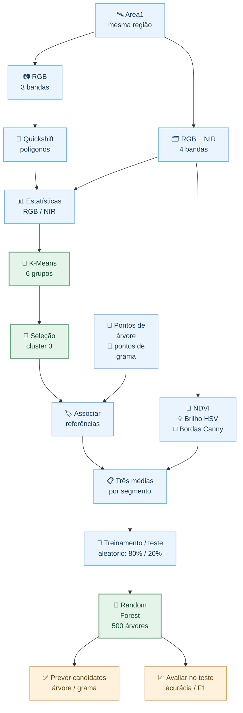
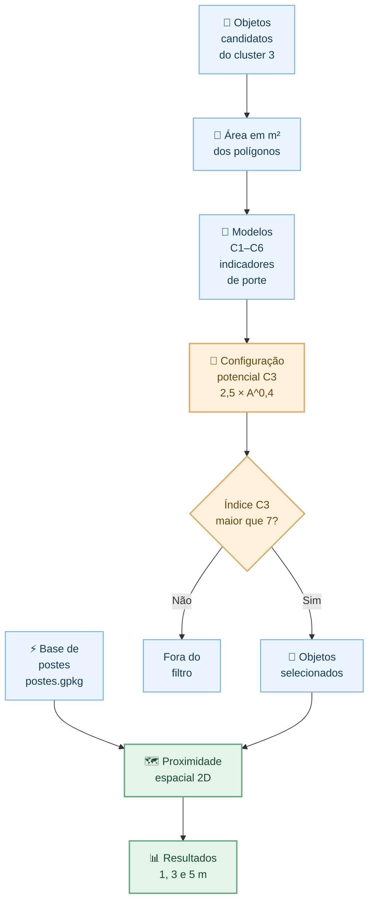

# Projeto de mestrado: Combinação de Características de Brilho, Bordas e NDVI para Detecção de Árvores Urbanas e Avaliação de Proximidade com Linhas de Energia

**Pesquisa de mestrado — Breno Braga Galvão | Em desenvolvimento**

Esta pesquisa investiga duas propostas complementares a partir de **uma única área de estudo (Area1)** em Caxias do Sul (RS):

| Proposta | Pergunta central | Resultado buscado |
|---|---|---|
| **🌳 Proposta 1 — Identificação da vegetação** | Como distinguir **árvores e gramíneas** por características de imagens de satélite? | Objetos classificados como árvore ou gramínea. |
| **⚡ Proposta 2 — Porte e proximidade de postes** | Quais objetos candidatos apresentam **indicador empírico de porte** acima do limiar e ficam próximos de postes? | Seleção exploratória e distâncias 2D a postes, **sem comprovação de risco elétrico**. |

## Por que mudamos o método? A memória RAM foi o limite

**Primeiro, o método original:** aplicamos **Quickshift à imagem RGB inteira**, seguido de **K-Means (seis grupos, com seleção do cluster 3)** e **Random Forest (500 árvores)**. A execução histórica alcançou **acurácia de 0,87 em 92 exemplos de teste**, com um consumo de **5,42 GiB de memória RAM**, valor superior aos **4 GiB disponíveis** no ambiente atual, o que motivou a adoção de uma nova estratégia de processamento com janelas menores.

**Depois, tentamos repetir o Quickshift global** para comparar outros algoritmos nas mesmas condições. A imagem tem **6.942 × 7.294 pixels (50.634.948 pixels)**. Em um ambiente com **4 GiB de RAM**, a tentativa **não concluiu**: houve `MemoryError` quando o Quickshift precisou alocar **mais 1,13 GiB** para uma matriz temporária. Como o erro ocorreu **durante a segmentação**, essa nova tentativa **nem chegou ao K-Means ou ao Random Forest**.

### Quanto de memória foi necessário ou observado?

| Situação | Memória RAM | O que esse número significa? |
|---|---:|---|
| **Método original completo: Quickshift + K-Means + Random Forest** | **5,42 GiB** | **Memória de 5,42 GiB**, valor adotado como referência para o processamento da imagem completa pelo método original. |
| **Nova tentativa do Quickshift global** | **1,13 GiB adicionais solicitados; falhou** | A tentativa **não concluiu**: houve `MemoryError` quando o Quickshift precisou alocar **mais 1,13 GiB** para uma matriz temporária. |
| **Quickshift em um recorte de 2.048 × 2.048 pixels** | **Cerca de 687 MB de pico** | Medição em um recorte maior, que conseguiu concluir; não equivale à imagem inteira. |
| **119 recortes de até 512 × 512 pixels, um após o outro** | **467,19 MiB de pico** | Medição do processo na comparação entre tamanhos de janela. |
| **Os mesmos 119 recortes divididos em até quatro partes de 256 × 256** | **456,80 MiB de pico** | Medição do mesmo tipo de processo; redução observada de **10,38 MiB (2,22%)**. |

**Decisão:** em vez de insistir no Quickshift global, passamos a **dividir a imagem em janelas menores, sem reduzir a resolução dos pixels**. Isso viabilizou comparar oito classificadores com exemplos e testes equivalentes **dentro de cada novo experimento**. Não significa que reproduzimos o método global original.

## Índice de tópicos e subtópicos

Clique no título para abrir diretamente a seção correspondente.

| Tópico / subtópico | O que apresenta |
|---|---|
| [Por que mudamos o método?](#intro-ram) | Limitação da RAM e motivo para processar em partes. |
| [Medições de memória](#intro-memoria) | RAM observada nas diferentes tentativas. |
| [1. Área de estudo e dados](#sec-1) | Fontes de dados e características da Area1. |
| [Dimensões e cobertura](#sec-1-dimensoes) | Tamanho das imagens e área efetiva de estudo. |
| [Resolução e coordenadas](#sec-1-resolucao) | Resolução espacial e referência geográfica. |
| [2. Metodologia original](#sec-2) | Procedimentos originais e duas propostas. |
| [2.1. Proposta 1 — Vegetação](#sec-2-1) | Identificação de árvores e gramíneas. |
| [2.1. Fluxo original](#sec-2-1-fluxo) | Quickshift, K-Means, cluster 3 e Random Forest. |
| [2.1. Resultados originais](#sec-2-1-resultados) | Acurácia e métricas históricas da classificação. |
| [2.2. Proposta 2 — Porte e postes](#sec-2-2) | Porte exploratório e proximidade de postes. |
| [2.2. Fluxo de porte e postes](#sec-2-2-fluxo) | Área dos segmentos, equações C1–C6 e distância. |
| [2.3. Pipeline original](#sec-2-3) | Infográfico com as 17 etapas do código original. |
| [3. Evolução metodológica](#sec-3) | Três novas configurações e oito classificadores. |
| [3.1. Processamento em partes](#sec-3-1) | Por que não repetimos o Quickshift global. |
| [3.2. Seleção dos 119 recortes](#sec-3-2) | Como os pontos conhecidos definiram as regiões. |
| [3.3. Quickshift, rótulos e atributos](#sec-3-3) | Como os segmentos se tornam exemplos rotulados. |
| [3.4. Treinamento e teste](#sec-3-4) | Divisão aleatória versus validação espacial. |
| [3.5. NDVI, HSV e Canny](#sec-3-5) | Contribuição dos atributos para o F1-macro. |
| [3.6. Oito classificadores](#sec-3-6) | Resultados gerais nas três configurações. |
| [3.6.1. Configuração 1](#sec-3-6-1) | 812 quadrantes de até 256 × 256 pixels. |
| [3.6.2. Configuração 2](#sec-3-6-2) | 119 recortes inteiros de até 512 × 512 pixels. |
| [3.6.3. Configuração 3](#sec-3-6-3) | 119 recortes subdivididos em partes de 256 × 256 pixels. |
| [3.7. Memória RAM](#sec-3-7) | Comparação dos picos de memória. |
| [4. Alometria Meta/WRI](#sec-4) | Estimativas de altura do dossel nos 257 pontos da Area1. |
| [4.1. Satélite e método](#sec-4-1) | Imagens Maxar e IA DINOv3 para a altura do dossel. |
| [4.2. Precisão publicada](#sec-4-2) | MAE do produto e diferença entre resolução e precisão. |
| [4.3. Alturas dos 257 pontos](#sec-4-3) | Distribuição das previsões da Meta/WRI na Area1. |
| [4.4. C1–C3 × Meta e equações do artigo](#sec-4-4) | Seis fórmulas originais e cinco inversões do artigo testadas. |
| [4.4. Calibração de coeficientes](#sec-4-4-calibracao) | Ajuste de a e b e avaliação espacial das fórmulas com Meta/WRI. |
| [4.4. Logarítmica × Meta nos 257 pontos](#sec-4-4-logaritmica) | Tabela de alturas por ponto, diferenças e validação espacial. |
| [4.4. Tabela Meta pixel e 5 m, C1–C6, log e potência](#sec-4-4-tabela-257) | Contagem das 257 árvores e estimativas lado a lado. |
| [4.4. Tabela única — todos os modelos](#sec-4-4-todos-modelos-tabela) | 257 árvores, Meta pixel e 5 m, C1–C6 e 11 famílias na mesma tabela. |
| [4.4. Onze famílias do artigo × Meta](#sec-4-4-onze-modelos) | Resultados das 11 famílias com validação espacial nos dois alvos. |
| [4.5. Dados e reprodução](#sec-4-5) | Raster, notebook V3, CSV, script e referências. |
| [5. Conclusão](#sec-5) | Principais resultados e limites científicos. |
| [6. Código e documentação técnica](#sec-6) | Notebooks, scripts, CSVs e documentação. |

---

## 1. Área de estudo e dados utilizados

A Area1 utiliza **dois arquivos raster referentes essencialmente à mesma região**, e não duas áreas de estudo:

| Arquivo raster | Bandas | O que o código faz com ele |
|---|---|---|
| `AOI_RGB_NEW.tif` | **RGB — 3 bandas** (vermelho, verde, azul) | Alimenta o **Quickshift** para criar regiões/polígonos. |
| `AOI_NEW_MULTI.tif` | **RGB + NIR — 4 bandas** | Fornece estatísticas RGB/NIR, NDVI, brilho HSV e bordas Canny. |

**Os arquivos têm papéis diferentes:** o RGB é usado para a segmentação; o RGB + NIR fornece atributos que descrevem os segmentos. As grades possuem um pequeno deslocamento entre suas origens, relevante para o alinhamento espacial.

### Dimensões e cobertura — imagem completa × área de estudo (AOI)

| Área / arquivo | Dimensões da grade (largura × altura) | Pixels na área | Área no terreno |
|---|---|---:|---:|
| **Imagem RGB completa** (`AOI_RGB_NEW.tif`) | **6.942 × 7.294 pixels** | **50.634.948** | **12,658737 km²** (≈ 12,66 km²) |
| **Imagem RGB + NIR completa** (`AOI_NEW_MULTI.tif`) | **6.942 × 7.294 pixels** | **50.634.948** | **12,658737 km²** (≈ 12,66 km²) |
| **Polígono AOI sobre o RGB** (área efetiva de estudo) | **6.942 × 7.294 pixels** (mesma grade) | **48.548.811** | **≈ 12,1372 km²** (≈ 12,14 km²) |
| **Polígono AOI sobre o RGB + NIR** (mesma área de estudo) | **6.942 × 7.294 pixels** (mesma grade) | **48.548.645** | **≈ 12,1372 km²** (≈ 12,14 km²) |

**Observação:** a **AOI usa a mesma grade de 6.942 × 7.294 pixels** das imagens. Como o polígono da área de estudo é irregular, **nem todos os pixels da grade pertencem à AOI**; por isso, a quantidade de pixels incluídos e a área em km² são menores.

### Resolução espacial e referência geográfica

| Característica | Valor |
|---|---|
| **Região da imagem** | **Caxias do Sul — Rio Grande do Sul, Brasil** |
| **Satélite atribuído na documentação** | **JL1KF01B** |
| **Disponibilização das imagens (conforme documentação da pesquisa)** | **CPFL** |
| **Dimensão de cada pixel no terreno** | **0,50 × 0,50 m** (50 × 50 cm) |
| **Área representada por pixel** | **0,25 m²** |
| **Dimensões do retângulo raster no terreno** | **3.471 m de largura × 3.647 m de altura** |
| **Sistema de coordenadas dos rasters** | **EPSG:31982** |

**Arquivos vetoriais de apoio:**

| Arquivo | Finalidade |
|---|---|
| `AOI_new.shp` e auxiliares | Polígono da área de interesse |
| `Arvores.gpkg` | **257 pontos de referência de árvores** |
| `Grama.gpkg` | **253 pontos de referência de gramíneas** |
| `postes.gpkg` | Localização dos postes |

Portanto, existem **510 pontos de referência**. Isso **não significa 510 objetos ou 510 registros de treinamento**: o Quickshift cria segmentos, que depois são associados aos pontos conhecidos.

**Esses pontos são dados originais da Area1:** já existiam nos arquivos `Arvores.gpkg` e `Grama.gpkg` e também foram utilizados no estudo inicial. Na V2 **reutilizamos somente a localização e a classe conhecida desses pontos**, não os segmentos escolhidos pelo K-Means, o Random Forest treinado, as previsões nem a acurácia de 0,87 do estudo inicial.

Os dez arquivos originais permanecem no [Google Drive — Area1](https://drive.google.com/drive/folders/1asqPz9xFr7dlnK1ggvrwftXEbkhvwjg6). Veja o [detalhamento dos arquivos e coordenadas](data/README.md).

---

## 2. Metodologia original — Quickshift + K-Means + Random Forest

### 2.1. 🌳 Proposta 1 — Identificação de árvores e gramíneas

**Objetivo:** classificar objetos vegetados em **árvore** ou **gramínea**, combinando NDVI, brilho HSV e bordas Canny.

#### Como o código original realiza essa proposta

**Leitura do fluxo:** o **Quickshift** segmenta o RGB, e os segmentos são convertidos em polígonos. As bandas **RGB + NIR** fornecem as características, e as referências identificam os exemplos de árvores e gramíneas. Depois de calcular as **três médias por segmento** (NDVI, brilho HSV e bordas Canny), o código separa aleatoriamente os dados rotulados em **80% para treinamento e 20% para teste** (`random_state=42`). O **Random Forest com 500 árvores** é treinado apenas com o conjunto de treinamento, **avaliado no conjunto de teste** (acurácia e F1) e, em seguida, aplicado para prever as classes dos objetos candidatos do **cluster 3**.

**O que está acontecendo:** o Quickshift divide a imagem RGB em segmentos; o K-Means utiliza **quatro médias e quatro desvios-padrão RGB/NIR** e seleciona os objetos do **cluster 3**. Os pontos conhecidos identificam exemplos de árvores e gramíneas. O Random Forest recebe **três valores médios por objeto** — **brilho HSV, bordas Canny e NDVI** — para aprender a distinguir as duas classes.

**Parâmetros do método original:**

| Etapa | Configuração |
|---|---|
| Quickshift sobre o RGB completo | `kernel_size=3`, `max_dist=5`, `ratio=0.04` |
| K-Means | **6 clusters**, `random_state=42`, `n_init=10`; escolha do **cluster 3** |
| Random Forest | **500 árvores**, `random_state=42` |
| Treino/teste | Aleatório **80%/20%**, `random_state=42`, sem estratificação |

O método original processa aproximadamente 50 milhões de pixels, agrupando-os em segmentos por meio do Quickshift. A classificação pelo Random Forest utiliza características desses segmentos, e não os pixels individualmente. Na execução histórica, foram utilizados 458 registros rotulados, divididos aleatoriamente entre treinamento (366) e teste (92). Entretanto, o código não separava geograficamente os exemplos de treinamento e teste, o que pode influenciar a avaliação do desempenho do modelo.

#### Resultados da Proposta 1

Os valores abaixo foram **registrados em execuções anteriores**:

| Indicador | Experimento inicial | Experimento com área maior |
|---|---:|---:|
| Pares objeto–rótulo | **133** | **458** |
| Treinamento | 106 | 366 |
| Teste | 27 | 92 |
| **Acurácia** | **0,81** | **0,87** |
| F1 — árvores | 0,80 | 0,85 |
| F1 — gramíneas | 0,83 | 0,88 |
| **F1-macro (aproximado)** | **≈ 0,815** | **≈ 0,865** |

*O F1-macro foi aproximado pela média dos F1 das duas classes, que já estão arredondados na tabela. Os valores exatos exigem as métricas originais sem arredondamento.*

**Por que são 510 pontos de referência, mas 458 registros na rodada maior?** O código mantém apenas objetos do **cluster 3** e os associa espacialmente aos pontos conhecidos. O resultado é uma tabela de **pares objeto–rótulo**: um ponto pode não ter candidato e um segmento pode gerar mais de uma associação.

Os **458 registros** geraram **366 exemplos de treinamento e 92 de teste**. A acurácia de **0,87** corresponde a esse conjunto de 92 testes. A primeira rodada de **133 registros** utilizou outras amostras; o aumento de **0,81 para 0,87**.

---

### 2.2. ⚡ Proposta 2 — Indicador de porte e proximidade com postes

**Objetivo:** calcular um indicador experimental de porte dos objetos e verificar sua **proximidade horizontal** aos postes da Area1.

#### Como o código original realiza essa proposta

**Leitura do fluxo:** o índice **C3** é calculado a partir da área dos candidatos; apenas quem passa pelo limiar entra na análise de **distâncias aos postes**. A fórmula e os detalhes do filtro aparecem abaixo.

**No fluxograma, a “Base de postes” é o arquivo `postes.gpkg`**, utilizado como entrada independente para calcular a proximidade dos objetos selecionados.

O código calcula a área dos polígonos, testa **seis configurações empíricas (C1–C6)** nas formas potencial e linear e usa o índice potencial **C3** na seleção:

$$
\widehat{H}_{C3} = 2{,}5 \cdot A^{0{,}4}
$$

Nessa expressão, **A** é a área projetada do polígono, em **m²**. No código, o cálculo é escrito como `2.5 * (area ** 0.4)`.

Depois aplica o filtro `Power_tree_size_C3 > 7` e calcula a proximidade dos objetos selecionados a **1, 3 e 5 metros dos pontos dos postes**, usando `sjoin_nearest`.

**Ponto importante para a banca:** a Proposta 2 usa os **candidatos do cluster 3**, e o código histórico **não exige `predicted_classe == 'arvore'`** nesse filtro. Portanto, os objetos selecionados **não são necessariamente apenas árvores previstas pelo Random Forest**.

**Limites científicos:** o índice C3 **não é altura real validada**, as distâncias são **2D até postes** e a Area1 **não possui a geometria dos cabos**. Não se pode interpretar esse resultado como **interferência em fios ou risco elétrico comprovado**. [Ver as fórmulas C1–C6 e suas limitações](docs/allometria.md).

---

### 2.3. Pipeline completo da metodologia original

A ilustração horizontal abaixo apresenta as **17 etapas do código original**, com a **Proposta 1** (classificação) e a **Proposta 2** (índice de porte e proximidade com postes) identificadas. Os resultados exibidos na etapa 12 são os valores **históricos da aplicação inicial**: acurácia **0,87** e F1 de árvores **0,85**.

  

**Para visualizar a imagem ampliada:** clique no infográfico para abrir em tamanho original. No README, ele ocupa a largura disponível da página.

[**Abrir o infográfico horizontal ampliado (17 etapas)**](docs/fluxo_17_etapas_horizontal_corrigido.png)

Este esquema representa o **notebook original**. Os experimentos posteriores da V2, com segmentação em quadrantes, têm protocolos próprios e estão explicados **na seção 3**.

## 3. Evolução metodológica — três novas configurações de processamento

Partimos da **imagem original da Area1 (6.942 × 7.294 pixels)** e dos **510 pontos georreferenciados** já conhecidos: **257 árvores** (`Arvores.gpkg`) e **253 gramíneas** (`Grama.gpkg`). A imagem inteira exigia muita memória RAM para repetir o Quickshift global; por isso, organizamos **quatro formas de processamento**, com objetivos complementares:

1. **Método original — imagem inteira:** Quickshift global → K-Means (seis grupos, seleção do cluster 3) → Random Forest. **Por quê?** Estabelecer o resultado inicial da classificação de árvores e gramíneas.
2. **Quadrantes de 256 × 256 pixels — área completa:** a imagem é organizada em **812 quadrantes**, com Quickshift por quadrante e extração de NDVI, brilho HSV e bordas Canny. **Por quê?** Reduzir a demanda de RAM e investigar **oito classificadores**, combinações de atributos e **F1-macro** com validação espacial.
3. **Recortes inteiros de 512 × 512 pixels — 119 regiões:** entre **210 janelas possíveis**, selecionamos as **119 que contêm pontos de referência conhecidos** e aplicamos Quickshift em cada recorte inteiro. **Por quê?** Avaliar os oito classificadores pelo **F1-macro** nessa escala de segmentação.
4. **Os mesmos 119 recortes subdivididos em 256 × 256 pixels:** dividimos cada recorte em até quatro partes e aplicamos Quickshift separadamente, avaliando os mesmos oito classificadores. **Por quê?** Comparar diretamente com a forma 3 o **F1-macro** e o consumo de memória RAM, mantendo os mesmos pontos e divisões espaciais de treino e teste.

**Importante:** as formas **3 e 4 são os dois testes de uma mesma comparação controlada**. Nos experimentos novos, reutilizamos **a imagem e os pontos originais**, mas não os segmentos do K-Means, o Random Forest treinado ou suas previsões. Os **119 recortes foram escolhidos pelas coordenadas das referências**, nunca pelos acertos do modelo. Há resultados documentados para baterias derivadas de quadrantes de 256 pixels; isso não comprova a conclusão de uma nova execução integral da rotina progressiva dos 812 quadrantes na V2.

  

*Figura — Visão geral dos três experimentos da Area1: método original, processamento por 812 quadrantes de 256 × 256 pixels e comparação controlada dos 119 recortes de até 512 × 512 pixels, também segmentados em partes de 256 × 256 pixels.*

**Perguntas que orientaram os testes**

| Pergunta | Como investigamos? |
|---|---|
| **1. Por que dividimos a imagem?** | Tentamos repetir o Quickshift global com limite de **4 GiB de RAM**, mas faltou memória. Passamos a processar partes menores, preservando os pixels originais. |
| **2. Por que escolhemos exatamente 119 recortes?** | Reutilizamos as **coordenadas dos 510 pontos de referência originais** (arquivos `Arvores.gpkg` e `Grama.gpkg`), **não as previsões do K-Means ou do Random Forest**. Na grade de até **512 × 512 pixels**, esses pontos ocupam **119 janelas distintas**, onde podemos avaliar a classificação. |
| **3. Qual algoritmo classifica melhor?** | Comparamos **oito classificadores**: **(1)** Random Forest; **(2)** SVM com kernel RBF; **(3)** regressão logística; **(4)** Extra Trees; **(5)** KNN (7 vizinhos); **(6)** HistGradientBoosting; **(7)** Gaussian Naive Bayes; e **(8)** Dummy (modelo de referência simples). Todos foram avaliados com os **mesmos exemplos, atributos e divisões espaciais de treinamento e teste**, permitindo comparar o desempenho pelo **F1-macro**. |
| **4. Dividir cada recorte em quatro partes muda os resultados ou a memória?** | Usamos as **mesmas 119 regiões** para descobrir se o tamanho da janela influencia os resultados. Primeiro, aplicamos o Quickshift nos recortes inteiros de **até 512 × 512 pixels**; depois, dividimos esses mesmos recortes em até quatro partes de **256 × 256 pixels**. Assim, podemos verificar **qual estratégia oferece melhor F1-macro para os oito classificadores e qual consome menos memória RAM**, mantendo as mesmas referências e condições de avaliação. |
| **5. NDVI, brilho HSV e bordas Canny funcionam melhor juntos?** | Comparamos **sete combinações** dos três atributos: **(1)** apenas NDVI; **(2)** apenas brilho HSV; **(3)** apenas bordas Canny; **(4)** NDVI + brilho HSV; **(5)** NDVI + bordas Canny; **(6)** brilho HSV + bordas Canny; e **(7)** NDVI + brilho HSV + bordas Canny. Todas as combinações foram avaliadas com os mesmos classificadores e as mesmas divisões espaciais de treinamento e teste, para identificar quais características proporcionam melhores resultados na classificação de árvores e gramíneas. |

### 3.1. Por que deixamos de processar a imagem inteira?

**No método original**, aplicamos **Quickshift na imagem inteira → K-Means (6 grupos, cluster 3) → Random Forest**, obtendo **F1 de 0,85 para árvores e F1-macro aproximado de 0,865**.

**Por que mudamos?** Ao tentar repetir a segmentação global, faltou memória RAM antes das etapas de K-Means e Random Forest. O erro indicou uma tentativa de alocação **adicional de 1,13 GiB** — **não** o consumo total do método. Como a imagem tem cerca de **50,6 milhões de pixels**, passamos a executar o Quickshift em partes menores, **sem reduzir a resolução dos pixels**.

Na **V2**, investigamos três configurações de segmentação:

| Configuração | Área processada | Objetivo |
|---|---|---|
| **Quadrantes de até 256 × 256 px** | **812 quadrantes** (28 × 29), cobrindo a imagem inteira | Processar progressivamente com menos demanda de RAM e comparar **oito classificadores** e combinações de atributos. |
| **Recortes inteiros de até 512 × 512 px** | **119 recortes com referências**, selecionados entre **210 janelas possíveis** (14 × 15) | Calcular o **F1-macro dos oito classificadores** com Quickshift aplicado ao recorte inteiro. |
| **Os mesmos recortes, subdivididos em até quatro partes de 256 × 256 px** | As **mesmas 119 regiões e referências** da linha anterior | Verificar como a subdivisão altera o **F1-macro** e o **pico de memória RAM**. |

**A diferença essencial:** os **812 quadrantes cobrem toda a imagem**; já os **119 recortes** são apenas as regiões da grade de 512 px que contêm pontos de referência conhecidos. As duas últimas configurações formam **uma comparação controlada**.

  

### 3.2. Por que selecionamos exatamente 119 recortes?

O número de **119 recortes não foi definido previamente**. Ele surgiu a partir da localização dos **510 pontos de referência já conhecidos** da Area1, sendo **257 árvores** (`Arvores.gpkg`) e **253 gramíneas** (`Grama.gpkg`), utilizados também no método original.

Para entender como chegamos a esse número, seguimos cinco etapas:

1. **Dividimos a imagem em uma grade de 512 × 512 pixels**, formando **210 janelas possíveis** (14 colunas × 15 linhas). As janelas nas bordas podem ter dimensões menores.
2. **Localizamos os 510 pontos de referência** nessa grade, identificando em qual janela cada árvore ou gramínea estava. Uma mesma janela pode conter vários pontos.
3. **Selecionamos somente as janelas que continham pelo menos um ponto conhecido.** Das 210 janelas possíveis, **119 tinham referências** e as outras 91 não tinham pontos rotulados para avaliar os classificadores.
4. **Processamos os 119 recortes inteiros**, aplicando Quickshift em janelas de até **512 × 512 pixels** e avaliando o **F1-macro dos oito classificadores**.
5. **Processamos novamente as mesmas 119 regiões**, mas dividindo cada recorte em até quatro partes de **256 × 256 pixels**, para comparar o **F1-macro e o consumo de memória RAM** com a estratégia anterior.

**Por que isso é importante?** Porque utilizamos **as mesmas regiões, os mesmos pontos conhecidos e as mesmas condições de avaliação** nas duas estratégias. Assim, conseguimos investigar se **alterar o tamanho da janela de segmentação influencia a qualidade da classificação e o consumo de memória**, sem confundir essa diferença com mudanças na região analisada.

### 3.3. Como Quickshift, pontos de referência e atributos permitem classificar árvores e gramíneas?

**Nos experimentos novos, não classificamos um bloco inteiro de 250 ou 500 metros como árvore ou gramínea.** Um mesmo bloco pode conter árvores, gramíneas, casas e ruas. A classificação é feita a partir dos **segmentos criados pelo Quickshift**, associados aos **pontos de referência já conhecidos**.

  

| Etapa | O que acontece? |
|---|---|
| **1. Quickshift — criar os segmentos** | Divide a imagem RGB em objetos menores. Nos experimentos novos, o Quickshift é aplicado em janelas de até **256 × 256** ou **512 × 512 pixels**. **O Quickshift não decide** se o segmento é árvore ou gramínea. |
| **2. Pontos de referência — informar a classe conhecida** | Utilizamos os **510 pontos existentes** da Area1 (**257 árvores e 253 gramíneas**) para associar rótulos aos segmentos correspondentes. **Nem todos os segmentos da imagem possuem um ponto conhecido.** |
| **3. Atributos — descrever cada segmento** | **Antes de treinar os classificadores**, calculamos para os segmentos características como **NDVI** (vermelho + infravermelho próximo), **brilho HSV** e **bordas Canny**. Seus valores médios descrevem cada segmento e, junto dos rótulos conhecidos, formam os exemplos usados pelos modelos. |
| **4. Separação geográfica — definir treino e teste** | Organizamos os **exemplos rotulados** em blocos de **250 ou 500 metros** para escolher os grupos de treinamento e teste; aplicamos também a exclusão espacial de **25 metros**. **Esses blocos não são segmentos e não recebem uma classe única.** |
| **5. Oito classificadores — treinar e avaliar** | Cada algoritmo é avaliado **separadamente**, usando os mesmos exemplos e divisões dentro do respectivo experimento. **Sete modelos aprendem com os atributos e rótulos do treinamento**; o **Dummy** serve como referência simples. Depois, comparamos as previsões com os rótulos reservados para teste usando o **F1-macro**. |

**Exemplo:** se um bloco geográfico contém três árvores, duas áreas de gramínea e várias casas, as árvores e gramíneas **que possuem pontos de referência** podem fornecer exemplos rotulados para a avaliação. **As casas não passam a ser uma terceira classe automaticamente**. Como não temos exemplos rotulados de **fundo urbano**, os resultados demonstram a distinção entre árvore e gramínea **nos exemplos avaliados**, mas não comprovam o reconhecimento correto de todas as estruturas da imagem.

**Diferença em relação ao método original:** antes, o **K-Means agrupava os segmentos em seis clusters** e selecionávamos o **cluster 3** como conjunto de candidatos, antes de associar as referências e treinar o Random Forest. **Nos experimentos novos, a comparação dos oito classificadores não depende dessa seleção do cluster 3**: os pontos conhecidos fornecem os rótulos dos segmentos produzidos pelo Quickshift.

**Ordem do processamento:** Quickshift cria os segmentos → os pontos conhecidos fornecem os rótulos → calculamos os atributos dos segmentos → separamos os exemplos geograficamente para treino e teste → treinamos e avaliamos os classificadores. **A comparação das combinações de atributos aparece na seção 3.5**, antes dos resultados gerais dos oito classificadores na seção 3.6, porque constitui uma análise experimental do desempenho, e não uma etapa anterior à classificação.

### 3.4. Como separamos treinamento e teste nas quatro formas de aplicar Quickshift?

**Primeiro, uma distinção:** os **256 × 256 e 512 × 512 pixels** indicam o tamanho das janelas usadas na **segmentação da imagem**. Já o treinamento e o teste são separados **depois**, a partir dos exemplos rotulados associados aos pontos conhecidos de árvores e gramíneas. Nas avaliações mais recentes, usamos também a localização geográfica desses exemplos para reduzir a influência da proximidade espacial.

  

| Forma de processamento | Exemplos usados para avaliar | Como separamos treinamento e teste? |
|---|---|---|
| **1. Método original: Quickshift na imagem inteira + K-Means + Random Forest** | **458 pares objeto–rótulo**, derivados da seleção do cluster 3 e da associação com as referências. | Divisão **aleatória de 80% para treinamento e 20% para teste**: **366 registros de treino e 92 de teste**, com semente fixa (`random_state=42`). **Não houve separação por localização geográfica** nem exclusão de 25 m. |
| **2. Quadrantes de até 256 × 256 pixels (grade de 812)** | **505 segmentos rotulados únicos** na bateria de resultados já documentada. | **Validação espacial:** agrupamos os exemplos em blocos geográficos de **250 m** e, separadamente, **500 m**. Em cada escala, realizamos **cinco divisões**, destinando aproximadamente **80% dos grupos ao treino e 20% ao teste**. Excluímos do treinamento objetos a até **25 m das geometrias de teste**. |
| **3. Os 119 recortes inteiros de até 512 × 512 pixels** | **505 referências comuns**, após eliminar associações repetidas entre os dois modos de segmentação. | **Validação espacial:** cinco divisões com blocos de **250 m** e cinco com blocos de **500 m**, reservando cerca de **20% dos grupos para teste**. Aplicamos exclusão de **25 m entre os pontos de treino e teste**. |
| **4. Os mesmos 119 recortes subdivididos em até quatro partes de 256 × 256 pixels** | **As mesmas 505 referências** da forma 3. | **Exatamente as mesmas divisões geográficas e os mesmos exemplos de treino e teste da forma 3**, com exclusão de 25 m entre pontos. Assim, o que muda entre as formas 3 e 4 é **a segmentação**, não a seleção dos exemplos. |

**Por que dividimos os dados em blocos geográficos de 250 e 500 metros?** Porque **árvores e gramíneas próximas podem apresentar características muito semelhantes** na imagem, como iluminação, textura e vegetação ao redor. Em uma separação totalmente aleatória, o classificador poderia aprender com exemplos de um local e ser testado em exemplos quase vizinhos, obtendo um **F1-macro possivelmente otimista** sem demonstrar que funciona igualmente bem em outros locais. Para reduzir esse problema, **mantivemos os exemplos de cada bloco no mesmo conjunto** (treinamento ou teste), reservando aproximadamente **80% dos blocos para treinar e 20% para testar**. Repetimos a avaliação com blocos de **250 m e 500 m** para observar como a escala da separação geográfica afeta os resultados. **Essas medidas são distâncias no terreno; não são os tamanhos das janelas do Quickshift em pixels.**

  

**Por que também excluímos exemplos de treinamento a até 25 metros do teste?** Porque **dois blocos diferentes podem fazer fronteira**, deixando um exemplo de treinamento muito perto de um exemplo de teste. Nesse caso, a semelhança entre os locais ainda poderia facilitar artificialmente a previsão. Por isso, **depois de definir os blocos de teste, removemos apenas do treinamento os exemplos situados a até 25 m deles**; os exemplos de teste permaneceram os mesmos. Essa faixa de exclusão busca diminuir a influência da proximidade espacial, mas **não garante independência completa** entre os dados. Nos testes com **quadrantes de 256 × 256 pixels**, calculamos a distância considerando as **geometrias dos segmentos**; na comparação dos **119 recortes inteiros e subdivididos**, consideramos os **pontos de referência**. Como alguns exemplos são removidos do treinamento, a proporção final de objetos pode não ser exatamente 80%/20%: essa proporção se refere à seleção inicial dos **blocos geográficos**.

  

**O que podemos comparar diretamente?** Os **oito classificadores** usam as mesmas divisões de treinamento e teste **dentro de cada avaliação**. Porém, somente as **formas 3 e 4** (os mesmos 119 recortes, inteiros ou subdivididos) compartilham exatamente as referências e divisões entre as duas formas de segmentação. Assim, podemos analisar mais diretamente o efeito de dividir os recortes, sem trocar também os locais de teste. A **forma 1**, do método original, usou divisão aleatória e outra métrica, portanto não é diretamente comparável aos F1-macro atuais. Os resultados documentados da **forma 2** vieram de uma bateria anterior: **a execução integral da rotina progressiva atual dos 812 quadrantes no Notebook V2 ainda não foi confirmada**, e essa rotina usa distâncias entre **centroides**, em vez de geometrias completas.

### 3.5. Qual é a contribuição do NDVI, brilho HSV e bordas Canny para o desempenho dos classificadores?

Os atributos descritos na **seção 3.3 são calculados antes do treinamento**. Nesta seção, **antes da comparação geral das três configurações de processamento**, analisamos **como a escolha dos atributos influencia o F1-macro dos classificadores**. Para verificar se **NDVI** realmente acrescenta informação, comparamos duas condições **fixas**: **(A) brilho HSV + bordas Canny** e **(B) NDVI + brilho HSV + bordas Canny**. Os mesmos segmentos rotulados, os mesmos classificadores e as mesmas partições de treino e teste foram utilizados em cada comparação. Portanto, **"HSV + Canny" é a dupla escolhida para comparação, e não necessariamente a melhor dupla entre todas as opções**.

**O que representa cada atributo?**

- **NDVI (`mean_ndvi`):** índice espectral calculado a partir do vermelho e do infravermelho próximo (NIR), relacionado à resposta da vegetação.
- **Brilho HSV (`mean_intensity`):** medida média de intensidade/valor da cor no segmento.
- **Bordas Canny (`mean_edges`):** média do mapa de bordas detectadas, relacionada às transições locais de intensidade/contorno.

A comparação E4b foi realizada a partir da **bateria derivada de 812 quadrantes de 256 × 256 pixels**. Ela reutiliza a base já rotulada de **505 segmentos únicos**, formada a partir dos **510 pontos de referência existentes** da Area1. Foram realizados **160 ajustes e avaliações pareadas** (8 modelos × 2 conjuntos de atributos × 2 escalas espaciais × 5 divisões), com blocos de **250 m e 500 m** e **embargo espacial de 25 m entre as geometrias de teste e os objetos de treinamento**. As médias abaixo são de **F1-macro**, dando o mesmo peso a árvores e gramíneas.

**Blocos espaciais de 250 m — média de cinco divisões**

| Classificador | HSV + Canny | NDVI + HSV + Canny | Ganho ao acrescentar NDVI |
|---|---:|---:|---:|
| **SVM RBF** | 0,7523 | **0,8987** | **+0,1464** |
| Regressão logística | 0,7556 | **0,8928** | +0,1372 |
| KNN (7) | 0,7445 | **0,8874** | +0,1429 |
| Extra Trees | 0,7008 | **0,8790** | +0,1782 |
| **Random Forest** | 0,6925 | **0,8656** | +0,1731 |
| HistGradientBoosting | 0,7206 | **0,8556** | +0,1349 |
| Gaussian Naive Bayes | 0,7409 | **0,8555** | +0,1146 |
| Dummy (maioria) | 0,2980 | 0,2980 | 0,0000 |

**Ordem dos modelos:** F1-macro médio decrescente da combinação **NDVI + HSV + Canny** nos blocos de 250 m. A dupla HSV + Canny permanece fixa para comparação.

**Blocos espaciais de 500 m — média de cinco divisões**

| Classificador | HSV + Canny | NDVI + HSV + Canny | Ganho ao acrescentar NDVI |
|---|---:|---:|---:|
| **SVM RBF** | 0,7886 | **0,8668** | **+0,0781** |
| Regressão logística | 0,7992 | **0,8664** | +0,0671 |
| Extra Trees | 0,7208 | **0,8629** | +0,1421 |
| **Random Forest** | 0,7264 | **0,8530** | +0,1266 |
| HistGradientBoosting | 0,7327 | **0,8524** | +0,1197 |
| KNN (7) | 0,7678 | **0,8502** | +0,0824 |
| Gaussian Naive Bayes | 0,7699 | **0,8398** | +0,0700 |
| Dummy (maioria) | 0,2799 | 0,2799 | 0,0000 |

**Ordem dos modelos:** F1-macro médio decrescente da combinação **NDVI + HSV + Canny** nos blocos de 500 m.

### 3.6. Resultados dos oito classificadores nas três configurações

As tabelas apresentam o **F1-macro médio** dos oito classificadores: quanto maior o valor, melhor o equilíbrio entre as classes árvore e gramínea. Em cada configuração, usamos **cinco divisões espaciais** com blocos de **250 m e 500 m** e **embargo de 25 m**. **Esses metros definem a separação geográfica entre treino e teste; não são os tamanhos dos recortes em pixels.**

  

  

#### 3.6.1. Configuração 1 — imagem organizada em 812 quadrantes de até 256 × 256 pixels

Os resultados abaixo vêm da **bateria já documentada com Quickshift por quadrantes de 256 px**, usando **505 segmentos rotulados únicos**, os três atributos **NDVI + brilho HSV + bordas Canny** e embargo espacial por **geometrias**. Essa bateria é derivada da grade de 812 quadrantes, mas **não comprova uma nova execução integral da rota progressiva atual do Notebook V2**.

| Classificador | F1-macro — blocos de 250 m | F1-macro — blocos de 500 m |
|---|---:|---:|
| SVM RBF | **0,8987** | **0,8668** |
| Regressão logística | 0,8928 | 0,8664 |
| Extra Trees | 0,8790 | 0,8629 |
| KNN (7) | 0,8874 | 0,8502 |
| Random Forest | 0,8656 | 0,8530 |
| HistGradientBoosting | 0,8556 | 0,8524 |
| Gaussian Naive Bayes | 0,8555 | 0,8398 |
| Dummy (referência simples) | 0,2980 | 0,2799 |

**Resultado:** o **SVM RBF** teve o maior F1-macro médio nas duas escalas de blocos dessa bateria.

#### 3.6.2. Configuração 2 — 119 recortes inteiros de até 512 × 512 pixels

Selecionamos as **119 regiões com pontos de referência**, entre as 210 janelas possíveis, e aplicamos **Quickshift em cada recorte inteiro**. Os valores abaixo vêm da comparação controlada E9, com **505 referências comuns** após deduplicação e embargo de **25 m entre pontos**.

| Classificador | F1-macro — blocos de 250 m | F1-macro — blocos de 500 m |
|---|---:|---:|
| Extra Trees | 0,9064 | **0,8747** |
| SVM RBF | **0,9157** | 0,8518 |
| Regressão logística | 0,9153 | 0,8484 |
| Random Forest | 0,8906 | 0,8657 |
| Gaussian Naive Bayes | 0,8894 | 0,8573 |
| KNN (7) | 0,8940 | 0,8377 |
| HistGradientBoosting | 0,8738 | 0,8390 |
| Dummy | 0,2847 | 0,2791 |

#### 3.6.3. Configuração 3 — os mesmos 119 recortes subdivididos em até quatro partes de 256 × 256 pixels

Processamos **exatamente as mesmas regiões** da configuração 2, agora com Quickshift independente em cada parte. Usamos os **mesmos 505 exemplos e as mesmas divisões de treino e teste**, mudando somente a forma de segmentar.

| Classificador | F1-macro — blocos de 250 m | F1-macro — blocos de 500 m |
|---|---:|---:|
| SVM RBF | **0,9341** | 0,8641 |
| Regressão logística | 0,9157 | **0,8685** |
| Extra Trees | 0,8968 | 0,8545 |
| KNN (7) | 0,9009 | 0,8486 |
| Random Forest | 0,8835 | 0,8566 |
| Gaussian Naive Bayes | 0,8875 | 0,8464 |
| HistGradientBoosting | 0,8714 | 0,8411 |
| Dummy | 0,2847 | 0,2791 |

**Como interpretar os resultados?** Em cada configuração, os oito classificadores estão organizados pela média do F1-macro nos blocos espaciais de 250 e 500 metros. Essa média serve apenas para ordenar a tabela; os melhores valores de cada coluna estão destacados em negrito.

**O que descobrimos?** Na comparação dos mesmos 119 recortes, os resultados variaram conforme o tamanho da segmentação e o classificador. Com blocos de **250 m**, o melhor resultado foi do **SVM RBF com recortes subdivididos em 256 × 256 pixels (F1-macro = 0,9341)**. Com blocos de **500 m**, destacou-se o **Extra Trees com recortes inteiros de 512 × 512 pixels (F1-macro = 0,8747)**. Portanto, **não existe uma única estratégia superior em todas as condições**.

**Quais resultados podemos comparar diretamente?** As configurações **2 e 3** utilizam as mesmas 119 regiões, os mesmos pontos de referência, atributos e divisões de treinamento e teste. Assim, permitem avaliar especificamente o efeito do tamanho da segmentação. Já a **configuração 1** utiliza outro protocolo experimental, e seus resultados devem ser analisados separadamente.

### 3.7. Qual configuração consome menos memória RAM?

A comparação controlada E9 mediu o **pico de memória RAM (RSS)** durante o processamento sequencial dos **mesmos 119 recortes** nas duas estratégias:

| Estratégia de segmentação | Pico de memória RAM |
|---|---:|
| **119 recortes inteiros de até 512 × 512 px** | **467,19 MiB** |
| **Mesmos 119 recortes, subdivididos em até quatro partes de 256 × 256 px** | **456,80 MiB** |

**Resultado:** subdividir os recortes reduziu o pico registrado em aproximadamente **10,38 MiB (2,22%)**. Essa economia foi **pequena** no pico total do processo; a subdivisão também alterou o F1-macro, mas **não melhorou todos os classificadores** (veja a seção 3.6).

**Limite da medição:** esses números representam o **pico total de RAM dos processos que trataram os 119 recortes em sequência**, não a memória necessária para executar o Quickshift global original. **Não há medição diretamente equivalente publicada para a execução integral dos 812 quadrantes pela rota progressiva atual da V2.**

## 4. Alometria de árvores de Caxias do Sul — estimativas de altura Meta/WRI CHMv2

Na qualificação, a banca sugeriu verificar se as alturas atribuídas às árvores eram plausíveis diante das características da arborização de **Caxias do Sul (RS)**. Para aprofundar essa questão, criamos a **V3 independente**, que utiliza os **257 pontos de referência de árvores da Area1**, as fórmulas experimentais C1–C6 do método original e **uma única fonte externa de estimativas de altura: Meta/WRI CHMv2**.

**Distinção fundamental:** as alturas Meta/WRI são **estimativas de dossel produzidas por aprendizado de máquina**. Já C3 (`2,5 × A^0,4`) é um **índice empírico calculado a partir da área de um superpixel Quickshift**, que não representa necessariamente a copa individual. Não existe altura medida de campo dessas árvores nos arquivos da Area1; portanto, não é possível confirmar a altura real de cada indivíduo nem validar a C3 em metros.

### 4.1. De qual satélite vêm os dados Meta/WRI?

O **Meta/WRI CHMv2 (2026)** foi produzido a partir de imagens ópticas comerciais RGB de alta resolução fornecidas pela **Maxar**, cujo mosaico pode reunir diferentes sensores e satélites (incluindo a família **WorldView**). As estimativas são geradas por um modelo de inteligência artificial com representações **DINOv3**, treinado com referências de altura derivadas de **LiDAR aerotransportado**. O GeoTIFF de alturas da Area1 **não informa o satélite exato de cada cena**, por isso não atribuímos um único WorldView às 257 árvores.

| Característica | Meta/WRI CHMv2 |
|---|---|
| Instituições | Meta e World Resources Institute (WRI) |
| Imagens de base | Mosaicos RGB comerciais de alta resolução da Maxar |
| Referência de alturas no treinamento | LiDAR aerotransportado |
| Método | Modelo de IA baseado em DINOv3 |
| Resolução espacial nominal | Aproximadamente **1 m** |
| Período das imagens | Mosaicos de datas diversas, grande parte com imagens de 2018–2020 |

**Importante:** resolução de 1 m significa maior detalhamento espacial, **não** erro garantido de 1 m na altura. A aquisição de cenas e a idade da arborização podem diferir da imagem original da Area1.

Referências: [Catálogo Meta/WRI no AWS Open Data](https://registry.opendata.aws/dataforgood-fb-forestsv2/) · [Brandt et al. (2026), artigo científico](https://doi.org/10.1038/s41597-026-07882-0).

### 4.2. Qual é a precisão publicada do Meta/WRI?

No conjunto independente de teste **SatLidar v2**, relatado por **Brandt et al. (2026)**, o **Meta/WRI CHMv2** apresentou **erro absoluto médio (MAE) de aproximadamente 3,0 metros** em relação às alturas de referência do teste. Na mesma avaliação, foi informado **R² de 0,86**.

O **MAE** resume a diferença absoluta média entre as previsões de altura e as referências do conjunto avaliado. **Não** significa que todas as árvores tenham margem de ±3 metros, nem que esse desempenho se repita nas ruas de Caxias do Sul. Não calculamos MAE/RMSE de altura real para a Area1, pois **não dispomos de alturas medidas dos mesmos 257 indivíduos**.

Fonte: [Brandt et al. (2026) — descrição, experimentos e limitações do CHMv2](https://doi.org/10.1038/s41597-026-07882-0).

### 4.3. Quais foram as alturas estimadas para os 257 pontos da Area1?

Extraímos valores diretamente do GeoTIFF público **Meta/WRI CHMv2**, associando cada previsão às coordenadas de `Arvores.gpkg`. Para verificar o efeito do posicionamento, registramos **a previsão no pixel exato** e, como teste complementar, **a maior previsão em um raio de 5 m**.

| Indicador | Resultado na Area1 |
|---|---:|
| Pontos originais com previsão no pixel | **257/257** |
| Mediana da altura modelada no pixel exato | **2,0 m** |
| Média da altura modelada no pixel exato | **4,61 m** |
| Mediana do máximo modelado no raio de 5 m | **6,0 m** |
| Pixels exatos com valor zero | **107/257 (41,6%)** |
| Pontos com valor zero em toda a vizinhança de 5 m | **42/257 (16,3%)** |
| Maior valor modelado observado no raio de 5 m | **30 m** |

**Por que há tantos zeros?** O valor 0 aparece efetivamente no produto raster, mas pode corresponder a solo, borda da copa, sombra, deslocamento da coordenada, desatualização da imagem ou ausência de vegetação detectada. **Não significa necessariamente que a árvore cadastrada não existe.**

**O máximo em 5 m não é automaticamente a altura da mesma árvore:** pode captar outra copa próxima. Por isso apresentamos as duas medidas separadamente e sem afirmar altura individual confirmada.

### 4.4. Como as configurações C1, C2 e C3 se comparam às alturas da Meta/WRI?

O [notebook original](Segmentacao_area_completa.ipynb) contém **seis configurações C1–C6**, cada uma com **duas formas**, potencial e linear. Para esta etapa da V3, o escopo selecionado foi **C1, C2 e C3 nas duas formas**, ou seja, **seis cálculos** aplicados aos mesmos 257 pontos originais.

A fórmula potencial é **I = a × A^b** e a linear é **I = a + b × A**, sendo **A a área do superpixel Quickshift (m²)** e **I um índice empírico não calibrado como altura em metros**.

| Configuração original | a | b | Potencial | Linear |
|---|---:|---:|---|---|
| **C1** | 0,5 | 0,7 | **0,5 × A^0,7** | **0,5 + 0,7 × A** |
| **C2** | 0,6 | 0,8 | **0,6 × A^0,8** | **0,6 + 0,8 × A** |
| **C3** | 2,5 | 0,4 | **2,5 × A^0,4** | **2,5 + 0,4 × A** |

**Origem correta das equações:** os **coeficientes a e b acima são escolhas experimentais do notebook original**, não coeficientes encontrados no artigo de [Chatziathanasiou et al. (2024)](https://doi.org/10.3390/land13101579). O artigo apresenta **relações de largura de copa (CW) em função da altura (H)**, estimadas com árvores medidas na Grécia; isso é conceitualmente diferente de usar a **área de um superpixel** para produzir um índice.

#### Resultados das seis fórmulas nos 257 pontos

Aplicamos as seis alternativas sobre **as mesmas áreas de superpixels** e comparamos numericamente seus valores às alturas **modeladas** pelo Meta/WRI CHMv2. A tabela está ordenada pela menor diferença numérica média na análise de sensibilidade da Meta no raio de 5 m, apenas para os 215 pontos com valor Meta acima de zero.

| Configuração | Diferença absoluta média vs. Meta no pixel (257 pontos) | Diferença absoluta média vs. Meta raio 5 m (215 positivos) | Pearson vs. Meta raio 5 m |
|---|---:|---:|---:|
| **C1 — potencial** | **11,553** | **8,711** | 0,036 |
| C3 — potencial | 13,067 | 9,846 | 0,027 |
| C2 — potencial | 25,395 | 21,869 | 0,038 |
| C3 — linear | 52,173 | 48,433 | 0,044 |
| C1 — linear | 90,796 | 86,908 | 0,044 |
| C2 — linear | 104,454 | 100,534 | 0,044 |

**Resultado:** entre as seis fórmulas originais, **C1 potencial apresentou a menor divergência numérica em relação à Meta**, tanto no pixel quanto no máximo em 5 m. **Isso NÃO comprova que C1 é a melhor fórmula para altura real.** Essas diferenças são entre **índices sem calibração física** e **previsões em metros de outro modelo**, portanto **não constituem MAE de altura real**. Além disso, as correlações foram próximas de zero. A fonte Meta no raio de 5 m pode captar vegetação de outra árvore.

#### Calibração de novos coeficientes e avaliação espacial sem vazamento

**Os coeficientes a e b podem ser modificados**. Em uma nova etapa, calibramos a família **H = a × A^b** para se aproximar das alturas **modeladas pelo Meta/WRI CHMv2**, usando os mesmos 257 pontos originais. Além da potência, testamos potência com intercepto, modelos com raiz quadrada, logaritmo, relação linear e função de saturação. **A é a área do superpixel Quickshift, não uma copa delimitada.**

**Duas fórmulas potenciais ajustadas nos 257 pontos** (coeficientes estimados sobre todo o conjunto; usar a validação espacial abaixo para avaliar desempenho):

| Alvo de previsão Meta/WRI | Fórmula potencial recalibrada |
|---|---|
| Altura prevista no pixel exato | **H = 1,3684 × A^0,17089** |
| Maior altura prevista no raio de 5 m | **H = 4,9039 × A^0,04608** |

Esses números **substituem apenas os coeficientes nas fórmulas experimentais calibradas da V3**. Não modificamos os coeficientes C1–C3 históricos do notebook original. O expoente muito pequeno, principalmente no raio de 5 m, mostra que a potência calibrada quase não varia com a área.

Para não escolher coeficientes por memorização, avaliamos os modelos em **5 divisões espaciais com blocos de 250 m e 500 m, exclusão de 25 m entre treino e teste e seleção interna de família de modelo**. Todos os 257 pontos foram avaliados fora do respectivo treino de cada divisão, tanto para o alvo pixel quanto para o alvo máximo em 5 m. O resultado abaixo é o **MAE contra a previsão da Meta/WRI** (em metros): **não é o MAE contra altura real de campo**.

| Modelo calibrado | MAE Meta pixel (250 m) | MAE Meta raio de 5 m (250 m) | MAE Meta pixel (500 m) | MAE Meta raio de 5 m (500 m) |
|---|---:|---:|---:|---:|
| **Constante — referência de controle** | **4,578** | **4,778** | **4,451** | **4,665** |
| Potência (a e b livres) | 4,593 | 4,810 | 4,510 | 4,734 |
| Potência + intercepto | 4,584 | 4,822 | 4,532 | 4,756 |
| Raiz quadrada + intercepto | 4,591 | 4,814 | 4,509 | 4,735 |
| Logarítmico + intercepto | 4,581 | 4,808 | 4,504 | 4,733 |
| Linear + intercepto | 4,589 | 4,819 | 4,519 | 4,739 |
| Saturação | 4,590 | 4,818 | 4,530 | 4,759 |

**Resultado metodológico:** em **ambos os alvos e ambas as escalas espaciais**, a referência **constante teve o menor erro absoluto médio**. A seleção interna dos modelos também escolheu a constante nos 5 folds de cada cenário. Portanto, **não há evidência nesta avaliação de que somente a área do superpixel seja suficiente para prever alturas individuais da Meta com confiabilidade**. Não seria correto eleger a potência ajustada como uma fórmula de altura validada só porque os coeficientes mudaram.

A referência constante é útil como **controle científico**, mas **não** como estimativa individual de porte de árvore. Na etapa seguinte, a melhoria com maior justificativa física seria substituir a área do superpixel por **área ou diâmetro de copa verdadeiramente individualizados**, e, quando disponíveis, usar espécies e alturas medidas. Também precisamos considerar que o valor zero no pixel Meta pode não representar ausência real de árvore e que o máximo de 5 m pode pertencer a outra copa.

**Arquivos:** [script de calibração](experimentos/v3_calibrar_altura_meta.py) · [resultados da validação espacial](docs/v3_alturas_publicas/v3_meta_calibracao_validacao_espacial.csv) · [coeficientes finais e modelos](docs/v3_alturas_publicas/v3_meta_calibracao_parametros_e_limites.json) · [previsões em todos os 257 pontos](docs/v3_alturas_publicas/v3_meta_calibracao_257_pontos.csv) · [gráfico MAE](docs/v3_alturas_publicas/v3_meta_calibracao_mae_250m.png).

#### Fórmula escolhida para aprofundar: alturas logarítmicas lado a lado com a Meta/WRI (257 pontos)

A fórmula **logarítmica** foi escolhida como **candidata principal para estudar na V3**, mesmo sem superar a referência constante na validação espacial. Usamos **somente a Meta/WRI CHMv2**, em duas formas independentes de consulta do mesmo produto: o pixel exato do ponto e o máximo em raio de 5 m.

**Coeficientes calibrados sobre os 257 pontos** (para gerar uma estimativa demonstrativa em cada linha, **não** para medir a precisão no conjunto utilizado no ajuste):

| Alvo Meta/WRI | Fórmula logarítmica selecionada |
|---|---|
| **Pixel exato** | **H = 1,02061062 + 0,43611553 × ln(1 + A)** |
| **Máximo no raio de 5 m** | **H = 4,83406389 + 0,26716928 × ln(1 + A)** |

Onde **A é a área do superpixel Quickshift em m², não a área individual de copa confirmada**. A operação `ln` é o logaritmo natural. Os coeficientes são resultados da calibração local **contra alturas modeladas pela Meta**, e não coeficientes retirados dos artigos ou de medições reais de campo.

**Exemplos reais da tabela gerada**, com os IDs fixos 0 a 5 (sem seleção dos casos pelo tamanho do erro). Todas as alturas estão em metros.

| Ponto | Área do superpixel (m²) | Meta pixel | Log ajustada ao pixel | Meta máximo 5 m | Log ajustada ao raio de 5 m |
|---:|---:|---:|---:|---:|---:|
| 0 | 251,50 | 16,00 | 3,43 | 17,00 | 6,31 |
| 1 | 261,50 | 0,00 | 3,45 | 6,00 | 6,32 |
| 2 | 68,75 | 10,00 | 2,87 | 13,00 | 5,97 |
| 3 | 369,25 | 19,00 | 3,60 | 20,00 | 6,41 |
| 4 | 130,50 | 0,00 | 3,15 | 2,00 | 6,14 |
| 5 | 35,00 | 0,00 | 2,58 | 2,00 | 5,79 |

**Importante:** a fórmula logarítmica não reproduz individualmente alturas mais elevadas da Meta nos exemplos acima. A tabela completa fornece **as 257 linhas** com a altura Meta, a altura logarítmica ajustada usando os 257 dados, e também as **previsões fora do treinamento (OOF)** das divisões espaciais de 250 m e 500 m, acompanhadas das diferenças ponto a ponto.

**Testes espaciais efetivos (previsões OOF):**

| Referência Meta | Blocos | MAE log vs. Meta | RMSE log vs. Meta | MAE da referência constante |
|---|---:|---:|---:|---:|
| Pixel exato | 250 m | **4,581 m** | 6,021 m | 4,578 m |
| Pixel exato | 500 m | **4,504 m** | 5,929 m | 4,451 m |
| Máximo no raio de 5 m | 250 m | **4,808 m** | 6,124 m | 4,778 m |
| Máximo no raio de 5 m | 500 m | **4,733 m** | 6,060 m | 4,665 m |

O erro é calculado **contra o produto Meta/WRI, não contra alturas reais em campo**. Em todos os quatro cenários, a fórmula logarítmica ficou **ligeiramente pior que o controle constante**, evidência de que a **área do superpixel sozinha é insuficiente** para estimar alturas individuais. A versão ajustada com todos os 257 pontos é útil para mostrar as alturas produzidas pela equação, mas sua avaliação correta exige as previsões OOF, que não tiveram acesso aos respectivos alvos de teste.

**Arquivos efetivamente executados:** [CSV — altura logarítmica e Meta nos 257 pontos](docs/v3_alturas_publicas/v3_logaritmica_257_alturas_vs_meta.csv) · [relatório com amostra e limites](docs/v3_alturas_publicas/v3_logaritmica_comparacao_meta.md) · [métricas espaciais](docs/v3_alturas_publicas/v3_logaritmica_resumo_validacao.csv) · [gráfico pixel](docs/v3_alturas_publicas/v3_logaritmica_meta_pixel.png) · [gráfico raio de 5 m](docs/v3_alturas_publicas/v3_logaritmica_meta_raio5.png) · [script reprodutível](experimentos/v3_comparar_logaritmica_meta.py) · [notebook V3](Alometria_caxias_v3.ipynb).

#### Tabela unificada das 257 árvores — Meta/WRI pixel e 5 m, C1–C6, logarítmica e potência ajustada

A tabela foi montada com **as 257 árvores de referência da Area1** em sua ordem original. A **primeira coluna contém a contagem de árvores de 1 a 257**; a **segunda traz a altura Meta/WRI CHMv2 no pixel exato**; a **terceira traz o máximo da Meta/WRI em um raio de 5 m**. Nas colunas seguintes ficam C1–C6, a logarítmica e a potência ajustada **H = 1,3684 × A^0,17089**.

| **Árvore** | **Meta pixel (m)** | **Meta 5 m (m)** | C1 pot. | C2 pot. | C3 pot. | C4 pot. | C5 pot. | C6 pot. | Log. ajustada | Pot. ajustada |
|---:|---:|---:|---:|---:|---:|---:|---:|---:|---:|---:|
| 1 | **16,00** | **17,00** | 23,95 | 49,96 | 22,81 | 63,44 | 57,88 | 72,23 | 3,43 | 3,52 |
| 2 | **0,00** | **6,00** | 24,62 | 51,54 | 23,17 | 64,68 | 59,95 | 74,29 | 3,45 | 3,54 |
| 3 | **10,00** | **13,00** | 9,66 | 17,70 | 13,58 | 33,17 | 18,01 | 28,39 | 2,87 | 2,82 |
| 4 | **19,00** | **20,00** | 31,34 | 67,92 | 26,60 | 76,86 | 81,78 | 95,24 | 3,60 | 3,76 |
| 5 | **0,00** | **2,00** | 15,13 | 29,56 | 17,55 | 45,69 | 32,07 | 45,04 | 3,15 | 3,15 |
| 6 | **0,00** | **2,00** | 6,02 | 10,31 | 10,36 | 23,66 | 9,81 | 17,46 | 2,58 | 2,51 |

**Consulte os 257 registros completos:** [tabela de leitura no GitHub](docs/v3_alturas_publicas/v3_tabela_meta_c1_c6_log_pot_257.md) · [CSV principal com essa mesma ordem de colunas](docs/v3_alturas_publicas/v3_comparacao_c1_c6_log_pot_meta_257.csv) · [CSV ampliado com as seis variantes lineares e as fórmulas ajustadas também ao alvo Meta de 5 m](docs/v3_alturas_publicas/v3_comparacao_completa_c1_c6_pot_linear_log_meta_257.csv) · [script reprodutível](experimentos/v3_tabela_meta_c1_c6_log_pot.py).

**Interpretação:** C1–C6 são índices empíricos potenciais **não calibrados como altura real em metros**; logarítmica e potência ajustada foram calibradas **contra o mapa Meta/WRI**, não contra altura medida em campo. **A é a área de um superpixel Quickshift**, não de copa confirmada. A coluna de 5 m é o máximo dentro da vizinhança e pode corresponder a outra árvore. A relação anteriormente proposta com **diâmetro individual de copa** não foi calculada porque esses diâmetros não foram medidos. Os modelos calibrados usando todos os 257 pontos **não constituem uma avaliação de teste independente**; [validação espacial está aqui](docs/v3_alturas_publicas/v3_meta_calibracao_validacao_espacial.csv).

#### Tabela única com os 257 pontos — Meta pixel, Meta 5 m e todos os modelos

Consolidamos **uma linha para cada uma das 257 árvores** da Area1. **As três primeiras colunas são, nesta ordem, (1) Árvore (1 a 257), (2) Meta/WRI no pixel e (3) Meta/WRI máximo no raio de 5 m**. Depois vêm as seis versões potenciais **C1–C6**, a **logarítmica**, a **potência ajustada** e as previsões individuais das **11 famílias de regressão do artigo** (linear, logarítmica, inversa, quadrática, cúbica, potencial, composta, curva-S, logística, crescimento e exponencial). Para cada uma das 11 famílias existem **duas colunas**, uma para o alvo Meta pixel e outra para Meta máximo em 5 m; foram geradas por **validação espacial fora do treino (OOF) com blocos de 250 m e embargo de 25 m**. A tabela ainda inclui controle constante e seleção aninhada.

Abaixo está uma **prévia reduzida das seis primeiras árvores e de algumas colunas**. Para conferir **todos os modelos e as 257 linhas na mesma tabela**, use o link logo depois.

| Árvore | Meta pixel | Meta 5 m | C1 pot. | C2 pot. | C3 pot. | C4 pot. | C5 pot. | C6 pot. | Log. ajustada | Pot. ajustada | Cúbico OOF pixel | Curva-S OOF pixel | Inverso OOF 5 m |
|---:|---:|---:|---:|---:|---:|---:|---:|---:|---:|---:|---:|---:|---:|
| 1 | 16,00 | 17,00 | 23,95 | 49,96 | 22,81 | 63,44 | 57,88 | 72,23 | 3,43 | 3,52 | 3,21 | 2,98 | 5,97 |
| 2 | 0,00 | 6,00 | 24,62 | 51,54 | 23,17 | 64,68 | 59,95 | 74,29 | 3,45 | 3,54 | 3,24 | 2,98 | 5,97 |
| 3 | 10,00 | 13,00 | 9,66 | 17,70 | 13,58 | 33,17 | 18,01 | 28,39 | 2,87 | 2,82 | 3,25 | 3,46 | 6,58 |
| 4 | 19,00 | 20,00 | 31,34 | 67,92 | 26,60 | 76,86 | 81,78 | 95,24 | 3,60 | 3,76 | 3,51 | 2,98 | 5,97 |
| 5 | 0,00 | 2,00 | 15,13 | 29,56 | 17,55 | 45,69 | 32,07 | 45,04 | 3,15 | 3,15 | 3,66 | 3,87 | 6,89 |
| 6 | 0,00 | 2,00 | 6,02 | 10,31 | 10,36 | 23,66 | 9,81 | 17,46 | 2,58 | 2,51 | 3,08 | 2,94 | 6,13 |

**Tabela completa:** [257 árvores × 39 colunas, Meta pixel e Meta 5 m nas posições 2 e 3](docs/v3_alturas_publicas/v3_todos_modelos_meta_257_tabela.md) · [CSV principal](docs/v3_alturas_publicas/v3_todos_modelos_meta_257.csv) · [CSV ampliado com 74 colunas, variantes lineares e validação espacial de 500 m](docs/v3_alturas_publicas/v3_todos_modelos_meta_257_completo.csv) · [script de consolidação](experimentos/v3_gerar_tabela_todos_modelos.py) · [execução na V3](Alometria_caxias_v3.ipynb).

**Como interpretar:** C1–C6 são **índices históricos sem altura validada**; a logarítmica e a potência foram **ajustadas nos próprios 257 pontos**; já as onze famílias do artigo foram **adaptadas e recalibradas** para os alvos Meta e apresentam **previsões de teste espacial**, não os coeficientes originais de Chatziathanasiou et al. (2024). O máximo Meta em 5 m pode ser de outra árvore. **Nenhuma altura foi medida em campo** e a área de superpixel não corresponde necessariamente à copa individual. Não compare diferenças entre índices e alturas da Meta como precisão real em metros.

#### Teste das 11 famílias do artigo — comparação com a Meta/WRI pixel e 5 m

Para não restringir a análise aos modelos anteriores, testamos **as onze famílias matemáticas da Tabela 1 de [Chatziathanasiou et al. (2024)](https://doi.org/10.3390/land13101579)**: linear, logarítmica, inversa, quadrática, cúbica, potencial, composta, curva-S, logística, crescimento e exponencial.

**Distinção científica obrigatória:** no artigo, os autores ajustaram **largura de copa medida como função de altura medida (`CW=f(H)`)** para árvores de espécies gregas. Na Area1 **não temos largura de copa individualizada nem alturas medidas em campo**. Portanto, **adaptamos essas onze famílias para estimar a altura *modelada* da Meta a partir do diâmetro circular equivalente de um superpixel** (`D_eq = 2√(A_superpixel/π)`). Os coeficientes foram reajustados nos exemplos de treino da Area1: **não são as equações do artigo com seus coeficientes publicados**, nem resultados de validação de altura real.

Também verificamos que os autores publicaram uma **[correção em março de 2026](https://doi.org/10.3390/land15030473)**, que retifica a apresentação de algumas equações do trabalho de 2024. A correção integra a referência bibliográfica desta comparação. Modelos **composto, crescimento e exponencial são parametrizações equivalentes**, não três técnicas independentes.

**Desenho experimental:** **257 pontos de árvores**; dois alvos do mesmo produto Meta/WRI (pixel exato e máximo em raio de 5 m); **cinco divisões geográficas com blocos de 250 e 500 m**, exclusão de **25 m** entre treino e teste e **escolha interna de modelo**. Os resultados abaixo são **MAE frente à estimativa Meta/WRI em metros**: quanto menor, maior a proximidade com essa fonte, mas **não é MAE contra altura real medida em campo**.

| Família adaptada | Meta pixel, 250 m | Meta pixel, 500 m | Meta máximo 5 m, 250 m | Meta máximo 5 m, 500 m |
|---|---:|---:|---:|---:|
| Linear | 4,591 | 4,509 | 4,814 | 4,735 |
| Logarítmica | 4,588 | 4,506 | 4,808 | 4,733 |
| Inversa | 4,589 | 4,506 | **4,802** | 4,731 |
| Quadrática | 4,589 | 4,522 | 4,819 | 4,743 |
| Cúbica | **4,584** | 4,529 | 4,820 | 4,751 |
| Potencial | 4,593 | 4,510 | 4,810 | 4,734 |
| Composta | 4,598 | 4,520 | 4,818 | 4,738 |
| Curva-S | 4,587 | **4,505** | 4,803 | **4,731** |
| Logística | 4,597 | 4,519 | 4,817 | 4,737 |
| Crescimento | 4,598 | 4,520 | 4,818 | 4,738 |
| Exponencial | 4,598 | 4,520 | 4,818 | 4,738 |
| **Controle constante** | **4,578** | **4,451** | **4,778** | **4,665** |
| **Seleção aninhada** | **4,578** | **4,451** | **4,778** | **4,665** |

**Qual chegou mais perto?** Entre as onze famílias, a **cúbica** apresentou a menor divergência para **pixel Meta com blocos de 250 m**; a **curva-S** foi a menor para pixel com 500 m e para o alvo de 5 m com 500 m; a **inversa** foi a menor para o alvo de 5 m com 250 m. **Porém, nenhuma das onze superou o controle constante em MAE**. O procedimento de **seleção interna escolheu o controle constante em todos os cinco folds de cada cenário**, e o desempenho de sua seleção foi calculado em testes externos.

**O que isso significa?** A **área do superpixel**, mesmo expressa como diâmetro circular equivalente, **não mostrou informação suficiente para prever adequadamente a altura individual estimada pelo Meta/WRI**. Não seria científico declarar a cúbica, inversa ou curva-S como altura correta da região por pequenas diferenças no ranking. Além disso, a **melhor das onze foi identificada depois de comparar os erros de teste**, o que torna sua seleção exploratória, não uma comprovação de superioridade em dados inéditos.

**Resultados reproduzíveis:** [tabela detalhada e equações adaptadas](docs/v3_alturas_publicas/v3_11_familias_meta_relatorio.md) · [CSV dos 11 modelos, controle e seleção nas quatro condições](docs/v3_alturas_publicas/v3_11_familias_meta_resumo.csv) · [previsões fora do treinamento dos 257 pontos](docs/v3_alturas_publicas/v3_11_familias_meta_257_previsoes.csv) · [detalhes dos folds](docs/v3_alturas_publicas/v3_11_familias_meta_folds.csv) · [gráfico](docs/v3_alturas_publicas/v3_11_familias_meta_mae.png) · [script](experimentos/v3_testar_11_modelos_artigo_meta.py) · [notebook V3](Alometria_caxias_v3.ipynb).

#### Testes com modelos de regressão do artigo científico

**Observação cronológica:** os cinco ensaios de inversão apresentados a seguir são experimentos exploratórios anteriores. A bateria completa das onze famílias está na subseção acima, incluindo a referência à [correção publicada pelos autores em 2026](https://doi.org/10.3390/land15030473). Os dois conjuntos de resultados têm procedimentos diferentes e não devem ser misturados em uma classificação única.

A [Tabela 1 do artigo](https://doi.org/10.3390/land13101579) apresenta **11 famílias de regressão CW–H**. Testamos **cinco equações com coeficientes efetivamente publicados** nas Tabelas 4–9, escolhendo formas com inversão algébrica explícita para tentar estimar **H a partir de CW**.

Para calcular uma largura a partir do que já temos, usamos apenas como **hipótese de sensibilidade** o diâmetro de um círculo de área igual ao superpixel (**CW hipotética = √(4A/π)**). **Uma área de superpixel não é uma copa individual medida**, e não conhecemos a espécie dos 257 pontos. Portanto, os modelos estrangeiros **não foram calibrados nem validados para a Area1**. Também restringimos as saídas às amplitudes de largura e altura observadas para cada espécie na amostra do artigo, sem extrapolar.

| Modelo publicado (espécie e local) | H calculada pela inversão da equação publicada | Pontos dentro dos limites do artigo |
|---|---|---:|
| *Magnolia grandiflora* — Kavala (logarítmico) | H = exp((CW + 1,906)/3,691) | **22/257** |
| *Magnolia grandiflora* — Orestiada (logarítmico) | H = exp((CW + 1,440)/3,375) | **19/257** |
| *Magnolia grandiflora* — Xanthi (inverso) | H = 16,672/(7,280 − CW) | **5/257** |
| *Magnolia grandiflora* — Komotini (inverso) | H = 14,882/(7,394 − CW) | **7/257** |
| *Acer negundo* — conjunto de cidades (composto) | H = ln(CW/0,676)/ln(1,123) | **0/257** |

**Interpretação:** a baixa quantidade de pontos nos domínios admissíveis revela a **incompatibilidade da largura derivada de superpixel com as amplitudes dessas regressões**, e não falha comprovada das equações para árvores com copas realmente medidas. Comparar divergências numéricas entre 5, 7, 19 ou 22 pontos distintos seria cientificamente inadequado para eleger uma fórmula vencedora.

A [comparação executada, com todas as diferenças e correlações](docs/v3_alturas_publicas/v3_c1_c3_meta_relatorio.md), o [CSV completo dos 257 pontos e todas as fórmulas](docs/v3_alturas_publicas/v3_c1_c3_meta_257_pontos.csv) e a [tabela de modelos publicados testados](docs/v3_alturas_publicas/v3_modelos_artigo_testados.csv) permitem reproduzir e auditar os resultados.

### 4.5. De onde foram obtidas as alturas? Código e arquivos

A **única fonte externa de altura ativa** neste estudo é o mapa de dossel **Meta/WRI CHMv2**.

| Recurso | Link e finalidade |
|---|---|
| **GeoTIFF original da Meta** | [Quadrante da Area1 — 2103121330.tif](https://dataforgood-fb-data.s3.us-east-1.amazonaws.com/forests/v2/global/dinov3_global_chm_v2_ml3/chm/2103121330.tif) |
| **Catálogo da Meta** | [Meta/WRI — AWS Open Data](https://registry.opendata.aws/dataforgood-fb-forestsv2/) |
| **Artigo do mapa de alturas** | [Brandt et al. (2026)](https://doi.org/10.1038/s41597-026-07882-0) |
| **Artigo dos modelos CW–H** | [Chatziathanasiou et al. (2024)](https://doi.org/10.3390/land13101579) |
| **Notebook alometria V3** | [Alometria_caxias_v3.ipynb](Alometria_caxias_v3.ipynb) |
| **Fórmulas originais C1–C6** | [experimentos/v3_alometria_caxias.py](experimentos/v3_alometria_caxias.py) |
| **Novos testes C1–C3 e equações do artigo** | [Script reprodutível da comparação](experimentos/v3_comparar_c1_c3_meta_e_artigo.py) |
| **Calibração a e b + novos modelos** | [Script de ajuste](experimentos/v3_calibrar_altura_meta.py) · [validação espacial (CSV)](docs/v3_alturas_publicas/v3_meta_calibracao_validacao_espacial.csv) · [coeficientes ajustados (JSON)](docs/v3_alturas_publicas/v3_meta_calibracao_parametros_e_limites.json) |
| **Estimativa de altura com a fórmula logarítmica** | [Tabela das 257 alturas logarítmicas × Meta](docs/v3_alturas_publicas/v3_logaritmica_257_alturas_vs_meta.csv) · [relatório com métricas e exemplos](docs/v3_alturas_publicas/v3_logaritmica_comparacao_meta.md) · [script](experimentos/v3_comparar_logaritmica_meta.py) |
| **Onze famílias do artigo: Meta pixel e 5 m** | [Relatório completo](docs/v3_alturas_publicas/v3_11_familias_meta_relatorio.md) · [resumo CSV de todas as famílias](docs/v3_alturas_publicas/v3_11_familias_meta_resumo.csv) · [predições de 257 pontos](docs/v3_alturas_publicas/v3_11_familias_meta_257_previsoes.csv) · [código](experimentos/v3_testar_11_modelos_artigo_meta.py). Testa famílias adaptadas, **não os coeficientes originais do artigo**. |
| **Dados das 257 árvores, C1–C3 e Meta** | [CSV completo por ponto](docs/v3_alturas_publicas/v3_c1_c3_meta_257_pontos.csv) |
| **Resumo e gráfico** | [Tabela das 11 alternativas testadas](docs/v3_alturas_publicas/v3_c1_c3_meta_resumo_comparativo.csv) · [Gráfico](docs/v3_alturas_publicas/v3_c1_c3_meta_comparacao.png) |
| **Relatório metodológico** | [Comparação detalhada C1–C3 × Meta e modelos do artigo](docs/v3_alturas_publicas/v3_c1_c3_meta_relatorio.md) |

**Conclusão científica:** nenhuma das equações foi validada para altura real de árvore individual. O estudo identifica **proximidade numérica com outro modelo** e limitações de transferibilidade dos modelos de espécies gregas, sem inferir risco elétrico.

---

## 5. Conclusão — O que podemos concluir e o que não podemos?

**Quais classificadores apresentaram os melhores resultados?** Avaliamos **oito algoritmos** e observamos que o desempenho depende tanto do modelo quanto da forma de segmentar a imagem. Na comparação entre os **mesmos 119 recortes**, o maior F1-macro com blocos espaciais de **250 m** foi do **SVM RBF**, utilizando partes de **256 × 256 pixels (0,9341)**. Com blocos de **500 m**, o melhor resultado foi do **Extra Trees**, utilizando recortes inteiros de **512 × 512 pixels (0,8747)**. Portanto, **nenhuma das duas formas de segmentação foi superior em todas as condições**.

**Usar NDVI, brilho HSV e bordas Canny juntos faz diferença?** **Sim, nos testes realizados.** Ao acrescentar o NDVI à combinação de brilho HSV e bordas Canny, o **F1-macro médio aumentou para os sete classificadores que utilizam os atributos**, tanto nos blocos de 250 m quanto nos de 500 m. O classificador Dummy permaneceu igual, pois não utiliza essas características para aprender. Em outra análise, testamos **as sete combinações possíveis** desses três atributos com **SVM RBF, Random Forest e regressão logística**; a combinação dos três alcançou a melhor média entre as alternativas avaliadas, nas duas escalas espaciais. **São análises complementares, realizadas com divisões de treino e teste diferentes**, e não devem ter suas médias misturadas.

**Dividir a imagem ajudou a economizar memória?** O processamento em partes menores permitiu trabalhar com a imagem sem repetir o Quickshift global, que havia apresentado erro por falta de RAM. Nos testes com os **119 recortes**, o pico de memória caiu de **467,19 MiB**, com recortes inteiros de 512 pixels, para **456,80 MiB**, com subdivisões de 256 pixels: uma redução de aproximadamente **2,22%**. A economia foi pequena nessa medição e **não representa o consumo do método original na imagem inteira**.

**A nova metodologia tornou a avaliação mais rigorosa?** No método original, utilizamos uma divisão aleatória de **80% dos dados para treinamento e 20% para teste**. Nos novos experimentos, adotamos uma **validação espacial com blocos de 250 e 500 metros e exclusão de 25 metros** entre exemplos de treinamento e teste. Essa estratégia busca reduzir a influência da proximidade geográfica, evitando avaliações excessivamente otimistas e permitindo testar os classificadores em locais espacialmente separados.

**Quais comparações são cientificamente válidas?** As configurações **2 e 3 podem ser comparadas diretamente**, pois usam as mesmas regiões, referências, atributos e divisões de treino e teste, mudando a forma de segmentação. A configuração **1 utiliza outro protocolo de avaliação** e seus valores não devem ser tratados como uma comparação controlada com as demais. Da mesma forma, **não podemos afirmar que a V2 superou o método original**: no experimento histórico, a acurácia foi **0,87**, enquanto as tabelas atuais apresentam **F1-macro** e foram produzidas com segmentos e estratégias de validação diferentes.

**O que ainda precisa ser validado?** Os resultados foram obtidos exclusivamente na **Area1**, sendo necessária a realização de testes em outras regiões para verificar se os modelos apresentam desempenho semelhante em diferentes áreas de estudo.

**E quanto ao porte das árvores e à proximidade de postes?** Essas análises são **exploratórias**. Sem medições reais de altura, geometria dos cabos e validação adicional, **não é possível concluir que exista risco elétrico**.

**Onde consultar os resultados e reproduzir os testes?** Os arquivos de resultados, as comparações metodológicas e os códigos estão organizados na [seção 6 — Código e documentação técnica](#sec-6).

---

## 6. Código e documentação técnica

| Material | Conteúdo |
|---|---|
| [Notebook V3 — alometria, calibração e altura Meta/WRI](Alometria_caxias_v3.ipynb) | Calcula os índices **C1–C6** originais e apresenta a **comparação C1–C3 nas formas potencial e linear**, além de cinco modelos invertidos de [Chatziathanasiou et al. (2024)](https://doi.org/10.3390/land13101579), com as 257 previsões **Meta/WRI**, além de calibração de coeficientes e validação espacial. [Código de comparação](experimentos/v3_comparar_c1_c3_meta_e_artigo.py) · [Resultados](docs/v3_alturas_publicas/v3_c1_c3_meta_relatorio.md). |
| [V3 — comparação dos índices alométricos C1–C3 com Meta/WRI](docs/v3_alturas_publicas/v3_c1_c3_meta_relatorio.md) | **Análise executada nos 257 pontos**: [6 fórmulas originais e 5 inversões do artigo](docs/v3_alturas_publicas/v3_c1_c3_meta_resumo_comparativo.csv) com diferenças numéricas, correlações e limitações. A única referência externa de altura é **Meta/WRI CHMv2**; **não são alturas medidas em campo**. |
| [Notebook original](Segmentacao_area_completa.ipynb) | Quickshift global, K-Means, Random Forest e proximidade |
| [Notebook V2](https://github.com/BrenoBragaGalvao/mestrado-arvores-urbanas/blob/main/Segmentacao_area_completa_v2_experimentos.ipynb) | **Versão experimental com três configurações de processamento**, todas usando a imagem e os pontos de referência originais, **sem reduzir a resolução dos pixels**:    **(1) Área completa em 812 quadrantes de até 256 × 256 pixels:** aplica Quickshift por quadrante, em lotes com resultados intermediários salvos para controlar o consumo de memória RAM; depois permite avaliar **oito classificadores pelo F1-macro** e investigar combinações de **NDVI, brilho HSV e bordas Canny**.    **(2) Os 119 recortes de até 512 × 512 pixels:** entre 210 janelas possíveis, seleciona as 119 com pontos conhecidos, aplica Quickshift ao recorte inteiro e avalia **o F1-macro dos oito classificadores**.    **(3) Os mesmos 119 recortes subdivididos em até quatro partes de 256 × 256 pixels:** aplica Quickshift separadamente em cada parte e avalia novamente **os oito classificadores**, para comparar **F1-macro e pico de memória RAM** com a configuração 2, usando as mesmas referências e divisões espaciais de treino/teste.    **Organização no notebook:** a configuração 1 é um caminho progressivo independente; as configurações 2 e 3 são os dois testes de uma mesma comparação controlada. A rota progressiva oferece ainda análises opcionais de porte e proximidade com postes. **O código está implementado, mas a publicação do notebook não comprova uma nova execução integral dos 812 quadrantes.** O método original com Quickshift global permanece preservado em outro notebook. |
| [Dados Area1](data/README.md) | Arquivos, coordenadas e estrutura do Drive |
| [Registro do método original](docs/experimento_area_completa.md) | Parâmetros, resultados históricos e limitações |
| [Detalhes da tentativa com imagem completa](docs/e10_teste_execucao_local.md) | Execução do Quickshift global e erro por insuficiência de memória |
| [Classificadores e protocolos de avaliação](docs/harmonizacao_protocolos.md) | Comparações de modelos e validação espacial |
| [Comparação das segmentações de 512 e 256 pixels](docs/comparacao_controlada_segmentacao_512_vs_256.md) | Comparação pareada da segmentação |
| [Medição real dos recortes](docs/e9_medicao_memoria.md) | Pico de memória observado nos 119 recortes, com janelas de 512 e 256 pixels |
| [Resultados das sete combinações de atributos](docs/E4_resumo_ablacao_812_quadrantes_2026-11-01.csv) | Planilha CSV com o desempenho das combinações de NDVI, brilho HSV e bordas Canny |
| [Comparação de dois e três atributos nos oito modelos](docs/E4b_oito_modelos_HSV_Canny_vs_tres_2026-11-02.csv) | Resumo CSV dos resultados dos oito classificadores |
| [Resultados por divisão espacial](docs/E4b_oito_modelos_resultados_por_particao_2026-11-02.csv) | Avaliações individuais e resultados por partição |
| [Código reprodutível da comparação 512 × 512 versus 256 × 256](experimentos/e9_reproduzir_512_256.py) | Script Python para reexecutar a comparação das duas formas de segmentação |
| [Estimativas C1–C6](docs/allometria.md) | Fórmulas exploratórias de porte |
