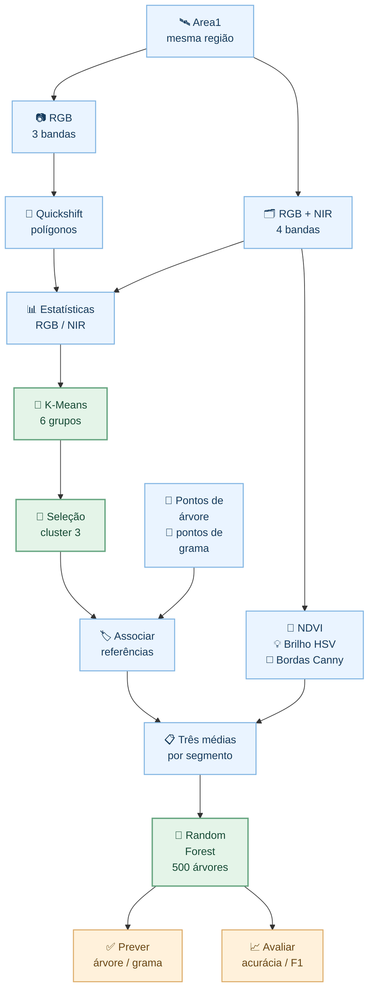
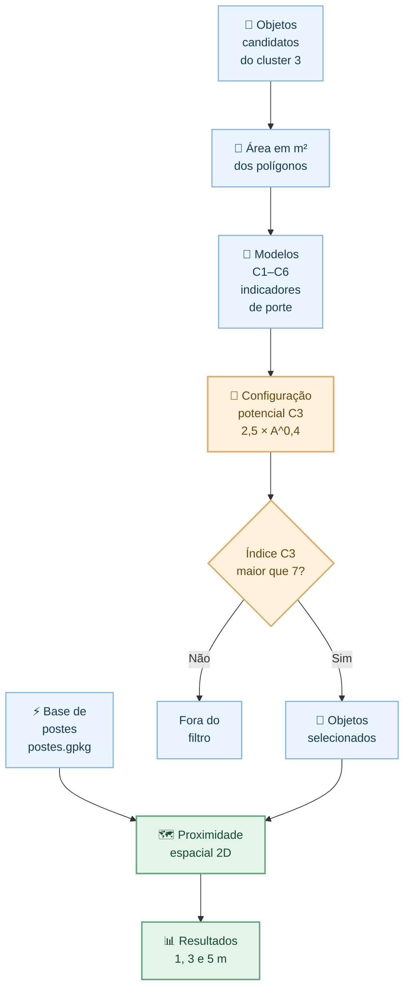

# Projeto de mestrado para detecção de árvores urbanas e avaliação de proximidade com linhas de energia utilizando brilho, bordas, NDVI e imagens aéreas.

**Pesquisa de mestrado — Breno Braga Galvão | Em desenvolvimento**

Esta pesquisa investiga duas propostas complementares a partir de **uma única área de estudo (Area1)** em Caxias do Sul (RS):

| Proposta | Pergunta central | Resultado buscado |
|---|---|---|
| **🌳 Proposta 1 — Identificação da vegetação** | Como distinguir **árvores e gramíneas** por características de imagens de satélite? | Objetos classificados como árvore ou gramínea. |
| **⚡ Proposta 2 — Porte e proximidade de postes** | Quais objetos candidatos apresentam **indicador empírico de porte** acima do limiar e ficam próximos de postes? | Seleção exploratória e distâncias 2D a postes, **sem comprovação de risco elétrico**. |

**Roteiro de leitura:** dados → **Proposta 1** → resultados históricos → **Proposta 2** → imagem completa das 17 etapas → documentação. **Todas as comparações dos experimentos novos aparecem no final do README.**

## 1. Área de estudo e dados utilizados

A Area1 utiliza **dois arquivos raster referentes essencialmente à mesma região**, e não duas áreas de estudo:

| Arquivo raster | Bandas | O que o código faz com ele |
|---|---|---|
| `AOI_RGB_NEW.tif` | **RGB — 3 bandas** (vermelho, verde, azul) | Alimenta o **Quickshift** para criar regiões/polígonos. |
| `AOI_NEW_MULTI.tif` | **RGB + NIR — 4 bandas** | Fornece estatísticas RGB/NIR, NDVI, brilho HSV e bordas Canny. |

**Os arquivos têm papéis diferentes:** o RGB é usado para a segmentação; o RGB + NIR fornece atributos que descrevem os segmentos. As grades possuem um pequeno deslocamento entre suas origens, relevante para o alinhamento espacial.

| Característica | Valor |
|---|---|
| Dimensão de **cada raster** | **6.942 colunas × 7.294 linhas** |
| Pixels por raster | **50.634.948** |
| Resolução espacial aproximada | **0,5 m/pixel** |
| Cobertura retangular das imagens | **12,66 km²** |
| Polígono efetivo de interesse (**AOI**) | **12,1372 km²**, ou aproximadamente **12,14 km²** |
| Referência espacial dos rasters | **EPSG:31982** |

Os **12,66 km²** representam o retângulo raster; a AOI de **12,14 km²** é delimitada por `AOI_new.shp`. A documentação indica imagens fornecidas pela **CPFL**, atribuídas ao satélite **JL1KF01B**, sem data de aquisição especificada.

**Arquivos vetoriais de apoio:**

| Arquivo | Finalidade |
|---|---|
| `AOI_new.shp` e auxiliares | Polígono da área de interesse |
| `Arvores.gpkg` | **257 pontos de referência de árvores** |
| `Grama.gpkg` | **253 pontos de referência de gramíneas** |
| `postes.gpkg` | Localização dos postes |

Portanto, existem **510 pontos de referência**. Isso **não significa 510 objetos ou 510 registros de treinamento**: o Quickshift cria segmentos, que depois são associados aos pontos conhecidos.

Os dez arquivos originais permanecem no [Google Drive — Area1](https://drive.google.com/drive/folders/1asqPz9xFr7dlnK1ggvrwftXEbkhvwjg6). Veja o [detalhamento dos arquivos e coordenadas](data/README.md).

---

## 2. 🌳 Proposta 1 — Identificação de árvores e gramíneas

**Objetivo:** classificar objetos vegetados em **árvore** ou **gramínea**, combinando NDVI, brilho HSV e bordas Canny.

### Como o código original realiza essa proposta

**Leitura do fluxo:** o **RGB** produz os polígonos; o **RGB + NIR** fornece os atributos; as referências identificam os exemplos; o **Random Forest** gera as previsões e as métricas.

**O que está acontecendo:** o Quickshift divide a imagem RGB em segmentos; o K-Means utiliza **quatro médias e quatro desvios-padrão RGB/NIR** e seleciona os objetos do **cluster 3**. Os pontos conhecidos identificam exemplos de árvores e gramíneas. O Random Forest recebe **três valores médios por objeto** — **brilho HSV, bordas Canny e NDVI** — para aprender a distinguir as duas classes.

**Parâmetros do método original:**

| Etapa | Configuração |
|---|---|
| Quickshift sobre o RGB completo | `kernel_size=3`, `max_dist=5`, `ratio=0.04` |
| K-Means | **6 clusters**, `random_state=42`, `n_init=10`; escolha do **cluster 3** |
| Random Forest | **500 árvores**, `random_state=42` |
| Treino/teste | Aleatório **80%/20%**, `random_state=42`, sem estratificação |

O método **não utiliza 50 milhões de pixels como 50 milhões de registros independentes**. Também não havia deduplicação explícita nem separação espacial entre treino e teste.

### Resultados históricos da Proposta 1

Os valores abaixo foram **registrados em execuções anteriores**, não recalculados por uma nova execução integral comprovada.

| Indicador | Experimento inicial | Experimento com área maior |
|---|---:|---:|
| Pares objeto–rótulo | **133** | **458** |
| Treinamento | 106 | 366 |
| Teste | 27 | 92 |
| **Acurácia** | **0,81** | **0,87** |
| F1 — árvores | 0,80 | 0,85 |
| F1 — gramíneas | 0,83 | 0,88 |

**Por que são 510 pontos de referência, mas 458 registros na rodada maior?** O código mantém apenas objetos do **cluster 3** e os associa espacialmente aos pontos conhecidos. O resultado é uma tabela de **pares objeto–rótulo**: um ponto pode não ter candidato e um segmento pode gerar mais de uma associação. Portanto, **não podemos concluir que 52 pontos foram descartados** sem auditar a execução histórica.

Os **458 registros** geraram **366 exemplos de treinamento e 92 de teste**. A acurácia de **0,87** corresponde a esse conjunto de 92 testes. A primeira rodada de **133 registros** utilizou outras amostras; o aumento de **0,81 para 0,87** é descritivo e não comprova, sozinho, um ganho causado pelo tamanho da área.

---

## 3. ⚡ Proposta 2 — Indicador de porte e proximidade com postes

**Objetivo:** calcular um indicador experimental de porte dos objetos e verificar sua **proximidade horizontal** aos postes da Area1.

### Como o código original realiza essa proposta

**Leitura do fluxo:** o índice **C3** é calculado a partir da área dos candidatos; apenas quem passa pelo limiar entra na análise de **distâncias aos postes**. A fórmula e os detalhes do filtro aparecem abaixo.

**No fluxograma, a “Base de postes” é o arquivo `postes.gpkg`**, utilizado como entrada independente para calcular a proximidade dos objetos selecionados.

O código calcula a área dos polígonos, testa **seis configurações empíricas (C1–C6)** nas formas potencial e linear e usa o índice potencial **C3** na seleção:

$$
\widehat{H}_{C3} = 2{,}5 \cdot A^{0{,}4}
$$

Nessa expressão, **A** é a área projetada do polígono, em **m²**. No código, o cálculo é escrito como `2.5 * (area ** 0.4)`.

Depois aplica o filtro `Power_tree_size_C3 > 7` e calcula a proximidade dos objetos selecionados a **1, 3 e 5 metros dos pontos dos postes**, usando `sjoin_nearest`.

**Ponto importante para a banca:** a Proposta 2 usa os **candidatos do cluster 3**, e o código histórico **não exige `predicted_classe == 'arvore'`** nesse filtro. Portanto, os objetos selecionados **não são necessariamente apenas árvores previstas pelo Random Forest**.

**Limites científicos:** o índice C3 **não é altura real validada**, as distâncias são **2D até postes** e a Area1 **não possui a geometria dos cabos**. Não se pode interpretar esse resultado como **interferência em fios ou risco elétrico comprovado**. [Ver as fórmulas C1–C6 e suas limitações](docs/allometria.md).

---

**Sobre os fluxogramas:** ambos estão em **código Mermaid**, como originalmente, com descrições completas, cores e espaçamento ampliado dentro das caixas para evitar cortes no GitHub. Eles representam o método original; a comparação da V2 está ao final do documento.

---

## 4. Imagem completa — as 17 etapas do código original

A ilustração horizontal abaixo apresenta as **17 etapas do código original**, com a **Proposta 1** (classificação) e a **Proposta 2** (índice de porte e proximidade com postes) identificadas. Os resultados exibidos na etapa 12 são os valores **históricos da rodada maior**: acurácia **0,87** e F1 de árvores **0,85**.

  

**Para visualizar a imagem ampliada:** clique no infográfico para abrir em tamanho original. No README, ele ocupa a largura disponível da página.

[**Abrir o infográfico horizontal ampliado (17 etapas)**](docs/fluxo_17_etapas_horizontal_corrigido.png)

Este esquema representa o **notebook original**. Os experimentos posteriores da V2, com segmentação em quadrantes, têm protocolos próprios e estão explicados **na última seção**.

## 5. Código e documentação técnica

| Material | Conteúdo |
|---|---|
| [Notebook original](Segmentacao_area_completa.ipynb) | Quickshift global, K-Means, Random Forest e proximidade |
| [Notebook V2](Segmentacao_area_completa_v2_experimentos.ipynb) | Experimentos adicionais E1–E9 |
| [Dados Area1](data/README.md) | Arquivos, coordenadas e estrutura do Drive |
| [Registro do método original](docs/experimento_area_completa_2026-10-29.md) | Parâmetros, resultados históricos e limitações |
| [Harmonização E3c/E8h](docs/harmonizacao_protocolos_2026-11-01.md) | Comparações de modelos e validação espacial |
| [Comparação E9](docs/comparacao_controlada_segmentacao_512_vs_256_2026-11-01.md) | Comparação pareada da segmentação |
| [Estimativas C1–C6](docs/allometria.md) | Fórmulas exploratórias de porte |

Os arquivos da Area1 ficam no **Google Drive**, e o notebook original foi preparado para **Google Colab**. O processamento global consome muita memória; **uma nova execução completa e bem-sucedida não está comprovada**. As baterias da V2 têm evidências documentadas separadamente, mas nem todas as saídas estão salvas no próprio notebook publicado.

---

## 6. Comparação científica — original versus novos experimentos

**Esta seção responde ao que foi comparado, com quais dados e quais conclusões são válidas.** Todos os experimentos derivam da **mesma Area1**, mas **não necessariamente dos mesmos segmentos ou conjuntos de teste**.

### 6.1. Qual dataset e qual avaliação foram usados?

| Experimento | Construção dos segmentos | Amostras supervisionadas | Avaliação |
|---|---|---|---|
| **Original inicial** | Método histórico; recorte inicial não totalmente reconstituído | **133 pares** | Aleatória, 27 registros de teste |
| **Original ampliado** | Quickshift **global** + K-Means **cluster 3** | **458 pares** | Aleatória, 92 registros de teste |
| **V2 — E3c/E8h** | Quickshift em **812 quadrantes** de até **256 × 256 px** | **505 segmentos únicos** (257 árvores, 248 gramíneas) | Oito classificadores, divisões aleatórias e espaciais |
| **V2 — E9** | **119 regiões**: Quickshift contínuo **512 px** versus quatro quadrantes **256 px** | **505 referências comuns dentro da E9** | Oito classificadores, testes espaciais pareados |

A E3c criou **168.133 segmentos** na extensão retangular do raster (inclusive fora da AOI), mas a classificação supervisionada usou **505 segmentos rotulados**. A E9 segmentou **recortes locais com referências**, não a imagem inteira. A igualdade numérica dos **505** na E3c e E9 **não garante geometrias idênticas**.

### 6.2. E3c — Random Forest versus outros classificadores

Nos mesmos **505 segmentos derivados** e nas mesmas divisões de treino/teste **dentro de cada protocolo**, foram avaliados **oito classificadores**.

**F1-macro médio** (cinco divisões espaciais, embargo de **25 m das geometrias de teste**):

| Classificador | Blocos 250 m | Blocos 500 m |
|---|---:|---:|
| **SVM RBF** | **0,8987** | **0,8668** |
| Regressão logística | 0,8928 | 0,8664 |
| KNN (7) | 0,8874 | 0,8502 |
| Extra Trees | 0,8790 | 0,8629 |
| **Random Forest** | **0,8656** | **0,8530** |
| HistGradientBoosting | 0,8556 | 0,8524 |
| Gaussian Naive Bayes | 0,8555 | 0,8398 |
| Dummy | 0,2980 | 0,2799 |

**O que significa:** o SVM teve maior F1-macro médio **nesse protocolo**, não superioridade estatística geral. Na **E4**, as três características **NDVI + brilho + Canny** juntas tiveram maior F1 médio nas condições estudadas. A **E5** explorou parâmetros do Quickshift/K-Means; *silhouette* não é acurácia.

### 6.3. E8h — comparação da avaliação aleatória com a espacial

Com a **mesma base derivada de 505 segmentos**, o Random Forest apresentou:

| Protocolo | Acurácia média | F1-macro médio |
|---|---:|---:|
| Aleatório 80/20 | **0,8832** | **0,8827** |
| Espacial 250 m, embargo 25 m | 0,8697 | 0,8656 |
| Espacial 500 m, embargo 25 m | 0,8591 | 0,8530 |

Os protocolos usam **conjuntos de teste diferentes**: essa comparação é **descritiva**, e não uma prova de que o embargo por si só causou toda a diferença. A E8h fez **40 ajustes aleatórios novos** e reutilizou **240 ajustes espaciais E3c** com verificações.

Usando a **regra antiga do RF com semente 42 na base nova**, foram **404 registros de treino e 101 de teste**, com acurácia **0,9010** e F1-macro **0,9009**. Esse experimento **não reproduz** o histórico de **0,87** com 458 pares.

### 6.4. E9 — segmentação contínua de 512 versus quadrantes de 256

Na E9, as **119 regiões** foram segmentadas das duas maneiras, mantendo os **mesmos 505 pontos de referência, as mesmas divisões e os mesmos modelos dentro da experiência**. Foram **320 avaliações**.

**F1-macro médio**, com embargo de **25 m entre pontos de referência**:

| Blocos | Modelo | Contínuo 512 px | Quatro 256 px |
|---|---|---:|---:|
| 250 m | Random Forest | **0,8906** | 0,8835 |
| 250 m | SVM RBF | 0,9157 | **0,9341** |
| 500 m | Random Forest | **0,8657** | 0,8566 |
| 500 m | SVM RBF | 0,8518 | **0,8641** |

**O que significa:** RF teve média ligeiramente maior com 512 contínuo; SVM, com quadrantes. O efeito não foi uniforme em todas as divisões. **512 contínuo é um recorte de 512 px, não o Quickshift global da imagem inteira**. A E9 também não reproduz o K-Means global e seu cluster 3.

### 6.5. Afinal, o que podemos comparar com rigor?

| Comparação | É válida como prova de melhoria? |
|---|---|
| Original **0,81 × 0,87** | **Não.** Apenas descrição de rodadas com testes diferentes. |
| Original **0,87 × resultados da V2** | **Não diretamente.** Mudaram segmentos, seleção de candidatos, amostras e testes; às vezes a métrica também mudou. |
| **RF × SVM × outros na E3c** | **Sim, dentro de cada protocolo**, com os mesmos dados e divisões. |
| **512 contínuo × quatro 256 na E9** | **Sim, nos recortes da E9**, com referências e testes pareados. |
| **Pipeline completo original × pipeline completo V2** | **Ainda não foi demonstrado** por uma reprodução ponta a ponta controlada. |

**Acurácia** é a proporção de classificações corretas. **F1-macro** é a média do F1 de árvores e gramíneas, com mesmo peso para cada classe. Portanto, **acurácia 0,87 não é diretamente comparável ao F1-macro 0,8656**.

### 6.6. O que já foi feito e o que falta?

Além dos testes detalhados, a V2 documenta **E6/E6c** (proximidade de postes e extrapolação dos atributos) e **E7** (cenários empíricos de porte), **sem validação de risco ou altura real**.

**Para comparar o método completo original com a alternativa**, ainda é necessário reproduzir o **Quickshift global, K-Means e cluster 3** sobre os dados originais, usar referências e divisões de teste equivalentes, e medir separadamente **cobertura dos candidatos** e **qualidade da classificação**. A nova execução global integral **não está comprovada**.

A Area1 não tem **alturas reais medidas, geometrias de cabos ou rótulos para todo o fundo urbano**. Assim, os resultados não demonstram risco elétrico real nem generalização para outras cidades.

**Conclusão científica:** temos comparações controladas **entre classificadores (E3c)** e **entre estratégias locais de segmentação (E9)**. O resultado histórico do Random Forest (**0,87**) permanece uma referência descritiva; **não foi demonstrado que a V2 completa o supera**.
