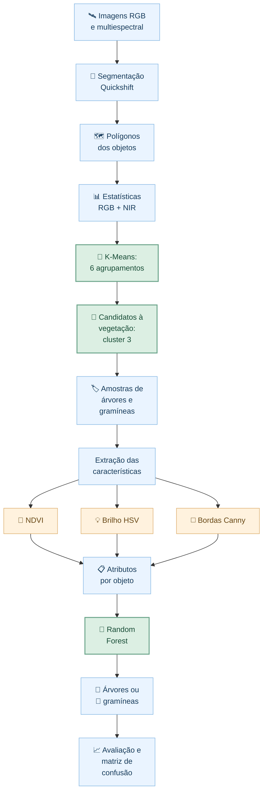
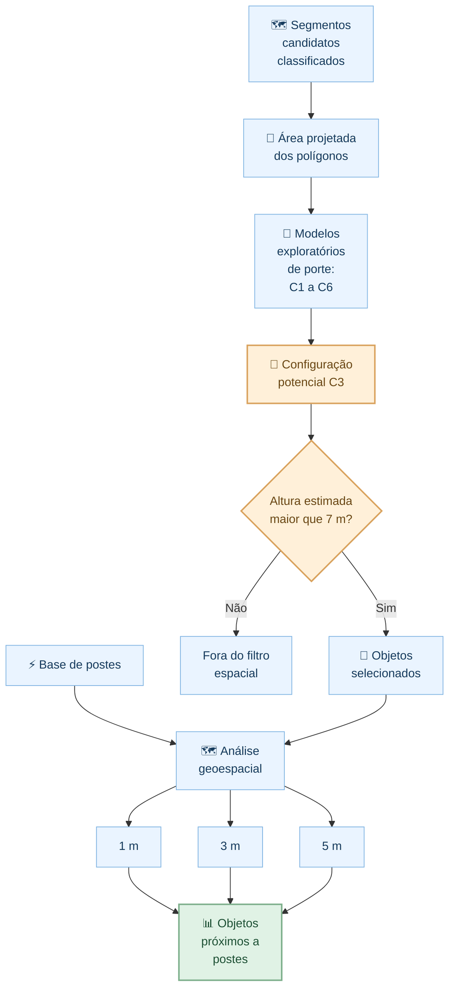
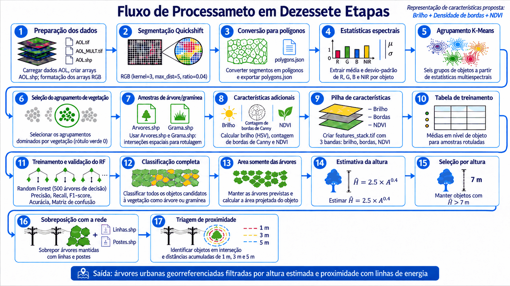
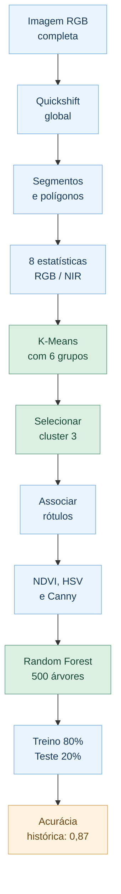
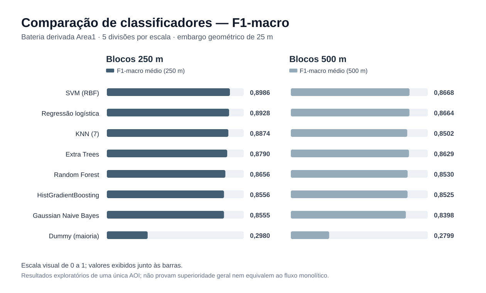
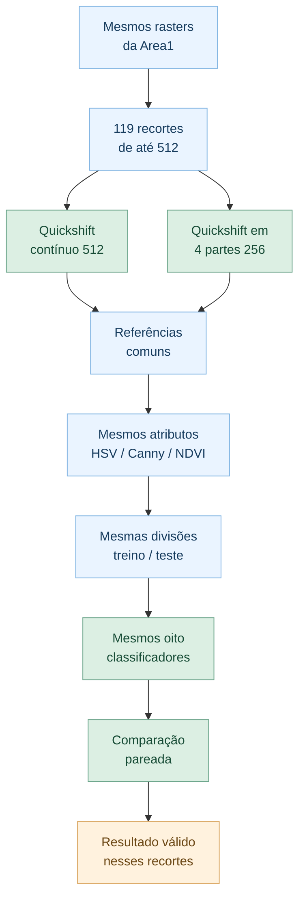

# Combinação de Características de Brilho, Bordas e NDVI para Detecção de Árvores Urbanas e Avaliação de Proximidade com Linhas de Energia

**Abordagem orientada a objetos para identificação de árvores urbanas em imagens multiespectrais de alta resolução e análise espacial de proximidade com a infraestrutura elétrica.**


## Visão geral

A vegetação arbórea é parte essencial da infraestrutura verde das cidades, mas sua localização e seu porte também são relevantes para o planejamento e a manutenção das redes elétricas. Identificar árvores em imagens aéreas e representar suas copas como objetos georreferenciados permite investigar a distribuição da vegetação e sua proximidade com elementos da infraestrutura urbana.

Esta pesquisa combina **segmentação de imagens, características espectrais e de textura, aprendizado de máquina e análise espacial**. O trabalho está organizado em **duas propostas complementares**:

- **Proposta 1 – Identificação de árvores e gramíneas:** reconhecer e diferenciar objetos vegetados em imagens de alta resolução, com foco na distinção entre árvores e gramíneas.
- **Proposta 2 – Proximidade com a rede elétrica:** analisar espacialmente a proximidade dos objetos identificados em relação à infraestrutura elétrica, utilizando os postes como referência na base de dados atual.

> **Escopo dos dados atuais:** a área de estudo contém a geometria dos **postes**, mas não dos cabos ou linhas de energia. Assim, a segunda proposta é investigada atualmente por meio da **proximidade com postes**, sem afirmar interferência efetiva nos fios.

## Propostas de pesquisa

### 🌳 Proposta 1 – Identificação de árvores e gramíneas

**Pergunta de pesquisa:** como distinguir árvores e gramíneas em imagens de alta resolução utilizando a combinação de NDVI, brilho e bordas em objetos segmentados?

A imagem RGB é dividida em regiões espacialmente coerentes pelo **Quickshift**. Para cada região, o código extrai estatísticas das bandas RGB e NIR e aplica **K-Means** para selecionar candidatos. Depois, utiliza amostras identificadas como árvores e gramíneas para treinar um **Random Forest** com três características complementares:

| Característica | O que representa | Por que utilizar |
|---|---|---|
| 🌿 **NDVI** | Resposta espectral relacionada à vegetação | Diferenciar padrões de cobertura vegetal |
| 💡 **Brilho (HSV)** | Intensidade luminosa observada na imagem | Representar diferenças radiométricas dos objetos |
| ◻️ **Bordas (Canny)** | Variações locais e contornos | Descrever aspectos estruturais e de textura |

**Desenho do processo de identificação**



A abordagem é **orientada a objetos**: em vez de tratar apenas pixels isolados, utiliza as propriedades dos segmentos, mantendo suas geometrias para a etapa espacial.

### ⚡ Proposta 2 – Proximidade com a rede elétrica

**Pergunta de pesquisa:** como utilizar os objetos identificados em imagens aéreas para apoiar a identificação de áreas de atenção próximas à infraestrutura elétrica urbana?

A pesquisa investiga a área projetada dos objetos e utiliza uma **estimativa empírica de altura**, calculada a partir dessa área, para selecionar candidatos a uma análise espacial. Em seguida, avalia a proximidade com os **postes**, em distâncias de **1, 3 e 5 metros**.

**Desenho do processo de análise espacial**



**Limites importantes:** a fórmula utilizada estima um possível porte a partir da área e **não mede diretamente a altura real da árvore**. No código atual, o filtro `C3 > 7` **não exige** que `predicted_classe == 'arvore'`; por isso, também podem passar objetos classificados como gramínea. A distância é medida em duas dimensões em relação aos postes, não aos cabos energizados.

## Contribuições metodológicas investigadas

A proposta reúne três elementos:

1. **Combinação de características complementares:** NDVI (espectral), brilho HSV (radiométrica) e bordas de Canny (estrutura e textura).
2. **Estratégia híbrida de agrupamento e classificação:** K-Means para pré-seleção dos candidatos e Random Forest para distinguir árvores e gramíneas.
3. **Preservação da geometria dos objetos:** manutenção dos polígonos para cálculo de área e análise de proximidade.

Essas são características da abordagem estudada; sua superioridade em relação a métodos alternativos **ainda precisa ser demonstrada por validação experimental**.

## Fluxo metodológico completo — 17 etapas

O diagrama ilustrado apresenta a visão geral do percurso da pesquisa, desde as imagens de entrada até a análise espacial.

<p align="center">
  
</p>

<details>
<summary><strong>Ver resumo das etapas</strong></summary>

| Etapas | O que acontece |
|---|---|
| **1–3** | Preparação dos rasters, área de interesse e segmentação Quickshift |
| **4–6** | Criação de polígonos, estatísticas espectrais e K-Means |
| **7–10** | Associação de amostras e extração de NDVI, brilho HSV e bordas Canny |
| **11–12** | Treinamento e aplicação do Random Forest |
| **13–15** | Área dos objetos, configurações exploratórias de porte e filtro C3 |
| **16–17** | Proximidade espacial com postes a 1 m, 3 m e 5 m |

</details>

*O diagrama é uma representação conceitual da metodologia. A base utilizada nesta execução inclui postes, mas não linhas ou cabos de energia.*

## Resultados preliminares

Os resultados abaixo são **históricos**, registrados em execuções anteriores. Não representam uma validação da execução atualmente em andamento no Colab.

| Indicador | Experimento inicial | Experimento com área maior |
|---|---:|---:|
| Registros rotulados (pares objeto–rótulo) | 133 | **458** |
| Amostras de treinamento | 106 | **366** |
| Amostras de teste | 27 | **92** |
| Acurácia global | 0,81 | **0,87** |
| F1-score — árvores | 0,80 | **0,85** |
| F1-score — gramíneas | 0,83 | **0,88** |

O número de pares objeto–rótulo não representa necessariamente a quantidade de objetos distintos. A comparação entre experimentos com conjuntos de teste diferentes não comprova, por si só, melhoria de desempenho.

### Estimativa empírica de altura

O notebook explora seis configurações de estimativa de porte (**C1–C6**), nas formas potencial e linear. A relação potencial adotada como hipótese experimental é:

$$
\widehat{H} = a \cdot A^b
$$

Em que **\(A\)** representa a área projetada do polígono da copa (m²), **\(\widehat{H}\)** representa a altura estimada e **\(a\)** e **\(b\)** são parâmetros experimentais.

Para selecionar os objetos que seguem para a análise de proximidade com postes, utiliza-se a **configuração potencial C3**:

$$
\boxed{\widehat{H}_{C3} = 2{,}5 \cdot A^{0{,}4}}
$$

A seleção considera os objetos com **altura estimada superior a 7 metros**. Esse valor é um critério experimental de seleção, **não uma medição direta de altura**.

**Limitação científica:** a expressão acima é uma adaptação empírica usada nesta pesquisa, inspirada na literatura sobre dimensões de copa e altura. Os coeficientes **2,5** e **0,4** não foram obtidos de uma calibração local com alturas medidas em campo. Portanto, a estimativa ainda precisa de validação antes de ser interpretada como altura real.

Para conhecer a fundamentação científica e as demais configurações, consulte [a documentação de alometria](docs/allometria.md).

## Tecnologias e bibliotecas

| Finalidade | Tecnologias |
|---|---|
| Linguagem e ambiente | Python, Google Colab, Google Drive |
| Rasters e geoprocessamento | Rasterio, GeoPandas, Shapely |
| Dados e cálculo numérico | NumPy, Pandas |
| Processamento de imagens | scikit-image |
| Aprendizado de máquina | scikit-learn (K-Means e Random Forest) |
| Visualizações | Matplotlib, Seaborn |
| Versionamento | GitHub |

As bibliotecas utilizadas estão listadas em [`requirements-colab.txt`](requirements-colab.txt).

## Estrutura do repositório

```text
mestrado-arvores-urbanas/
├── 📓 Segmentacao_area_completa.ipynb
├── 📘 README.md
├── 📦 requirements-colab.txt
├── 🚫 .gitignore
├── 📂 data/
│   └── README.md
└── 📂 docs/
    ├── allometria.md
    ├── experimento_area_completa_2026-10-29.md
    └── pipeline_17_etapas.png
```

O **GitHub** contém o código e a documentação. Os dados geoespaciais, devido ao tamanho, permanecem no **Google Drive**.

## Dados e armazenamento

### Área de estudo e origem das imagens

A pesquisa utiliza imagens de satélite de alta resolução para analisar a vegetação urbana de **Caxias do Sul, no Rio Grande do Sul**.

| Característica | Informação |
|---|---|
| **Área de estudo** | Caxias do Sul — RS, Brasil |
| **Satélite** | **JL1KF01B** |
| **Disponibilização das imagens** | **CPFL — Companhia Paulista de Força e Luz** |
| **Dados espectrais** | **RGB + infravermelho próximo (NIR)** |
| **Resolução espacial dos rasters utilizados** | Aproximadamente **0,5 m/pixel** |
| **Sistema de referência dos rasters** | **EPSG:31982** |

O sensor **JL1KF01B** é a origem das imagens indicada na apresentação da pesquisa. As bandas RGB e NIR sustentam tanto a segmentação da imagem quanto a extração das características espectrais utilizadas na identificação de árvores e gramíneas.

*A identificação do satélite, a localização da área de estudo e a disponibilização pela CPFL são informações constantes da documentação da pesquisa. A data de aquisição das imagens não está especificada nessa documentação.*

Os dez arquivos necessários já estão organizados na [pasta `Area1` no Google Drive](https://drive.google.com/drive/folders/1asqPz9xFr7dlnK1ggvrwftXEbkhvwjg6), no seguinte caminho usado pelo notebook:

```text
/content/drive/MyDrive/Projetos/Segmentacao_Breno/
├── Area1/
│   ├── AOI_RGB_NEW.tif
│   ├── AOI_NEW_MULTI.tif
│   ├── AOI_new.shp
│   ├── AOI_new.shx
│   ├── AOI_new.dbf
│   ├── AOI_new.prj
│   ├── AOI_new.cpg
│   ├── Arvores.gpkg
│   ├── Grama.gpkg
│   └── postes.gpkg
└── outputs/
```

As imagens de entrada têm resolução espacial aproximada de **0,5 m/pixel**. Os rasters utilizam **EPSG:31982** e as camadas de árvores, gramíneas e postes têm **EPSG:4674** na origem, sendo reprojetadas para operações métricas. Veja [o detalhamento dos dados](data/README.md).

## Como executar no Google Colab

1. Abra o **[notebook principal diretamente do GitHub no Colab](https://colab.research.google.com/github/BrenoBragaGalvao/mestrado-arvores-urbanas/blob/main/Segmentacao_area_completa.ipynb)**.
2. Execute a célula que monta o Google Drive: `drive.mount('/content/drive')`.
3. Confirme que os arquivos estão na pasta `Area1`, conforme a estrutura acima.
4. Execute as **116 células** na ordem. O processamento da imagem inteira pode exigir **RAM alta**.
5. Confira as saídas das células, gráficos e relatórios de classificação. Os resultados só poderão ser considerados reproduzidos depois de concluída a execução sem erros.

**Onde os arquivos gerados ficam salvos?** O código original usa nomes relativos para `polygons.json`, `polygons_arvores.json`, `features_stack.tif` e `arvores_segmentadas.json`; normalmente eles ficam no diretório corrente do Colab, **não automaticamente** em `outputs/` no Drive. Alterações realizadas no Colab também não são enviadas automaticamente ao GitHub.

**Sobre o notebook:** `Segmentacao_area_completa.ipynb` contém o código original com **116 células**. A cópia publicada no GitHub preserva as células de código e texto e as saídas textuais; imagens históricas incorporadas permanecem no arquivo original conservado no Google Drive. O código não utiliza divisão treino/teste estratificada nem processamento de imagens em blocos.

## Próximas etapas científicas

- Confirmar a execução integral com os dados reais e documentar os resultados obtidos.
- Verificar a qualidade e a independência das amostras usadas em treino e teste.
- Comparar classificadores e realizar ablação das características NDVI, brilho e Canny.
- Validar a relação entre área de copa e altura com medições reais.
- Ampliar a análise para geometrias de cabos/linhas de energia, quando disponíveis.

---

**Autor:** Breno Braga Galvão  
**Situação:** pesquisa de mestrado em desenvolvimento.
 
---

# Entenda os experimentos: o que mudou do Random Forest original para a V2?

> **Comece por aqui.** Esta parte foi organizada para explicar o mestrado sem presumir conhecimento prévio dos testes. Ela não substitui o conteúdo anterior, que foi preservado. A conclusão mais importante é: **as imagens originais são as mesmas; os segmentos e a forma de avaliar os modelos nem sempre são os mesmos.**

## 1. A pesquisa em poucas palavras

Queremos usar imagens de satélite para reconhecer **árvores e gramíneas** e depois estudar a proximidade dos objetos identificados com **postes**.

O processamento tem três níveis diferentes:

- **Imagens de origem:** os arquivos RGB e RGB/NIR guardados na pasta `Area1`.
- **Segmentos:** pedaços da imagem criados pelo Quickshift. O mesmo local pode gerar segmentos diferentes conforme a imagem é dividida.
- **Amostras rotuladas:** pontos que sabemos que representam árvore ou gramínea; eles são associados a segmentos para ensinar e testar um classificador.

**Não é correto chamar os 458 registros antigos e os 505 segmentos novos de datasets idênticos.** São amostras montadas de formas diferentes, embora venham da mesma área de estudo.

## 2. Quais são os dados utilizados?

| Dado | Características | Finalidade |
|---|---|---|
| `AOI_RGB_NEW.tif` | Imagem de três bandas: vermelho, verde e azul (RGB) | Criar segmentos com Quickshift |
| `AOI_NEW_MULTI.tif` | Imagem de quatro bandas: RGB + infravermelho próximo (NIR) | Calcular informações espectrais |
| `AOI_new.shp` e auxiliares | Polígono da área de interesse (AOI) | Definir o recorte geográfico |
| `Arvores.gpkg` | 257 pontos de referência de árvores | Identificar exemplos conhecidos |
| `Grama.gpkg` | 253 pontos de referência de gramíneas | Identificar exemplos conhecidos |
| `postes.gpkg` | Pontos que representam postes | Medir proximidade horizontal, não distância a cabos |

**As imagens têm 7.294 linhas × 6.942 colunas, cerca de 50,6 milhões de pixels, resolução aproximada de 0,5 m/pixel e EPSG:31982.** A extensão retangular é de aproximadamente 3,65 km × 3,47 km, mas nem todo esse retângulo está dentro da AOI. A área de estudo documentada é **Caxias do Sul (RS)**, com imagens atribuídas ao satélite JL1KF01B.

As imagens RGB e multiespectral têm um pequeno deslocamento entre as grades de origem. Isso é relevante para conferir a correspondência dos pixels ao extrair atributos.

**Por que temos 510 pontos, mas não 510 segmentos no resultado?** Porque dois pontos podem cair no mesmo segmento. Além disso, o método antigo selecionava apenas segmentos do cluster 3. Por isso, **pontos**, **pares objeto–rótulo** e **segmentos únicos** são contagens diferentes.

## 3. O que fizemos primeiro: o Random Forest original

O notebook histórico [`Segmentacao_area_completa.ipynb`](Segmentacao_area_completa.ipynb) executava estas etapas:



| Configuração | Original |
|---|---|
| Quickshift | `kernel_size=3`, `max_dist=5`, `ratio=0.04`; imagem inteira |
| K-Means | 6 grupos, `random_state=42`, `n_init=10` |
| Seleção de segmentos | **Cluster 3** do agrupamento global |
| Características usadas pelo RF | Média do brilho HSV, média de bordas Canny e média do NDVI por segmento |
| Random Forest | **500 árvores**, `random_state=42` |
| Treino/teste | 80% / 20%, `random_state=42`, aleatório e sem estratificação |
| Retirada explícita de segmentos duplicados | **Não** |
| Validação espacial | **Não** |

O K-Means analisava oito estatísticas RGB/NIR para selecionar candidatos, **mas o Random Forest era treinado com apenas os três atributos HSV/Canny/NDVI**.

### Resultados da época

| Indicador | Experimento inicial | Experimento com área maior |
|---|---:|---:|
| Pares objeto–rótulo | **133** | **458** |
| Registros de treinamento | 106 | 366 |
| Registros de teste | 27 | 92 |
| **Acurácia global** | **0,81** | **0,87** |
| F1 de árvores | 0,80 | 0,85 |
| F1 de gramíneas | 0,83 | 0,88 |

**Como interpretar:** acurácia de **0,87** significa aproximadamente 87% de previsões corretas *naquele teste de 92 registros*. São valores **históricos registrados no notebook**, não uma execução integral recém-reproduzida.

Os **458** representam *pares objeto–rótulo*, que podem conter o mesmo objeto mais de uma vez. Aumentar de 0,81 para 0,87 é uma melhora **descritiva entre rodadas**, mas não comprova que ampliar a área tenha causado o ganho, porque os conjuntos de treino e teste também mudaram. A dimensão exata do recorte da primeira rodada de 133 registros não está demonstrada nos registros atuais.

## 4. O que mudou depois, no notebook V2?

O arquivo [`Segmentacao_area_completa_v2_experimentos.ipynb`](Segmentacao_area_completa_v2_experimentos.ipynb) foi ampliado para investigar mais possibilidades **com os mesmos arquivos originais da Area1**, sem pedir novas imagens ou rótulos.

| Etapa | Em linguagem simples |
|---|---|
| E1–E2 | Conferimos os rótulos, retiramos repetições e testamos uma divisão geográfica de treino/teste |
| E3/E3c | Comparamos **oito classificadores** nos mesmos testes de cada protocolo |
| E4 | Testamos quais combinações de **NDVI, brilho e bordas** ajudam mais |
| E5 | Mudamos parâmetros de Quickshift e K-Means para estudar sensibilidade |
| E6/E6c | Investigamos proximidade com postes e se os atributos extrapolam os exemplos rotulados |
| E7 | Testamos índices empíricos de porte, **sem validar altura real** |
| E8/E8h | Organizamos evidências e aproximamos as métricas do modo de avaliação antigo |
| E9 | Comparamos **duas formas de segmentar os mesmos recortes** |

### A diferença mais importante: Quickshift global versus quadrantes

**No original**, Quickshift era aplicado à imagem inteira e depois o K-Means global selecionava o **cluster 3**.

**Na bateria derivada E3c**, a imagem foi processada em **812 quadrantes independentes de até 256 × 256 pixels**, gerando **168.133 segmentos** na extensão retangular. Foram obtidos **505 segmentos rotulados únicos** (257 árvores e 248 gramíneas), a partir dos 510 pontos. O **filtro global do cluster 3 não foi reproduzido** nesse protocolo.

Imagine uma copa atravessando a borda entre dois quadrantes: ela pode ficar inteira em um segmento no processo contínuo e ser cortada em dois no processo por quadrantes. Mesmo usando os mesmos pixels de origem, a **média dos três atributos por objeto pode mudar**.

**Portanto: mesma imagem original não significa mesmo dataset de treinamento e teste.**

## 5. Visão geral das bases: o que é igual e o que é diferente?

| Característica | Random Forest original | V2 E3c | V2 E9 |
|---|---|---|---|
| Arquivos de origem | Area1 | Area1 | Area1 |
| Dimensão dos rasters de origem | 7.294 × 6.942 px | Igual | Igual |
| Região segmentada | Imagem completa, depois recorte AOI | 812 quadrantes de até 256 px | 119 recortes de até 512 px |
| Quickshift | Global | Independente por quadrante | Contínuo 512 versus quatro 256 |
| K-Means cluster 3 | **Sim** | **Não, na bateria derivada** | **Não** |
| Conjunto supervisionado | **458 pares** (rodada maior) | **505 segmentos únicos** | **505 referências comuns** |
| Classificadores | Random Forest | 8 modelos | 8 modelos |
| Características conceituais | HSV, Canny, NDVI | HSV, Canny, NDVI | HSV, Canny, NDVI |
| Avaliação | Aleatória 80/20 | Aleatória e espacial | Espacial pareada |
| É reprodução exata do método histórico? | Referência histórica | **Não** | **Não** |

**O número 505 da E3c e o número 505 da E9 não garantem, por si só, que todas as geometrias sejam iguais entre esses dois experimentos.** Na E9, os pontos são compartilhados entre as **duas estratégias da própria E9**.

## 6. Comparação válida nº 1: qual classificador funciona melhor? (E3c)

Na E3c, mantemos fixos, **dentro de cada protocolo**, os segmentos, os atributos e a divisão entre treino e teste. **Só trocamos o modelo**.

Foram **8 modelos × 30 protocolos = 240 ajustes**: blocos espaciais de 250 m ou 500 m, cinco divisões por escala e embargos geométricos de 0, 25 ou 50 metros. O embargo afasta amostras de treino das geometrias de teste conforme a regra da E3c.

**F1-macro médio — cinco divisões, embargo de 25 m:**

| Modelo | Blocos 250 m | Blocos 500 m |
|---|---:|---:|
| **SVM RBF** | **0,8987** | **0,8668** |
| Regressão logística | 0,8928 | 0,8664 |
| KNN | 0,8874 | 0,8502 |
| Extra Trees | 0,8790 | 0,8629 |
| **Random Forest** | **0,8656** | **0,8530** |
| HistGradientBoosting | 0,8556 | 0,8524 |
| Naive Bayes | 0,8555 | 0,8398 |
| Dummy (modelo simples) | 0,2980 | 0,2799 |



**O que podemos dizer:** SVM teve **maior F1-macro médio que RF** nesse protocolo; não podemos afirmar superioridade geral em outras imagens ou cidades. As cinco divisões compartilham observações de uma mesma AOI e não são cinco áreas independentes.

### E a comparação com divisão aleatória 80/20?

Fizemos **40 novos ajustes** (oito modelos × cinco divisões aleatórias) sobre a mesma **base derivada de 505 segmentos**, para incluir a forma aleatória de avaliação.

| Random Forest sobre os 505 segmentos | Acurácia média | F1-macro médio |
|---|---:|---:|
| Divisão aleatória 80/20 | 0,8832 | 0,8827 |
| Espacial 250 m, embargo 25 m | 0,8697 | 0,8656 |
| Espacial 500 m, embargo 25 m | 0,8591 | 0,8530 |

**Cuidado:** entre protocolos mudam as amostras de teste; as diferenças não são uma medida isolada do efeito causal da validação espacial.

Em **uma única divisão aleatória** usando a semente 42, o RF original (500 árvores) foi aplicado à **base nova** de 505 segmentos: 404 treino / 101 teste, acurácia **0,9010** e F1-macro **0,9009**. Isso **não reproduz** a acurácia histórica **0,87**, obtida com outros pares.

## 7. Comparação válida nº 2: segmentar em 512 ou em 256 altera as notas? (E9)

Essa experiência **não foi feita para comparar o resultado 0,87**. Ela responde a uma pergunta diferente: **a escala da segmentação afeta as classificações?**

Escolhemos **119 regiões de até 512 × 512 pixels** contendo os pontos de referência. Cada região foi segmentada de duas maneiras:



A E9 utiliza **505 referências comuns (257 árvores, 248 gramíneas)**, oito classificadores, blocos de 250 m/500 m, exclusão opcional de 0/25 m **entre pontos de referência**, cinco divisões por escala e **320 avaliações** no total, 160 para cada forma de segmentação.

**F1-macro médio — blocos de 250 m, exclusão de 25 m:**

| Modelo | Contínuo 512 | Quatro 256 |
|---|---:|---:|
| Random Forest | **0,8906** | 0,8835 |
| SVM RBF | 0,9157 | **0,9341** |
| Regressão logística | 0,9153 | **0,9157** |
| Extra Trees | **0,9064** | 0,8968 |

**Conclusão da E9:** o RF apresentou média ligeiramente maior no contínuo 512, enquanto o SVM apresentou média maior nos quadrantes. O efeito **depende do algoritmo** e não foi igual em todas as divisões.

**Não confunda:** "512 contínuo" significa **um recorte de 512 pixels**, e **não o Quickshift sobre toda a imagem de 50,6 milhões de pixels**. A E9 também não refaz o K-Means global e seu cluster 3.

[Ver documentação e todas as métricas da E9](docs/comparacao_controlada_segmentacao_512_vs_256_2026-11-01.md).

## 8. Afinal, o que podemos comparar sem cometer erro?

| Comparação | Podemos afirmar que um é melhor? | Motivo |
|---|---|---|
| Original **0,81 × 0,87** | **Não como prova causal** | Rodadas com testes diferentes; apenas evolução histórica descritiva |
| Original **0,87 × E3c F1 0,8656** | **Não** | Métricas diferentes (**acurácia** × **F1-macro**) e amostras diferentes |
| Original **0,87 × E3c acurácia 0,8697** | **Não** | Métrica igual, **amostras/segmentação/teste diferentes** |
| **RF × SVM dentro da E3c** | **Sim, no protocolo testado** | Mesmos segmentos e testes por rodada |
| **512 contínuo × quatro 256 na E9** | **Sim, nesses recortes** | Mesmas referências e divisões nos dois braços |
| Pipeline original completo × V2 completa | **Ainda não** | Não temos reconstrução ponta a ponta nas mesmas condições |

**Acurácia** = proporção de previsões corretas. **F1-macro** = média do F1 das classes árvore e gramínea, dando peso igual às duas. Um valor de 0,87 na primeira métrica **não é diretamente equivalente** a 0,87 na segunda.

**Analogia:** duas turmas tiraram nota 8,7, mas fizeram provas diferentes. A igualdade numérica não significa que tiveram desempenho idêntico nas mesmas condições.

## 9. O que já conseguimos responder ao professor Dibio?

| Pergunta | Resposta sustentada |
|---|---|
| O modelo inicial funcionou? | Há registro histórico de **0,87 de acurácia**, com 458 pares e 92 registros de teste |
| Comparamos outras técnicas? | **Sim**: oito classificadores nos mesmos testes dentro da E3c |
| Os três atributos fazem diferença? | A ablação E4 comparou sete combinações, favorecendo os três atributos juntos no protocolo documentado |
| A segmentação altera os resultados? | **Sim, nos recortes E9**; o sentido da diferença depende do classificador |
| Conseguimos detectar interferência nos cabos? | **Não foi validado**; a base tem postes, mas não geometrias 3D de cabos |
| Provamos que a V2 completa supera o método original? | **Ainda não** |

A contribuição defensável é um **protocolo de classificação orientada a objetos com comparação justa entre modelos, validação espacial interna e avaliação de sensibilidade à segmentação**. Não afirmar que SVM é universalmente superior, que a metodologia estima altura real ou que confirma risco elétrico.

## 10. O que falta para comparar o original com a V2 completa?

Este é o **próximo experimento científico prioritário**, se quisermos afirmar melhoria ou piora em relação ao método original:

1. Reexecutar o **Quickshift sobre o raster completo**, o **K-Means global** e a **seleção do cluster 3**, registrando quais pontos e segmentos permanecem.
2. Executar a alternativa por blocos utilizando **as mesmas referências identificadas individualmente** e os mesmos procedimentos de extração de características, quando possível.
3. Separar **cobertura de candidatos** ("quantos pontos de referência cada método inclui?") de **qualidade de classificação** ("como os classificadores acertam nos exemplos comparáveis?").
4. Usar divisões comuns de treino/teste, métricas iguais, matrizes de confusão e uma lista auditável de IDs e exclusões.
5. Declarar eventuais impedimentos: a execução global de Quickshift no raster completo **ainda não foi novamente comprovada**, devido ao consumo de memória; E9 é um experimento de recortes e **não substitui** isso.

Essas comparações internas devem usar **somente os dez arquivos atuais da Area1**. Para validar **altura real, risco para cabos ou generalização para outras cidades**, a base atual não oferece as referências necessárias.

## 11. Onde conferir todos os detalhes?

| Arquivo | O que contém |
|---|---|
| [Notebook original](Segmentacao_area_completa.ipynb) | Código original de Quickshift, K-Means e Random Forest |
| [Notebook V2](Segmentacao_area_completa_v2_experimentos.ipynb) | Etapas ampliadas e comparações E1–E9 |
| [Documentação do experimento histórico](docs/experimento_area_completa_2026-10-29.md) | Parâmetros e resultados iniciais |
| [Harmonização dos protocolos](docs/harmonizacao_protocolos_2026-11-01.md) | Comparação com métricas homogêneas entre os algoritmos |
| [Experimento pareado E9](docs/comparacao_controlada_segmentacao_512_vs_256_2026-11-01.md) | Comparação 512 contínuo × quatro 256 |
| [Documentação dos dados](data/README.md) | Arquivos de origem e referência espacial |

**Estado em 01/11/2026:** as baterias derivadas E3c/E9 possuem resultados e evidências documentados, mas **a V2 completa publicada no GitHub não possui uma execução monolítica integral comprovada nem todas as saídas executadas salvas no próprio notebook**. O histórico não foi reescrito como se fosse uma reprodução recente. Os dados originais permanecem sem alterações.
