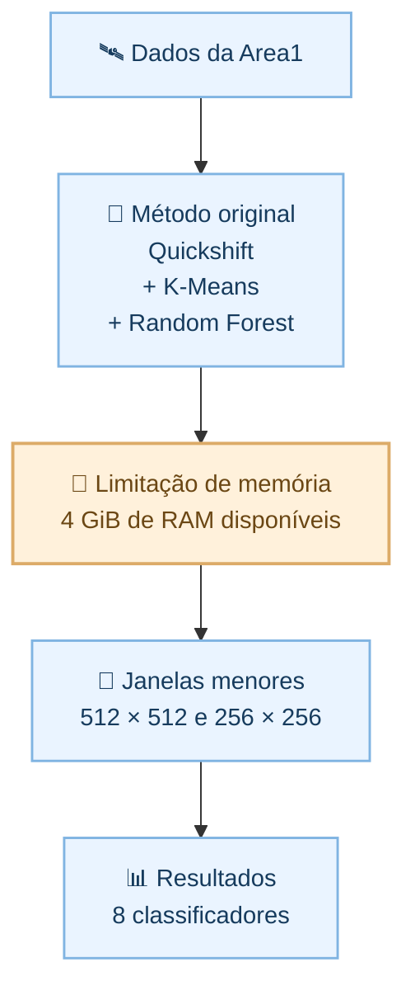
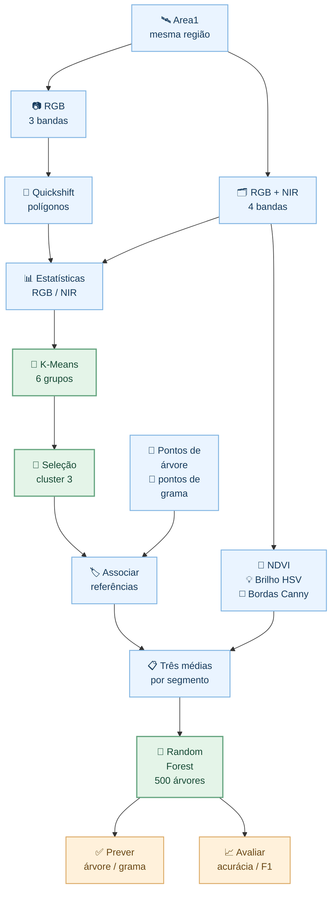
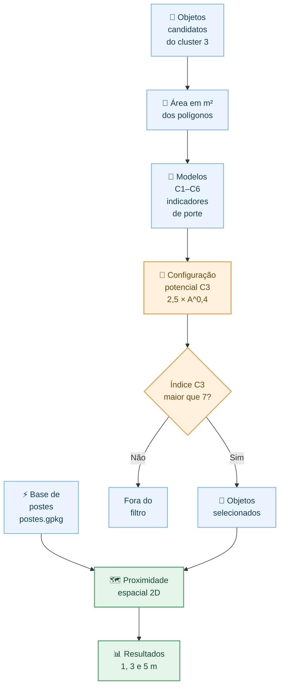
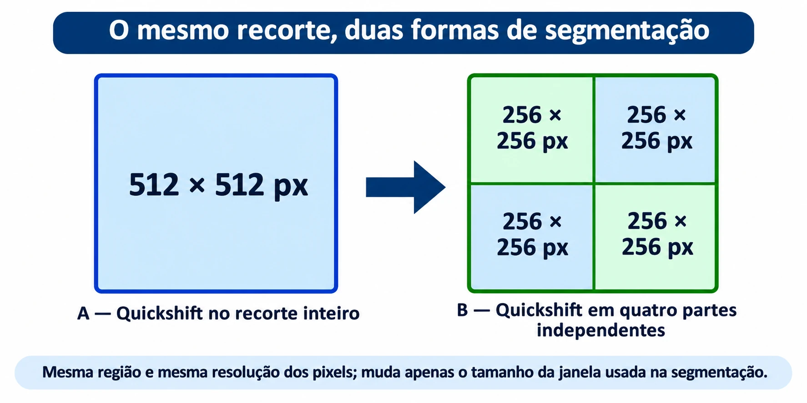
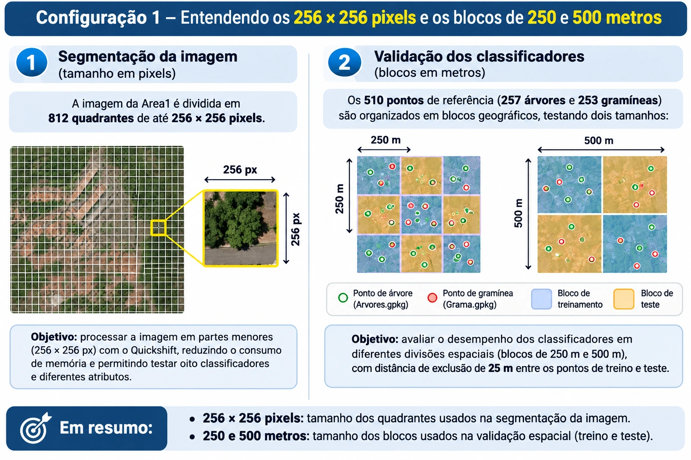

# Projeto de mestrado: Combinação de Características de Brilho, Bordas e NDVI para Detecção de Árvores Urbanas e Avaliação de Proximidade com Linhas de Energia

**Pesquisa de mestrado — Breno Braga Galvão | Em desenvolvimento**

Esta pesquisa investiga duas propostas complementares a partir de **uma única área de estudo (Area1)** em Caxias do Sul (RS):

| Proposta | Pergunta central | Resultado buscado |
|---|---|---|
| **🌳 Proposta 1 — Identificação da vegetação** | Como distinguir **árvores e gramíneas** por características de imagens de satélite? | Objetos classificados como árvore ou gramínea. |
| **⚡ Proposta 2 — Porte e proximidade de postes** | Quais objetos candidatos apresentam **indicador empírico de porte** acima do limiar e ficam próximos de postes? | Seleção exploratória e distâncias 2D a postes, **sem comprovação de risco elétrico**. |

### Roteiro de leitura

## Por que mudamos o método? A memória RAM foi o limite

**Primeiro, o método original:** aplicamos **Quickshift à imagem RGB inteira**, seguido de **K-Means (seis grupos, com seleção do cluster 3)** e **Random Forest (500 árvores)**. A execução histórica alcançou **acurácia de 0,87 em 92 exemplos de teste**, com um consumo de **5,42 GiB de memória RAM**, valor superior aos **4 GiB disponíveis** no ambiente atual, o que motivou a adoção de uma nova estratégia de processamento com janelas menores.

**Depois, tentamos repetir o Quickshift global** para comparar outros algoritmos nas mesmas condições. A imagem tem **6.942 × 7.294 pixels (50.634.948 pixels)**. Em um ambiente com **4 GiB de RAM**, a tentativa **não concluiu**: houve `MemoryError` quando o Quickshift precisou alocar **mais 1,13 GiB** para uma matriz temporária. Como o erro ocorreu **durante a segmentação**, essa nova tentativa **nem chegou ao K-Means ou ao Random Forest**.

### Quanto de memória foi necessário ou observado?

| Situação | Memória RAM | O que esse número significa? |
|---|---:|---|
| **Método original completo: Quickshift + K-Means + Random Forest** | **5,42 GiB** | **Memória de 5,42 GiB**, valor adotado como referência para o processamento da imagem completa pelo método original. |
| **Nova tentativa do Quickshift global** | **1,13 GiB adicionais solicitados; falhou** | A tentativa **não concluiu**: houve `MemoryError` quando o Quickshift precisou alocar **mais 1,13 GiB** para uma matriz temporária. |
| **Quickshift em um recorte de 2.048 × 2.048 pixels** | **Cerca de 687 MB de pico** | Medição em um recorte maior, que conseguiu concluir; não equivale à imagem inteira. |
| **119 recortes de até 512 × 512 pixels, um após o outro** | **467,19 MiB de pico** | Medição do processo na comparação entre tamanhos de janela. |
| **Os mesmos 119 recortes divididos em até quatro partes de 256 × 256** | **456,80 MiB de pico** | Medição do mesmo tipo de processo; redução observada de **10,38 MiB (2,22%)**. |

**Decisão:** em vez de insistir no Quickshift global, passamos a **dividir a imagem em janelas menores, sem reduzir a resolução dos pixels**. Isso viabilizou comparar oito classificadores com exemplos e testes equivalentes **dentro de cada novo experimento**. Não significa que reproduzimos o método global original.

---

## 1. Área de estudo e dados utilizados

A Area1 utiliza **dois arquivos raster referentes essencialmente à mesma região**, e não duas áreas de estudo:

| Arquivo raster | Bandas | O que o código faz com ele |
|---|---|---|
| `AOI_RGB_NEW.tif` | **RGB — 3 bandas** (vermelho, verde, azul) | Alimenta o **Quickshift** para criar regiões/polígonos. |
| `AOI_NEW_MULTI.tif` | **RGB + NIR — 4 bandas** | Fornece estatísticas RGB/NIR, NDVI, brilho HSV e bordas Canny. |

**Os arquivos têm papéis diferentes:** o RGB é usado para a segmentação; o RGB + NIR fornece atributos que descrevem os segmentos. As grades possuem um pequeno deslocamento entre suas origens, relevante para o alinhamento espacial.

### Dimensões e cobertura — imagem completa × área de estudo (AOI)

| Área / arquivo | Dimensões da grade (largura × altura) | Pixels na área | Área no terreno |
|---|---|---:|---:|
| **Imagem RGB completa** (`AOI_RGB_NEW.tif`) | **6.942 × 7.294 pixels** | **50.634.948** | **12,658737 km²** (≈ 12,66 km²) |
| **Imagem RGB + NIR completa** (`AOI_NEW_MULTI.tif`) | **6.942 × 7.294 pixels** | **50.634.948** | **12,658737 km²** (≈ 12,66 km²) |
| **Polígono AOI sobre o RGB** (área efetiva de estudo) | **6.942 × 7.294 pixels** (mesma grade) | **48.548.811** | **≈ 12,1372 km²** (≈ 12,14 km²) |
| **Polígono AOI sobre o RGB + NIR** (mesma área de estudo) | **6.942 × 7.294 pixels** (mesma grade) | **48.548.645** | **≈ 12,1372 km²** (≈ 12,14 km²) |

**Observação:** a **AOI usa a mesma grade de 6.942 × 7.294 pixels** das imagens. Como o polígono da área de estudo é irregular, **nem todos os pixels da grade pertencem à AOI**; por isso, a quantidade de pixels incluídos e a área em km² são menores.

### Resolução espacial e referência geográfica

| Característica | Valor |
|---|---|
| **Região da imagem** | **Caxias do Sul — Rio Grande do Sul, Brasil** |
| **Satélite atribuído na documentação** | **JL1KF01B** |
| **Disponibilização das imagens (conforme documentação da pesquisa)** | **CPFL** |
| **Dimensão de cada pixel no terreno** | **0,50 × 0,50 m** (50 × 50 cm) |
| **Área representada por pixel** | **0,25 m²** |
| **Dimensões do retângulo raster no terreno** | **3.471 m de largura × 3.647 m de altura** |
| **Sistema de coordenadas dos rasters** | **EPSG:31982** |

**Arquivos vetoriais de apoio:**

| Arquivo | Finalidade |
|---|---|
| `AOI_new.shp` e auxiliares | Polígono da área de interesse |
| `Arvores.gpkg` | **257 pontos de referência de árvores** |
| `Grama.gpkg` | **253 pontos de referência de gramíneas** |
| `postes.gpkg` | Localização dos postes |

Portanto, existem **510 pontos de referência**. Isso **não significa 510 objetos ou 510 registros de treinamento**: o Quickshift cria segmentos, que depois são associados aos pontos conhecidos.

**Esses pontos são dados originais da Area1:** já existiam nos arquivos `Arvores.gpkg` e `Grama.gpkg` e também foram utilizados no estudo inicial. Na V2 **reutilizamos somente a localização e a classe conhecida desses pontos**, não os segmentos escolhidos pelo K-Means, o Random Forest treinado, as previsões nem a acurácia de 0,87 do estudo inicial.

Os dez arquivos originais permanecem no [Google Drive — Area1](https://drive.google.com/drive/folders/1asqPz9xFr7dlnK1ggvrwftXEbkhvwjg6). Veja o [detalhamento dos arquivos e coordenadas](data/README.md).

---

## 2. 🌳 Proposta 1 — Identificação de árvores e gramíneas

**Objetivo:** classificar objetos vegetados em **árvore** ou **gramínea**, combinando NDVI, brilho HSV e bordas Canny.

### Como o código original realiza essa proposta

**Leitura do fluxo:** o **RGB** produz os polígonos; o **RGB + NIR** fornece os atributos; as referências identificam os exemplos; o **Random Forest** gera as previsões e as métricas.

**O que está acontecendo:** o Quickshift divide a imagem RGB em segmentos; o K-Means utiliza **quatro médias e quatro desvios-padrão RGB/NIR** e seleciona os objetos do **cluster 3**. Os pontos conhecidos identificam exemplos de árvores e gramíneas. O Random Forest recebe **três valores médios por objeto** — **brilho HSV, bordas Canny e NDVI** — para aprender a distinguir as duas classes.

**Parâmetros do método original:**

| Etapa | Configuração |
|---|---|
| Quickshift sobre o RGB completo | `kernel_size=3`, `max_dist=5`, `ratio=0.04` |
| K-Means | **6 clusters**, `random_state=42`, `n_init=10`; escolha do **cluster 3** |
| Random Forest | **500 árvores**, `random_state=42` |
| Treino/teste | Aleatório **80%/20%**, `random_state=42`, sem estratificação |

O método original processa aproximadamente 50 milhões de pixels, agrupando-os em segmentos por meio do Quickshift. A classificação pelo Random Forest utiliza características desses segmentos, e não os pixels individualmente. Na execução histórica, foram utilizados 458 registros rotulados, divididos aleatoriamente entre treinamento (366) e teste (92). Entretanto, o código não separava geograficamente os exemplos de treinamento e teste, o que pode influenciar a avaliação do desempenho do modelo.

### Resultados da Proposta 1

Os valores abaixo foram **registrados em execuções anteriores**:

| Indicador | Experimento inicial | Experimento com área maior |
|---|---:|---:|
| Pares objeto–rótulo | **133** | **458** |
| Treinamento | 106 | 366 |
| Teste | 27 | 92 |
| **Acurácia** | **0,81** | **0,87** |
| F1 — árvores | 0,80 | 0,85 |
| F1 — gramíneas | 0,83 | 0,88 |
| **F1-macro (aproximado)** | **≈ 0,815** | **≈ 0,865** |

*O F1-macro foi aproximado pela média dos F1 das duas classes, que já estão arredondados na tabela. Os valores exatos exigem as métricas originais sem arredondamento.*

**Por que são 510 pontos de referência, mas 458 registros na rodada maior?** O código mantém apenas objetos do **cluster 3** e os associa espacialmente aos pontos conhecidos. O resultado é uma tabela de **pares objeto–rótulo**: um ponto pode não ter candidato e um segmento pode gerar mais de uma associação.

Os **458 registros** geraram **366 exemplos de treinamento e 92 de teste**. A acurácia de **0,87** corresponde a esse conjunto de 92 testes. A primeira rodada de **133 registros** utilizou outras amostras; o aumento de **0,81 para 0,87**.

---

## 3. ⚡ Proposta 2 — Indicador de porte e proximidade com postes

**Objetivo:** calcular um indicador experimental de porte dos objetos e verificar sua **proximidade horizontal** aos postes da Area1.

### Como o código original realiza essa proposta

**Leitura do fluxo:** o índice **C3** é calculado a partir da área dos candidatos; apenas quem passa pelo limiar entra na análise de **distâncias aos postes**. A fórmula e os detalhes do filtro aparecem abaixo.

**No fluxograma, a “Base de postes” é o arquivo `postes.gpkg`**, utilizado como entrada independente para calcular a proximidade dos objetos selecionados.

O código calcula a área dos polígonos, testa **seis configurações empíricas (C1–C6)** nas formas potencial e linear e usa o índice potencial **C3** na seleção:

$$
\widehat{H}_{C3} = 2{,}5 \cdot A^{0{,}4}
$$

Nessa expressão, **A** é a área projetada do polígono, em **m²**. No código, o cálculo é escrito como `2.5 * (area ** 0.4)`.

Depois aplica o filtro `Power_tree_size_C3 > 7` e calcula a proximidade dos objetos selecionados a **1, 3 e 5 metros dos pontos dos postes**, usando `sjoin_nearest`.

**Ponto importante para a banca:** a Proposta 2 usa os **candidatos do cluster 3**, e o código histórico **não exige `predicted_classe == 'arvore'`** nesse filtro. Portanto, os objetos selecionados **não são necessariamente apenas árvores previstas pelo Random Forest**.

**Limites científicos:** o índice C3 **não é altura real validada**, as distâncias são **2D até postes** e a Area1 **não possui a geometria dos cabos**. Não se pode interpretar esse resultado como **interferência em fios ou risco elétrico comprovado**. [Ver as fórmulas C1–C6 e suas limitações](docs/allometria.md).

---

## 4. Imagem completa — as 17 etapas do código original

A ilustração horizontal abaixo apresenta as **17 etapas do código original**, com a **Proposta 1** (classificação) e a **Proposta 2** (índice de porte e proximidade com postes) identificadas. Os resultados exibidos na etapa 12 são os valores **históricos da aplicação inicial**: acurácia **0,87** e F1 de árvores **0,85**.

  

**Para visualizar a imagem ampliada:** clique no infográfico para abrir em tamanho original. No README, ele ocupa a largura disponível da página.

[**Abrir o infográfico horizontal ampliado (17 etapas)**](docs/fluxo_17_etapas_horizontal_corrigido.png)

Este esquema representa o **notebook original**. Os experimentos posteriores da V2, com segmentação em quadrantes, têm protocolos próprios e estão explicados **na última seção**.

## 5. Código e documentação técnica

| Material | Conteúdo |
|---|---|
| [Notebook original](Segmentacao_area_completa.ipynb) | Quickshift global, K-Means, Random Forest e proximidade |
| [Notebook V2](https://github.com/BrenoBragaGalvao/mestrado-arvores-urbanas/blob/main/Segmentacao_area_completa_v2_experimentos.ipynb) | **Versão experimental com três configurações de processamento**, todas usando a imagem e os pontos de referência originais, **sem reduzir a resolução dos pixels**:    **(1) Área completa em 812 quadrantes de até 256 × 256 pixels:** aplica Quickshift por quadrante, em lotes com resultados intermediários salvos para controlar o consumo de memória RAM; depois permite avaliar **oito classificadores pelo F1-macro** e investigar combinações de **NDVI, brilho HSV e bordas Canny**.    **(2) Os 119 recortes de até 512 × 512 pixels:** entre 210 janelas possíveis, seleciona as 119 com pontos conhecidos, aplica Quickshift ao recorte inteiro e avalia **o F1-macro dos oito classificadores**.    **(3) Os mesmos 119 recortes subdivididos em até quatro partes de 256 × 256 pixels:** aplica Quickshift separadamente em cada parte e avalia novamente **os oito classificadores**, para comparar **F1-macro e pico de memória RAM** com a configuração 2, usando as mesmas referências e divisões espaciais de treino/teste.    **Organização no notebook:** a configuração 1 é um caminho progressivo independente; as configurações 2 e 3 são os dois testes de uma mesma comparação controlada. A rota progressiva oferece ainda análises opcionais de porte e proximidade com postes. **O código está implementado, mas a publicação do notebook não comprova uma nova execução integral dos 812 quadrantes.** O método original com Quickshift global permanece preservado em outro notebook. |
| [Dados Area1](data/README.md) | Arquivos, coordenadas e estrutura do Drive |
| [Registro do método original](docs/experimento_area_completa.md) | Parâmetros, resultados históricos e limitações |
| [Detalhes da tentativa com imagem completa](docs/e10_teste_execucao_local.md) | Execução do Quickshift global e erro por insuficiência de memória |
| [Classificadores e protocolos de avaliação](docs/harmonizacao_protocolos.md) | Comparações de modelos e validação espacial |
| [Comparação das segmentações de 512 e 256 pixels](docs/comparacao_controlada_segmentacao_512_vs_256.md) | Comparação pareada da segmentação |
| [Medição real dos recortes](docs/e9_medicao_memoria.md) | Pico de memória observado nos 119 recortes, com janelas de 512 e 256 pixels |
| [Estimativas C1–C6](docs/allometria.md) | Fórmulas exploratórias de porte |

---

## 6. Como saímos do método original e comparamos oito algoritmos?

Partimos da **imagem original da Area1 (6.942 × 7.294 pixels)** e dos **510 pontos georreferenciados** já conhecidos: **257 árvores** (`Arvores.gpkg`) e **253 gramíneas** (`Grama.gpkg`). A imagem inteira exigia muita memória RAM para repetir o Quickshift global; por isso, organizamos **quatro formas de processamento**, com objetivos complementares:

1. **Método original — imagem inteira:** Quickshift global → K-Means (seis grupos, seleção do cluster 3) → Random Forest. **Por quê?** Estabelecer o resultado inicial da classificação de árvores e gramíneas.
2. **Quadrantes de 256 × 256 pixels — área completa:** a imagem é organizada em **812 quadrantes**, com Quickshift por quadrante e extração de NDVI, brilho HSV e bordas Canny. **Por quê?** Reduzir a demanda de RAM e investigar **oito classificadores**, combinações de atributos e **F1-macro** com validação espacial.
3. **Recortes inteiros de 512 × 512 pixels — 119 regiões:** entre **210 janelas possíveis**, selecionamos as **119 que contêm pontos de referência conhecidos** e aplicamos Quickshift em cada recorte inteiro. **Por quê?** Avaliar os oito classificadores pelo **F1-macro** nessa escala de segmentação.
4. **Os mesmos 119 recortes subdivididos em 256 × 256 pixels:** dividimos cada recorte em até quatro partes e aplicamos Quickshift separadamente, avaliando os mesmos oito classificadores. **Por quê?** Comparar diretamente com a forma 3 o **F1-macro** e o consumo de memória RAM, mantendo os mesmos pontos e divisões espaciais de treino e teste.

**Importante:** as formas **3 e 4 são os dois testes de uma mesma comparação controlada**. Nos experimentos novos, reutilizamos **a imagem e os pontos originais**, mas não os segmentos do K-Means, o Random Forest treinado ou suas previsões. Os **119 recortes foram escolhidos pelas coordenadas das referências**, nunca pelos acertos do modelo. Há resultados documentados para baterias derivadas de quadrantes de 256 pixels; isso não comprova a conclusão de uma nova execução integral da rotina progressiva dos 812 quadrantes na V2.

  

*Figura — Visão geral dos três experimentos da Area1: método original, processamento por 812 quadrantes de 256 × 256 pixels e comparação controlada dos 119 recortes de até 512 × 512 pixels, também segmentados em partes de 256 × 256 pixels.*

**Perguntas que orientaram os testes**

| Pergunta | Como investigamos? |
|---|---|
| **1. Por que dividimos a imagem?** | Tentamos repetir o Quickshift global com limite de **4 GiB de RAM**, mas faltou memória. Passamos a processar partes menores, preservando os pixels originais. |
| **2. Por que escolhemos exatamente 119 recortes?** | Reutilizamos as **coordenadas dos 510 pontos de referência originais** (arquivos `Arvores.gpkg` e `Grama.gpkg`), **não as previsões do K-Means ou do Random Forest**. Na grade de até **512 × 512 pixels**, esses pontos ocupam **119 janelas distintas**, onde podemos avaliar a classificação. |
| **3. Qual algoritmo classifica melhor?** | Comparamos **oito classificadores**: **(1)** Random Forest; **(2)** SVM com kernel RBF; **(3)** regressão logística; **(4)** Extra Trees; **(5)** KNN (7 vizinhos); **(6)** HistGradientBoosting; **(7)** Gaussian Naive Bayes; e **(8)** Dummy (modelo de referência simples). Todos foram avaliados com os **mesmos exemplos, atributos e divisões espaciais de treinamento e teste**, permitindo comparar o desempenho pelo **F1-macro**. |
| **4. Dividir cada recorte em quatro partes muda os resultados ou a memória?** | Usamos as **mesmas 119 regiões** para descobrir se o tamanho da janela influencia os resultados. Primeiro, aplicamos o Quickshift nos recortes inteiros de **até 512 × 512 pixels**; depois, dividimos esses mesmos recortes em até quatro partes de **256 × 256 pixels**. Assim, podemos verificar **qual estratégia oferece melhor F1-macro para os oito classificadores e qual consome menos memória RAM**, mantendo as mesmas referências e condições de avaliação. |
| **5. NDVI, brilho HSV e bordas Canny funcionam melhor juntos?** | Comparamos **sete combinações** dos três atributos: **(1)** apenas NDVI; **(2)** apenas brilho HSV; **(3)** apenas bordas Canny; **(4)** NDVI + brilho HSV; **(5)** NDVI + bordas Canny; **(6)** brilho HSV + bordas Canny; e **(7)** NDVI + brilho HSV + bordas Canny. Todas as combinações foram avaliadas com os mesmos classificadores e as mesmas divisões espaciais de treinamento e teste, para identificar quais características proporcionam melhores resultados na classificação de árvores e gramíneas. |

### 6.1. Por que deixamos de processar a imagem inteira?

**No método original**, aplicamos **Quickshift na imagem inteira → K-Means (6 grupos, cluster 3) → Random Forest**, obtendo **F1 de 0,85 para árvores e F1-macro aproximado de 0,865**.

**Por que mudamos?** Ao tentar repetir a segmentação global, faltou memória RAM antes das etapas de K-Means e Random Forest. O erro indicou uma tentativa de alocação **adicional de 1,13 GiB** — **não** o consumo total do método. Como a imagem tem cerca de **50,6 milhões de pixels**, passamos a executar o Quickshift em partes menores, **sem reduzir a resolução dos pixels**.

Na **V2**, investigamos três configurações de segmentação:

| Configuração | Área processada | Objetivo |
|---|---|---|
| **Quadrantes de até 256 × 256 px** | **812 quadrantes** (28 × 29), cobrindo a imagem inteira | Processar progressivamente com menos demanda de RAM e comparar **oito classificadores** e combinações de atributos. |
| **Recortes inteiros de até 512 × 512 px** | **119 recortes com referências**, selecionados entre **210 janelas possíveis** (14 × 15) | Calcular o **F1-macro dos oito classificadores** com Quickshift aplicado ao recorte inteiro. |
| **Os mesmos recortes, subdivididos em até quatro partes de 256 × 256 px** | As **mesmas 119 regiões e referências** da linha anterior | Verificar como a subdivisão altera o **F1-macro** e o **pico de memória RAM**. |

**A diferença essencial:** os **812 quadrantes cobrem toda a imagem**; já os **119 recortes** são apenas as regiões da grade de 512 px que contêm pontos de referência conhecidos. As duas últimas configurações formam **uma comparação controlada**.

  

### 6.2. Por que selecionamos exatamente 119 recortes?

O número de **119 recortes não foi definido previamente**. Ele surgiu a partir da localização dos **510 pontos de referência já conhecidos** da Area1, sendo **257 árvores** (`Arvores.gpkg`) e **253 gramíneas** (`Grama.gpkg`), utilizados também no método original.

Para entender como chegamos a esse número, seguimos cinco etapas:

1. **Dividimos a imagem em uma grade de 512 × 512 pixels**, formando **210 janelas possíveis** (14 colunas × 15 linhas). As janelas nas bordas podem ter dimensões menores.
2. **Localizamos os 510 pontos de referência** nessa grade, identificando em qual janela cada árvore ou gramínea estava. Uma mesma janela pode conter vários pontos.
3. **Selecionamos somente as janelas que continham pelo menos um ponto conhecido.** Das 210 janelas possíveis, **119 tinham referências** e as outras 91 não tinham pontos rotulados para avaliar os classificadores.
4. **Processamos os 119 recortes inteiros**, aplicando Quickshift em janelas de até **512 × 512 pixels** e avaliando o **F1-macro dos oito classificadores**.
5. **Processamos novamente as mesmas 119 regiões**, mas dividindo cada recorte em até quatro partes de **256 × 256 pixels**, para comparar o **F1-macro e o consumo de memória RAM** com a estratégia anterior.

**Por que isso é importante?** Porque utilizamos **as mesmas regiões, os mesmos pontos conhecidos e as mesmas condições de avaliação** nas duas estratégias. Assim, conseguimos investigar se **alterar o tamanho da janela de segmentação influencia a qualidade da classificação e o consumo de memória**, sem confundir essa diferença com mudanças na região analisada.

### 6.3. Como separamos treinamento e teste nas quatro formas de aplicar Quickshift?

**Primeiro, uma distinção:** os **256 × 256 e 512 × 512 pixels** indicam o tamanho das janelas usadas na **segmentação da imagem**. Já o treinamento e o teste são separados **depois**, a partir dos exemplos rotulados associados aos pontos conhecidos de árvores e gramíneas. Nas avaliações mais recentes, usamos também a localização geográfica desses exemplos para reduzir a influência da proximidade espacial.

| Forma de processamento | Exemplos usados para avaliar | Como separamos treinamento e teste? |
|---|---|---|
| **1. Método original: Quickshift na imagem inteira + K-Means + Random Forest** | **458 pares objeto–rótulo**, derivados da seleção do cluster 3 e da associação com as referências. | Divisão **aleatória de 80% para treinamento e 20% para teste**: **366 registros de treino e 92 de teste**, com semente fixa (`random_state=42`). **Não houve separação por localização geográfica** nem exclusão de 25 m. |
| **2. Quadrantes de até 256 × 256 pixels (grade de 812)** | **505 segmentos rotulados únicos** na bateria de resultados já documentada. | **Validação espacial:** agrupamos os exemplos em blocos geográficos de **250 m** e, separadamente, **500 m**. Em cada escala, realizamos **cinco divisões**, destinando aproximadamente **80% dos grupos ao treino e 20% ao teste**. Excluímos do treinamento objetos a até **25 m das geometrias de teste**. |
| **3. Os 119 recortes inteiros de até 512 × 512 pixels** | **505 referências comuns**, após eliminar associações repetidas entre os dois modos de segmentação. | **Validação espacial:** cinco divisões com blocos de **250 m** e cinco com blocos de **500 m**, reservando cerca de **20% dos grupos para teste**. Aplicamos exclusão de **25 m entre os pontos de treino e teste**. |
| **4. Os mesmos 119 recortes subdivididos em até quatro partes de 256 × 256 pixels** | **As mesmas 505 referências** da forma 3. | **Exatamente as mesmas divisões geográficas e os mesmos exemplos de treino e teste da forma 3**, com exclusão de 25 m entre pontos. Assim, o que muda entre as formas 3 e 4 é **a segmentação**, não a seleção dos exemplos. |

**Por que usamos blocos de 250 e 500 metros?** Para avaliar os classificadores em **grupos de locais diferentes** daqueles utilizados no treinamento. Testamos os dois tamanhos de bloco para verificar como a distribuição geográfica dos exemplos influencia o **F1-macro**. Os blocos são medidos em **metros**, enquanto as janelas do Quickshift são medidas em **pixels**.

**E os 25 metros?** Depois de escolher os exemplos de teste, retiramos do conjunto de **treinamento** os exemplos demasiado próximos deles. Na bateria da forma 2, a distância foi considerada entre **geometrias dos segmentos**; nas formas 3 e 4, entre **pontos de referência**. Isso torna as duas formas de validação semelhantes em objetivo, mas **não idênticas**. Além disso, como a exclusão remove exemplos do treino, **a quantidade final de objetos treinados pode variar de uma divisão para outra**: 80%/20% refere-se à seleção dos grupos, não necessariamente à contagem exata de objetos após a exclusão.

**O que podemos comparar diretamente?** Os **oito classificadores são avaliados com as mesmas divisões dentro de cada protocolo**, mas somente as **formas 3 e 4** compartilham exatamente as mesmas referências e divisões entre as estratégias de segmentação. O resultado histórico da forma 1 não é diretamente comparável aos F1-macro das novas formas. Os resultados publicados da forma 2 vieram de uma bateria anterior; **a execução integral da rota progressiva atual dos 812 quadrantes no Notebook V2 ainda não foi confirmada** e essa rota utiliza exclusão por **centroides**, em vez de geometrias completas.

### 6.4. Resultados dos oito classificadores nas três configurações

As tabelas apresentam o **F1-macro médio** dos oito classificadores: quanto maior o valor, melhor o equilíbrio entre as classes árvore e gramínea. Em cada configuração, usamos **cinco divisões espaciais** com blocos de **250 m e 500 m** e **embargo de 25 m**. **Esses metros definem a separação geográfica entre treino e teste; não são os tamanhos dos recortes em pixels.**

  

  

#### 6.4.1. Configuração 1 — imagem organizada em 812 quadrantes de até 256 × 256 pixels

Os resultados abaixo vêm da **bateria já documentada com Quickshift por quadrantes de 256 px**, usando **505 segmentos rotulados únicos**, os três atributos **NDVI + brilho HSV + bordas Canny** e embargo espacial por **geometrias**. Essa bateria é derivada da grade de 812 quadrantes, mas **não comprova uma nova execução integral da rota progressiva atual do Notebook V2**.

| Classificador | F1-macro — blocos de 250 m | F1-macro — blocos de 500 m |
|---|---:|---:|
| SVM RBF | **0,8987** | **0,8668** |
| Regressão logística | 0,8928 | 0,8664 |
| Extra Trees | 0,8790 | 0,8629 |
| KNN (7) | 0,8874 | 0,8502 |
| Random Forest | 0,8656 | 0,8530 |
| HistGradientBoosting | 0,8556 | 0,8524 |
| Gaussian Naive Bayes | 0,8555 | 0,8398 |
| Dummy (referência simples) | 0,2980 | 0,2799 |

**Resultado:** o **SVM RBF** teve o maior F1-macro médio nas duas escalas de blocos dessa bateria.

#### 6.4.2. Configuração 2 — 119 recortes inteiros de até 512 × 512 pixels

Selecionamos as **119 regiões com pontos de referência**, entre as 210 janelas possíveis, e aplicamos **Quickshift em cada recorte inteiro**. Os valores abaixo vêm da comparação controlada E9, com **505 referências comuns** após deduplicação e embargo de **25 m entre pontos**.

| Classificador | F1-macro — blocos de 250 m | F1-macro — blocos de 500 m |
|---|---:|---:|
| Extra Trees | 0,9064 | **0,8747** |
| SVM RBF | **0,9157** | 0,8518 |
| Regressão logística | 0,9153 | 0,8484 |
| Random Forest | 0,8906 | 0,8657 |
| Gaussian Naive Bayes | 0,8894 | 0,8573 |
| KNN (7) | 0,8940 | 0,8377 |
| HistGradientBoosting | 0,8738 | 0,8390 |
| Dummy | 0,2847 | 0,2791 |

#### 6.4.3. Configuração 3 — os mesmos 119 recortes subdivididos em até quatro partes de 256 × 256 pixels

Processamos **exatamente as mesmas regiões** da configuração 2, agora com Quickshift independente em cada parte. Usamos os **mesmos 505 exemplos e as mesmas divisões de treino e teste**, mudando somente a forma de segmentar.

| Classificador | F1-macro — blocos de 250 m | F1-macro — blocos de 500 m |
|---|---:|---:|
| SVM RBF | **0,9341** | 0,8641 |
| Regressão logística | 0,9157 | **0,8685** |
| Extra Trees | 0,8968 | 0,8545 |
| KNN (7) | 0,9009 | 0,8486 |
| Random Forest | 0,8835 | 0,8566 |
| Gaussian Naive Bayes | 0,8875 | 0,8464 |
| HistGradientBoosting | 0,8714 | 0,8411 |
| Dummy | 0,2847 | 0,2791 |

**Como interpretar os resultados?** Em cada configuração, os oito classificadores estão organizados pela média do F1-macro nos blocos espaciais de 250 e 500 metros. Essa média serve apenas para ordenar a tabela; os melhores valores de cada coluna estão destacados em negrito.

**O que descobrimos?** Na comparação dos mesmos 119 recortes, os resultados variaram conforme o tamanho da segmentação e o classificador. Com blocos de **250 m**, o melhor resultado foi do **SVM RBF com recortes subdivididos em 256 × 256 pixels (F1-macro = 0,9341)**. Com blocos de **500 m**, destacou-se o **Extra Trees com recortes inteiros de 512 × 512 pixels (F1-macro = 0,8747)**. Portanto, **não existe uma única estratégia superior em todas as condições**.

**Quais resultados podemos comparar diretamente?** As configurações **2 e 3** utilizam as mesmas 119 regiões, os mesmos pontos de referência, atributos e divisões de treinamento e teste. Assim, permitem avaliar especificamente o efeito do tamanho da segmentação. Já a **configuração 1** utiliza outro protocolo experimental, e seus resultados devem ser analisados separadamente.

### 6.5. NDVI + brilho HSV + bordas Canny: os três juntos são melhores?

Para verificar se **NDVI** realmente acrescenta informação, comparamos duas condições **fixas**: **(A) brilho HSV + bordas Canny** e **(B) NDVI + brilho HSV + bordas Canny**. Os mesmos segmentos rotulados, os mesmos classificadores e as mesmas partições de treino e teste foram utilizados em cada comparação. Portanto, **"HSV + Canny" é a dupla escolhida para comparação, e não necessariamente a melhor dupla entre todas as opções**.

**O que representa cada atributo?**

- **NDVI (`mean_ndvi`):** índice espectral calculado a partir do vermelho e do infravermelho próximo (NIR), relacionado à resposta da vegetação.
- **Brilho HSV (`mean_intensity`):** medida média de intensidade/valor da cor no segmento.
- **Bordas Canny (`mean_edges`):** média do mapa de bordas detectadas, relacionada às transições locais de intensidade/contorno.

A comparação E4b foi realizada a partir da **bateria derivada de 812 quadrantes de 256 × 256 pixels**. Ela reutiliza a base já rotulada de **505 segmentos únicos**, formada a partir dos **510 pontos de referência existentes** da Area1. Foram realizados **160 ajustes e avaliações pareadas** (8 modelos × 2 conjuntos de atributos × 2 escalas espaciais × 5 divisões), com blocos de **250 m e 500 m** e **embargo espacial de 25 m entre as geometrias de teste e os objetos de treinamento**. As médias abaixo são de **F1-macro**, dando o mesmo peso a árvores e gramíneas.

**Blocos espaciais de 250 m — média de cinco divisões**

| Classificador | HSV + Canny | NDVI + HSV + Canny | Ganho ao acrescentar NDVI |
|---|---:|---:|---:|
| **SVM RBF** | 0,7523 | **0,8987** | **+0,1464** |
| Regressão logística | 0,7556 | **0,8928** | +0,1372 |
| KNN (7) | 0,7445 | **0,8874** | +0,1429 |
| Extra Trees | 0,7008 | **0,8790** | +0,1782 |
| **Random Forest** | 0,6925 | **0,8656** | +0,1731 |
| HistGradientBoosting | 0,7206 | **0,8556** | +0,1349 |
| Gaussian Naive Bayes | 0,7409 | **0,8555** | +0,1146 |
| Dummy (maioria) | 0,2980 | 0,2980 | 0,0000 |

**Ordem dos modelos:** F1-macro médio decrescente da combinação **NDVI + HSV + Canny** nos blocos de 250 m. A dupla HSV + Canny permanece fixa para comparação.

**Blocos espaciais de 500 m — média de cinco divisões**

| Classificador | HSV + Canny | NDVI + HSV + Canny | Ganho ao acrescentar NDVI |
|---|---:|---:|---:|
| **SVM RBF** | 0,7886 | **0,8668** | **+0,0781** |
| Regressão logística | 0,7992 | **0,8664** | +0,0671 |
| Extra Trees | 0,7208 | **0,8629** | +0,1421 |
| **Random Forest** | 0,7264 | **0,8530** | +0,1266 |
| HistGradientBoosting | 0,7327 | **0,8524** | +0,1197 |
| KNN (7) | 0,7678 | **0,8502** | +0,0824 |
| Gaussian Naive Bayes | 0,7699 | **0,8398** | +0,0700 |
| Dummy (maioria) | 0,2799 | 0,2799 | 0,0000 |

**Ordem dos modelos:** F1-macro médio decrescente da combinação **NDVI + HSV + Canny** nos blocos de 500 m.

### 6.6. Qual configuração consome menos memória RAM?

A comparação controlada E9 mediu o **pico de memória RAM (RSS)** durante o processamento sequencial dos **mesmos 119 recortes** nas duas estratégias:

| Estratégia de segmentação | Pico de memória RAM |
|---|---:|
| **119 recortes inteiros de até 512 × 512 px** | **467,19 MiB** |
| **Mesmos 119 recortes, subdivididos em até quatro partes de 256 × 256 px** | **456,80 MiB** |

**Resultado:** subdividir os recortes reduziu o pico registrado em aproximadamente **10,38 MiB (2,22%)**. Essa economia foi **pequena** no pico total do processo; a subdivisão também alterou o F1-macro, mas **não melhorou todos os classificadores** (veja a seção 6.4).

**Limite da medição:** esses números representam o **pico total de RAM dos processos que trataram os 119 recortes em sequência**, não a memória necessária para executar o Quickshift global original. **Não há medição diretamente equivalente publicada para a execução integral dos 812 quadrantes pela rota progressiva atual da V2.**

### 6.7. O que podemos concluir — e o que não podemos?

**Quais classificadores apresentaram os melhores resultados?** Avaliamos **oito algoritmos** e observamos que o desempenho depende tanto do modelo quanto da forma de segmentar a imagem. Na comparação entre os **mesmos 119 recortes**, o maior F1-macro com blocos espaciais de **250 m** foi do **SVM RBF**, utilizando partes de **256 × 256 pixels (0,9341)**. Com blocos de **500 m**, o melhor resultado foi do **Extra Trees**, utilizando recortes inteiros de **512 × 512 pixels (0,8747)**. Portanto, **nenhuma das duas formas de segmentação foi superior em todas as condições**.

**Usar NDVI, brilho HSV e bordas Canny juntos faz diferença?** **Sim, nos testes realizados.** Ao acrescentar o NDVI à combinação de brilho HSV e bordas Canny, o **F1-macro médio aumentou para os sete classificadores que utilizam os atributos**, tanto nos blocos de 250 m quanto nos de 500 m. O classificador Dummy permaneceu igual, pois não utiliza essas características para aprender. Em outra análise, testamos **as sete combinações possíveis** desses três atributos com **SVM RBF, Random Forest e regressão logística**; a combinação dos três alcançou a melhor média entre as alternativas avaliadas, nas duas escalas espaciais. **São análises complementares, realizadas com divisões de treino e teste diferentes**, e não devem ter suas médias misturadas.

**Dividir a imagem ajudou a economizar memória?** O processamento em partes menores permitiu trabalhar com a imagem sem repetir o Quickshift global, que havia apresentado erro por falta de RAM. Nos testes com os **119 recortes**, o pico de memória caiu de **467,19 MiB**, com recortes inteiros de 512 pixels, para **456,80 MiB**, com subdivisões de 256 pixels: uma redução de aproximadamente **2,22%**. A economia foi pequena nessa medição e **não representa o consumo do método original na imagem inteira**.

**Quais comparações são cientificamente válidas?** As configurações **2 e 3 podem ser comparadas diretamente**, pois usam as mesmas regiões, referências, atributos e divisões de treino e teste, mudando a forma de segmentação. A configuração **1 utiliza outro protocolo de avaliação** e seus valores não devem ser tratados como uma comparação controlada com as demais. Da mesma forma, **não podemos afirmar que a V2 superou o método original**: no experimento histórico, a acurácia foi **0,87**, enquanto as tabelas atuais apresentam **F1-macro** e foram produzidas com segmentos e estratégias de validação diferentes.

**O que ainda precisa ser validado?** Os resultados foram obtidos exclusivamente na **Area1**, sendo necessária a realização de testes em outras regiões para verificar se os modelos apresentam desempenho semelhante em diferentes áreas de estudo.

**E quanto ao porte das árvores e à proximidade de postes?** Essas análises são **exploratórias**. Sem medições reais de altura, geometria dos cabos e validação adicional, **não é possível concluir que exista risco elétrico**.

**Onde consultar os resultados e reproduzir os testes?** [Sete combinações de atributos](docs/E4_resumo_ablacao_812_quadrantes_2026-11-01.csv) · [Comparação entre dois e três atributos nos oito classificadores](docs/E4b_oito_modelos_HSV_Canny_vs_tres_2026-11-02.csv) · [Resultados detalhados das divisões espaciais](docs/E4b_oito_modelos_resultados_por_particao_2026-11-02.csv) · [Comparação dos oito classificadores](docs/harmonizacao_protocolos.md) · [Comparação entre recortes de 512 e 256 pixels](docs/comparacao_controlada_segmentacao_512_vs_256.md) · [Código de reprodução dos recortes](experimentos/e9_reproduzir_512_256.py) · [Medição de memória RAM](docs/e9_medicao_memoria.md).

