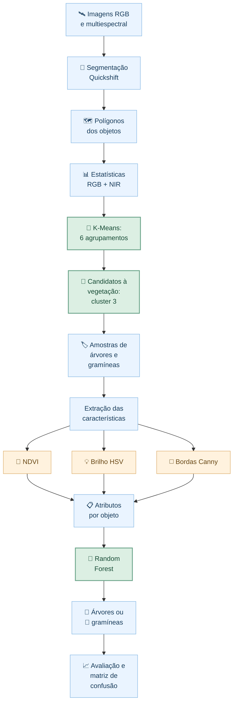
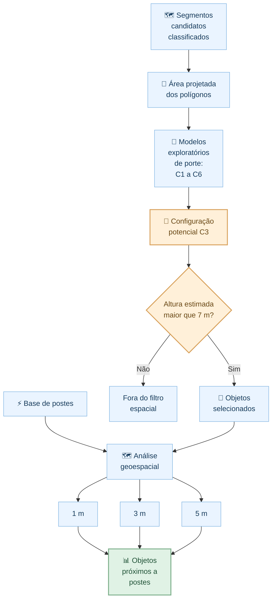
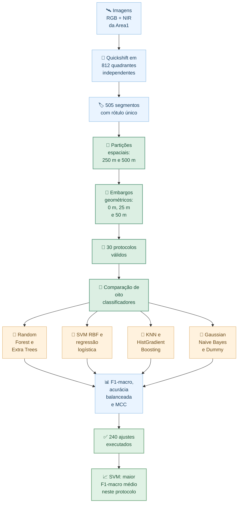
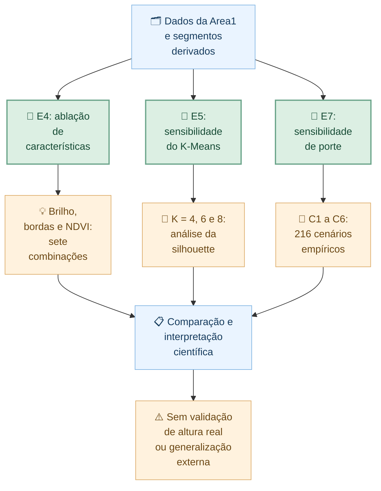
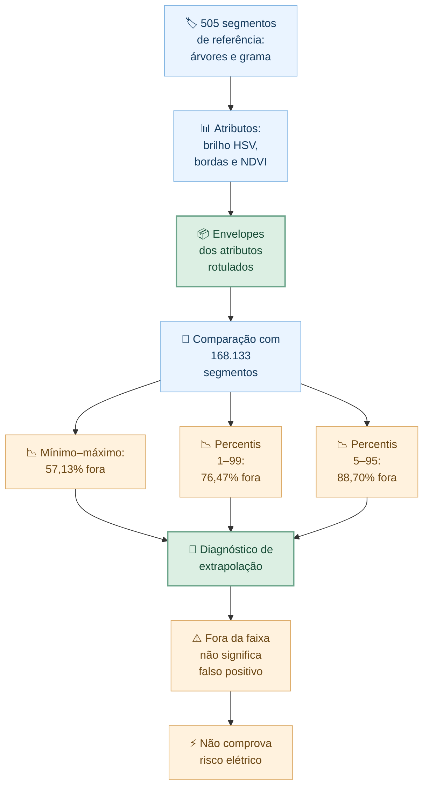
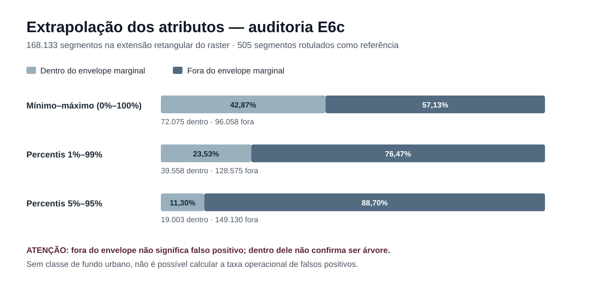

# Combinação de Características de Brilho, Bordas e NDVI para Detecção de Árvores Urbanas e Avaliação de Proximidade com Linhas de Energia

**Abordagem orientada a objetos para identificação de árvores urbanas em imagens multiespectrais de alta resolução e análise espacial de proximidade com a infraestrutura elétrica.**


## Visão geral

A vegetação arbórea é parte essencial da infraestrutura verde das cidades, mas sua localização e seu porte também são relevantes para o planejamento e a manutenção das redes elétricas. Identificar árvores em imagens aéreas e representar suas copas como objetos georreferenciados permite investigar a distribuição da vegetação e sua proximidade com elementos da infraestrutura urbana.

Esta pesquisa combina **segmentação de imagens, características espectrais e de textura, aprendizado de máquina e análise espacial**. O trabalho está organizado em **duas propostas complementares**:

- **Proposta 1 – Identificação de árvores e gramíneas:** reconhecer e diferenciar objetos vegetados em imagens de alta resolução, com foco na distinção entre árvores e gramíneas.
- **Proposta 2 – Proximidade com a rede elétrica:** analisar espacialmente a proximidade dos objetos identificados em relação à infraestrutura elétrica, utilizando os postes como referência na base de dados atual.

> **Escopo dos dados atuais:** a área de estudo contém a geometria dos **postes**, mas não dos cabos ou linhas de energia. Assim, a segunda proposta é investigada atualmente por meio da **proximidade com postes**, sem afirmar interferência efetiva nos fios.

## Propostas de pesquisa

### 🌳 Proposta 1 – Identificação de árvores e gramíneas

**Pergunta de pesquisa:** como distinguir árvores e gramíneas em imagens de alta resolução utilizando a combinação de NDVI, brilho e bordas em objetos segmentados?

A imagem RGB é dividida em regiões espacialmente coerentes pelo **Quickshift**. Para cada região, o código extrai estatísticas das bandas RGB e NIR e aplica **K-Means** para selecionar candidatos. Depois, utiliza amostras identificadas como árvores e gramíneas para treinar um **Random Forest** com três características complementares:

| Característica | O que representa | Por que utilizar |
|---|---|---|
| 🌿 **NDVI** | Resposta espectral relacionada à vegetação | Diferenciar padrões de cobertura vegetal |
| 💡 **Brilho (HSV)** | Intensidade luminosa observada na imagem | Representar diferenças radiométricas dos objetos |
| ◻️ **Bordas (Canny)** | Variações locais e contornos | Descrever aspectos estruturais e de textura |

**Desenho do processo de identificação**



A abordagem é **orientada a objetos**: em vez de tratar apenas pixels isolados, utiliza as propriedades dos segmentos, mantendo suas geometrias para a etapa espacial.

### ⚡ Proposta 2 – Proximidade com a rede elétrica

**Pergunta de pesquisa:** como utilizar os objetos identificados em imagens aéreas para apoiar a identificação de áreas de atenção próximas à infraestrutura elétrica urbana?

A pesquisa investiga a área projetada dos objetos e utiliza uma **estimativa empírica de altura**, calculada a partir dessa área, para selecionar candidatos a uma análise espacial. Em seguida, avalia a proximidade com os **postes**, em distâncias de **1, 3 e 5 metros**.

**Desenho do processo de análise espacial**



**Limites importantes:** a fórmula utilizada estima um possível porte a partir da área e **não mede diretamente a altura real da árvore**. No código atual, o filtro `C3 > 7` **não exige** que `predicted_classe == 'arvore'`; por isso, também podem passar objetos classificados como gramínea. A distância é medida em duas dimensões em relação aos postes, não aos cabos energizados.

## Contribuições metodológicas investigadas

A proposta reúne três elementos:

1. **Combinação de características complementares:** NDVI (espectral), brilho HSV (radiométrica) e bordas de Canny (estrutura e textura).
2. **Estratégia híbrida de agrupamento e classificação:** K-Means para pré-seleção dos candidatos e Random Forest para distinguir árvores e gramíneas.
3. **Preservação da geometria dos objetos:** manutenção dos polígonos para cálculo de área e análise de proximidade.

Essas são características da abordagem estudada; sua superioridade em relação a métodos alternativos **ainda precisa ser demonstrada por validação experimental**.

## Fluxo metodológico completo — 17 etapas

O diagrama ilustrado apresenta a visão geral do percurso da pesquisa, desde as imagens de entrada até a análise espacial.

<p align="center">
  
</p>

<details>
<summary><strong>Ver resumo das etapas</strong></summary>

| Etapas | O que acontece |
|---|---|
| **1–3** | Preparação dos rasters, área de interesse e segmentação Quickshift |
| **4–6** | Criação de polígonos, estatísticas espectrais e K-Means |
| **7–10** | Associação de amostras e extração de NDVI, brilho HSV e bordas Canny |
| **11–12** | Treinamento e aplicação do Random Forest |
| **13–15** | Área dos objetos, configurações exploratórias de porte e filtro C3 |
| **16–17** | Proximidade espacial com postes a 1 m, 3 m e 5 m |

</details>

*O diagrama é uma representação conceitual da metodologia. A base utilizada nesta execução inclui postes, mas não linhas ou cabos de energia.*

## Resultados preliminares

Os resultados abaixo são **históricos**, registrados em execuções anteriores. Não representam uma validação da execução atualmente em andamento no Colab.

| Indicador | Experimento inicial | Experimento com área maior |
|---|---:|---:|
| Registros rotulados (pares objeto–rótulo) | 133 | **458** |
| Amostras de treinamento | 106 | **366** |
| Amostras de teste | 27 | **92** |
| Acurácia global | 0,81 | **0,87** |
| F1-score — árvores | 0,80 | **0,85** |
| F1-score — gramíneas | 0,83 | **0,88** |

O número de pares objeto–rótulo não representa necessariamente a quantidade de objetos distintos. A comparação entre experimentos com conjuntos de teste diferentes não comprova, por si só, melhoria de desempenho.

### Estimativa empírica de altura

O notebook explora seis configurações de estimativa de porte (**C1–C6**), nas formas potencial e linear. A relação potencial adotada como hipótese experimental é:

$$
\widehat{H} = a \cdot A^b
$$

Em que **\(A\)** representa a área projetada do polígono da copa (m²), **\(\widehat{H}\)** representa a altura estimada e **\(a\)** e **\(b\)** são parâmetros experimentais.

Para selecionar os objetos que seguem para a análise de proximidade com postes, utiliza-se a **configuração potencial C3**:

$$
\boxed{\widehat{H}_{C3} = 2{,}5 \cdot A^{0{,}4}}
$$

A seleção considera os objetos com **altura estimada superior a 7 metros**. Esse valor é um critério experimental de seleção, **não uma medição direta de altura**.

**Limitação científica:** a expressão acima é uma adaptação empírica usada nesta pesquisa, inspirada na literatura sobre dimensões de copa e altura. Os coeficientes **2,5** e **0,4** não foram obtidos de uma calibração local com alturas medidas em campo. Portanto, a estimativa ainda precisa de validação antes de ser interpretada como altura real.

Para conhecer a fundamentação científica e as demais configurações, consulte [a documentação de alometria](docs/allometria.md).

## Tecnologias e bibliotecas

| Finalidade | Tecnologias |
|---|---|
| Linguagem e ambiente | Python, Google Colab, Google Drive |
| Rasters e geoprocessamento | Rasterio, GeoPandas, Shapely |
| Dados e cálculo numérico | NumPy, Pandas |
| Processamento de imagens | scikit-image |
| Aprendizado de máquina | scikit-learn (K-Means e Random Forest) |
| Visualizações | Matplotlib, Seaborn |
| Versionamento | GitHub |

As bibliotecas utilizadas estão listadas em [`requirements-colab.txt`](requirements-colab.txt).

## Estrutura do repositório

```text
mestrado-arvores-urbanas/
├── 📓 Segmentacao_area_completa.ipynb
├── 📘 README.md
├── 📦 requirements-colab.txt
├── 🚫 .gitignore
├── 📂 data/
│   └── README.md
└── 📂 docs/
    ├── allometria.md
    ├── experimento_area_completa_2026-10-29.md
    └── pipeline_17_etapas.png
```

O **GitHub** contém o código e a documentação. Os dados geoespaciais, devido ao tamanho, permanecem no **Google Drive**.

## Dados e armazenamento

### Área de estudo e origem das imagens

A pesquisa utiliza imagens de satélite de alta resolução para analisar a vegetação urbana de **Caxias do Sul, no Rio Grande do Sul**.

| Característica | Informação |
|---|---|
| **Área de estudo** | Caxias do Sul — RS, Brasil |
| **Satélite** | **JL1KF01B** |
| **Disponibilização das imagens** | **CPFL — Companhia Paulista de Força e Luz** |
| **Dados espectrais** | **RGB + infravermelho próximo (NIR)** |
| **Resolução espacial dos rasters utilizados** | Aproximadamente **0,5 m/pixel** |
| **Sistema de referência dos rasters** | **EPSG:31982** |

O sensor **JL1KF01B** é a origem das imagens indicada na apresentação da pesquisa. As bandas RGB e NIR sustentam tanto a segmentação da imagem quanto a extração das características espectrais utilizadas na identificação de árvores e gramíneas.

*A identificação do satélite, a localização da área de estudo e a disponibilização pela CPFL são informações constantes da documentação da pesquisa. A data de aquisição das imagens não está especificada nessa documentação.*

Os dez arquivos necessários já estão organizados na [pasta `Area1` no Google Drive](https://drive.google.com/drive/folders/1asqPz9xFr7dlnK1ggvrwftXEbkhvwjg6), no seguinte caminho usado pelo notebook:

```text
/content/drive/MyDrive/Projetos/Segmentacao_Breno/
├── Area1/
│   ├── AOI_RGB_NEW.tif
│   ├── AOI_NEW_MULTI.tif
│   ├── AOI_new.shp
│   ├── AOI_new.shx
│   ├── AOI_new.dbf
│   ├── AOI_new.prj
│   ├── AOI_new.cpg
│   ├── Arvores.gpkg
│   ├── Grama.gpkg
│   └── postes.gpkg
└── outputs/
```

As imagens de entrada têm resolução espacial aproximada de **0,5 m/pixel**. Os rasters utilizam **EPSG:31982** e as camadas de árvores, gramíneas e postes têm **EPSG:4674** na origem, sendo reprojetadas para operações métricas. Veja [o detalhamento dos dados](data/README.md).

## Como executar no Google Colab

1. Abra o **[notebook principal diretamente do GitHub no Colab](https://colab.research.google.com/github/BrenoBragaGalvao/mestrado-arvores-urbanas/blob/main/Segmentacao_area_completa.ipynb)**.
2. Execute a célula que monta o Google Drive: `drive.mount('/content/drive')`.
3. Confirme que os arquivos estão na pasta `Area1`, conforme a estrutura acima.
4. Execute as **116 células** na ordem. O processamento da imagem inteira pode exigir **RAM alta**.
5. Confira as saídas das células, gráficos e relatórios de classificação. Os resultados só poderão ser considerados reproduzidos depois de concluída a execução sem erros.

**Onde os arquivos gerados ficam salvos?** O código original usa nomes relativos para `polygons.json`, `polygons_arvores.json`, `features_stack.tif` e `arvores_segmentadas.json`; normalmente eles ficam no diretório corrente do Colab, **não automaticamente** em `outputs/` no Drive. Alterações realizadas no Colab também não são enviadas automaticamente ao GitHub.

**Sobre o notebook:** `Segmentacao_area_completa.ipynb` contém o código original com **116 células**. A cópia publicada no GitHub preserva as células de código e texto e as saídas textuais; imagens históricas incorporadas permanecem no arquivo original conservado no Google Drive. O código não utiliza divisão treino/teste estratificada nem processamento de imagens em blocos.

## Próximas etapas científicas

- Confirmar a execução integral com os dados reais e documentar os resultados obtidos.
- Verificar a qualidade e a independência das amostras usadas em treino e teste.
- Comparar classificadores e realizar ablação das características NDVI, brilho e Canny.
- Validar a relação entre área de copa e altura com medições reais.
- Ampliar a análise para geometrias de cabos/linhas de energia, quando disponíveis.

---

**Autor:** Breno Braga Galvão  
**Situação:** pesquisa de mestrado em desenvolvimento.


---

## Atualização experimental — novembro de 2026 (notebook V2)

> **Atualização aditiva:** as seções anteriores preservam a descrição e os resultados históricos do notebook original. Esta seção documenta novos experimentos, resultados exploratórios e limitações. Métricas obtidas sob protocolos diferentes não devem ser comparadas diretamente.

### Notebook ampliado e cobertura dos dados

O [notebook V2 de experimentos](Segmentacao_area_completa_v2_experimentos.ipynb) acrescenta as etapas E1–E8: auditoria de amostras, validação espacial, comparação de modelos, ablação de atributos, sensibilidade de parâmetros, proximidade com postes, análise alométrica e consolidação científica.

- **Dados usados:** os dez arquivos já existentes na pasta Area1, sem novas referências rotuladas.
- **Imagem:** 7.294 × 6.942 pixels (aproximadamente 50,6 milhões de pixels).
- **Bateria derivada:** Quickshift executado **independentemente em 812/812 quadrantes de 256 × 256 pixels**, com **168.133 segmentos** extraídos na extensão retangular da imagem, inclusive fora do polígono da AOI.
- **Amostras:** 510 associações ponto–segmento preexistentes, reduzidas a **505 segmentos rotulados únicos** (257 árvores e 248 gramíneas), sem conflitos de classes.
- **Limite de execução:** cobertura por quadrantes **não equivale** à segmentação monolítica do Quickshift nem comprova a execução sequencial integral da V2; o notebook publicado não contém saídas de execução salvas.

### Comparação de classificadores — E3/E3c

A bateria derivada anterior documentou **220 avaliações**, envolvendo quatro técnicas/baselines e sete subconjuntos de atributos em dez partições espaciais. A nova bateria **E3c executou 240 ajustes de oito classificadores** em 30 protocolos válidos: blocos geográficos de 250 e 500 metros, cinco divisões por escala (semente 2026) e embargos geométricos de 0, 25 e 50 metros.

**Fluxograma da bateria comparativa E3c** — gerado pelo próprio GitHub com Mermaid, seguindo o padrão dos diagramas da metodologia original.



*Os testes usaram as mesmas divisões espaciais por protocolo. Essa execução derivada não equivale ao Quickshift monolítico.*


| Técnica | F1-macro médio, 250 m | F1-macro médio, 500 m |
|---|---:|---:|
| **SVM (RBF)** | **0,8987** | **0,8668** |
| Regressão logística | 0,8928 | 0,8664 |
| KNN (7) | 0,8874 | 0,8502 |
| Extra Trees | 0,8790 | 0,8629 |
| Random Forest | 0,8656 | 0,8530 |
| HistGradientBoosting | 0,8556 | 0,8524 |
| Gaussian Naive Bayes | 0,8555 | 0,8398 |
| Dummy (maioria) | 0,2980 | 0,2799 |

*Condição da tabela: embargo de 25 m e cinco divisões por escala. Foram medidas também acurácia, acurácia balanceada, F1/precisão/recall da classe árvore e MCC.*


**Interpretação:** SVM apresentou o maior F1-macro médio nas duas escalas, dentro deste protocolo. Isso **não comprova superioridade estatística geral**, porque as divisões reutilizam exemplos de uma única área. Esses resultados não podem ser diretamente comparados à acurácia histórica de 0,87 nem à V2 monolítica.

### Ablação, agrupamento e análise alométrica — E4/E5/E7

- **E4:** a combinação completa dos atributos NDVI, brilho HSV e bordas Canny obteve o maior F1-macro médio nas seis comparações de ablação documentadas (três classificadores × duas escalas), entre sete combinações examinadas.
- **E5:** em 131.786 segmentos com oito atributos RGB/NIR válidos, a silhouette amostral do K-Means foi 0,3853 para K=4; 0,3417 para K=6; e 0,2939 para K=8. Silhouette **não mede acurácia de identificação de árvores**.
- **E7:** foram documentados 216 cenários de sensibilidade das configurações C1–C6, em formas potencial/linear, limiares e distâncias a postes. Sem alturas observadas, trata-se de **índices empíricos de porte**, não de medidas de altura validadas.

**Fluxograma das análises complementares E4, E5 e E7**



*O indicador de silhouette avalia agrupamento, não acurácia de classificação; os índices C1–C6 não são alturas medidas.*


### Diagnóstico de extrapolação — E6c

Os exemplos usados para treinar os classificadores possuem somente as classes **árvore** e **grama**, mas os segmentos da imagem incluem superfícies urbanas não rotuladas. A auditoria E6c comparou os atributos dos **168.133 segmentos** com os envelopes marginais obtidos a partir dos **505 segmentos de referência**:

**Fluxograma da auditoria de extrapolação E6c**



*Os valores representam a extensão retangular do raster, incluindo áreas fora da AOI. Não se trata de taxa de falsos positivos.*


| Faixa dos atributos no conjunto rotulado | Segmentos fora | Percentual fora |
|---|---:|---:|
| Mínimo–máximo | 96.058 | **57,13%** |
| Percentis 1%–99% | 128.575 | **76,47%** |
| Percentis 5%–95% | 149.130 | **88,70%** |



**Alerta metodológico:** fora do envelope **não significa falso positivo**, e dentro do envelope **não confirma ser árvore**. Sem rótulos para o fundo urbano, a taxa operacional de falsos positivos não é estimável. Os valores foram calculados na extensão retangular dos rasters, não exclusivamente na AOI.

A análise derivada de proximidade a postes também produziu um alerta: **7.421 dos 7.594 postes** na AOI (97,7%) apareceram a até 1 m de um segmento previsto como árvore sob o filtro considerado. Essa saturação **não representa 7.421 árvores verificadas nem postes com risco elétrico confirmado**; indica que a seleção de candidatos precisa de validação. Além disso, os IDs de clusters do K-Means não devem ser transferidos entre ajustes ou quadrantes.

### Atendimento às recomendações científicas e pontos ainda abertos

| Recomendação | Evidência disponível / situação |
|---|---|
| Mais testes reais e comparação entre técnicas | 220 avaliações anteriores documentadas + 240 novos ajustes E3c executados na bateria derivada |
| Verificar robustez e independência das amostras | Deduplicação, divisões espaciais, comparação pareada e sensibilidade de embargos |
| Entender a contribuição das características | Ablação de NDVI, brilho HSV e bordas Canny |
| Fundamentar as lacunas da literatura | Matriz de estudos, diferenças de dados e discussão científica acrescentadas no notebook V2 |
| Investigar fontes alternativas de dados | Levantamento de bases públicas documentado na V2, sem incorporar novas bases ao experimento atual |
| Validar a V2 integral e as estimativas operacionais | **Ainda não comprovado**: execução monolítica, generalização externa, classe de fundo, alturas reais e geometria dos cabos |

**Contribuição delimitada:** integração auditável de segmentação orientada a objetos, comparação de classificadores com validação espacial interna e análise **exploratória** de proximidade com postes. Não há evidência suficiente para afirmar detecção operacional de conflitos com cabos ou superioridade sobre técnicas não comparadas diretamente, como YOLO e LiDAR.

**Reprodutibilidade:** os pacotes de evidências das baterias derivadas reúnem scripts, tabelas CSV, gráficos, logs e manifestos de integridade. O processamento integral sequencial da V2 precisa ser executado e documentado separadamente para que seus resultados possam ser declarados validados. Os gráficos adicionados a esta seção são de **baterias derivadas**, não saídas monolíticas da V2.

**Arquivos novos nesta atualização:** imagens de [comparação E3c](docs/resultados_e3c_f1_por_escala_2026-11-01.svg) e [auditoria E6c](docs/resultados_e6c_extrapolacao_2026-11-01.svg). O fluxograma anterior de 17 etapas, suas imagens e todo o restante do README permanecem preservados.
