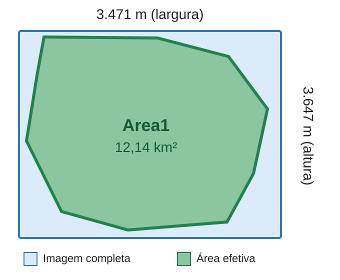
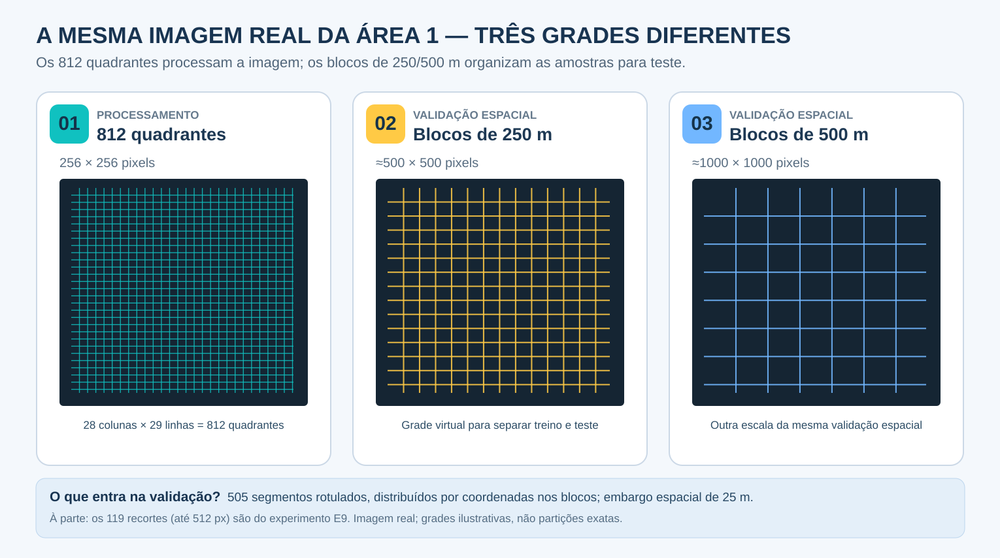
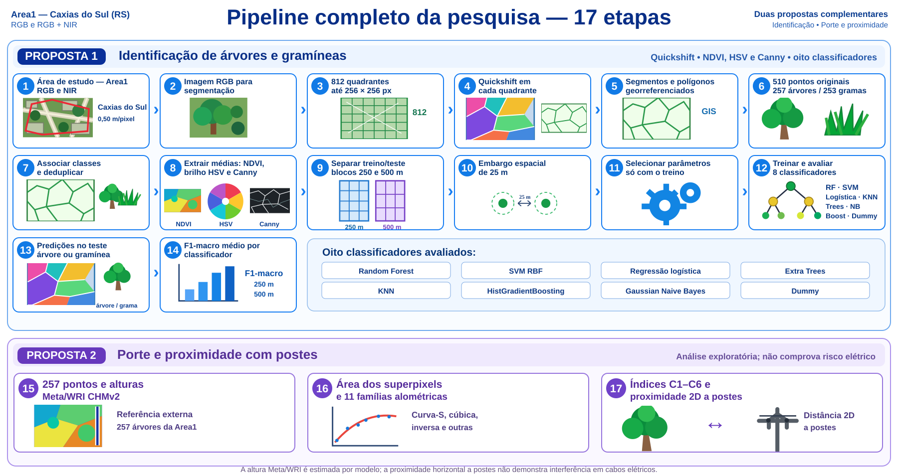
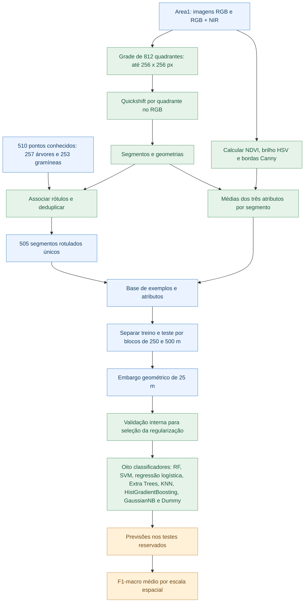
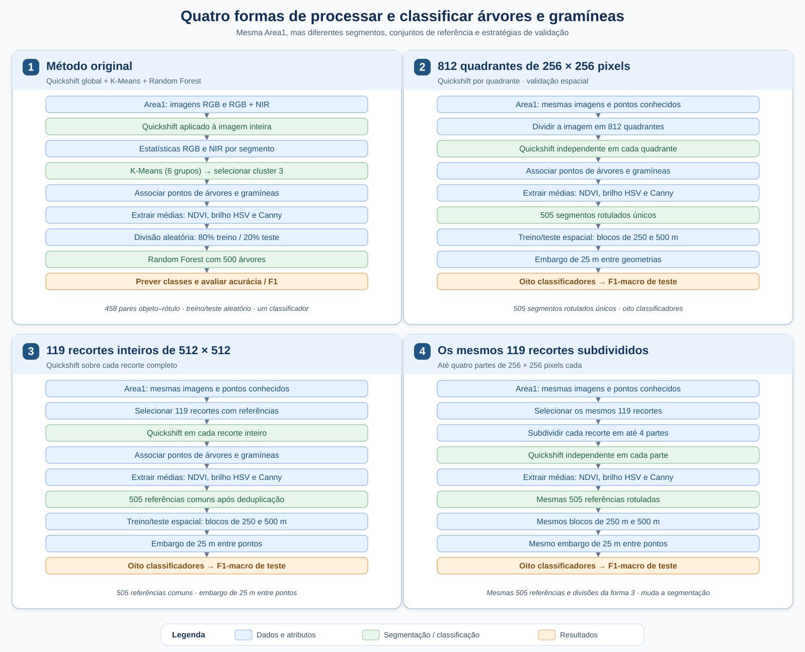
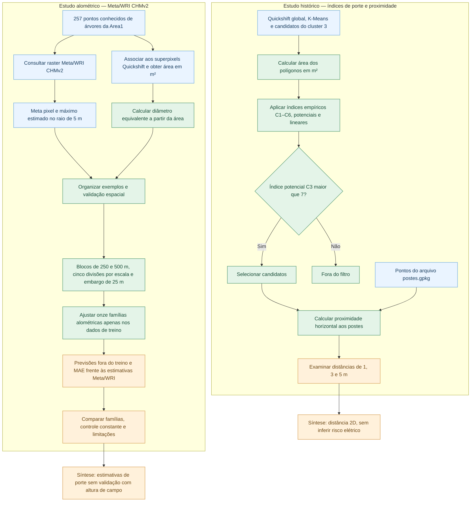

# Projeto de mestrado: Combinação de Características de Brilho, Bordas e NDVI para Detecção de Árvores Urbanas e Avaliação de Proximidade com Linhas de Energia

**Pesquisador:** Breno Braga Galvão  
**Área de estudo:** Area1, Caxias do Sul (RS)

## Índice

- [1. Introdução](#sec-1)
- [1.1. Contextualização da pesquisa](#sec-1-1)
- [1.2. Área de estudo e informações sobre os dados utilizados](#sec-1-2)
- [2. Pipeline completo da metodologia](#sec-2)
- [3. Proposta 1 — Identificação de árvores e gramíneas](#sec-3)
- [3.1. Metodologia utilizada](#sec-3-1)
- [3.2. Por que deixamos de processar a imagem inteira?](#sec-3-2)
- [3.3. Quickshift, referências e atributos](#sec-3-3)
- [3.4. Treinamento e teste espacial](#sec-3-4)
- [3.5. Contribuição do NDVI, HSV e Canny](#sec-3-5)
- [3.6. Resultados dos oito classificadores](#sec-3-6)
- [3.7. Controle do overfitting](#sec-3-7)
- [4. Proposta 2 — Porte e proximidade com postes](#sec-4)
- [4.1. Alometria: conceito e aplicação](#sec-4-1)
- [4.2. Fonte Meta/WRI CHMv2](#sec-4-2)
- [4.2.1. Resultados nos 257 pontos](#sec-4-2-1)
- [4.3. Onze famílias de equações alométricas](#sec-4-3)
- [4.4. Resultados: cinco árvores](#sec-4-4)
- [4.5. Tabela comparativa — primeiras 15 árvores](#sec-4-5)
- [5. Conclusões](#sec-5)
- [6. Código e documentação técnica](#sec-6)

## 1. Introdução

### 1.1. Contextualização da pesquisa

A arborização e a cobertura herbácea são componentes importantes da paisagem urbana. Sua identificação em imagens de sensoriamento remoto pode apoiar levantamentos de vegetação e análises espaciais, desde que se reconheçam as limitações de resolução, iluminação, segmentação e disponibilidade de referências de campo. Nesta pesquisa, a **Area1 de Caxias do Sul (RS)** é analisada por processamento de imagens e aprendizado de máquina.

O estudo mantém **duas propostas complementares**:

| Proposta | Pergunta investigada | Escopo do resultado |
|---|---|---|
| **🌳 Proposta 1 — Identificação de árvores e gramíneas** | É possível distinguir essas duas classes utilizando características de brilho, bordas e resposta espectral? | Classificação supervisionada de segmentos associados a referências conhecidas. |
| **⚡ Proposta 2 — Indicador de porte e proximidade com postes** | O que a área dos segmentos, as equações alométricas e as distâncias horizontais a postes permitem explorar? | Estimativas e indicadores exploratórios, sem comprovação de altura real nem de risco elétrico. |

Na **Proposta 1**, a metodologia central utiliza **812 quadrantes de até 256 × 256 pixels**, com segmentação Quickshift, atributos **NDVI, brilho HSV e bordas Canny** e **oito classificadores** avaliados por **F1-macro**, com separação espacial entre treino e teste. A **Proposta 2** reúne experimentos próprios de alometria e proximidade: a referência externa **Meta/WRI CHMv2** permite comparar alturas modeladas em **257 pontos de árvores**, mas não substitui medições de campo.

### 1.2. Área de estudo e informações sobre os dados utilizados

A Area1 situa-se em **Caxias do Sul, Rio Grande do Sul**. São utilizados dois rasters referentes essencialmente à mesma região, com a mesma dimensão de grade e papéis distintos:

| Arquivo | Bandas | Emprego |
|---|---|---|
| **AOI_RGB_NEW.tif** | RGB: vermelho, verde e azul (3 bandas) | Entrada da segmentação Quickshift. |
| **AOI_NEW_MULTI.tif** | RGB + infravermelho próximo/NIR (4 bandas) | Extração de NDVI, brilho HSV, bordas Canny e estatísticas dos segmentos. |

| Característica | Valor documentado |
|---|---|
| Dimensão dos rasters | **6.942 × 7.294 pixels** |
| Grade retangular | **50.634.948 pixels**; aproximadamente **12,658737 km²** |
| Área efetiva do polígono AOI | Aproximadamente **12,14 km²**, menor que o retângulo por causa do contorno irregular |
| Resolução espacial | **0,50 × 0,50 m por pixel** (0,25 m²) |
| Retângulo no terreno | **3.471 × 3.647 m = 12.658.737 m²** (≈ **12,66 km²**) |
| Referência cartográfica | **EPSG:31982** |
| Satélite atribuído na documentação dos rasters | **JL1KF01B** |
| Disponibilização das imagens conforme os registros da pesquisa | **CPFL** |

  

*Figura — Diferença entre o retângulo total da imagem (aproximadamente 12,66 km²) e a área efetiva do polígono Area1 (aproximadamente 12,14 km²). Desenho ilustrativo, fora de escala.*

**Por que o retângulo tem 12,66 km², mas a Area1 tem aproximadamente 12,14 km²?** Os **3.471 m de largura** e **3.647 m de altura** representam a extensão completa e retangular da imagem. A área total desse retângulo é:

**3.471 m × 3.647 m = 12.658.737 m² ≈ 12,66 km²**

Já a **Area1 é delimitada por um polígono irregular**, que não ocupa todo o retângulo. Por isso, sua área efetiva é de aproximadamente **12,14 km²**, ou cerca de **0,52 km² a menos**. Assim, **12,66 km² corresponde à imagem inteira** e **12,14 km² corresponde somente à área de estudo dentro dela**.

O vetor **AOI_new.shp** delimita a área de interesse; **Arvores.gpkg** contém **257 pontos de árvores**; **Grama.gpkg** contém **253 pontos de gramíneas**; e **postes.gpkg** registra os pontos de postes. Portanto, existem **510 pontos originais de referência**. Esses pontos não são equivalentes, um a um, ao número de segmentos de treinamento: na avaliação da configuração adotada, após a associação dos pontos às geometrias do Quickshift e a deduplicação, foram considerados **505 segmentos rotulados únicos**.

*Figura — A Area1 é dividida em **812 quadrantes de até 256 × 256 pixels para executar o Quickshift**. Os blocos de **250 m e 500 m** são usados **depois da segmentação**, na separação espacial dos exemplos entre treino e teste. Eles não produzem novas segmentações; as grades desenhadas são ilustrativas.*

**Onde entram os 812 quadrantes e os blocos de 250 m e 500 m?** Primeiro, a imagem RGB é dividida em **812 quadrantes de até 256 × 256 pixels**, e o **Quickshift é executado separadamente em cada quadrante**, criando os segmentos. Depois, os pontos de referência conhecidos são associados a esses segmentos, formando a base de **505 segmentos rotulados únicos**. **Somente na avaliação dos oito classificadores** entram os **blocos geográficos de 250 m ou 500 m**: eles agrupam os exemplos por localização para separar treinamento e teste, com **cinco divisões por escala** e **exclusão espacial de 25 m**. Portanto, **256 × 256 pixels é a janela do Quickshift; 250 m e 500 m são os blocos de validação**, não novos recortes da imagem.

**Por que usamos blocos de 250 m e 500 m, em vez de escolher apenas um tamanho?** Para verificar se o desempenho dos classificadores **muda conforme a escala geográfica da divisão entre treino e teste**. Blocos de **250 m** formam grupos menores e blocos de **500 m**, grupos maiores, alterando quais exemplos são usados em cada conjunto e podendo modificar o **F1-macro**. Avaliar as **duas escalas** permite verificar a sensibilidade dos resultados e evita depender de uma única divisão espacial. **Blocos maiores não são necessariamente mais difíceis em todos os casos.**

## 2. Pipeline completo da metodologia

O diagrama apresenta as **17 etapas de síntese**, preservando as **duas propostas** e substituindo, nesta apresentação, o pipeline histórico que mostrava somente Random Forest. A primeira proposta utiliza **oito classificadores**. A segunda contém análises exploratórias complementares e **não deve ser interpretada como validação da altura ou do risco elétrico**.

  

*Figura — Pipeline atualizado: segmentação e classificação supervisionada na Proposta 1; análise exploratória de porte, alturas modeladas e proximidade com postes na Proposta 2.*

| Parte do pipeline | Síntese |
|---|---|
| **Preparação da imagem** | Leitura das bandas RGB e RGB + NIR e organização da imagem em 812 quadrantes sem reduzir a resolução dos pixels. |
| **Segmentação e referências** | Quickshift por quadrante, associação dos pontos conhecidos e deduplicação dos exemplos rotulados. |
| **Extração dos atributos** | Médias de NDVI, brilho HSV e bordas Canny por segmento, calculadas **antes** da classificação. |
| **Treinamento e avaliação** | Blocos espaciais de 250 e 500 m, embargo de 25 m, escolha interna de parâmetros, treinamento de oito classificadores e F1-macro nos testes. |
| **Estudo exploratório complementar** | Meta/WRI CHMv2 nos 257 pontos, onze famílias alométricas, índices empíricos C1–C6 e distâncias horizontais a postes. |

Consultar o infográfico horizontal original das 17 etapas (documentação histórica)

O infográfico original representa o código anterior, com **Quickshift global, K-Means e Random Forest**. Ele permanece preservado para comparação histórica; **não representa a metodologia principal deste novo README**.

## 3. Proposta 1 — Identificação de árvores e gramíneas

A classificação adotada nesta apresentação utiliza **Quickshift na grade de 812 quadrantes de até 256 × 256 pixels**, seguido de associação às referências, extração de atributos e comparação de oito classificadores. O objetivo é distinguir **árvore** e **gramínea nos exemplos rotulados**: isso não constitui uma classificação validada de todas as categorias presentes na cidade, como telhados, vias ou solo exposto.

### 3.1. Metodologia utilizada

A imagem é organizada em **812 quadrantes** (grade de 28 × 29 partes, com dimensões menores nas bordas). O Quickshift é aplicado **independentemente a cada quadrante**, formando segmentos e polígonos. Os pontos conhecidos de árvores e gramíneas identificam as classes dos segmentos associados. A base usada para a avaliação reúne **505 segmentos rotulados únicos**.

As três médias — **NDVI, brilho HSV e bordas Canny** — são calculadas para cada segmento. Depois, os exemplos são separados espacialmente e avaliados com **Random Forest, SVM RBF, regressão logística, Extra Trees, KNN, HistGradientBoosting, Gaussian Naive Bayes e Dummy**, utilizando a mesma base e as mesmas partições externas em cada comparação.

**Fluxograma da metodologia adotada (código Mermaid):**

**Cuidados de interpretação:** os resultados deste capítulo vêm de uma **bateria já documentada e derivada da configuração de 812 quadrantes**, com as características e partições previamente produzidas. A reexecução mais recente ajustou os classificadores, **sem recalcular o Quickshift global ou toda a segmentação dos 812 quadrantes**. A publicação do notebook, por si só, não comprova uma nova execução integral de sua rota progressiva.

### 3.2. Por que deixamos de processar a imagem inteira?

No método original, o processamento seguia **Quickshift na imagem RGB inteira → K-Means com seis grupos (seleção do cluster 3) → Random Forest com 500 árvores**. A avaliação histórica utilizou **458 pares segmento–rótulo**, com divisão **aleatória de 80% para treino e 20% para teste**, e registrou acurácia de **0,87 em 92 exemplos de teste**. Essa acurácia **não é diretamente comparável** ao F1-macro espacial atual.

Ao tentar repetir o Quickshift global em um ambiente com aproximadamente **4 GiB de RAM**, ocorreu um **MemoryError** durante a segmentação: foi solicitada uma alocação **adicional de 1,13 GiB** para uma matriz temporária. A execução **não chegou** às etapas de K-Means e Random Forest. Diante do tamanho de aproximadamente **50,6 milhões de pixels**, a solução adotada foi aplicar o Quickshift em quadrantes menores, mantendo o tamanho original dos pixels.

| Registro documentado | Memória / interpretação |
|---|---|
| Método completo histórico | **5,42 GiB** como referência de memória registrada no processamento original; não corresponde à nova execução. |
| Nova tentativa de Quickshift global com cerca de 4 GiB disponíveis | **Falhou** ao tentar alocar **mais 1,13 GiB**; esse valor é a **alocação solicitada**, não o consumo total. |
| Teste em recorte isolado de 2.048 × 2.048 pixels | Pico de cerca de **687 MB**; recorte maior que concluiu, não a imagem inteira. |

**Por que não utilizar K-Means na nova configuração?** Porque o Quickshift já produz os segmentos e os pontos conhecidos permitem atribuir diretamente os rótulos árvore/gramínea aos segmentos correspondentes. Assim, não dependemos da seleção do cluster 3. Isso **não prova que o K-Means seja inútil**; indica que ele não era necessário neste protocolo supervisionado.

Figuras históricas de comparação das formas de segmentação (métodos alternativos preservados)

Essas figuras contextualizam alternativas estudadas e estão mantidas por integridade documental. **Os resultados dos recortes de 119 regiões não são a referência principal dos resultados apresentados abaixo**; eles continuam disponíveis no [README preservado](README_versao_outubro.md).

### 3.3. Como Quickshift, pontos de referência e atributos permitem classificar árvores e gramíneas?

1. **Quickshift:** separa o raster RGB em regiões visualmente semelhantes, chamadas **segmentos** ou superpixels. **Não identifica sozinho** se um segmento é árvore ou gramínea.
2. **Pontos conhecidos:** os **510 pontos originais** informam a classe de referência na localização registrada. A associação espacial e a deduplicação dos registros geram os **505 segmentos únicos** usados nesta avaliação. Nem todo segmento da imagem possui referência rotulada.
3. **Atributos antes do classificador:** calculam-se, em cada segmento, médias de **NDVI** (informação do vermelho e do infravermelho próximo), **brilho HSV** (valor/intensidade) e **bordas Canny** (presença de transições locais). A área do segmento utilizada nas análises de porte é outra característica geométrica, sem equivaler necessariamente à área de uma copa individual.
4. **Classificadores:** recebem os vetores numéricos dos segmentos rotulados e aprendem a distinguir as duas classes. Cada classificador possui regras e parâmetros próprios. As previsões são feitas nos segmentos reservados para teste.
5. **Avaliação:** comparam-se as previsões e os rótulos conhecidos. O **F1-macro**, calculado **após** as previsões, é a média do F1 das classes árvore e gramínea; por isso, os classificadores podem apresentar resultados distintos mesmo recebendo os mesmos três atributos.

**Em uma frase:** o Quickshift **segmenta**, os pontos de referência **rotulam**, os atributos **descrevem** e os algoritmos supervisionados **classificam**.

### 3.4. Como separamos treinamento e teste na metodologia adotada?

A validação desta configuração é **espacial**, e não um sorteio aleatório simples dos objetos. Os exemplos são agrupados em blocos geográficos de **250 m** e, separadamente, **500 m**. Para cada tamanho são realizadas **cinco divisões**, reservando aproximadamente **80% dos grupos para treino** e **20% para teste**. Os exemplos de um mesmo bloco não são distribuídos entre os dois conjuntos na mesma divisão.

Após a separação, removem-se do **treinamento** os objetos cujas **geometrias** estejam a até **25 m** das geometrias de teste. Os exemplos de teste permanecem reservados. Portanto, a proporção final de segmentos pode não corresponder exatamente a 80%/20%: a proporção se refere à seleção inicial dos **grupos espaciais**.

**Por que não usar somente 80/20 aleatório?** Árvores e gramíneas próximas podem compartilhar iluminação, textura e condições de imagem. Distribuir exemplos quase vizinhos entre treinamento e teste pode favorecer um desempenho artificialmente otimista. Os blocos e o embargo **reduzem essa influência**, embora não garantam independência completa nem substituam validação em outra região.

**Não confundir as escalas:** os **256 × 256 pixels** definem o tamanho da janela de **segmentação**, enquanto **250 e 500 metros** definem a escala geográfica das **partições de validação**.

**Por que avaliamos blocos de 250 m e 500 m, em vez de escolher apenas um tamanho?** Para verificar se os resultados dos classificadores **se mantêm consistentes quando muda a escala geográfica da separação entre treino e teste**. Blocos de **250 m** organizam as amostras em regiões menores; blocos de **500 m**, em regiões maiores. Isso modifica a distribuição espacial dos exemplos e pode alterar o F1-macro. Usar as **duas escalas** permite avaliar a sensibilidade e a estabilidade dos modelos, sem depender de uma única escolha arbitrária. **Blocos maiores não garantem, por si só, testes mais difíceis**.

Consultar o diagrama comparativo histórico de treino e teste

No conjunto de **812 quadrantes**, a avaliação publicada utiliza embargo entre **geometrias dos segmentos**. O diagrama histórico também apresenta outras configurações com regras de embargo distintas, que não devem ser confundidas com a adotada aqui.

### 3.5. Qual é a contribuição do NDVI, brilho HSV e bordas Canny para o desempenho dos classificadores?

Os atributos são **calculados antes** de treinar os modelos. Para verificar a contribuição adicional do NDVI, foram comparadas duas entradas, mantendo-se os mesmos **505 segmentos rotulados**, modelos e divisões externas em cada escala espacial:

- **HSV + Canny:** duas características (condição de comparação).
- **NDVI + HSV + Canny:** as duas características anteriores, com o NDVI acrescentado.

A dupla HSV + Canny **não é necessariamente a melhor combinação de dois atributos** entre todas as alternativas. Os mesmos sete classificadores que aprendem com os atributos e o Dummy foram avaliados; os hiperparâmetros foram escolhidos **separadamente dentro dos dados de treinamento** para cada conjunto de características. A comparação documentou **900 ajustes internos** e **160 avaliações externas pareadas**, com embargo geométrico de 25 m.

**Blocos espaciais de 250 m — F1-macro médio em cinco divisões**

| Classificador | HSV + Canny | NDVI + HSV + Canny | Ganho ao acrescentar NDVI |
|---|---:|---:|---:|
| **KNN (25/35)** | 0,7474 | **0,8931** | **+0,1457** |
| SVM RBF | 0,7464 | 0,8908 | +0,1444 |
| Regressão logística | 0,7557 | 0,8879 | +0,1323 |
| HistGradientBoosting | 0,7608 | 0,8325 | +0,0717 |
| Extra Trees | 0,7369 | 0,8266 | +0,0897 |
| Random Forest | 0,7522 | 0,8220 | +0,0699 |
| Gaussian Naive Bayes | 0,7122 | 0,7986 | +0,0864 |
| Dummy (maioria) | 0,2980 | 0,2980 | 0,0000 |

**Blocos espaciais de 500 m — F1-macro médio em cinco divisões**

| Classificador | HSV + Canny | NDVI + HSV + Canny | Ganho ao acrescentar NDVI |
|---|---:|---:|---:|
| **Regressão logística** | 0,7909 | **0,8666** | **+0,0758** |
| SVM RBF | 0,7900 | 0,8619 | +0,0719 |
| KNN (25/35) | 0,7835 | 0,8481 | +0,0646 |
| Extra Trees | 0,7822 | 0,8335 | +0,0514 |
| HistGradientBoosting | 0,7805 | 0,8246 | +0,0441 |
| Random Forest | 0,7743 | 0,8240 | +0,0498 |
| Gaussian Naive Bayes | 0,7256 | 0,7400 | +0,0144 |
| Dummy (maioria) | 0,2799 | 0,2799 | 0,0000 |

**Interpretação:** incluir NDVI elevou o F1-macro médio dos **sete classificadores que usam os atributos**, nas duas escalas; o **Dummy** permaneceu inalterado porque não aprende a partir dessas características. Os valores de F1-macro não são valores de NDVI, HSV ou Canny: são **métricas de desempenho medidas depois das previsões**.

### 3.6. Resultados dos oito classificadores na configuração adotada

A tabela apresenta **exclusivamente a bateria documentada com segmentos derivados dos 812 quadrantes de até 256 × 256 pixels**. São **505 segmentos rotulados únicos**, os três atributos **NDVI + HSV + Canny** e cinco divisões espaciais por escala, com embargo de **25 m entre geometrias**. Os classificadores foram ordenados pela média de seus resultados nas duas escalas, apenas para facilitar a leitura.

| Classificador | F1-macro — blocos de 250 m | F1-macro — blocos de 500 m |
|---|---:|---:|
| Regressão logística | 0,8879 | **0,8666** |
| SVM RBF | 0,8908 | 0,8619 |
| KNN (25/35) | **0,8931** | 0,8481 |
| Extra Trees | 0,8266 | 0,8335 |
| HistGradientBoosting | 0,8325 | 0,8246 |
| Random Forest | 0,8220 | 0,8240 |
| Gaussian Naive Bayes | 0,7986 | 0,7400 |
| Dummy (referência simples) | 0,2980 | 0,2799 |

**Por que o F1-macro muda entre blocos de 250 e 500 m?** Porque o tamanho do bloco altera **quais exemplos ficam no treino e no teste** e, portanto, a dificuldade da avaliação. Esses blocos não alteram o tamanho dos quadrantes Quickshift.

**Como interpretar os resultados?** Valores maiores indicam melhor equilíbrio entre as classes árvore e gramínea nos testes. Cada coluna representa o **F1-macro médio de cinco divisões espaciais**, e não uma acurácia na imagem inteira nem uma estimativa de altura.

**O que descobrimos?** Com blocos de **250 m**, o maior resultado foi do **KNN (25/35): 0,8931**. Com blocos de **500 m**, liderou a **regressão logística: 0,8666**. **Nenhum algoritmo foi o melhor nas duas escalas.**

**Quais resultados podemos comparar diretamente?** Na configuração dos 812 quadrantes, os oito classificadores compartilham a mesma base rotulada, os atributos e as divisões externas **dentro de cada escala**. A comparação de HSV + Canny versus NDVI + HSV + Canny também utiliza esse protocolo supervisionado. Os resultados históricos do Quickshift global e das configurações com 119 recortes **não são comparações diretas**, pois diferem em segmentação, construção dos exemplos e/ou protocolos. [Consultar o histórico integral](README_versao_outubro.md).

### 3.7. Como controlamos o overfitting na avaliação dos classificadores?

**Overfitting** (sobreajuste) ocorre quando o modelo aprende particularidades dos dados de treinamento e pode apresentar desempenho inferior em exemplos reservados. Foram adotados os seguintes cuidados:

1. **Deduplicação:** uso de **505 segmentos rotulados únicos** e verificação de separação entre identificadores de treino e teste.
2. **Validação espacial:** blocos de **250 e 500 m**, cinco divisões por escala, com **exclusão geométrica de 25 m** entre exemplos próximos.
3. **Escolha interna dos parâmetros:** comparação de receitas de regularização **moderada e forte** por **três divisões internas dos dados de treinamento**, sem usar os testes externos para escolher parâmetros de cada rodada.
4. **Padronização sem vazamento:** quando necessária, a transformação é ajustada apenas nos exemplos de treinamento, dentro de um pipeline.
5. **Auditoria:** registro dos resultados tanto de treino quanto de teste para verificar a diferença entre eles.

**F1-macro médio de treino e teste de quatro modelos representativos nos 812 quadrantes** (média das dez divisões espaciais, reunindo cinco de 250 m e cinco de 500 m):

| Experimento | Classificador | F1 treino | F1 teste | Diferença |
|---|---|---:|---:|---:|
| **812 quadrantes de 256 px** | Regressão logística | 0,9011 | 0,8773 | +0,0239 |
| **812 quadrantes de 256 px** | SVM RBF | 0,9110 | 0,8764 | +0,0347 |
| **812 quadrantes de 256 px** | Random Forest | 0,8861 | 0,8230 | +0,0630 |
| **812 quadrantes de 256 px** | HistGradientBoosting | 0,8998 | 0,8286 | +0,0712 |

**O que o resultado mostra?** A diferença entre treino e teste ainda é maior em **Random Forest** e **HistGradientBoosting** do que em alguns outros modelos. As medidas de validação e regularização ajudam a **reduzir o risco**, mas **não comprovam ausência total de sobreajuste**.

**Limitação de generalização:** todos os exemplos pertencem à mesma **Area1**. A avaliação mede **generalização espacial interna**; não demonstra desempenho em outra cidade ou imagem independente. Além disso, os conjuntos externos já foram examinados em etapas anteriores da pesquisa, o que limita interpretações retrospectivas de seleção de modelos.

## 4. Proposta 2 — Indicador de porte e proximidade com postes

Esta proposta investiga **porte da vegetação e distância horizontal a postes**, com caráter **exploratório**. Ela reúne testes históricos com índices derivados da área dos segmentos e um estudo posterior comparando famílias alométricas com **alturas estimadas pelo Meta/WRI CHMv2**. Os protocolos dessas análises não devem ser confundidos com o F1-macro da Proposta 1.

### 4.1. Alometria: o que é e como utilizamos?

**Alometria** é o estudo de relações matemáticas entre dimensões de organismos. No contexto desta pesquisa, investigamos se a **área projetada dos superpixels Quickshift** poderia ajudar a aproximar a altura estimada de árvores. Como o superpixel **não corresponde necessariamente à copa de um único indivíduo**, sua área é uma variável geométrica aproximada, não uma medida botânica direta.

**Fluxograma da Proposta 2 — duas análises exploratórias complementares**

O fluxograma separa o **estudo posterior de alometria com alturas modeladas pela Meta/WRI** do **procedimento histórico com índices de porte e proximidade com postes**. São análises relacionadas à Area1, mas não equivalem a um único teste integrado de risco elétrico.

**Como interpretar:** as onze famílias são comparadas às **estimativas Meta/WRI**, e não a alturas medidas em campo. Na análise histórica, os candidatos vêm do **cluster 3**, sem exigir necessariamente a previsão “árvore” do Random Forest; a distância é **horizontal até postes**, não até cabos. Nenhuma dessas análises comprova risco elétrico.

O notebook original contém seis configurações empíricas **C1–C6**, cada uma nas formas **potencial** e **linear**. Por exemplo, o índice potencial C3 foi definido como:

\[
I_{C3}=2{,}5\times A^{0{,}4},
\]

em que **A** representa a área do segmento em m². Esses índices são **exploratórios** e não constituem alturas medidas nem seis famílias matemáticas diferentes.

### 4.2. Meta/WRI CHMv2 — de onde foram retiradas as alturas?

O **Meta/WRI Canopy Height Map v2 (CHMv2)** fornece estimativas de **altura de dossel em metros**, com resolução espacial nominal de cerca de **1 m**, a partir de modelagem de sensoriamento remoto. O raster consultado para a Area1 foi **2103121330.tif**, distribuído no conjunto de dados Meta/WRI, descrito por **Brandt et al. (2026)**.

A análise utiliza **uma única fonte externa de alturas**, o CHMv2, com duas formas de consulta: valor no **pixel do ponto** e **máximo na vizinhança de 5 m**. A resolução horizontal de 1 m **não significa erro vertical de apenas 1 m**. Os valores são **previsões de altura do dossel**, não medidas de campo das árvores cadastradas. As fontes do raster, do artigo e do código de extração estão reunidas na [seção 6](#sec-6).

#### 4.2.1. O que a Meta/WRI estimou nos 257 pontos da Area1?

O GeoTIFF foi consultado nas coordenadas dos **257 pontos de Arvores.gpkg**. **Meta pixel** é o valor do pixel exato; **Meta 5 m** é a **maior estimativa** em um raio de 5 m, que pode pertencer a outra copa.

| Indicador | Resultado documentado |
|---|---:|
| Pontos consultados | **257 de 257** |
| Mediana da estimativa no pixel | **2 m** |
| Mediana do máximo no raio de 5 m | **6 m** |
| Pixels exatos com altura modelada igual a zero | **107 (41,6%)** |
| Pontos com altura zero em toda a vizinhança de 5 m | **42 (16,3%)** |
| Maior altura modelada na vizinhança de 5 m | **30 m** |

O valor zero pode resultar de solo, sombra, diferença de posicionamento, cobertura vegetal não identificada ou diferença temporal. **Zero não comprova ausência de árvore no ponto de referência.**

### 4.3. Aplicação de onze equações alométricas

Foram avaliadas **onze famílias matemáticas** descritas por **Chatziathanasiou, Kitikidou e Milios (2024)**: **linear, logarítmica, inversa, quadrática, cúbica, potencial, composta, curva-S, logística, crescimento e exponencial**. O artigo original relaciona largura de copa (**CW**) e altura (**H**) em espécies estudadas na Grécia. Aqui, as famílias foram **adaptadas e reajustadas** para relacionar uma medida derivada da área do superpixel à **altura modelada pelo Meta/WRI**, e **não** se utilizaram diretamente coeficientes gregos como se fossem validados para a Area1.

A transformação geométrica utilizada é **\(D_{eq}=2\sqrt{A/\pi}\)**, sendo **A** a área do superpixel. Os coeficientes são ajustados nos dados de treinamento das divisões espaciais. Avaliaram-se separadamente as referências **Meta pixel** e **Meta 5 m**, com blocos de **250 e 500 m**, cinco divisões por escala e **embargo de 25 m**. O erro foi expresso em **MAE (metros)**, comparado às **estimativas Meta/WRI**, não a alturas medidas em campo.

*Figura — Onze famílias de curvas adaptadas do estudo de referência, com parâmetros ajustados para a Area1. As configurações empíricas C1–C6 do notebook original são distintas dessas famílias ajustadas.*

**Resultado geral:** curva-S, cúbica e inversa tiveram os menores MAE em diferentes cenários, mas **nenhuma superou o controle constante**. Isso indica que **a área do superpixel, isoladamente, não explica adequadamente a variação das alturas modeladas**. A documentação científica original e a correção do artigo de 2026 estão na [seção 6](#sec-6).

### 4.4. Resultados — amostra comparativa de cinco árvores

Para evitar selecionar exemplos pelos próprios erros, foram escolhidas **as cinco primeiras árvores na ordem do arquivo de resultados**. As tabelas apresentam as **onze famílias** usando **previsões fora do treinamento (OOF)**, **blocos espaciais de 250 m** e a referência **Meta pixel**. A coluna **Meta 5 m** aparece somente como contexto; para compará-la quantitativamente aos modelos, devem ser utilizadas as colunas de previsão específicas de 5 m disponíveis no CSV.

**Tabela A — Referência Meta/WRI e seis famílias (valores em metros)**

| Árvore | Meta pixel (m) | Meta 5 m (m) | Linear (m) | Logarítmico (m) | Inverso (m) | Quadrático (m) | Cúbico (m) | Potencial (m) |
| ---: | ---: | ---: | ---: | ---: | ---: | ---: | ---: | ---: |
| 1 | 16,00 | 17,00 | 3,08 | 3,02 | 2,98 | 3,15 | 3,21 | 3,02 |
| 2 | 0,00 | 6,00 | 3,09 | 3,02 | 2,98 | 3,17 | 3,24 | 3,02 |
| 3 | 10,00 | 13,00 | 3,28 | 3,40 | 3,56 | 3,23 | 3,25 | 3,27 |
| 4 | 19,00 | 20,00 | 3,15 | 3,04 | 2,98 | 3,32 | 3,51 | 3,04 |
| 5 | 0,00 | 2,00 | 3,81 | 3,86 | 3,87 | 3,73 | 3,66 | 3,84 |

**Tabela B — Mesmas cinco árvores e outras cinco famílias (valores em metros)**

| Árvore | Meta pixel (m) | Meta 5 m (m) | Composto (m) | Curva-S (m) | Logístico (m) | Crescimento (m) | Exponencial (m) |
| ---: | ---: | ---: | ---: | ---: | ---: | ---: | ---: |
| 1 | 16,00 | 17,00 | 3,09 | 2,98 | 3,09 | 3,09 | 3,09 |
| 2 | 0,00 | 6,00 | 3,10 | 2,98 | 3,10 | 3,10 | 3,10 |
| 3 | 10,00 | 13,00 | 3,19 | 3,46 | 3,20 | 3,19 | 3,19 |
| 4 | 19,00 | 20,00 | 3,17 | 2,98 | 3,17 | 3,17 | 3,17 |
| 5 | 0,00 | 2,00 | 3,75 | 3,87 | 3,76 | 3,75 | 3,75 |

**Como interpretar?** Para a **árvore 1**, a referência Meta pixel é **16,00 m**, enquanto a previsão da **curva-S é 2,98 m**; a diferença absoluta é aproximadamente **13,02 m**. Essa diferença é em relação à **estimativa do CHMv2**, e **não** em relação à altura real da árvore. Algumas famílias produzem resultados muito semelhantes, e o estudo **não demonstrou vantagem sobre o controle constante**.

A tabela integral contém **257 árvores e 74 colunas**, incluindo estimativas para os blocos de 500 m, previsões relativas à Meta 5 m, modelos de controle e índices históricos C1–C6. Consulte a [tabela completa na seção 6](#sec-6).

**E a proximidade com postes?** Na implementação **histórica** da segunda proposta, o índice potencial **C3 > 7** foi utilizado para selecionar candidatos oriundos do **cluster 3**; não se exigia necessariamente uma previsão do Random Forest igual a “árvore”. Depois, foram examinadas distâncias **horizontais de 1, 3 e 5 m** aos pontos do arquivo **postes.gpkg**. Sem alturas medidas em campo, geometrias dos cabos, validação botânica e localização tridimensional, **não é possível inferir interferência nos fios ou risco elétrico**.

### 4.5. Tabela comparativa — primeiras 15 árvores

A tabela apresenta as **15 primeiras árvores na ordem original**, sem selecionar exemplos pelos resultados. As **três primeiras colunas** são a contagem, a **Meta pixel** e a **Meta 5 m**; depois vêm as previsões da **logarítmica, inversa, curva-S e cúbica** em blocos de **250 m** e os índices históricos **C1 potencial e C3 potencial** (as versões `I = a × A^b` do notebook original). As previsões das quatro famílias são **OOF (teste espacial)**; C1 e C3 **não são alturas calibradas em metros** e não representam as variantes lineares.

| Árvore | **Meta pixel (m)** | **Meta 5 m (m)** | Log. pixel (m) | Log. 5 m (m) | Inversa pixel (m) | Inversa 5 m (m) | Curva-S pixel (m) | Curva-S 5 m (m) | Cúbica pixel (m) | Cúbica 5 m (m) | C1 potencial (índice) | C3 potencial (índice) |
|---:|---:|---:|---:|---:|---:|---:|---:|---:|---:|---:|---:|---:|
| 1 | 16,00 | 17,00 | 3,02 | 5,97 | 2,98 | 5,97 | 2,98 | 5,97 | 3,21 | 5,97 | 23,95 | 22,81 |
| 2 | 0,00 | 6,00 | 3,02 | 5,97 | 2,98 | 5,97 | 2,98 | 5,97 | 3,24 | 5,97 | 24,62 | 23,17 |
| 3 | 10,00 | 13,00 | 3,40 | 6,50 | 3,56 | 6,58 | 3,46 | 6,57 | 3,25 | 6,39 | 9,66 | 13,58 |
| 4 | 19,00 | 20,00 | 3,04 | 5,97 | 2,98 | 5,97 | 2,98 | 5,97 | 3,51 | 5,97 | 31,34 | 26,60 |
| 5 | 0,00 | 2,00 | 3,86 | 6,87 | 3,87 | 6,89 | 3,87 | 6,89 | 3,66 | 6,72 | 15,13 | 17,55 |
| 6 | 0,00 | 2,00 | 2,93 | 6,11 | 3,11 | 6,13 | 2,94 | 6,13 | 3,08 | 6,26 | 6,02 | 10,36 |
| 7 | 0,00 | 0,00 | 3,98 | 6,98 | 3,93 | 6,96 | 3,97 | 6,96 | 3,87 | 6,89 | 17,15 | 18,84 |
| 8 | 0,00 | 0,00 | 3,98 | 6,97 | 3,93 | 6,96 | 3,97 | 6,96 | 3,86 | 6,88 | 17,09 | 18,81 |
| 9 | 3,00 | 6,00 | 4,17 | 7,13 | 4,03 | 7,05 | 4,11 | 7,06 | 4,30 | 7,23 | 20,65 | 20,96 |
| 10 | 6,00 | 9,00 | 3,73 | 6,77 | 3,79 | 6,82 | 3,77 | 6,81 | 3,51 | 6,60 | 13,38 | 16,36 |
| 11 | 0,00 | 3,00 | 4,14 | 7,11 | 4,01 | 7,04 | 4,09 | 7,05 | 4,21 | 7,16 | 19,99 | 20,57 |
| 12 | 5,00 | 6,00 | 3,35 | 6,45 | 3,52 | 6,54 | 3,41 | 6,53 | 3,22 | 6,37 | 9,14 | 13,15 |
| 13 | 10,00 | 10,00 | 2,15 | 5,14 | 2,24 | 5,13 | 2,17 | 5,13 | 2,22 | 5,33 | 5,72 | 10,06 |
| 14 | 1,00 | 8,00 | 2,39 | 5,40 | 2,50 | 5,47 | 2,44 | 5,46 | 2,29 | 5,39 | 8,13 | 12,31 |
| 15 | 6,00 | 9,00 | 2,77 | 5,83 | 2,79 | 5,86 | 2,79 | 5,85 | 2,60 | 5,67 | 14,23 | 16,94 |

**Resultados completos:** A tabela acima apresenta as 15 primeiras árvores. Para consultar os **257 pontos avaliados e os resultados de todos os modelos**, incluindo os testes com blocos espaciais de 250 m e 500 m, acesse a [**tabela completa — 257 pontos e 74 colunas**](docs/v3_alturas_publicas/v3_todos_modelos_meta_257_completo.csv).

Por exemplo, na **árvore 1**, a Meta indica **16 m no pixel e 17 m no raio de 5 m**, enquanto os modelos logarítmico, inverso, curva-S e cúbico retornam valores bastante inferiores nos testes espaciais. Isso mostra que, apesar de terem sido testadas diversas famílias, **os modelos ainda não recuperam de forma confiável a variação individual das alturas modeladas pela Meta**. Os índices **C1 potencial** e **C3 potencial** apresentam valores maiores, mas não equivalem automaticamente a metros de altura real; as variantes lineares existem no notebook original e não são as colunas desta tabela.

## 5. Conclusões

**Proposta 1 — Identificação de árvores e gramíneas.** A segmentação Quickshift em quadrantes de até 256 × 256 pixels permitiu organizar o processamento da Area1 sem reduzir a resolução dos pixels e avaliar, na bateria derivada documentada, **505 segmentos rotulados únicos** com **oito classificadores**. O acréscimo de **NDVI** à dupla HSV + Canny aumentou o F1-macro médio dos sete modelos que utilizam atributos. O **KNN** obteve **0,8931** em blocos de **250 m** e a **regressão logística**, **0,8666** em blocos de **500 m**. O melhor classificador, portanto, depende da escala de validação.

A utilização de **blocos espaciais** e **embargo geométrico de 25 m**, somada à seleção de parâmetros somente no treinamento, reduziu riscos metodológicos. Contudo, **não eliminou comprovadamente o overfitting**, nem substitui testes independentes em outras regiões. O desempenho histórico do método original (**acurácia 0,87**) **não pode ser comparado diretamente** com esses F1-macro espaciais.

**Proposta 2 — Porte e proximidade com postes.** O estudo das **257 referências de árvores**, das estimativas **Meta/WRI CHMv2**, dos índices originais C1–C6 e das **onze famílias alométricas** foi exploratório. A área do superpixel, isoladamente, não reproduziu de forma suficientemente confiável a variação das alturas estimadas pela Meta/WRI; os melhores ajustes não superaram o controle constante. As distâncias horizontais aos postes também **não comprovam risco elétrico**.

**Próximos passos:** validar classificações e alturas com amostras independentes, medir árvores e copas em campo, estudar outras áreas geográficas e, para qualquer discussão de infraestrutura elétrica, dispor da geometria dos cabos e de critérios técnicos apropriados.

## 6. Código e documentação técnica

### Documentação preservada e reprodutibilidade

**[README_versao_outubro.md — documentação integral anterior](README_versao_outubro.md)**: cópia preservada do README antes desta reorganização, com **todas as metodologias alternativas, tabelas, figuras, resultados históricos e discussões anteriores**. Os códigos e as bases experimentais anteriores permanecem no repositório, sem exclusão.

**Atenção:** os scripts de reavaliação supervisionada reutilizam características previamente extraídas; essa execução **não equivale a recalcular a segmentação Quickshift em todo o raster**. O estado de execução de cada etapa deve ser conferido nos relatórios e nos artefatos produzidos.

| Material | Onde consultar / finalidade |
|---|---|
| **Notebook original da classificação e proximidade** | [Segmentacao_area_completa.ipynb](Segmentacao_area_completa.ipynb) — Quickshift global, K-Means, Random Forest e índice de porte. |
| **Notebook de experimentos com quadrantes e recortes** | [Segmentacao_area_completa_v2_experimentos.ipynb](Segmentacao_area_completa_v2_experimentos.ipynb) — código das três configurações investigadas, mantendo o histórico. |
| **Reexecução supervisionada dos oito classificadores** | [reexecutar_tabelas_aninhadas_v2.py](experimentos/reexecutar_tabelas_aninhadas_v2.py) — seleção interna de regularização e testes espaciais. |
| **Comparação dos atributos com o protocolo atual** | [reexecutar_ablacao_atributos_aninhada_v2.py](experimentos/reexecutar_ablacao_atributos_aninhada_v2.py), [relatório técnico](docs/e4b_ablação_aninhada_2026-11-03.md) e [valores das tabelas](docs/e4b_ablacao_aninhada_2026-11-03_tabelas.csv). |
| **Validação espacial e auditoria** | [Harmonização dos protocolos](docs/harmonizacao_protocolos.md), [auditoria de regularização](docs/auditoria_regularizacao_e2_e3a_e3b_2026-11-03.md) e [plano dos experimentos](docs/plano_experimentos_area1.md). |
| **Relato do Quickshift global e da RAM** | [Tentativa de execução local](docs/e10_teste_execucao_local.md) e [registro do método original](docs/experimento_area_completa.md). |
| **Dados da Area1** | [Estrutura, fontes e referências](data/README.md); [pasta com dados originais no Google Drive](https://drive.google.com/drive/folders/1asqPz9xFr7dlnK1ggvrwftXEbkhvwjg6). |
| **Notebook principal de alometria** | [Alometria_caxias_v3.ipynb](Alometria_caxias_v3.ipynb) — alturas de referência, índices e regressões. |
| **Extração das alturas Meta/WRI** | [v3_amostrar_altura_publica.py](experimentos/v3_amostrar_altura_publica.py). |
| **Testes das onze famílias** | [v3_testar_11_modelos_artigo_meta.py](experimentos/v3_testar_11_modelos_artigo_meta.py) e [relatório completo](docs/v3_alturas_publicas/v3_11_familias_meta_relatorio.md). |
| **Resultados dos 257 pontos / 74 colunas** | [CSV completo](docs/v3_alturas_publicas/v3_todos_modelos_meta_257_completo.csv) e [tabela Markdown](docs/v3_alturas_publicas/v3_todos_modelos_meta_257_tabela.md). |
| **Métricas e previsões alométricas** | [Resumo das onze famílias (CSV)](docs/v3_alturas_publicas/v3_11_familias_meta_resumo.csv), [previsões para os 257 pontos](docs/v3_alturas_publicas/v3_11_familias_meta_257_previsoes.csv) e [calibração espacial](docs/v3_alturas_publicas/v3_meta_calibracao_validacao_espacial.csv). |
| **Índices exploratórios históricos e estudos complementares** | [Descrição da alometria original](docs/allometria.md), [comparação C1–C3 e Meta/WRI](docs/v3_alturas_publicas/v3_c1_c3_meta_relatorio.md) e [comparação 512 vs 256 pixels](docs/comparacao_controlada_segmentacao_512_vs_256.md). |
| **Figura atualizada do pipeline** | [17 etapas e oito classificadores (SVG)](docs/pipeline_17_etapas_ilustrado.svg). |
| **Figura original preservada** | [Fluxograma horizontal histórico](docs/fluxo_17_etapas_horizontal_corrigido.png). |
| **Fonte Meta/WRI CHMv2** | [Raster original 2103121330.tif](https://dataforgood-fb-data.s3.us-east-1.amazonaws.com/forests/v2/global/dinov3_global_chm_v2_ml3/chm/2103121330.tif), [AWS Open Data](https://registry.opendata.aws/dataforgood-fb-forestsv2/) e [Brandt et al. (2026)](https://doi.org/10.1038/s41597-026-07882-0). |
| **Onze famílias de equações** | [Chatziathanasiou, Kitikidou e Milios (2024)](https://doi.org/10.3390/land13101579) e [correção de 2026](https://doi.org/10.3390/land15030473). |
| **Contexto regional das espécies** | [PDAU de Caxias do Sul](https://caxias.rs.gov.br/servicos/meio-ambiente/plano-diretor-de-arborizacao-urbana-pdau) e [Anexo 1 — espécies arbóreas](https://gcpstorage.caxias.rs.gov.br/documents/2020/09/c2d2ec2b-dfb4-4646-aadd-01eced79a722.pdf). |

**Nota de publicação:** o [portal do mestrado](https://brenobragagalvao.github.io/mestrado-arvores-urbanas/) é mantido em arquivos próprios na pasta docs. **Esta reorganização altera apenas o README principal e adiciona uma figura**, sem sincronizar nem modificar o site nesta etapa.
