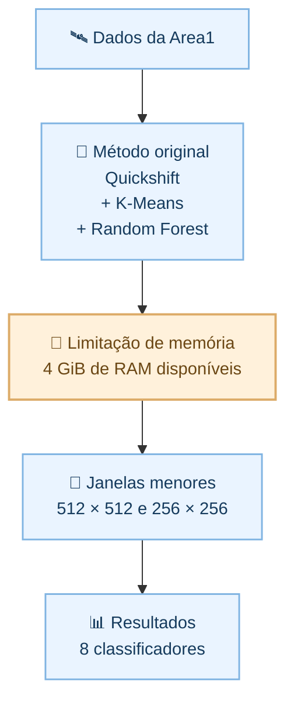
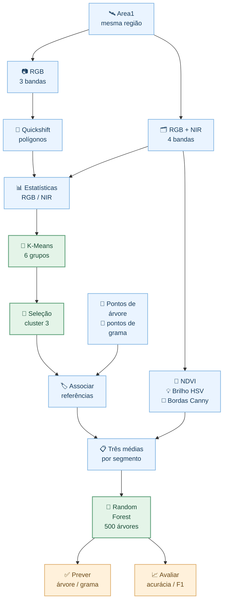
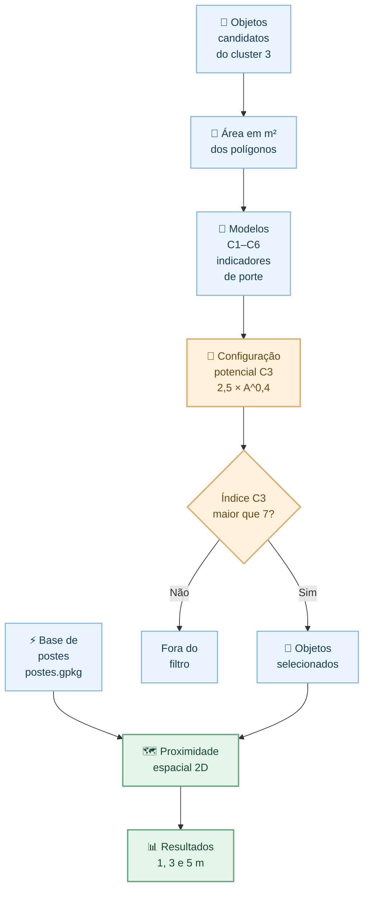
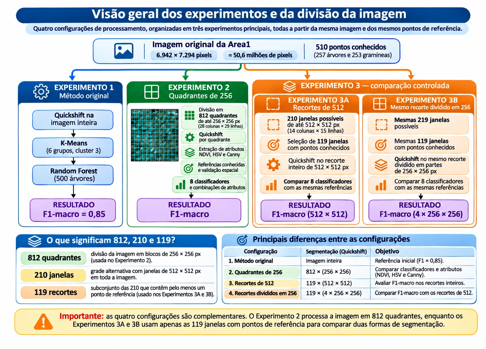
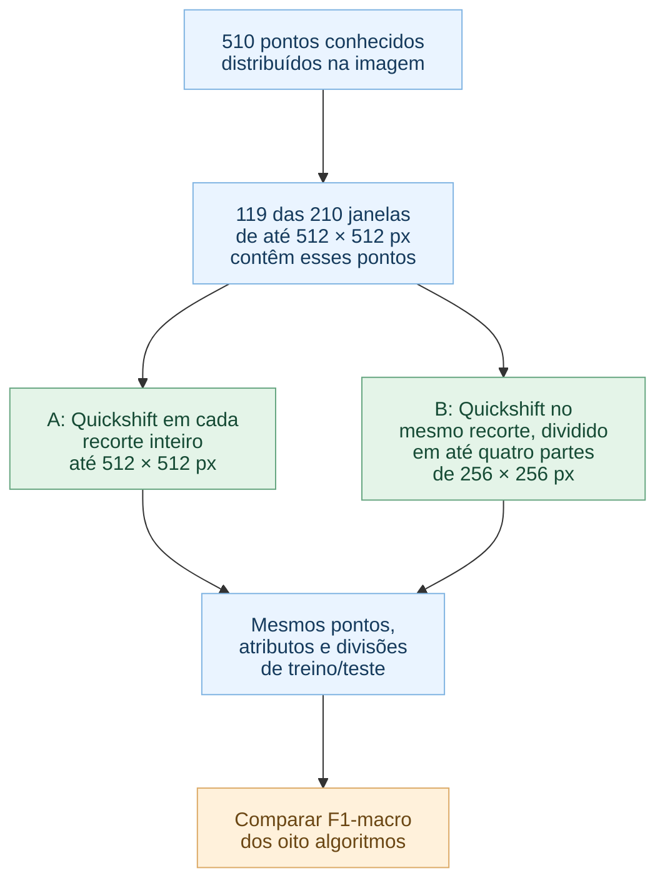

# Projeto de mestrado: Combinação de Características de Brilho, Bordas e NDVI para Detecção de Árvores Urbanas e Avaliação de Proximidade com Linhas de Energia

**Pesquisa de mestrado — Breno Braga Galvão | Em desenvolvimento**

Esta pesquisa investiga duas propostas complementares a partir de **uma única área de estudo (Area1)** em Caxias do Sul (RS):

| Proposta | Pergunta central | Resultado buscado |
|---|---|---|
| **🌳 Proposta 1 — Identificação da vegetação** | Como distinguir **árvores e gramíneas** por características de imagens de satélite? | Objetos classificados como árvore ou gramínea. |
| **⚡ Proposta 2 — Porte e proximidade de postes** | Quais objetos candidatos apresentam **indicador empírico de porte** acima do limiar e ficam próximos de postes? | Seleção exploratória e distâncias 2D a postes, **sem comprovação de risco elétrico**. |

### Roteiro de leitura

## Por que mudamos o método? A memória RAM foi o limite

**Primeiro, o método original:** aplicamos **Quickshift à imagem RGB inteira**, seguido de **K-Means (seis grupos, com seleção do cluster 3)** e **Random Forest (500 árvores)**. A execução histórica alcançou **acurácia de 0,87 em 92 exemplos de teste**, com um consumo de **5,42 GiB de memória RAM**, valor superior aos **4 GiB disponíveis** no ambiente atual, o que motivou a adoção de uma nova estratégia de processamento com janelas menores.

**Depois, tentamos repetir o Quickshift global** para comparar outros algoritmos nas mesmas condições. A imagem tem **6.942 × 7.294 pixels (50.634.948 pixels)**. Em um ambiente com **4 GiB de RAM**, a tentativa **não concluiu**: houve `MemoryError` quando o Quickshift precisou alocar **mais 1,13 GiB** para uma matriz temporária. Como o erro ocorreu **durante a segmentação**, essa nova tentativa **nem chegou ao K-Means ou ao Random Forest**.

### Quanto de memória foi necessário ou observado?

| Situação | Memória RAM | O que esse número significa? |
|---|---:|---|
| **Método original completo: Quickshift + K-Means + Random Forest** | **5,42 GiB** | **Memória de 5,42 GiB**, valor adotado como referência para o processamento da imagem completa pelo método original. |
| **Nova tentativa do Quickshift global** | **1,13 GiB adicionais solicitados; falhou** | A tentativa **não concluiu**: houve `MemoryError` quando o Quickshift precisou alocar **mais 1,13 GiB** para uma matriz temporária. |
| **Quickshift em um recorte de 2.048 × 2.048 pixels** | **Cerca de 687 MB de pico** | Medição em um recorte maior, que conseguiu concluir; não equivale à imagem inteira. |
| **119 recortes de até 512 × 512 pixels, um após o outro** | **467,19 MiB de pico** | Medição do processo na comparação entre tamanhos de janela. |
| **Os mesmos 119 recortes divididos em até quatro partes de 256 × 256** | **456,80 MiB de pico** | Medição do mesmo tipo de processo; redução observada de **10,38 MiB (2,22%)**. |

**Decisão:** em vez de insistir no Quickshift global, passamos a **dividir a imagem em janelas menores, sem reduzir a resolução dos pixels**. Isso viabilizou comparar oito classificadores com exemplos e testes equivalentes **dentro de cada novo experimento**. Não significa que reproduzimos o método global original.

---

## 1. Área de estudo e dados utilizados

A Area1 utiliza **dois arquivos raster referentes essencialmente à mesma região**, e não duas áreas de estudo:

| Arquivo raster | Bandas | O que o código faz com ele |
|---|---|---|
| `AOI_RGB_NEW.tif` | **RGB — 3 bandas** (vermelho, verde, azul) | Alimenta o **Quickshift** para criar regiões/polígonos. |
| `AOI_NEW_MULTI.tif` | **RGB + NIR — 4 bandas** | Fornece estatísticas RGB/NIR, NDVI, brilho HSV e bordas Canny. |

**Os arquivos têm papéis diferentes:** o RGB é usado para a segmentação; o RGB + NIR fornece atributos que descrevem os segmentos. As grades possuem um pequeno deslocamento entre suas origens, relevante para o alinhamento espacial.

### Dimensões e cobertura — imagem completa × área de estudo (AOI)

| Área / arquivo | Dimensões da grade (largura × altura) | Pixels na área | Área no terreno |
|---|---|---:|---:|
| **Imagem RGB completa** (`AOI_RGB_NEW.tif`) | **6.942 × 7.294 pixels** | **50.634.948** | **12,658737 km²** (≈ 12,66 km²) |
| **Imagem RGB + NIR completa** (`AOI_NEW_MULTI.tif`) | **6.942 × 7.294 pixels** | **50.634.948** | **12,658737 km²** (≈ 12,66 km²) |
| **Polígono AOI sobre o RGB** (área efetiva de estudo) | **6.942 × 7.294 pixels** (mesma grade) | **48.548.811** | **≈ 12,1372 km²** (≈ 12,14 km²) |
| **Polígono AOI sobre o RGB + NIR** (mesma área de estudo) | **6.942 × 7.294 pixels** (mesma grade) | **48.548.645** | **≈ 12,1372 km²** (≈ 12,14 km²) |

**Observação:** a **AOI usa a mesma grade de 6.942 × 7.294 pixels** das imagens. Como o polígono da área de estudo é irregular, **nem todos os pixels da grade pertencem à AOI**; por isso, a quantidade de pixels incluídos e a área em km² são menores.

### Resolução espacial e referência geográfica

| Característica | Valor |
|---|---|
| **Região da imagem** | **Caxias do Sul — Rio Grande do Sul, Brasil** |
| **Satélite atribuído na documentação** | **JL1KF01B** |
| **Disponibilização das imagens (conforme documentação da pesquisa)** | **CPFL** |
| **Dimensão de cada pixel no terreno** | **0,50 × 0,50 m** (50 × 50 cm) |
| **Área representada por pixel** | **0,25 m²** |
| **Dimensões do retângulo raster no terreno** | **3.471 m de largura × 3.647 m de altura** |
| **Sistema de coordenadas dos rasters** | **EPSG:31982** |

**Arquivos vetoriais de apoio:**

| Arquivo | Finalidade |
|---|---|
| `AOI_new.shp` e auxiliares | Polígono da área de interesse |
| `Arvores.gpkg` | **257 pontos de referência de árvores** |
| `Grama.gpkg` | **253 pontos de referência de gramíneas** |
| `postes.gpkg` | Localização dos postes |

Portanto, existem **510 pontos de referência**. Isso **não significa 510 objetos ou 510 registros de treinamento**: o Quickshift cria segmentos, que depois são associados aos pontos conhecidos.

**Esses pontos são dados originais da Area1:** já existiam nos arquivos `Arvores.gpkg` e `Grama.gpkg` e também foram utilizados no estudo inicial. Na V2 **reutilizamos somente a localização e a classe conhecida desses pontos**, não os segmentos escolhidos pelo K-Means, o Random Forest treinado, as previsões nem a acurácia de 0,87 do estudo inicial.

Os dez arquivos originais permanecem no [Google Drive — Area1](https://drive.google.com/drive/folders/1asqPz9xFr7dlnK1ggvrwftXEbkhvwjg6). Veja o [detalhamento dos arquivos e coordenadas](data/README.md).

---

## 2. 🌳 Proposta 1 — Identificação de árvores e gramíneas

**Objetivo:** classificar objetos vegetados em **árvore** ou **gramínea**, combinando NDVI, brilho HSV e bordas Canny.

### Como o código original realiza essa proposta

**Leitura do fluxo:** o **RGB** produz os polígonos; o **RGB + NIR** fornece os atributos; as referências identificam os exemplos; o **Random Forest** gera as previsões e as métricas.

**O que está acontecendo:** o Quickshift divide a imagem RGB em segmentos; o K-Means utiliza **quatro médias e quatro desvios-padrão RGB/NIR** e seleciona os objetos do **cluster 3**. Os pontos conhecidos identificam exemplos de árvores e gramíneas. O Random Forest recebe **três valores médios por objeto** — **brilho HSV, bordas Canny e NDVI** — para aprender a distinguir as duas classes.

**Parâmetros do método original:**

| Etapa | Configuração |
|---|---|
| Quickshift sobre o RGB completo | `kernel_size=3`, `max_dist=5`, `ratio=0.04` |
| K-Means | **6 clusters**, `random_state=42`, `n_init=10`; escolha do **cluster 3** |
| Random Forest | **500 árvores**, `random_state=42` |
| Treino/teste | Aleatório **80%/20%**, `random_state=42`, sem estratificação |

O método original processa aproximadamente 50 milhões de pixels, agrupando-os em segmentos por meio do Quickshift. A classificação pelo Random Forest utiliza características desses segmentos, e não os pixels individualmente. Na execução histórica, foram utilizados 458 registros rotulados, divididos aleatoriamente entre treinamento (366) e teste (92). Entretanto, o código não separava geograficamente os exemplos de treinamento e teste, o que pode influenciar a avaliação do desempenho do modelo.

### Resultados da Proposta 1

Os valores abaixo foram **registrados em execuções anteriores**:

| Indicador | Experimento inicial | Experimento com área maior |
|---|---:|---:|
| Pares objeto–rótulo | **133** | **458** |
| Treinamento | 106 | 366 |
| Teste | 27 | 92 |
| **Acurácia** | **0,81** | **0,87** |
| F1 — árvores | 0,80 | 0,85 |
| F1 — gramíneas | 0,83 | 0,88 |

**Por que são 510 pontos de referência, mas 458 registros na rodada maior?** O código mantém apenas objetos do **cluster 3** e os associa espacialmente aos pontos conhecidos. O resultado é uma tabela de **pares objeto–rótulo**: um ponto pode não ter candidato e um segmento pode gerar mais de uma associação.

Os **458 registros** geraram **366 exemplos de treinamento e 92 de teste**. A acurácia de **0,87** corresponde a esse conjunto de 92 testes. A primeira rodada de **133 registros** utilizou outras amostras; o aumento de **0,81 para 0,87**.

---

## 3. ⚡ Proposta 2 — Indicador de porte e proximidade com postes

**Objetivo:** calcular um indicador experimental de porte dos objetos e verificar sua **proximidade horizontal** aos postes da Area1.

### Como o código original realiza essa proposta

**Leitura do fluxo:** o índice **C3** é calculado a partir da área dos candidatos; apenas quem passa pelo limiar entra na análise de **distâncias aos postes**. A fórmula e os detalhes do filtro aparecem abaixo.

**No fluxograma, a “Base de postes” é o arquivo `postes.gpkg`**, utilizado como entrada independente para calcular a proximidade dos objetos selecionados.

O código calcula a área dos polígonos, testa **seis configurações empíricas (C1–C6)** nas formas potencial e linear e usa o índice potencial **C3** na seleção:

$$
\widehat{H}_{C3} = 2{,}5 \cdot A^{0{,}4}
$$

Nessa expressão, **A** é a área projetada do polígono, em **m²**. No código, o cálculo é escrito como `2.5 * (area ** 0.4)`.

Depois aplica o filtro `Power_tree_size_C3 > 7` e calcula a proximidade dos objetos selecionados a **1, 3 e 5 metros dos pontos dos postes**, usando `sjoin_nearest`.

**Ponto importante para a banca:** a Proposta 2 usa os **candidatos do cluster 3**, e o código histórico **não exige `predicted_classe == 'arvore'`** nesse filtro. Portanto, os objetos selecionados **não são necessariamente apenas árvores previstas pelo Random Forest**.

**Limites científicos:** o índice C3 **não é altura real validada**, as distâncias são **2D até postes** e a Area1 **não possui a geometria dos cabos**. Não se pode interpretar esse resultado como **interferência em fios ou risco elétrico comprovado**. [Ver as fórmulas C1–C6 e suas limitações](docs/allometria.md).

---

## 4. Imagem completa — as 17 etapas do código original

A ilustração horizontal abaixo apresenta as **17 etapas do código original**, com a **Proposta 1** (classificação) e a **Proposta 2** (índice de porte e proximidade com postes) identificadas. Os resultados exibidos na etapa 12 são os valores **históricos da aplicação inicial**: acurácia **0,87** e F1 de árvores **0,85**.

  

**Para visualizar a imagem ampliada:** clique no infográfico para abrir em tamanho original. No README, ele ocupa a largura disponível da página.

[**Abrir o infográfico horizontal ampliado (17 etapas)**](docs/fluxo_17_etapas_horizontal_corrigido.png)

Este esquema representa o **notebook original**. Os experimentos posteriores da V2, com segmentação em quadrantes, têm protocolos próprios e estão explicados **na última seção**.

## 5. Código e documentação técnica

| Material | Conteúdo |
|---|---|
| [Notebook original](Segmentacao_area_completa.ipynb) | Quickshift global, K-Means, Random Forest e proximidade |
| [Notebook V2](Segmentacao_area_completa_v2_experimentos.ipynb) | **Versão experimental com três configurações de processamento**, todas usando a imagem e os pontos de referência originais, **sem reduzir a resolução dos pixels**: **(1) Área completa em 812 quadrantes de até 256 × 256 pixels:** aplica Quickshift por quadrante, em lotes com resultados intermediários salvos para controlar o consumo de memória RAM; depois permite avaliar **oito classificadores pelo F1-macro** e investigar combinações de **NDVI, brilho HSV e bordas Canny**. **(2) Os 119 recortes de até 512 × 512 pixels:** entre 210 janelas possíveis, seleciona as 119 com pontos conhecidos, aplica Quickshift ao recorte inteiro e avalia **o F1-macro dos oito classificadores**. **(3) Os mesmos 119 recortes subdivididos em até quatro partes de 256 × 256 pixels:** aplica Quickshift separadamente em cada parte e avalia novamente **os oito classificadores**, para comparar **F1-macro e pico de memória RAM** com a configuração 2, usando as mesmas referências e divisões espaciais de treino/teste. **Organização no notebook:** a configuração 1 é um caminho progressivo independente; as configurações 2 e 3 são os dois testes de uma mesma comparação controlada. A rota progressiva oferece ainda análises opcionais de porte e proximidade com postes. **O código está implementado, mas a publicação do notebook não comprova uma nova execução integral dos 812 quadrantes.** O método original com Quickshift global permanece preservado em outro notebook. |
| [Dados Area1](data/README.md) | Arquivos, coordenadas e estrutura do Drive |
| [Registro do método original](docs/experimento_area_completa.md) | Parâmetros, resultados históricos e limitações |
| [Detalhes da tentativa com imagem completa](docs/e10_teste_execucao_local.md) | Execução do Quickshift global e erro por insuficiência de memória |
| [Classificadores e protocolos de avaliação](docs/harmonizacao_protocolos.md) | Comparações de modelos e validação espacial |
| [Comparação das segmentações de 512 e 256 pixels](docs/comparacao_controlada_segmentacao_512_vs_256.md) | Comparação pareada da segmentação |
| [Medição real dos recortes](docs/e9_medicao_memoria.md) | Pico de memória observado nos 119 recortes, com janelas de 512 e 256 pixels |
| [Estimativas C1–C6](docs/allometria.md) | Fórmulas exploratórias de porte |

---

## 6. Como saímos do método original e comparamos oito algoritmos?

Partimos da **imagem original da Area1 (6.942 × 7.294 pixels)** e dos **510 pontos georreferenciados** já conhecidos: **257 árvores** (`Arvores.gpkg`) e **253 gramíneas** (`Grama.gpkg`). A imagem inteira exigia muita memória RAM para repetir o Quickshift global; por isso, organizamos **quatro formas de processamento**, com objetivos complementares:

1. **Método original — imagem inteira:** Quickshift global → K-Means (seis grupos, seleção do cluster 3) → Random Forest. **Por quê?** Estabelecer o resultado inicial da classificação de árvores e gramíneas.
2. **Quadrantes de 256 × 256 pixels — área completa:** a imagem é organizada em **812 quadrantes**, com Quickshift por quadrante e extração de NDVI, brilho HSV e bordas Canny. **Por quê?** Reduzir a demanda de RAM e investigar **oito classificadores**, combinações de atributos e **F1-macro** com validação espacial.
3. **Recortes inteiros de 512 × 512 pixels — 119 regiões:** entre **210 janelas possíveis**, selecionamos as **119 que contêm pontos de referência conhecidos** e aplicamos Quickshift em cada recorte inteiro. **Por quê?** Avaliar os oito classificadores pelo **F1-macro** nessa escala de segmentação.
4. **Os mesmos 119 recortes subdivididos em 256 × 256 pixels:** dividimos cada recorte em até quatro partes e aplicamos Quickshift separadamente, avaliando os mesmos oito classificadores. **Por quê?** Comparar diretamente com a forma 3 o **F1-macro** e o consumo de memória RAM, mantendo os mesmos pontos e divisões espaciais de treino e teste.

**Importante:** as formas **3 e 4 são os dois testes de uma mesma comparação controlada**. Nos experimentos novos, reutilizamos **a imagem e os pontos originais**, mas não os segmentos do K-Means, o Random Forest treinado ou suas previsões. Os **119 recortes foram escolhidos pelas coordenadas das referências**, nunca pelos acertos do modelo. Há resultados documentados para baterias derivadas de quadrantes de 256 pixels; isso não comprova a conclusão de uma nova execução integral da rotina progressiva dos 812 quadrantes na V2.

  

*Figura — Visão geral dos três experimentos da Area1: método original, processamento por 812 quadrantes de 256 × 256 pixels e comparação controlada dos 119 recortes de até 512 × 512 pixels, também segmentados em partes de 256 × 256 pixels.*

**Perguntas que orientaram os testes**

| Pergunta | Como investigamos? |
|---|---|
| **1. Por que dividimos a imagem?** | Tentamos repetir o Quickshift global com limite de **4 GiB de RAM**, mas faltou memória. Passamos a processar partes menores, preservando os pixels originais. |
| **2. Por que escolhemos exatamente 119 recortes?** | Reutilizamos as **coordenadas dos 510 pontos de referência originais** (arquivos `Arvores.gpkg` e `Grama.gpkg`), **não as previsões do K-Means ou do Random Forest**. Na grade de até **512 × 512 pixels**, esses pontos ocupam **119 janelas distintas**, onde podemos avaliar a classificação. |
| **3. Qual algoritmo classifica melhor?** | Comparamos **oito classificadores**: **(1)** Random Forest; **(2)** SVM com kernel RBF; **(3)** regressão logística; **(4)** Extra Trees; **(5)** KNN (7 vizinhos); **(6)** HistGradientBoosting; **(7)** Gaussian Naive Bayes; e **(8)** Dummy (modelo de referência simples). Todos foram avaliados com os **mesmos exemplos, atributos e divisões espaciais de treinamento e teste**, permitindo comparar o desempenho pelo **F1-macro**. |
| **4. Dividir cada recorte em quatro partes muda os resultados ou a memória?** | Usamos as **mesmas 119 regiões**: primeiro segmentadas inteiras (até **512 × 512**) e depois em até **quatro partes de 256 × 256**. Comparamos previsões e medimos o pico de RAM. |
| **5. NDVI, brilho HSV e bordas Canny funcionam melhor juntos?** | Comparamos **sete combinações** dos três atributos: **(1)** apenas NDVI; **(2)** apenas brilho HSV; **(3)** apenas bordas Canny; **(4)** NDVI + brilho HSV; **(5)** NDVI + bordas Canny; **(6)** brilho HSV + bordas Canny; e **(7)** NDVI + brilho HSV + bordas Canny. Todas as combinações foram avaliadas com os mesmos classificadores e as mesmas divisões espaciais de treinamento e teste, para identificar quais características proporcionam melhores resultados na classificação de árvores e gramíneas. |

### 6.1. Primeiro: a imagem inteira e a mudança de estratégia

O método original era:

**Imagem completa → Quickshift global → K-Means (6 grupos, cluster 3) → Random Forest → acurácia histórica 0,87.**

Ao tentar repetir esse processamento, o Quickshift global falhou por memória insuficiente, antes de chegar ao K-Means e ao Random Forest. O valor de **1,13 GiB** registrado no erro era **uma alocação adicional**, não a RAM total do método. Os números e limites estão apresentados no início do README.

Na V2, usamos a **mesma imagem da Area1**, mas **segmentamos cada janela separadamente**. Isso reduz a quantidade de pixels processados **de uma só vez**, sem fazer a imagem ficar menos nítida.

| Forma de trabalhar | Quantas janelas? | Para que serviu? |
|---|---:|---|
| **Imagem original inteira** | 1 imagem com **50,6 milhões de pixels** | Referência do método global Quickshift + K-Means + Random Forest. |
| **Toda a grade em janelas de até 256 × 256 pixels** | **812 quadrantes** (28 colunas × 29 linhas) | Percorrer a **imagem retangular inteira** em partes menores. |
| **Toda a grade se fosse dividida em janelas de até 512 × 512 pixels** | **210 janelas possíveis** (14 colunas × 15 linhas) | Mostrar de onde vêm os recortes usados no teste seguinte. |
| **Somente janelas de 512 que contêm pontos conhecidos** | **119 das 210 janelas** | Comparar classificações **onde temos a resposta correta** (árvore ou gramínea). |

**Importante:** os **812 quadrantes** e os **119 recortes** **não são duas coberturas completas equivalentes**. Os 812 percorrem a imagem toda usando janelas de 256 px. Os 119 são **uma seleção** dentro da grade de 512 px, apenas para o teste com referências conhecidas.

### 6.2. Por que exatamente 119 recortes? Entenda sem confundir

**Não escolhemos o número 119 antes de começar. Ele apareceu a partir dos pontos de referência dos arquivos originais `Arvores.gpkg` e `Grama.gpkg`, e NÃO do K-Means ou das previsões do Random Forest.**

1. **Antes de executar qualquer classificador**, a Area1 já tinha **257 pontos identificados como árvores** (`Arvores.gpkg`) e **253 como gramíneas** (`Grama.gpkg`): **510 pontos de referência conhecidos**. O método inicial também utilizou esses mesmos arquivos.
2. Dividimos **mentalmente a grade da imagem** em **210 posições possíveis de 512 × 512 pixels**. As janelas nas bordas podem ser menores.
3. Localizamos cada um dos **510 pontos** na sua respectiva janela. **Vários pontos podem estar na mesma janela.**
4. Ao contar **somente as posições diferentes que continham pelo menos um ponto**, encontramos **119 janelas**. São esses os **119 recortes** — e **não 119 novas imagens nem 119 árvores**.
5. Usamos **cada um desses mesmos recortes duas vezes**: uma segmentação Quickshift com o recorte inteiro (até 512 × 512), outra com o recorte dividido em até quatro partes (256 × 256). Assim, a diferença entre os testes está **na forma de segmentar**, não no local da imagem.

**Exemplo apenas para entender a contagem:** se dez pontos conhecidos estivessem distribuídos em apenas duas janelas, usaríamos **dois recortes**, não dez. No conjunto real, os **510 pontos ficaram em 119 recortes**.

**Por que não as 210 janelas?** É possível segmentar todas elas, mas **as outras 91 não contêm pontos de referência conhecidos nesse conjunto**. Portanto, elas **não acrescentariam novos exemplos rotulados para calcular acurácia ou F1-macro**. Escolhemos as 119 para fazer a comparação dos classificadores **sem gastar processamento nas regiões sem rótulos**.

Nos 119 recortes existem **510 pontos originais**, mas, após agrupar referências que compartilham um mesmo segmento, a comparação controlada utiliza **505 referências únicas comuns**. **Pontos, recortes e segmentos são contagens diferentes.**

**Isso é diferente de comparar com o método original:** na execução histórica, a segmentação era global, havia seleção do **cluster 3 do K-Means** e foram obtidos **458 pares objeto–rótulo** para treinar/testar o Random Forest. Na comparação dos 119 recortes, a segmentação foi **refeita localmente**; por isso, os exemplos resultantes e o protocolo não são idênticos. **Os 119 recortes servem para comparar os novos algoritmos e os tamanhos de janela entre si, não para provar que um deles superou a acurácia histórica de 0,87.**

### 6.3. Primeiro resultado: quais algoritmos funcionaram melhor?

Com os segmentos derivados das **janelas de 256 × 256 pixels**, comparamos **oito classificadores** usando os **mesmos 505 segmentos rotulados únicos**, três atributos (**NDVI, brilho HSV e bordas Canny**) e divisões de treinamento e teste equivalentes.

A tabela mostra o **F1-macro médio**: quanto **maior**, melhor o equilíbrio da classificação das duas classes. Os blocos de **250 e 500 metros** servem para separar espacialmente treinamento e teste; **não são tamanhos de recortes em pixels**. Foi usado embargo de 25 m e cinco divisões por escala.

| Classificador | Blocos de 250 m | Blocos de 500 m |
|---|---:|---:|
| **SVM RBF** | **0,8987** | **0,8668** |
| Regressão logística | 0,8928 | 0,8664 |
| Extra Trees | 0,8790 | 0,8629 |
| KNN (7) | 0,8874 | 0,8502 |
| **Random Forest** | **0,8656** | **0,8530** |
| HistGradientBoosting | 0,8556 | 0,8524 |
| Gaussian Naive Bayes | 0,8555 | 0,8398 |
| Dummy (referência simples) | 0,2980 | 0,2799 |

**Ordem dos modelos:** F1-macro médio decrescente da **média aritmética das duas escalas** (250 m e 500 m). Essa média foi usada apenas para ordenar as linhas, sem substituir os resultados por escala nem constituir uma nova avaliação estatística.

**Resultado:** o **SVM RBF** teve o **maior F1-macro médio** nas duas configurações desse teste. Isso mostra um desempenho promissor **nessa nova base**; não é comparação direta com a acurácia histórica 0,87 do método global.

### 6.4. NDVI + brilho HSV + bordas Canny: os três juntos são melhores? (E4/E4b)

Para verificar se **NDVI** realmente acrescenta informação, comparamos duas condições **fixas**: **(A) brilho HSV + bordas Canny** e **(B) NDVI + brilho HSV + bordas Canny**. Os mesmos segmentos rotulados, os mesmos classificadores e as mesmas partições de treino e teste foram utilizados em cada comparação. Portanto, **"HSV + Canny" é a dupla escolhida para comparação, e não necessariamente a melhor dupla entre todas as opções**.

**O que representa cada atributo?**

- **NDVI (`mean_ndvi`):** índice espectral calculado a partir do vermelho e do infravermelho próximo (NIR), relacionado à resposta da vegetação.
- **Brilho HSV (`mean_intensity`):** medida média de intensidade/valor da cor no segmento.
- **Bordas Canny (`mean_edges`):** média do mapa de bordas detectadas, relacionada às transições locais de intensidade/contorno.

A comparação E4b foi realizada a partir da **bateria derivada de 812 quadrantes de 256 × 256 pixels**. Ela reutiliza a base já rotulada de **505 segmentos únicos**, formada a partir dos **510 pontos de referência existentes** da Area1. Foram realizados **160 ajustes e avaliações pareadas** (8 modelos × 2 conjuntos de atributos × 2 escalas espaciais × 5 divisões), com blocos de **250 m e 500 m** e **embargo espacial de 25 m entre as geometrias de teste e os objetos de treinamento**. As médias abaixo são de **F1-macro**, dando o mesmo peso a árvores e gramíneas.

**Blocos espaciais de 250 m — média de cinco divisões**

| Classificador | HSV + Canny | NDVI + HSV + Canny | Ganho ao acrescentar NDVI |
|---|---:|---:|---:|
| **SVM RBF** | 0,7523 | **0,8987** | **+0,1464** |
| Regressão logística | 0,7556 | **0,8928** | +0,1372 |
| KNN (7) | 0,7445 | **0,8874** | +0,1429 |
| Extra Trees | 0,7008 | **0,8790** | +0,1782 |
| **Random Forest** | 0,6925 | **0,8656** | +0,1731 |
| HistGradientBoosting | 0,7206 | **0,8556** | +0,1349 |
| Gaussian Naive Bayes | 0,7409 | **0,8555** | +0,1146 |
| Dummy (maioria) | 0,2980 | 0,2980 | 0,0000 |

**Ordem dos modelos:** F1-macro médio decrescente da combinação **NDVI + HSV + Canny** nos blocos de 250 m. A dupla HSV + Canny permanece fixa para comparação.

**Blocos espaciais de 500 m — média de cinco divisões**

| Classificador | HSV + Canny | NDVI + HSV + Canny | Ganho ao acrescentar NDVI |
|---|---:|---:|---:|
| **SVM RBF** | 0,7886 | **0,8668** | **+0,0781** |
| Regressão logística | 0,7992 | **0,8664** | +0,0671 |
| Extra Trees | 0,7208 | **0,8629** | +0,1421 |
| **Random Forest** | 0,7264 | **0,8530** | +0,1266 |
| HistGradientBoosting | 0,7327 | **0,8524** | +0,1197 |
| KNN (7) | 0,7678 | **0,8502** | +0,0824 |
| Gaussian Naive Bayes | 0,7699 | **0,8398** | +0,0700 |
| Dummy (maioria) | 0,2799 | 0,2799 | 0,0000 |

**Ordem dos modelos:** F1-macro médio decrescente da combinação **NDVI + HSV + Canny** nos blocos de 500 m.

**Como interpretar:** com o terceiro atributo, os **sete classificadores treináveis** tiveram F1-macro **médio maior em ambas as escalas**, enquanto o Dummy permaneceu igual porque ignora os atributos. Em **250 m**, o trio venceu a dupla nos cinco testes de cada classificador treinável; em **500 m**, venceu em **quatro dos cinco testes** para regressão logística e Naive Bayes e em **cinco dos cinco** para os demais. Os ganhos são **diferenças absolutas de F1-macro**, não aumentos relativos nem taxas de acerto: +0,1464 significa **14,64 pontos percentuais na escala de F1**.

**E as outras combinações?** O experimento E4 anterior também comparou **sete subconjuntos não vazios** dos três atributos (cada um isolado, cada dupla e os três juntos), usando **Random Forest, SVM RBF e regressão logística**. Nessa bateria, o trio teve a maior média entre as sete combinações para os três modelos nas duas escalas. **Essa é outra comparação**, cujas partições e médias diferem da bateria E4b. Veja o [resumo das sete combinações](docs/E4_resumo_ablacao_812_quadrantes_2026-11-01.csv).

**Evidência e reprodução:** as médias da tabela E4b estão no [CSV-resumo dos oito classificadores](docs/E4b_oito_modelos_HSV_Canny_vs_tres_2026-11-02.csv). As **160 avaliações por divisão espacial** estão no [CSV detalhado do E4b](docs/E4b_oito_modelos_resultados_por_particao_2026-11-02.csv). Foi conferida a correspondência exata (**diferença numérica zero**) entre os **80 resultados do trio** no E4b e os resultados anteriores do **E3c**, para as mesmas divisões e embargo geométrico. Os outros **80 resultados**, com apenas HSV + Canny, foram calculados sobre essas mesmas divisões.

A [V2](Segmentacao_area_completa_v2_experimentos.ipynb) foi ampliada na **Etapa 2** para gerar `E4b_oito_modelos_rodadas.csv` e `E4b_oito_modelos_HSV_Canny_vs_tres.csv` quando o processamento dos 812 quadrantes for executado e concluído. **A versão atual do notebook ainda não foi reexecutada para validar esses novos arquivos.** Além disso, a implementação progressiva atual emprega embargo por **centroides**, enquanto o E4b acima utilizou **geometrias completas**; os números não devem ser anunciados como uma reprodução idêntica dessa nova execução até conferir o protocolo.

**Limites científicos:** os testes reutilizam exemplos da **mesma Area1**, sem dados rotulados de fundo urbano e sem validação externa. As cinco divisões por escala também não são observações independentes. O resultado sustenta que **acrescentar NDVI melhorou o F1-macro médio nos protocolos avaliados**, mas não prova desempenho superior em outras regiões ou significância estatística.

### 6.5. Segundo resultado: 512 × 512 é melhor que quatro partes de 256 × 256?

Agora a pergunta é outra: **se os classificadores receberem segmentos formados de maneiras diferentes, a previsão muda?** Para responder, mantivemos **os mesmos 119 recortes**, referências e divisões de teste; só alteramos a segmentação:

**F1-macro médio com cinco divisões por escala e distância de exclusão de 25 m entre os pontos:**

| Classificador | 250 m: 512 inteiro | 250 m: quatro 256 | 500 m: 512 inteiro | 500 m: quatro 256 |
|---|---:|---:|---:|---:|
| **SVM RBF** | 0,9157 | **0,9341** | 0,8518 | **0,8641** |
| Regressão logística | 0,9153 | **0,9157** | 0,8484 | **0,8685** |
| Extra Trees | **0,9064** | 0,8968 | **0,8747** | 0,8545 |
| Random Forest | **0,8906** | 0,8835 | **0,8657** | 0,8566 |
| KNN (7) | 0,8940 | **0,9009** | 0,8377 | **0,8486** |
| Gaussian Naive Bayes | **0,8894** | 0,8875 | **0,8573** | 0,8464 |
| HistGradientBoosting | **0,8738** | 0,8714 | 0,8390 | **0,8411** |
| Dummy | 0,2847 | 0,2847 | 0,2791 | 0,2791 |

**Ordem dos modelos:** F1-macro médio decrescente da **média aritmética das quatro condições** exibidas (250/500 m × 512/256 px). É somente um critério de apresentação: as diferenças entre protocolos e o vencedor em cada condição continuam descritos separadamente.

**O que aprendemos:** com blocos geográficos de **250 m**, o maior resultado foi **SVM RBF em quatro partes de 256 px (0,9341)**. Com blocos de **500 m**, foi **Extra Trees em recortes inteiros de 512 px (0,8747)**. Ou seja, **não existe um vencedor único em todas as condições**.

Medimos também a memória: **467,19 MiB** no processamento de 512 contínuo e **456,80 MiB** em quatro partes de 256; uma diferença de **10,38 MiB (2,22%)** no pico total de RAM do processo, considerando os **119 recortes processados sequencialmente**. **Esse valor não representa a RAM necessária para executar o Quickshift global original.**

### 6.6. O que podemos concluir — e o que não podemos?

**Conseguimos:** contornar a limitação de memória pela segmentação em partes, comparar **sete combinações de NDVI, brilho HSV e Canny**, avaliar **oito classificadores** em condições homogêneas dentro de cada teste, investigar o efeito de janelas de **512 e 256 pixels** e identificar resultados promissores, principalmente do **SVM RBF**.

**Ainda não conseguimos comprovar:** que a V2 supera o **Quickshift global + K-Means + Random Forest** original. Embora os **pontos de referência sejam os mesmos arquivos de origem**, a V2 gerou **novos segmentos** em janelas, não reutilizou o cluster 3 nem as previsões históricas e usou outro treinamento/teste. Além disso, o resultado histórico **0,87 é acurácia**, não a mesma F1-macro da V2. Também **não medimos a memória total do pipeline original**.

As análises de porte e proximidade são **exploratórias**: sem alturas medidas, classe de fundo urbano e geometria dos cabos, **não comprovam risco elétrico**.

**Onde estão os códigos e os resultados:** [Resumo E4 — combinações de atributos](docs/E4_resumo_ablacao_812_quadrantes_2026-11-01.csv) · [Notebook V2](Segmentacao_area_completa_v2_experimentos.ipynb) · [Código para comparar 512 e 256 pixels](experimentos/e9_reproduzir_512_256.py) · [Comparação dos oito algoritmos](docs/harmonizacao_protocolos.md) · [Comparação das janelas](docs/comparacao_controlada_segmentacao_512_vs_256.md) · [Medição de memória](docs/e9_medicao_memoria.md).

*As tabelas foram obtidas em experimentos já documentados. O código atual da V2 foi reorganizado para reexecutá-los, mas essa versão simplificada ainda precisa ser executada e comparada aos resultados publicados.*

