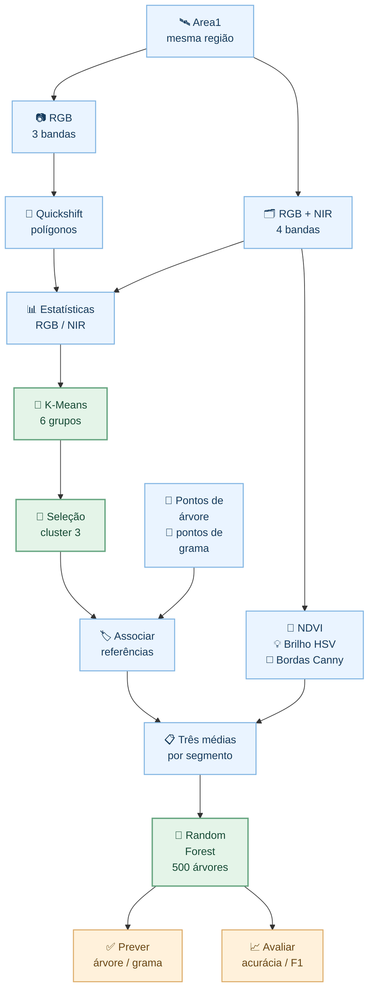
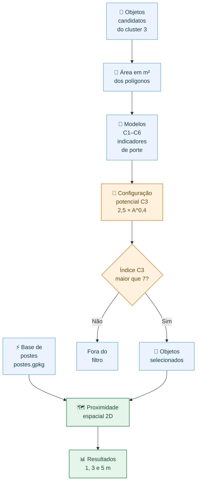
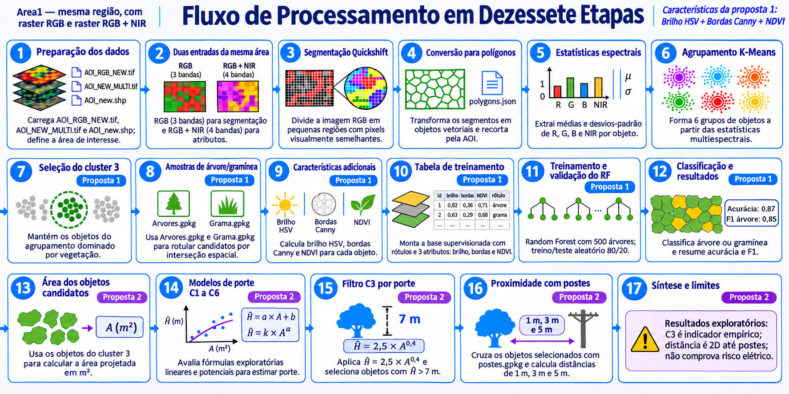
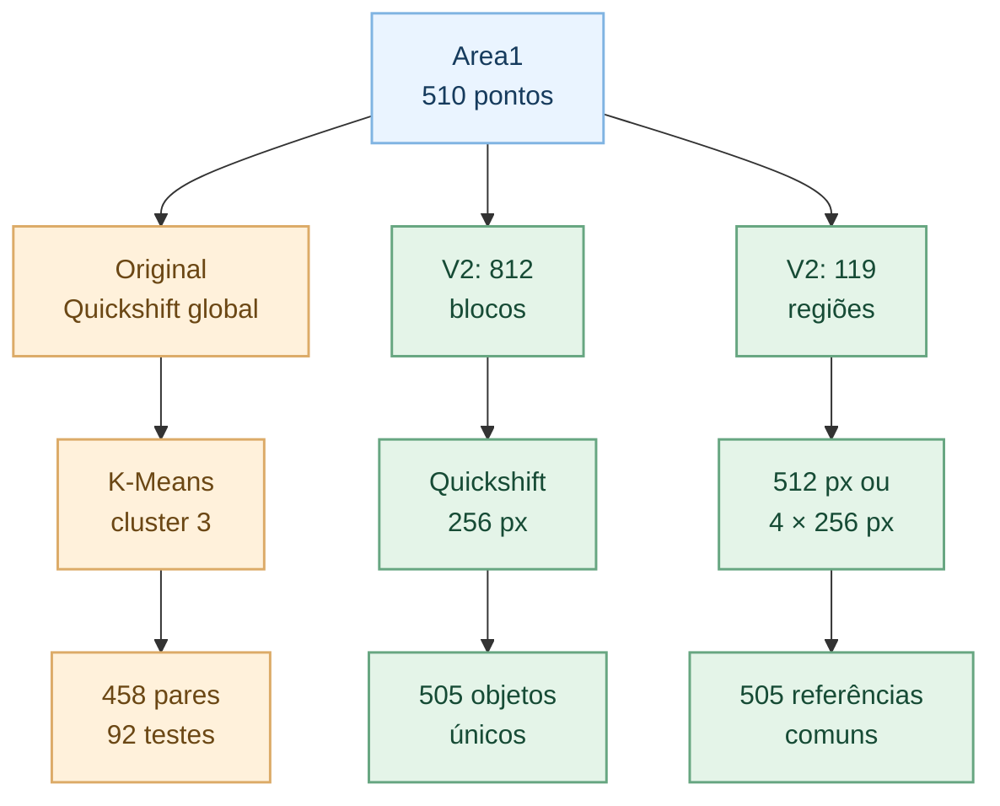
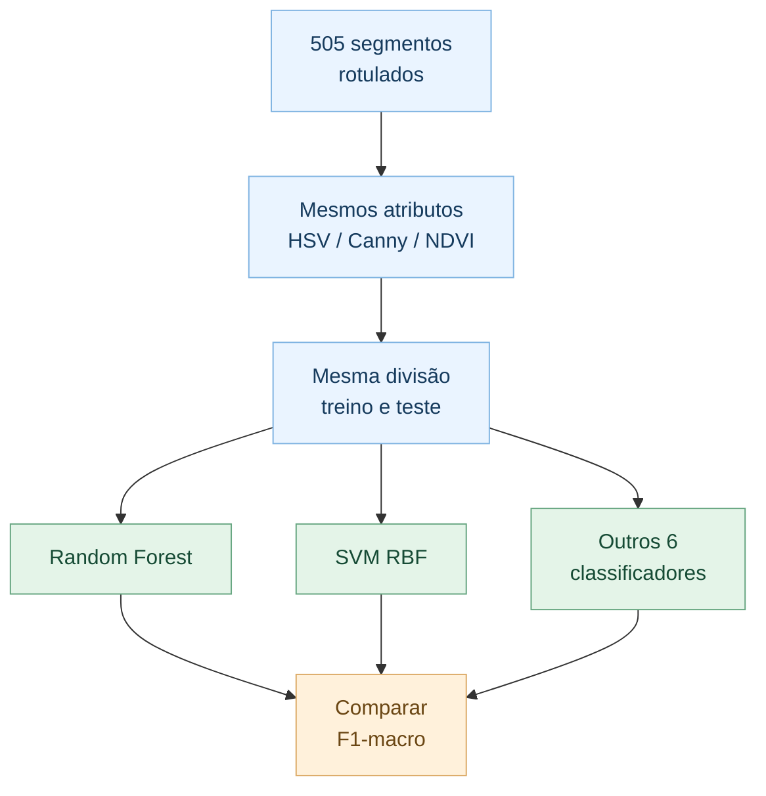
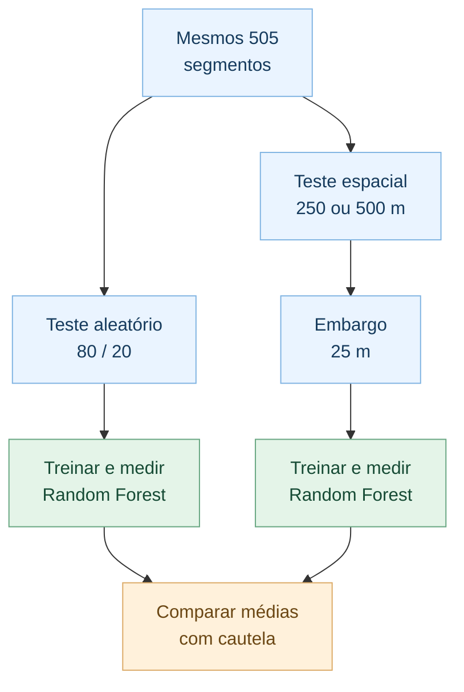
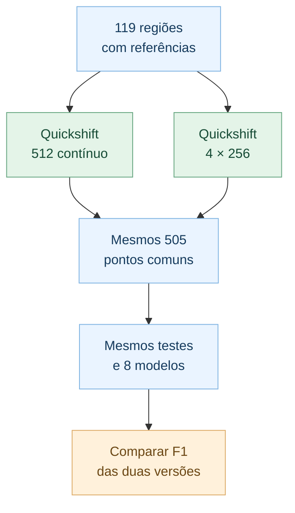

# Projeto de mestrado para detecção de árvores urbanas e avaliação de proximidade com linhas de energia utilizando brilho, bordas, NDVI e imagens aéreas.

**Pesquisa de mestrado — Breno Braga Galvão | Em desenvolvimento**

Esta pesquisa investiga duas propostas complementares a partir de **uma única área de estudo (Area1)** em Caxias do Sul (RS):

| Proposta | Pergunta central | Resultado buscado |
|---|---|---|
| **🌳 Proposta 1 — Identificação da vegetação** | Como distinguir **árvores e gramíneas** por características de imagens de satélite? | Objetos classificados como árvore ou gramínea. |
| **⚡ Proposta 2 — Porte e proximidade de postes** | Quais objetos candidatos apresentam **indicador empírico de porte** acima do limiar e ficam próximos de postes? | Seleção exploratória e distâncias 2D a postes, **sem comprovação de risco elétrico**. |

**Roteiro de leitura:** dados → **Proposta 1** → resultados históricos → **Proposta 2** → imagem completa das 17 etapas → documentação. **Todas as comparações dos experimentos novos aparecem no final do README.**

## 1. Área de estudo e dados utilizados

A Area1 utiliza **dois arquivos raster referentes essencialmente à mesma região**, e não duas áreas de estudo:

| Arquivo raster | Bandas | O que o código faz com ele |
|---|---|---|
| `AOI_RGB_NEW.tif` | **RGB — 3 bandas** (vermelho, verde, azul) | Alimenta o **Quickshift** para criar regiões/polígonos. |
| `AOI_NEW_MULTI.tif` | **RGB + NIR — 4 bandas** | Fornece estatísticas RGB/NIR, NDVI, brilho HSV e bordas Canny. |

**Os arquivos têm papéis diferentes:** o RGB é usado para a segmentação; o RGB + NIR fornece atributos que descrevem os segmentos. As grades possuem um pequeno deslocamento entre suas origens, relevante para o alinhamento espacial.

| Característica | Valor |
|---|---|
| **Imagem RGB — largura × altura** | **6.942 × 7.294 pixels** (colunas × linhas) |
| **Imagem RGB + NIR — largura × altura** | **6.942 × 7.294 pixels** (colunas × linhas) |
| **Total de pixels por imagem** | **50.634.948** na grade retangular completa |
| **Dimensão de cada pixel no terreno** | **0,50 m × 0,50 m** (50 cm × 50 cm) |
| **Área representada por pixel** | **0,25 m²** |
| **Dimensões da imagem no terreno** | **3.471 m de largura × 3.647 m de altura** |
| **Área da imagem retangular completa** | **12,658737 km²** (aproximadamente **12,66 km²**) |
| **Pixels dentro da AOI — raster RGB** | **48.548.811 pixels** |
| **Pixels dentro da AOI — raster RGB + NIR** | **48.548.645 pixels** |
| **Área do polígono de estudo (AOI)** | **12,1372 km²** (aproximadamente **12,14 km²**) |
| **Sistema de coordenadas dos rasters** | **EPSG:31982** |

**Qual é a diferença entre a imagem inteira e o recorte da Area1?** Cada arquivo raster contém uma **grade retangular de 6.942 × 7.294 pixels**. O arquivo `AOI_new.shp` delimita, dentro dessa grade, um **polígono irregular**. Assim, a área efetiva do estudo possui aproximadamente **48,55 milhões de pixels**, mas não tem um segundo par de dimensões retangulares em pixels que represente exatamente seu formato.

As duas contagens da AOI foram **calculadas diretamente sobre os rasters originais**, contabilizando os pixels **cujo centro cai dentro do polígono**. A diferença de **166 pixels** entre RGB e RGB + NIR decorre do pequeno deslocamento entre as grades. Trata-se da **cobertura geométrica do polígono**, não do número de exemplos usados para treinar o Random Forest nem de uma medida de pixels espectrais válidos.

Os **12,66 km²** correspondem à extensão retangular dos rasters, enquanto **12,14 km²** correspondem ao polígono AOI. A documentação indica imagens fornecidas pela **CPFL**, atribuídas ao satélite **JL1KF01B**, sem data de aquisição especificada.

**Arquivos vetoriais de apoio:**

| Arquivo | Finalidade |
|---|---|
| `AOI_new.shp` e auxiliares | Polígono da área de interesse |
| `Arvores.gpkg` | **257 pontos de referência de árvores** |
| `Grama.gpkg` | **253 pontos de referência de gramíneas** |
| `postes.gpkg` | Localização dos postes |

Portanto, existem **510 pontos de referência**. Isso **não significa 510 objetos ou 510 registros de treinamento**: o Quickshift cria segmentos, que depois são associados aos pontos conhecidos.

Os dez arquivos originais permanecem no [Google Drive — Area1](https://drive.google.com/drive/folders/1asqPz9xFr7dlnK1ggvrwftXEbkhvwjg6). Veja o [detalhamento dos arquivos e coordenadas](data/README.md).

---

## 2. 🌳 Proposta 1 — Identificação de árvores e gramíneas

**Objetivo:** classificar objetos vegetados em **árvore** ou **gramínea**, combinando NDVI, brilho HSV e bordas Canny.

### Como o código original realiza essa proposta

**Leitura do fluxo:** o **RGB** produz os polígonos; o **RGB + NIR** fornece os atributos; as referências identificam os exemplos; o **Random Forest** gera as previsões e as métricas.

**O que está acontecendo:** o Quickshift divide a imagem RGB em segmentos; o K-Means utiliza **quatro médias e quatro desvios-padrão RGB/NIR** e seleciona os objetos do **cluster 3**. Os pontos conhecidos identificam exemplos de árvores e gramíneas. O Random Forest recebe **três valores médios por objeto** — **brilho HSV, bordas Canny e NDVI** — para aprender a distinguir as duas classes.

**Parâmetros do método original:**

| Etapa | Configuração |
|---|---|
| Quickshift sobre o RGB completo | `kernel_size=3`, `max_dist=5`, `ratio=0.04` |
| K-Means | **6 clusters**, `random_state=42`, `n_init=10`; escolha do **cluster 3** |
| Random Forest | **500 árvores**, `random_state=42` |
| Treino/teste | Aleatório **80%/20%**, `random_state=42`, sem estratificação |

O método **não utiliza 50 milhões de pixels como 50 milhões de registros independentes**. Também não havia deduplicação explícita nem separação espacial entre treino e teste.

### Resultados históricos da Proposta 1

Os valores abaixo foram **registrados em execuções anteriores**, não recalculados por uma nova execução integral comprovada.

| Indicador | Experimento inicial | Experimento com área maior |
|---|---:|---:|
| Pares objeto–rótulo | **133** | **458** |
| Treinamento | 106 | 366 |
| Teste | 27 | 92 |
| **Acurácia** | **0,81** | **0,87** |
| F1 — árvores | 0,80 | 0,85 |
| F1 — gramíneas | 0,83 | 0,88 |

**Por que são 510 pontos de referência, mas 458 registros na rodada maior?** O código mantém apenas objetos do **cluster 3** e os associa espacialmente aos pontos conhecidos. O resultado é uma tabela de **pares objeto–rótulo**: um ponto pode não ter candidato e um segmento pode gerar mais de uma associação. Portanto, **não podemos concluir que 52 pontos foram descartados** sem auditar a execução histórica.

Os **458 registros** geraram **366 exemplos de treinamento e 92 de teste**. A acurácia de **0,87** corresponde a esse conjunto de 92 testes. A primeira rodada de **133 registros** utilizou outras amostras; o aumento de **0,81 para 0,87** é descritivo e não comprova, sozinho, um ganho causado pelo tamanho da área.

---

## 3. ⚡ Proposta 2 — Indicador de porte e proximidade com postes

**Objetivo:** calcular um indicador experimental de porte dos objetos e verificar sua **proximidade horizontal** aos postes da Area1.

### Como o código original realiza essa proposta

**Leitura do fluxo:** o índice **C3** é calculado a partir da área dos candidatos; apenas quem passa pelo limiar entra na análise de **distâncias aos postes**. A fórmula e os detalhes do filtro aparecem abaixo.

**No fluxograma, a “Base de postes” é o arquivo `postes.gpkg`**, utilizado como entrada independente para calcular a proximidade dos objetos selecionados.

O código calcula a área dos polígonos, testa **seis configurações empíricas (C1–C6)** nas formas potencial e linear e usa o índice potencial **C3** na seleção:

$$
\widehat{H}_{C3} = 2{,}5 \cdot A^{0{,}4}
$$

Nessa expressão, **A** é a área projetada do polígono, em **m²**. No código, o cálculo é escrito como `2.5 * (area ** 0.4)`.

Depois aplica o filtro `Power_tree_size_C3 > 7` e calcula a proximidade dos objetos selecionados a **1, 3 e 5 metros dos pontos dos postes**, usando `sjoin_nearest`.

**Ponto importante para a banca:** a Proposta 2 usa os **candidatos do cluster 3**, e o código histórico **não exige `predicted_classe == 'arvore'`** nesse filtro. Portanto, os objetos selecionados **não são necessariamente apenas árvores previstas pelo Random Forest**.

**Limites científicos:** o índice C3 **não é altura real validada**, as distâncias são **2D até postes** e a Area1 **não possui a geometria dos cabos**. Não se pode interpretar esse resultado como **interferência em fios ou risco elétrico comprovado**. [Ver as fórmulas C1–C6 e suas limitações](docs/allometria.md).

---

**Sobre os fluxogramas:** ambos estão em **código Mermaid**, como originalmente, com descrições completas, cores e espaçamento ampliado dentro das caixas para evitar cortes no GitHub. Eles representam o método original; a comparação da V2 está ao final do documento.

---

## 4. Imagem completa — as 17 etapas do código original

A ilustração horizontal abaixo apresenta as **17 etapas do código original**, com a **Proposta 1** (classificação) e a **Proposta 2** (índice de porte e proximidade com postes) identificadas. Os resultados exibidos na etapa 12 são os valores **históricos da rodada maior**: acurácia **0,87** e F1 de árvores **0,85**.

  

**Para visualizar a imagem ampliada:** clique no infográfico para abrir em tamanho original. No README, ele ocupa a largura disponível da página.

[**Abrir o infográfico horizontal ampliado (17 etapas)**](docs/fluxo_17_etapas_horizontal_corrigido.png)

Este esquema representa o **notebook original**. Os experimentos posteriores da V2, com segmentação em quadrantes, têm protocolos próprios e estão explicados **na última seção**.

## 5. Código e documentação técnica

| Material | Conteúdo |
|---|---|
| [Notebook original](Segmentacao_area_completa.ipynb) | Quickshift global, K-Means, Random Forest e proximidade |
| [Notebook V2](Segmentacao_area_completa_v2_experimentos.ipynb) | Auditoria de amostras, comparação de modelos, validação espacial, atributos, segmentação, porte e proximidade com postes |
| [Dados Area1](data/README.md) | Arquivos, coordenadas e estrutura do Drive |
| [Registro do método original](docs/experimento_area_completa_2026-10-29.md) | Parâmetros, resultados históricos e limitações |
| [Classificadores e protocolos de avaliação](docs/harmonizacao_protocolos_2026-11-01.md) | Comparações de modelos e validação espacial |
| [Comparação das segmentações de 512 e 256 pixels](docs/comparacao_controlada_segmentacao_512_vs_256_2026-11-01.md) | Comparação pareada da segmentação |
| [Estimativas C1–C6](docs/allometria.md) | Fórmulas exploratórias de porte |

Os arquivos da Area1 ficam no **Google Drive**, e o notebook original foi preparado para **Google Colab**. O processamento global consome muita memória; **uma nova execução completa e bem-sucedida não está comprovada**. As baterias da V2 têm evidências documentadas separadamente, mas nem todas as saídas estão salvas no próprio notebook publicado.

---

## 6. Comparação científica — o que foi testado e o que os resultados significam

### Qual é a finalidade desta seção?

A seção 6 **não serve apenas para comparar o Random Forest original com algoritmos novos**. Seu objetivo é **avaliar cientificamente a metodologia desenvolvida**: descobrir quais escolhas influenciam o desempenho, se os resultados permanecem consistentes sob diferentes avaliações e o que ainda precisamos demonstrar.

As quatro perguntas principais são:

| O que avaliamos | Pergunta que queremos responder |
|---|---|
| **1. Algoritmos de classificação** | Random Forest, SVM, regressão logística e outros: **qual apresenta melhor desempenho quando os testes são equivalentes?** |
| **2. Características da imagem** | **NDVI, brilho HSV e bordas Canny juntos** funcionam melhor do que atributos isolados ou combinações menores? |
| **3. Forma de avaliar** | O desempenho **continua bom quando treino e teste estão geograficamente separados**, em vez de apenas sorteados? |
| **4. Forma de segmentar** | Segmentar um recorte contínuo de **512 × 512 pixels** produz resultados diferentes de usar **quatro quadrantes de 256 × 256 pixels**? |

Os experimentos complementares também examinam **a qualidade dos rótulos, a seleção de objetos próximos a postes, a extrapolação dos atributos e a sensibilidade dos indicadores empíricos de porte**. São verificações importantes, mas **não constituem uma medição validada de altura ou risco elétrico**.

**E a comparação com o Random Forest original, que obteve 0,87 de acurácia?** Essa é uma **questão adicional ainda não respondida de forma definitiva**. Os experimentos novos permitem comparações válidas **dentro dos próprios protocolos**, mas **ainda não demonstram que a metodologia completa da V2 supera o método original**, porque as bases, os segmentos e os testes não foram mantidos idênticos.

> **Regra principal:** utilizar os **mesmos arquivos da Area1** não significa utilizar os **mesmos objetos, registros, divisões de teste ou métricas**. Para afirmar que houve melhoria, é necessário controlar essas diferenças.

### Guia dos experimentos: nomes e objetivos

Os códigos **E1, E2, E3c, E8h, E9** e semelhantes são apenas **identificadores de seções do notebook**. Eles **não são resultados, métricas nem nomes dos algoritmos**. Por isso, apresentamos primeiro o **nome do que foi investigado**; o código fica somente como referência para localizar as células.

| Nome da investigação | Código no notebook |
|---|---|
| **Auditoria das amostras e rótulos:** conferir duplicações, conflitos e sobreposições entre treino e teste | E1 |
| **Validação espacial:** separar treino e teste por regiões geográficas | E2 |
| **Comparação de classificadores:** testar Random Forest, SVM, regressão logística e outros modelos nas mesmas divisões | E3 / E3c |
| **Contribuição dos atributos:** testar NDVI, brilho HSV e bordas Canny isolados e combinados | E4 |
| **Sensibilidade da segmentação:** variar parâmetros de Quickshift e K-Means | E5 |
| **Análise da proximidade a postes:** comparar critérios de seleção com e sem filtro de classe | E6 |
| **Extrapolação dos atributos:** identificar candidatos fora das faixas de características conhecidas | E6c |
| **Sensibilidade dos modelos de porte:** comparar configurações C1–C6 e limiares | E7 |
| **Consolidação científica e revisão da literatura:** documentar evidências, execução e limitações | E8 |
| **Harmonização das avaliações:** comparar avaliação aleatória e espacial com as mesmas métricas na base derivada | E8h |
| **Comparação das escalas de segmentação:** recortes contínuos de 512 pixels versus quadrantes de 256 pixels | E9 |

A seguir, detalhamos **três comparações centrais**: classificadores, formas de validação e estratégias de segmentação.

### 6.1. Primeiro entenda: quais dados entram em cada teste?

Abaixo está o caminho dos dados. **Uma mesma Area1 dá origem a bases supervisionadas diferentes**, conforme a segmentação e a seleção de objetos.

| Experimento | Como formou a base | Quantidade usada | Como avaliou |
|---|---|---|---|
| **Original inicial** | Primeira rodada histórica; recorte não reconstruído integralmente | **133 pares** objeto–rótulo | **27 testes** aleatórios |
| **Original ampliado** | Quickshift **global** + K-Means **cluster 3** | **458 pares** objeto–rótulo | **92 testes** aleatórios |
| **V2 — classificadores e validação espacial** | Quickshift independente em **812 blocos de até 256 × 256 px** | **505 segmentos únicos** (257 árvores, 248 gramíneas) | Divisões **aleatórias e espaciais** |
| **V2 — comparação da segmentação** | **119 regiões**, cada uma segmentada em **512 contínuo** ou **quatro blocos 256** | **505 referências comuns às duas alternativas de segmentação** | Testes **espaciais pareados** |

**Por que 458 e 505 não são a mesma base?** No original, eram contados **pares segmento–rótulo após a seleção do cluster 3**, sem deduplicação explícita. Na comparação de classificadores, foram obtidos **segmentos rotulados únicos** de outra segmentação. Na comparação das estratégias de segmentação, os **505 são referências compartilhadas entre as duas formas de processar os mesmos recortes**. A coincidência numérica de 505 nas duas comparações novas **não significa que elas tenham as mesmas geometrias**.

Na comparação de classificadores, os 812 blocos produziram **168.133 segmentos** em toda a extensão retangular do raster, incluindo partes fora da AOI. Somente os **505 rotulados** entraram nos testes supervisionados. A comparação de segmentações trabalha com **recortes locais selecionados**, não com toda a imagem.

### 6.2. Comparação de oito classificadores — Random Forest, SVM e alternativas

**Pergunta:** se os dados e a divisão de teste forem iguais, **Random Forest, SVM ou outro algoritmo** classifica melhor os objetos?

**Como a comparação funciona:**

1. Partimos dos **mesmos 505 segmentos únicos** da base derivada.
2. Para cada modelo, utilizamos **as mesmas três características** e **a mesma divisão de treino/teste** dentro de cada rodada.
3. Mudamos **o classificador** e calculamos as **mesmas métricas**. Assim, a comparação entre algoritmos **é válida dentro daquele protocolo**.

A tabela mostra **F1-macro médio** de cinco divisões espaciais com embargo de **25 m das geometrias de teste**:

| Modelo | Blocos de 250 m | Blocos de 500 m |
|---|---:|---:|
| **SVM RBF** | **0,8987** | **0,8668** |
| Regressão logística | 0,8928 | 0,8664 |
| KNN (7) | 0,8874 | 0,8502 |
| Extra Trees | 0,8790 | 0,8629 |
| **Random Forest** | **0,8656** | **0,8530** |
| HistGradientBoosting | 0,8556 | 0,8524 |
| Gaussian Naive Bayes | 0,8555 | 0,8398 |
| Dummy (referência simples) | 0,2980 | 0,2799 |

**Exemplo:** no protocolo de blocos **250 m / embargo 25 m**, SVM obteve média **0,8987**, e Random Forest **0,8656**. O **SVM teve maior média nessas condições**, sem comprovar que seria superior em qualquer área ou que a diferença seja estatisticamente significativa.

A **análise da contribuição das características** também comparou combinações das características e encontrou maior F1 médio com **NDVI + brilho HSV + Canny juntos** nas condições estudadas. A **análise de sensibilidade da segmentação** avaliou parâmetros de Quickshift/K-Means; a medida *silhouette* do K-Means **não é acurácia de classificação**.

### 6.3. Avaliação aleatória versus avaliação espacial — por que testar as duas?

**Pergunta:** o desempenho estimado muda quando o modelo é testado com objetos sorteados aleatoriamente ou com **regiões geograficamente separadas**?

**Entenda a diferença:** no **teste aleatório 80/20**, alguns objetos de treinamento podem ficar muito próximos dos objetos testados. No **teste espacial**, usamos blocos geográficos e afastamos objetos de treinamento das **geometrias de teste** por um embargo de 25 m. O objetivo é investigar se o desempenho se mantém quando os testes são espacialmente mais separados.

**Random Forest sobre a base nova de 505 segmentos:**

| Avaliação | Acurácia média | F1-macro médio |
|---|---:|---:|
| Aleatória 80/20 | **0,8832** | **0,8827** |
| Espacial 250 m, embargo 25 m | 0,8697 | 0,8656 |
| Espacial 500 m, embargo 25 m | 0,8591 | 0,8530 |

Foram **40 ajustes aleatórios novos** (oito modelos × cinco divisões) e **240 resultados espaciais da comparação de classificadores, reutilizados com verificações**, não 280 ajustes inteiramente novos.

**Cuidado importante:** as divisões aleatórias e espaciais **não testam exatamente os mesmos objetos**. Portanto, as diferenças das médias são **descritivas**: não podemos dizer que toda a diferença foi causada somente pelo embargo.

Também repetimos a **regra histórica** do Random Forest (500 árvores, divisão aleatória 80/20, semente 42), **mas usando a base nova**: **404 treino, 101 teste, acurácia 0,9010 e F1-macro 0,9009**. **Não é reprodução do 0,87 histórico**, porque a base original possuía 458 pares, não 505 segmentos novos.

### 6.4. Comparação da segmentação — recortes contínuos de 512 versus quadrantes de 256 pixels

**Pergunta:** mantendo os **mesmos pontos, modelos e divisões**, segmentar um recorte contínuo de **512 × 512 pixels** dá resultados diferentes de dividi-lo em **quatro quadrantes de 256 × 256 pixels**?

**O que é mantido igual:** os rasters e recortes originais, os **505 pontos de referência compartilhados**, os mapas de **NDVI, brilho HSV e Canny**, os modelos e as divisões de teste dentro da comparação de segmentações. **O que muda:** a forma como o Quickshift divide cada recorte em segmentos. Portanto, as **médias dos atributos por segmento podem mudar**.

O protocolo usa cinco divisões por escala (250 e 500 m) e, no quadro abaixo, embargo de **25 m entre pontos de referência** — diferente do embargo **entre geometrias completas** utilizado na comparação de classificadores. Foram **320 avaliações** no total.

**F1-macro médio nos testes pareados da comparação de segmentações:**

| Blocos | Modelo | 512 contínuo | Quatro 256 |
|---|---|---:|---:|
| 250 m | Random Forest | **0,8906** | 0,8835 |
| 250 m | SVM RBF | 0,9157 | **0,9341** |
| 500 m | Random Forest | **0,8657** | 0,8566 |
| 500 m | SVM RBF | 0,8518 | **0,8641** |

**Exemplo:** com blocos de 250 m, o Random Forest apresentou média maior no **512 contínuo**, mas o SVM teve média maior nos **quatro quadrantes 256**. O efeito **depende do classificador** e não foi igual em todas as divisões.

**Atenção:** “512 contínuo” é **um recorte local de 512 pixels**. **Não equivale ao Quickshift global aplicado à imagem inteira**, e a comparação de segmentações não reproduz o filtro original do K-Means **cluster 3**.

### 6.5. Como saber se uma comparação é cientificamente válida?

Antes de comparar duas notas, devemos perguntar: **mesmos exemplos de teste? mesmos atributos? mesma métrica? apenas uma condição foi alterada?**

| Comparação | Podemos interpretar como melhoria? | Motivo |
|---|---|---|
| Original **0,81 × 0,87** | **Não causalmente** | As rodadas tinham exemplos e testes diferentes. |
| Original **0,87 × V2 RF 0,8656** | **Não** | **Acurácia × F1-macro**, além de dados e divisões diferentes. |
| Original **0,87 × V2 acurácia 0,8697** | **Não diretamente** | A métrica é igual, mas os segmentos e testes são outros. |
| **RF × SVM na comparação de classificadores**, mesmo protocolo | **Sim, internamente** | Mesmos exemplos, atributos, divisões e métricas. |
| **512 contínuo × quatro 256 na comparação de segmentações** | **Sim, nesses recortes** | Mesmas referências, modelos e divisões em cada par. |
| **Pipeline completo original × V2 completa** | **Ainda não demonstrado** | Não houve reprodução integral controlada nas mesmas condições. |

**Entenda as métricas:** **acurácia** = proporção de previsões corretas. **F1-macro** = média do F1 de árvores e gramíneas, com o mesmo peso para as duas classes. **Uma acurácia de 0,87 não é a mesma medida que um F1-macro de 0,8656.**

### 6.6. O que já fizemos e o que falta para responder ao orientador?

**Já feito e documentado:** comparação de oito classificadores, testes de combinações de NDVI/brilho HSV/Canny, sensibilidade do Quickshift/K-Means, análise da proximidade com postes e extrapolação dos atributos, estudo de indicadores empíricos de porte, harmonização das avaliações aleatórias e espaciais e comparação de segmentações em recortes equivalentes.

**Ainda falta uma comparação ponta a ponta:** reexecutar o **Quickshift global**, o **K-Means com seis grupos** e a **seleção do cluster 3** do método original; registrar quais referências entram nos dois métodos; usar **divisões comuns e as mesmas métricas**; e separar **cobertura de candidatos** de **qualidade da classificação**. A execução global atual sobre os aproximadamente **50,6 milhões de pixels** **não está novamente comprovada**.

**Limitação dos dados:** a Area1 não contém **alturas reais medidas, geometrias dos cabos elétricos nem rótulos de fundo urbano completo**. Os resultados atuais, portanto, **não validam risco elétrico real, altura verdadeira ou generalização para outras cidades**.

**Resposta resumida para a banca:**

> “O método original registrou 0,87 de acurácia em 92 testes, mas utilizou uma base diferente da V2. Nos experimentos novos, comparei oito classificadores em divisões equivalentes e comparei duas formas de segmentação nos mesmos recortes. Esses testes são válidos dentro dos respectivos protocolos. Ainda não posso afirmar que o pipeline novo supera o original, porque falta executar uma comparação integral sob as mesmas condições.”

Para os detalhes e a reprodução dos protocolos, consulte [Comparação de classificadores e avaliação aleatória/espacial](docs/harmonizacao_protocolos_2026-11-01.md) e [Comparação pareada das segmentações em 512 e 256 pixels](docs/comparacao_controlada_segmentacao_512_vs_256_2026-11-01.md).
