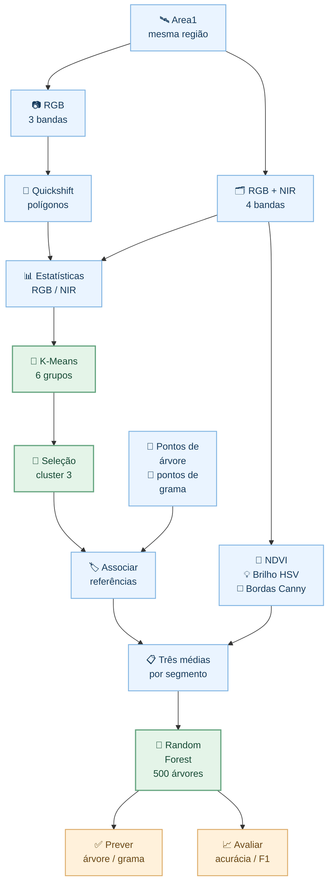
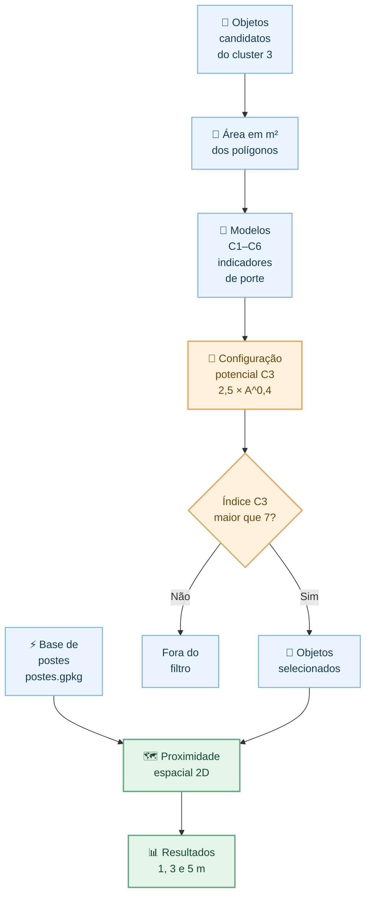
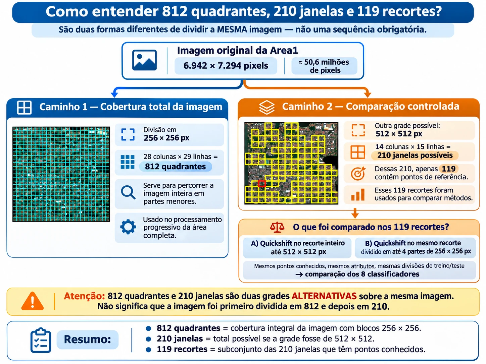
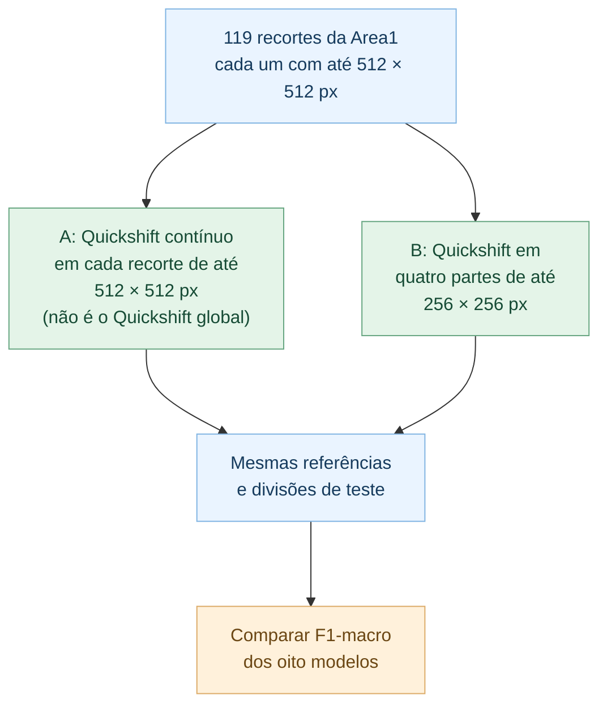

# Projeto de mestrado para detecção de árvores urbanas e avaliação de proximidade com linhas de energia utilizando brilho, bordas, NDVI e imagens aéreas.

**Pesquisa de mestrado — Breno Braga Galvão | Em desenvolvimento**

Esta pesquisa investiga duas propostas complementares a partir de **uma única área de estudo (Area1)** em Caxias do Sul (RS):

| Proposta | Pergunta central | Resultado buscado |
|---|---|---|
| **🌳 Proposta 1 — Identificação da vegetação** | Como distinguir **árvores e gramíneas** por características de imagens de satélite? | Objetos classificados como árvore ou gramínea. |
| **⚡ Proposta 2 — Porte e proximidade de postes** | Quais objetos candidatos apresentam **indicador empírico de porte** acima do limiar e ficam próximos de postes? | Seleção exploratória e distâncias 2D a postes, **sem comprovação de risco elétrico**. |

**Roteiro de leitura:** dados da Area1 → método original → limitação de memória → testes com janelas menores → resultados dos oito classificadores (seção 6).

## Memória: por que usamos janelas menores?

A imagem original tem **6.942 × 7.294 pixels (50,6 milhões)**. Ao tentar repetir o **Quickshift global** em um ambiente com limite de **4 GiB de RAM**, a execução falhou com `MemoryError` ao solicitar uma matriz adicional de **1,13 GiB**. **1,13 GiB é o tamanho da alocação que falhou, não o consumo total do método original**, que não foi medido na execução histórica.

Por isso, a V2 adotou processamento por **janelas de pixels**, sem diminuir a resolução da imagem. Em uma medição real dos **mesmos 119 recortes da Area1**, processados sequencialmente, obtivemos:

| Configuração | Pico de RAM do processo | Resultado |
|---|---:|---|
| **512 × 512 px** (cada recorte inteiro) | **467,19 MiB** | Processamento concluído |
| **4 × 256 × 256 px** (mesmo recorte dividido) | **456,80 MiB** | Processamento concluído |

A divisão apresentou **10,38 MiB a menos de pico de RAM (2,22%)** nesse teste. São valores de **memória residente do processo inteiro**, não somente do Quickshift. O teste global e a comparação entre tamanhos de janela têm dimensões e protocolos diferentes: **512 pixels por recorte não significa processar a imagem globalmente**. [Medição detalhada de memória](docs/e9_medicao_memoria_2026-11-02.md) · [Tentativa do Quickshift global](docs/e10_teste_execucao_local_2026-11-02.md).

---

## 1. Área de estudo e dados utilizados

A Area1 utiliza **dois arquivos raster referentes essencialmente à mesma região**, e não duas áreas de estudo:

| Arquivo raster | Bandas | O que o código faz com ele |
|---|---|---|
| `AOI_RGB_NEW.tif` | **RGB — 3 bandas** (vermelho, verde, azul) | Alimenta o **Quickshift** para criar regiões/polígonos. |
| `AOI_NEW_MULTI.tif` | **RGB + NIR — 4 bandas** | Fornece estatísticas RGB/NIR, NDVI, brilho HSV e bordas Canny. |

**Os arquivos têm papéis diferentes:** o RGB é usado para a segmentação; o RGB + NIR fornece atributos que descrevem os segmentos. As grades possuem um pequeno deslocamento entre suas origens, relevante para o alinhamento espacial.

### Dimensões e cobertura — imagem completa × área de estudo (AOI)

| Área / arquivo | Dimensões da grade (largura × altura) | Pixels na área | Área no terreno |
|---|---|---:|---:|
| **Imagem RGB completa** (`AOI_RGB_NEW.tif`) | **6.942 × 7.294 pixels** | **50.634.948** | **12,658737 km²** (≈ 12,66 km²) |
| **Imagem RGB + NIR completa** (`AOI_NEW_MULTI.tif`) | **6.942 × 7.294 pixels** | **50.634.948** | **12,658737 km²** (≈ 12,66 km²) |
| **Polígono AOI sobre o RGB** (área efetiva de estudo) | **6.942 × 7.294 pixels** (mesma grade) | **48.548.811** | **≈ 12,1372 km²** (≈ 12,14 km²) |
| **Polígono AOI sobre o RGB + NIR** (mesma área de estudo) | **6.942 × 7.294 pixels** (mesma grade) | **48.548.645** | **≈ 12,1372 km²** (≈ 12,14 km²) |

**Observação:** a **AOI usa a mesma grade de 6.942 × 7.294 pixels** das imagens. Como o polígono da área de estudo é irregular, **nem todos os pixels da grade pertencem à AOI**; por isso, a quantidade de pixels incluídos e a área em km² são menores.

### Resolução espacial e referência geográfica

| Característica | Valor |
|---|---|
| **Região da imagem** | **Caxias do Sul — Rio Grande do Sul, Brasil** |
| **Satélite atribuído na documentação** | **JL1KF01B** |
| **Disponibilização das imagens (conforme documentação da pesquisa)** | **CPFL** |
| **Dimensão de cada pixel no terreno** | **0,50 × 0,50 m** (50 × 50 cm) |
| **Área representada por pixel** | **0,25 m²** |
| **Dimensões do retângulo raster no terreno** | **3.471 m de largura × 3.647 m de altura** |
| **Sistema de coordenadas dos rasters** | **EPSG:31982** |

**Arquivos vetoriais de apoio:**

| Arquivo | Finalidade |
|---|---|
| `AOI_new.shp` e auxiliares | Polígono da área de interesse |
| `Arvores.gpkg` | **257 pontos de referência de árvores** |
| `Grama.gpkg` | **253 pontos de referência de gramíneas** |
| `postes.gpkg` | Localização dos postes |

Portanto, existem **510 pontos de referência**. Isso **não significa 510 objetos ou 510 registros de treinamento**: o Quickshift cria segmentos, que depois são associados aos pontos conhecidos.

Os dez arquivos originais permanecem no [Google Drive — Area1](https://drive.google.com/drive/folders/1asqPz9xFr7dlnK1ggvrwftXEbkhvwjg6). Veja o [detalhamento dos arquivos e coordenadas](data/README.md).

---

## 2. 🌳 Proposta 1 — Identificação de árvores e gramíneas

**Objetivo:** classificar objetos vegetados em **árvore** ou **gramínea**, combinando NDVI, brilho HSV e bordas Canny.

### Como o código original realiza essa proposta

**Leitura do fluxo:** o **RGB** produz os polígonos; o **RGB + NIR** fornece os atributos; as referências identificam os exemplos; o **Random Forest** gera as previsões e as métricas.

**O que está acontecendo:** o Quickshift divide a imagem RGB em segmentos; o K-Means utiliza **quatro médias e quatro desvios-padrão RGB/NIR** e seleciona os objetos do **cluster 3**. Os pontos conhecidos identificam exemplos de árvores e gramíneas. O Random Forest recebe **três valores médios por objeto** — **brilho HSV, bordas Canny e NDVI** — para aprender a distinguir as duas classes.

**Parâmetros do método original:**

| Etapa | Configuração |
|---|---|
| Quickshift sobre o RGB completo | `kernel_size=3`, `max_dist=5`, `ratio=0.04` |
| K-Means | **6 clusters**, `random_state=42`, `n_init=10`; escolha do **cluster 3** |
| Random Forest | **500 árvores**, `random_state=42` |
| Treino/teste | Aleatório **80%/20%**, `random_state=42`, sem estratificação |

O método **não utiliza 50 milhões de pixels como 50 milhões de registros independentes**. Também não havia deduplicação explícita nem separação espacial entre treino e teste.

### Resultados históricos da Proposta 1

Os valores abaixo foram **registrados em execuções anteriores**, não recalculados por uma nova execução integral comprovada.

| Indicador | Experimento inicial | Experimento com área maior |
|---|---:|---:|
| Pares objeto–rótulo | **133** | **458** |
| Treinamento | 106 | 366 |
| Teste | 27 | 92 |
| **Acurácia** | **0,81** | **0,87** |
| F1 — árvores | 0,80 | 0,85 |
| F1 — gramíneas | 0,83 | 0,88 |

**Por que são 510 pontos de referência, mas 458 registros na rodada maior?** O código mantém apenas objetos do **cluster 3** e os associa espacialmente aos pontos conhecidos. O resultado é uma tabela de **pares objeto–rótulo**: um ponto pode não ter candidato e um segmento pode gerar mais de uma associação. Portanto, **não podemos concluir que 52 pontos foram descartados** sem auditar a execução histórica.

Os **458 registros** geraram **366 exemplos de treinamento e 92 de teste**. A acurácia de **0,87** corresponde a esse conjunto de 92 testes. A primeira rodada de **133 registros** utilizou outras amostras; o aumento de **0,81 para 0,87** é descritivo e não comprova, sozinho, um ganho causado pelo tamanho da área.

---

## 3. ⚡ Proposta 2 — Indicador de porte e proximidade com postes

**Objetivo:** calcular um indicador experimental de porte dos objetos e verificar sua **proximidade horizontal** aos postes da Area1.

### Como o código original realiza essa proposta

**Leitura do fluxo:** o índice **C3** é calculado a partir da área dos candidatos; apenas quem passa pelo limiar entra na análise de **distâncias aos postes**. A fórmula e os detalhes do filtro aparecem abaixo.

**No fluxograma, a “Base de postes” é o arquivo `postes.gpkg`**, utilizado como entrada independente para calcular a proximidade dos objetos selecionados.

O código calcula a área dos polígonos, testa **seis configurações empíricas (C1–C6)** nas formas potencial e linear e usa o índice potencial **C3** na seleção:

$$
\widehat{H}_{C3} = 2{,}5 \cdot A^{0{,}4}
$$

Nessa expressão, **A** é a área projetada do polígono, em **m²**. No código, o cálculo é escrito como `2.5 * (area ** 0.4)`.

Depois aplica o filtro `Power_tree_size_C3 > 7` e calcula a proximidade dos objetos selecionados a **1, 3 e 5 metros dos pontos dos postes**, usando `sjoin_nearest`.

**Ponto importante para a banca:** a Proposta 2 usa os **candidatos do cluster 3**, e o código histórico **não exige `predicted_classe == 'arvore'`** nesse filtro. Portanto, os objetos selecionados **não são necessariamente apenas árvores previstas pelo Random Forest**.

**Limites científicos:** o índice C3 **não é altura real validada**, as distâncias são **2D até postes** e a Area1 **não possui a geometria dos cabos**. Não se pode interpretar esse resultado como **interferência em fios ou risco elétrico comprovado**. [Ver as fórmulas C1–C6 e suas limitações](docs/allometria.md).

---

**Sobre os fluxogramas:** ambos estão em **código Mermaid**, como originalmente, com descrições completas, cores e espaçamento ampliado dentro das caixas para evitar cortes no GitHub. Eles representam o método original; a comparação da V2 está ao final do documento.

---

## 4. Imagem completa — as 17 etapas do código original

A ilustração horizontal abaixo apresenta as **17 etapas do código original**, com a **Proposta 1** (classificação) e a **Proposta 2** (índice de porte e proximidade com postes) identificadas. Os resultados exibidos na etapa 12 são os valores **históricos da rodada maior**: acurácia **0,87** e F1 de árvores **0,85**.

  

**Para visualizar a imagem ampliada:** clique no infográfico para abrir em tamanho original. No README, ele ocupa a largura disponível da página.

[**Abrir o infográfico horizontal ampliado (17 etapas)**](docs/fluxo_17_etapas_horizontal_corrigido.png)

Este esquema representa o **notebook original**. Os experimentos posteriores da V2, com segmentação em quadrantes, têm protocolos próprios e estão explicados **na última seção**.

## 5. Código e documentação técnica

| Material | Conteúdo |
|---|---|
| [Notebook original](Segmentacao_area_completa.ipynb) | Quickshift global, K-Means, Random Forest e proximidade |
| [Notebook V2](Segmentacao_area_completa_v2_experimentos.ipynb) | Auditoria de amostras, comparação de modelos, validação espacial, atributos, segmentação, porte e proximidade com postes |
| [Dados Area1](data/README.md) | Arquivos, coordenadas e estrutura do Drive |
| [Registro do método original](docs/experimento_area_completa_2026-10-29.md) | Parâmetros, resultados históricos e limitações |
| [Classificadores e protocolos de avaliação](docs/harmonizacao_protocolos_2026-11-01.md) | Comparações de modelos e validação espacial |
| [Comparação das segmentações de 512 e 256 pixels](docs/comparacao_controlada_segmentacao_512_vs_256_2026-11-01.md) | Comparação pareada da segmentação |
| [Estimativas C1–C6](docs/allometria.md) | Fórmulas exploratórias de porte |

Os arquivos da Area1 ficam no **Google Drive**, e o notebook original foi preparado para **Google Colab**. O processamento global consome muita memória; **uma nova execução completa e bem-sucedida não está comprovada**. As baterias da V2 têm evidências documentadas separadamente, mas nem todas as saídas estão salvas no próprio notebook publicado.

---

## 6. Por que dividimos a imagem e qual algoritmo funcionou melhor?

O **método original** segmentava a imagem inteira de uma vez com **Quickshift global**, usava **K-Means (seis grupos, cluster 3)** e treinava um **Random Forest**. Nesse estudo histórico, a acurácia foi de **0,87 em 92 exemplos de teste**.

O problema para ampliar os testes foi **repetir a segmentação global com a memória disponível**, e não treinar os classificadores. A V2 resolveu a limitação prática **processando recortes menores**. Com isso, conseguimos comparar **oito algoritmos nas mesmas condições dentro de cada experimento**, em vez de testar somente Random Forest.

**Perguntas que orientaram os testes**

| O que queríamos descobrir? | Como investigamos? |
|---|---|
| **1. Por que não continuar usando a imagem inteira?** | Testamos a execução do Quickshift global em um ambiente com **4 GiB de RAM**; houve falta de memória. Por isso, passamos a processar janelas menores, sem reduzir a resolução dos pixels. |
| **2. Qual algoritmo classifica melhor árvores e gramíneas?** | Comparamos **oito classificadores** usando os **mesmos 505 segmentos rotulados**, os mesmos atributos (NDVI, brilho e bordas) e as mesmas divisões de treino e teste. |
| **3. Processar janelas de 512 × 512 ou quatro partes de 256 × 256 muda os resultados e a memória utilizada?** | Usamos os **mesmos 119 recortes** nas duas formas de segmentação, comparamos as previsões dos oito classificadores e medimos o pico de memória: **467,19 MiB** e **456,80 MiB**, respectivamente. |
| **4. Os resultados se mantêm quando testamos em outras regiões da imagem?** | Separamos treino e teste por **blocos geográficos de 250 m e 500 m**, em vez de depender apenas de sorteios aleatórios, e comparamos os resultados pela **F1-macro**. |

### 6.1. O que mudou de um experimento para o outro?

| Estudo | Como a imagem foi segmentada | O que foi avaliado? |
|---|---|---|
| **Original** | Quickshift **global** na imagem inteira + K-Means, cluster 3 | Random Forest; acurácia histórica **0,87** |
| **V2 — comparação dos algoritmos** | Quickshift em **janelas de 256 × 256 px**; base derivada com **505 segmentos rotulados únicos** | Oito classificadores nas mesmas partições |
| **V2 — comparação dos tamanhos das janelas** | Os mesmos **119 recortes de até 512 × 512 px**, processados inteiros **ou** divididos em quatro partes de até 256 × 256 px | Oito classificadores nas **mesmas referências** e divisões, comparando também o tamanho das janelas |

**Não criamos imagens de menor resolução:** dividimos a imagem original em regiões menores para conseguir processá-la. A V2 por quadrantes é um **método experimental diferente** do Quickshift global original.

Ver a Area1 e a localização dos quadrantes e recortes

  

A grade completa tem **812 quadrantes** (28 colunas × 29 linhas), com janelas menores nas bordas. Os **119 recortes do teste de tamanhos de janela** foram escolhidos por conter os pontos de referência e **não representam cobertura integral da AOI**.

### 6.2. Qual algoritmo identificou melhor árvores e gramíneas?

A avaliação utiliza **505 segmentos rotulados únicos**, extraídos da Area1 por janelas de **256 × 256 px**. Todos os modelos recebem os **mesmos três atributos** (NDVI, brilho HSV e bordas Canny), os **mesmos exemplos de treino/teste** e as mesmas métricas **dentro de cada protocolo**.

**F1-macro médio** (quanto maior, melhor). Foram usadas cinco divisões espaciais por escala, com blocos de 250 ou 500 **metros** e embargo geométrico de 25 m:

| Classificador | Blocos de 250 m | Blocos de 500 m |
|---|---:|---:|
| **SVM RBF** | **0,8987** | **0,8668** |
| Regressão logística | 0,8928 | 0,8664 |
| KNN (7) | 0,8874 | 0,8502 |
| Extra Trees | 0,8790 | 0,8629 |
| **Random Forest** | **0,8656** | **0,8530** |
| HistGradientBoosting | 0,8556 | 0,8524 |
| Gaussian Naive Bayes | 0,8555 | 0,8398 |
| Dummy (referência simples) | 0,2980 | 0,2799 |

**O que encontramos:** nessas duas configurações, **SVM RBF obteve o maior F1-macro médio**, superando o Random Forest. Isso é um resultado **descritivo dentro da base derivada de 256 px**, não prova de superioridade universal.

### 6.3. O tamanho das janelas muda a classificação?

Esse é **outro teste**, separado da tabela anterior. Usamos os **mesmos 119 recortes** e os **mesmos 505 pontos de referência comuns**. Em cada recorte, comparamos:

**F1-macro médio da comparação entre janelas**, com cinco divisões por escala e embargo de **25 m entre pontos de referência**:

| Classificador | 250 m / 512 px | 250 m / 4 × 256 px | 500 m / 512 px | 500 m / 4 × 256 px |
|---|---:|---:|---:|---:|
| Random Forest | **0,8906** | 0,8835 | **0,8657** | 0,8566 |
| **SVM RBF** | 0,9157 | **0,9341** | 0,8518 | **0,8641** |
| Regressão logística | 0,9153 | **0,9157** | 0,8484 | **0,8685** |
| Extra Trees | **0,9064** | 0,8968 | **0,8747** | 0,8545 |
| KNN (7) | 0,8940 | **0,9009** | 0,8377 | **0,8486** |
| HistGradientBoosting | **0,8738** | 0,8714 | 0,8390 | **0,8411** |
| Gaussian Naive Bayes | **0,8894** | 0,8875 | **0,8573** | 0,8464 |
| Dummy | 0,2847 | 0,2847 | 0,2791 | 0,2791 |

**O que encontramos:** com blocos de **250 m**, o maior F1-macro médio foi do **SVM em quatro partes de 256 px (0,9341)**. Com blocos de **500 m**, o maior foi do **Extra Trees em 512 px contínuos (0,8747)**. Logo, o melhor resultado **dependeu do tamanho das janelas, do classificador e do protocolo de teste**.

A memória também foi medida nesses 119 recortes: **467,19 MiB em 512 contínuo** e **456,80 MiB em quatro 256**. É uma redução observada de **2,22% no pico do processo**, não uma economia de 75%.

### 6.4. O que podemos concluir?

- **Sim:** dividir a imagem viabilizou experimentos controlados com **oito classificadores** e os dados existentes da Area1.
- **Sim:** o **SVM RBF apresentou resultados promissores**, mas não foi o melhor em todas as configurações.
- **Ainda não:** não podemos afirmar que a V2 superou o **pipeline global original**, pois ele tinha **outros segmentos, seleção por K-Means e outra avaliação**. Acurácia histórica **0,87** e F1-macro novo **não são a mesma métrica**.
- **Também não:** como não existem alturas reais medidas nem geometria de cabos, os dados não comprovam risco elétrico. A proximidade calculada é horizontal em relação aos **postes**.

**Código e evidências:** [Notebook V2](Segmentacao_area_completa_v2_experimentos.ipynb) · [Código para comparar 512 e 256 pixels](experimentos/e9_reproduzir_512_256.py) · [Resultados dos oito classificadores](docs/harmonizacao_protocolos_2026-11-01.md) · [Resultados da comparação entre janelas](docs/comparacao_controlada_segmentacao_512_vs_256_2026-11-01.md) · [Medição de memória](docs/e9_medicao_memoria_2026-11-02.md).

*As tabelas acima vêm dos experimentos já documentados. A nova célula para repetir a comparação das janelas foi acrescentada à V2 para reproduzi-los; ela ainda precisa ser executada e conferida antes de substituir os resultados publicados.*

