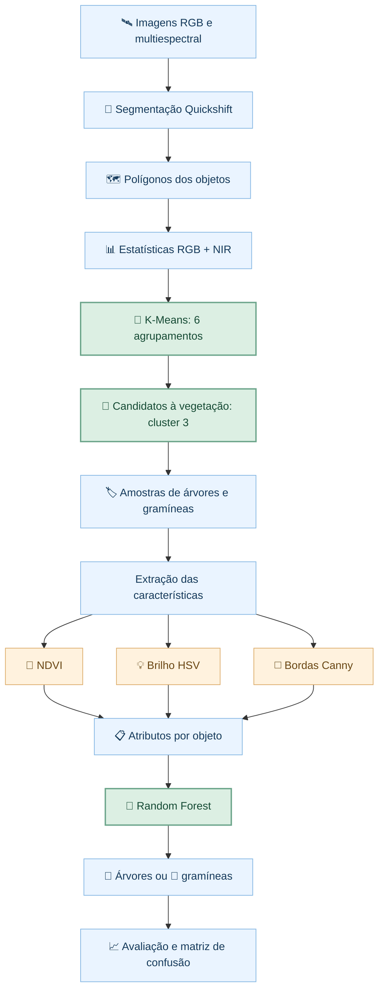
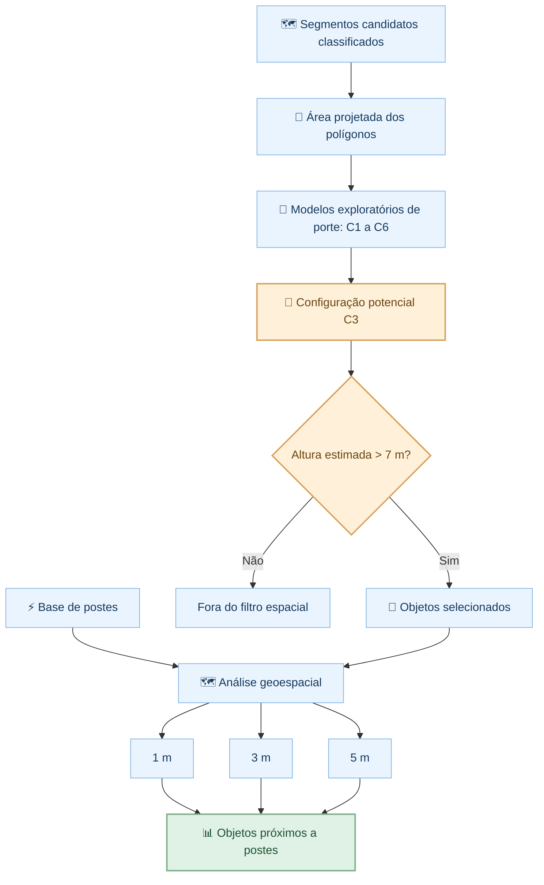
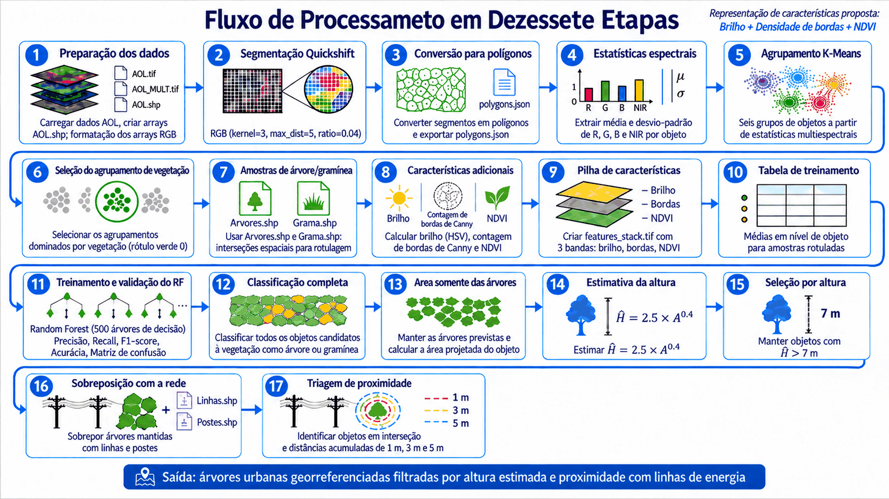

# Combinação de Características de Brilho, Bordas e NDVI para Detecção de Árvores Urbanas e Avaliação de Proximidade com Linhas de Energia

**Abordagem orientada a objetos para identificação de árvores urbanas em imagens multiespectrais de alta resolução e análise espacial de proximidade com a infraestrutura elétrica.**


## Visão geral

A vegetação arbórea é parte essencial da infraestrutura verde das cidades, mas sua localização e seu porte também são relevantes para o planejamento e a manutenção das redes elétricas. Identificar árvores em imagens aéreas e representar suas copas como objetos georreferenciados permite investigar a distribuição da vegetação e sua proximidade com elementos da infraestrutura urbana.

Esta pesquisa combina **segmentação de imagens**, **características espectrais e de textura**, **aprendizado de máquina** e **análise espacial**. O trabalho está organizado em duas propostas complementares: reconhecer árvores e gramíneas e, em seguida, investigar a proximidade espacial de objetos selecionados em relação à rede elétrica.

> **Escopo dos dados atuais:** a área de estudo contém a geometria dos **postes**, mas não dos cabos ou linhas de energia. Assim, a segunda proposta é investigada atualmente por meio da **proximidade com postes**, sem afirmar interferência efetiva nos fios.

## Propostas de pesquisa

### 🌳 Proposta 1 – Identificação de árvores e gramíneas

**Pergunta de pesquisa:** como distinguir árvores e gramíneas em imagens de alta resolução utilizando a combinação de NDVI, brilho e bordas em objetos segmentados?

A imagem RGB é dividida em regiões espacialmente coerentes pelo **Quickshift**. Para cada região, o código extrai estatísticas das bandas RGB e NIR e aplica **K-Means** para selecionar candidatos. Depois, utiliza amostras identificadas como árvores e gramíneas para treinar um **Random Forest** com três características complementares:

| Característica | O que representa | Por que utilizar |
|---|---|---|
| 🌿 **NDVI** | Resposta espectral relacionada à vegetação | Diferenciar padrões de cobertura vegetal |
| 💡 **Brilho (HSV)** | Intensidade luminosa observada na imagem | Representar diferenças radiométricas dos objetos |
| ◻️ **Bordas (Canny)** | Variações locais e contornos | Descrever aspectos estruturais e de textura |

**Desenho do processo de identificação**



A abordagem é **orientada a objetos**: em vez de tratar apenas pixels isolados, utiliza as propriedades dos segmentos, mantendo suas geometrias para a etapa espacial.

### ⚡ Proposta 2 – Proximidade com a rede elétrica

**Pergunta de pesquisa:** como utilizar os objetos identificados em imagens aéreas para apoiar a identificação de áreas de atenção próximas à infraestrutura elétrica urbana?

A pesquisa investiga a área projetada dos objetos e utiliza uma **estimativa empírica de altura**, calculada a partir dessa área, para selecionar candidatos a uma análise espacial. Em seguida, avalia a proximidade com os **postes**, em distâncias de **1, 3 e 5 metros**.

**Desenho do processo de análise espacial**



**Limites importantes:** a fórmula utilizada estima um possível porte a partir da área e **não mede diretamente a altura real da árvore**. No código atual, o filtro `C3 > 7` **não exige** que `predicted_classe == 'arvore'`; por isso, também podem passar objetos classificados como gramínea. A distância é medida em duas dimensões em relação aos postes, não aos cabos energizados.

## Contribuições metodológicas investigadas

A proposta reúne três elementos:

1. **Combinação de características complementares:** NDVI (espectral), brilho HSV (radiométrica) e bordas de Canny (estrutura e textura).
2. **Estratégia híbrida de agrupamento e classificação:** K-Means para pré-seleção dos candidatos e Random Forest para distinguir árvores e gramíneas.
3. **Preservação da geometria dos objetos:** manutenção dos polígonos para cálculo de área e análise de proximidade.

Essas são características da abordagem estudada; sua superioridade em relação a métodos alternativos **ainda precisa ser demonstrada por validação experimental**.

## Fluxo metodológico completo — 17 etapas

O diagrama ilustrado apresenta a visão geral do percurso da pesquisa, desde as imagens de entrada até a análise espacial.

<p align="center">
  
</p>

<details>
<summary><strong>Ver resumo das etapas</strong></summary>

| Etapas | O que acontece |
|---|---|
| **1–3** | Preparação dos rasters, área de interesse e segmentação Quickshift |
| **4–6** | Criação de polígonos, estatísticas espectrais e K-Means |
| **7–10** | Associação de amostras e extração de NDVI, brilho HSV e bordas Canny |
| **11–12** | Treinamento e aplicação do Random Forest |
| **13–15** | Área dos objetos, configurações exploratórias de porte e filtro C3 |
| **16–17** | Proximidade espacial com postes a 1 m, 3 m e 5 m |

</details>

*O diagrama é uma representação conceitual da metodologia. A base utilizada nesta execução inclui postes, mas não linhas ou cabos de energia.*

## Resultados preliminares

Os resultados abaixo são **históricos**, registrados em execuções anteriores. Não representam uma validação da execução atualmente em andamento no Colab.

| Indicador | Experimento inicial | Experimento com área maior |
|---|---:|---:|
| Registros rotulados (pares objeto–rótulo) | 133 | **458** |
| Amostras de treinamento | 106 | **366** |
| Amostras de teste | 27 | **92** |
| Acurácia global | 0,81 | **0,87** |
| F1-score — árvores | 0,80 | **0,85** |
| F1-score — gramíneas | 0,83 | **0,88** |

O número de pares objeto–rótulo não representa necessariamente a quantidade de objetos distintos. A comparação entre experimentos com conjuntos de teste diferentes não comprova, por si só, melhoria de desempenho.

### Estimativa empírica de altura

O notebook explora seis configurações de estimativa de porte (**C1–C6**), nas formas potencial e linear. Na etapa de análise espacial, utiliza-se a configuração **potencial C3** para selecionar objetos com maior porte estimado, conforme um limiar experimental.

Essa relação é uma **estimativa experimental**, inspirada na literatura sobre dimensões da copa e altura, e **não representa uma medição real de altura em campo**.

Para conhecer a fundamentação científica, os parâmetros utilizados e as limitações do método, consulte [a documentação de alometria](docs/allometria.md).

## Tecnologias e bibliotecas

| Finalidade | Tecnologias |
|---|---|
| Linguagem e ambiente | Python, Google Colab, Google Drive |
| Rasters e geoprocessamento | Rasterio, GeoPandas, Shapely |
| Dados e cálculo numérico | NumPy, Pandas |
| Processamento de imagens | scikit-image |
| Aprendizado de máquina | scikit-learn (K-Means e Random Forest) |
| Visualizações | Matplotlib, Seaborn |
| Versionamento | GitHub |

As bibliotecas utilizadas estão listadas em [`requirements-colab.txt`](requirements-colab.txt).

## Estrutura do repositório

```text
mestrado-arvores-urbanas/
├── 📓 Segmentacao_area_completa.ipynb
├── 📘 README.md
├── 📦 requirements-colab.txt
├── 🚫 .gitignore
├── 📂 data/
│   └── README.md
└── 📂 docs/
    ├── allometria.md
    ├── experimento_area_completa_2026-10-29.md
    └── pipeline_17_etapas.png
```

O **GitHub** contém o código e a documentação. Os dados geoespaciais, devido ao tamanho, permanecem no **Google Drive**.

## Dados e armazenamento

Os dez arquivos necessários já estão organizados na [pasta `Area1` no Google Drive](https://drive.google.com/drive/folders/1asqPz9xFr7dlnK1ggvrwftXEbkhvwjg6), no seguinte caminho usado pelo notebook:

```text
/content/drive/MyDrive/Projetos/Segmentacao_Breno/
├── Area1/
│   ├── AOI_RGB_NEW.tif
│   ├── AOI_NEW_MULTI.tif
│   ├── AOI_new.shp
│   ├── AOI_new.shx
│   ├── AOI_new.dbf
│   ├── AOI_new.prj
│   ├── AOI_new.cpg
│   ├── Arvores.gpkg
│   ├── Grama.gpkg
│   └── postes.gpkg
└── outputs/
```

As imagens de entrada têm resolução espacial aproximada de **0,5 m/pixel**. Os rasters utilizam **EPSG:31982** e as camadas de árvores, gramíneas e postes têm **EPSG:4674** na origem, sendo reprojetadas para operações métricas. Veja [o detalhamento dos dados](data/README.md).

## Como executar no Google Colab

1. Abra o **[notebook principal diretamente do GitHub no Colab](https://colab.research.google.com/github/BrenoBragaGalvao/mestrado-arvores-urbanas/blob/main/Segmentacao_area_completa.ipynb)**.
2. Execute a célula que monta o Google Drive: `drive.mount('/content/drive')`.
3. Confirme que os arquivos estão na pasta `Area1`, conforme a estrutura acima.
4. Execute as **116 células** na ordem. O processamento da imagem inteira pode exigir **RAM alta**.
5. Confira as saídas das células, gráficos e relatórios de classificação. Os resultados só poderão ser considerados reproduzidos depois de concluída a execução sem erros.

**Onde os arquivos gerados ficam salvos?** O código original usa nomes relativos para `polygons.json`, `polygons_arvores.json`, `features_stack.tif` e `arvores_segmentadas.json`; normalmente eles ficam no diretório corrente do Colab, **não automaticamente** em `outputs/` no Drive. Alterações realizadas no Colab também não são enviadas automaticamente ao GitHub.

**Sobre o notebook:** `Segmentacao_area_completa.ipynb` contém o código original com **116 células**. A cópia publicada no GitHub preserva as células de código e texto e as saídas textuais; imagens históricas incorporadas permanecem no arquivo original conservado no Google Drive. O código não utiliza divisão treino/teste estratificada nem processamento de imagens em blocos.

## Próximas etapas científicas

- Confirmar a execução integral com os dados reais e documentar os resultados obtidos.
- Verificar a qualidade e a independência das amostras usadas em treino e teste.
- Comparar classificadores e realizar ablação das características NDVI, brilho e Canny.
- Validar a relação entre área de copa e altura com medições reais.
- Ampliar a análise para geometrias de cabos/linhas de energia, quando disponíveis.

---

**Autor:** Breno Braga Galvão  
**Situação:** pesquisa de mestrado em desenvolvimento.
