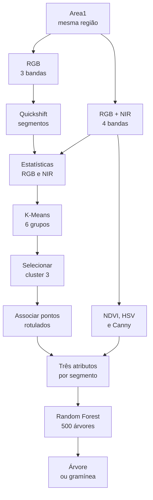

# Detecção de árvores urbanas: NDVI, brilho e bordas

**Breno Braga Galvão | Pesquisa de mestrado em desenvolvimento**

Este projeto possui **dois objetivos**: (1) identificar **árvores e gramíneas** em imagens de satélite; (2) investigar, de forma **exploratória**, a proximidade dos objetos selecionados com **postes**. A base atual não permite afirmar contato com cabos ou risco elétrico real.

**Organização deste README:** dados → método original → resultados → análise espacial → arquivos. **A comparação entre todos os experimentos antigos e novos está concentrada na última seção.**

## 1. Dados utilizados

A **Area1 é uma única região em Caxias do Sul (RS)**, representada por **dois arquivos raster complementares**. Não são duas áreas de estudo.

| Arquivo | Conteúdo | Uso |
|---|---|---|
| `AOI_RGB_NEW.tif` | **RGB (3 bandas)**: vermelho, verde, azul | O Quickshift cria os **segmentos**. |
| `AOI_NEW_MULTI.tif` | **RGB + NIR (4 bandas)**: RGB e infravermelho próximo | O código extrai estatísticas, NDVI, brilho HSV e bordas Canny. |

As imagens cobrem essencialmente a mesma região, mas suas grades apresentam um pequeno deslocamento de origem. Segundo a documentação da pesquisa, foram disponibilizadas pela **CPFL** e atribuídas ao satélite **JL1KF01B**; a data de aquisição não está informada.

| Característica | Valor |
|---|---|
| Dimensão de **cada raster** | **6.942 colunas × 7.294 linhas** |
| Total de pixels por raster | **50.634.948** |
| Resolução | Aproximadamente **0,5 m/pixel** |
| Área retangular coberta pelas imagens | Aproximadamente **12,66 km²** |
| Área do polígono efetivo (AOI) | **12,1372 km²**, aproximadamente **12,14 km²** |
| Sistema de coordenadas | **EPSG:31982** |

**12,66 km²** é o retângulo das imagens; **12,14 km²** é a área de interesse delimitada por `AOI_new.shp`.

| Arquivo de apoio | Função |
|---|---|
| `AOI_new.shp` e auxiliares | Limite da área de interesse |
| `Arvores.gpkg` | **257 pontos** de referência de árvores |
| `Grama.gpkg` | **253 pontos** de referência de gramíneas |
| `postes.gpkg` | Localização dos postes |

Há **510 pontos de referência disponíveis** (257 + 253). **Ponto não é sinônimo de segmento ou de registro de treinamento.** O Quickshift cria segmentos; depois, o código associa os pontos a esses objetos para construir exemplos de treinamento.

Os dez arquivos da Area1 estão no [Google Drive](https://drive.google.com/drive/folders/1asqPz9xFr7dlnK1ggvrwftXEbkhvwjg6). Mais detalhes: [dados e coordenadas](data/README.md).

## 2. Como funciona o método original?

O [notebook original](Segmentacao_area_completa.ipynb) segmenta a imagem RGB completa com Quickshift, agrupa objetos por K-Means e treina um Random Forest.

**Em palavras simples:** Quickshift transforma pixels em segmentos; K-Means seleciona candidatos usando estatísticas RGB/NIR; os pontos conhecidos fornecem os rótulos; e Random Forest aprende com **três atributos médios por segmento**: **NDVI, brilho HSV e bordas Canny**. Os aproximadamente 50,6 milhões de pixels **não são 50,6 milhões de exemplos independentes para o RF**.

| Parâmetro histórico | Configuração |
|---|---|
| Quickshift | `kernel_size=3`, `max_dist=5`, `ratio=0.04` |
| K-Means | 6 grupos, `random_state=42`, `n_init=10`, escolha do **cluster 3** |
| Random Forest | **500 árvores**, `random_state=42` |
| Treino/teste | Aleatório **80%/20%**, `random_state=42`, sem estratificação |

O original **não tinha separação espacial** de treino/teste nem uma etapa explícita de deduplicação. [Detalhes técnicos do método](docs/experimento_area_completa_2026-10-29.md).

## 3. Resultados históricos

Resultados **salvos em execuções anteriores**, ainda sem uma nova reprodução integral comprovada.

| Indicador | Rodada inicial | Rodada com área maior |
|---|---:|---:|
| Pares objeto–rótulo | **133** | **458** |
| Treino | 106 | 366 |
| Teste | 27 | 92 |
| **Acurácia** | **0,81** | **0,87** |
| F1 — árvores | 0,80 | 0,85 |
| F1 — gramíneas | 0,83 | 0,88 |

**Por que 510 pontos viraram 458 registros na rodada maior?** O código seleciona segmentos do **cluster 3** e associa esses objetos aos pontos conhecidos, produzindo **pares segmento–rótulo**. Pode haver pontos sem um segmento candidato e mais de uma associação com o mesmo objeto. **Não podemos dizer que 52 pontos foram descartados** sem auditar a execução histórica.

A acurácia de **0,87** veio dos **92 registros de teste**, e não dos 510 pontos disponíveis. A rodada inicial de **133 registros** usou outros exemplos e testes; portanto, **0,81 → 0,87 é uma mudança histórica observada**, não prova causal de ganho por aumento da área. Também é necessário conferir se associações repetidas ocorreram nos dois conjuntos históricos.

## 4. Segundo objetivo: área dos objetos e postes

O notebook explora seis configurações empíricas de porte (**C1–C6**, potenciais e lineares). A configuração **C3** usada no filtro espacial é:

\[
\widehat{H}_{C3} = 2{,}5 \cdot A^{0{,}4}
\]

O código seleciona objetos com `Power_tree_size_C3 > 7` e pesquisa proximidade **horizontal a postes** a **1, 3 e 5 metros**.

**Limitações:** C3 não é altura medida; o filtro não exige explicitamente `predicted_classe == 'arvore'`; e não existem geometrias de cabos ou alturas reais na Area1. Portanto, **não há validação de risco elétrico**. Veja [fundamentação da estimativa](docs/allometria.md).

## 5. Notebooks e documentação

| Material | Conteúdo |
|---|---|
| [Notebook original](Segmentacao_area_completa.ipynb) | Código original: Quickshift global, K-Means, RF e postes |
| [Notebook V2](Segmentacao_area_completa_v2_experimentos.ipynb) | Ampliações experimentais E1–E9 |
| [Dados Area1](data/README.md) | Arquivos, coordenadas e execução |
| [Experimento histórico](docs/experimento_area_completa_2026-10-29.md) | Parâmetros originais e limites |
| [Comparação de modelos E3c/E8h](docs/harmonizacao_protocolos_2026-11-01.md) | Protocolos e resultados completos |
| [Comparação de segmentações E9](docs/comparacao_controlada_segmentacao_512_vs_256_2026-11-01.md) | Métodos, métricas e evidências |
| [Fluxo ilustrado de 17 etapas](docs/pipeline_17_etapas.png) | Visão ampliada do processamento original |

**Execução:** os dados grandes permanecem no Drive, sob `/content/drive/MyDrive/Projetos/Segmentacao_Breno/Area1/`; o notebook original foi preparado para **Google Colab**. O Quickshift global exige RAM elevada, e **a execução integral atual não foi novamente comprovada**. Os resultados das baterias derivadas também **não estão todos gravados nas próprias células da V2**, mas têm documentação separada.

---

## 6. Comparação entre os experimentos antigos e os novos

Esta é a parte central para **responder ao orientador**. Os testes usam a **mesma Area1**, mas **nem sempre os mesmos segmentos, registros ou testes**.

### 6.1. O que foi usado em cada experiência?

| Experimento | Como os segmentos foram produzidos | Base de classificação | Teste |
|---|---|---|---|
| **Original inicial** | Rodada histórica; recorte não inteiramente reconstruído | **133 pares** | Aleatório: 27 registros |
| **Original ampliado** | Quickshift global + K-Means **cluster 3** | **458 pares** | Aleatório: 92 registros |
| **V2 — E3c/E8h** | Quickshift em **812 quadrantes de até 256 px** | **505 segmentos únicos** | Modelos nos mesmos testes por protocolo; aleatório e espacial |
| **V2 — E9** | **119 regiões**: contínuo 512 px × quatro quadrantes 256 px | **505 referências comuns na E9** | Mesmo teste nos dois tipos de segmentação |

A E3c gerou **168.133 segmentos** na extensão retangular do raster, incluindo partes fora da AOI; foram usados **505 segmentos rotulados** (257 árvores e 248 gramíneas). A E9 trabalhou com **recortes que contêm referências**, não com toda a imagem. Ter **505** nas duas baterias **não garante geometrias idênticas entre elas**.

### 6.2. E3c: Random Forest versus outros classificadores

**Pergunta:** mantendo os **mesmos exemplos de treino/teste por protocolo**, algum dos oito classificadores obtém melhores notas? A tabela mostra o **F1-macro médio** de cinco divisões espaciais, com **embargo de 25 m das geometrias de teste**.

| Modelo | Blocos 250 m | Blocos 500 m |
|---|---:|---:|
| **SVM RBF** | **0,8987** | **0,8668** |
| Regressão logística | 0,8928 | 0,8664 |
| KNN (7) | 0,8874 | 0,8502 |
| Extra Trees | 0,8790 | 0,8629 |
| **Random Forest** | **0,8656** | **0,8530** |
| HistGradientBoosting | 0,8556 | 0,8524 |
| Gaussian Naive Bayes | 0,8555 | 0,8398 |
| Dummy | 0,2980 | 0,2799 |

**Conclusão:** o SVM teve a maior **média nesses protocolos**, sem prova de superioridade universal. A **E4** comparou combinações de atributos e encontrou maior F1 médio usando **NDVI + brilho + Canny juntos**. A **E5** investigou parâmetros do Quickshift e K-Means; o índice *silhouette* **não equivale à acurácia**.

### 6.3. E8h: aleatório versus espacial na base nova

O Random Forest, sobre os **mesmos 505 segmentos derivados**, apresentou:

| Avaliação | Acurácia média | F1-macro médio |
|---|---:|---:|
| Aleatória 80/20 | **0,8832** | **0,8827** |
| Espacial 250 m, embargo 25 m | 0,8697 | 0,8656 |
| Espacial 500 m, embargo 25 m | 0,8591 | 0,8530 |

**Interpretação:** os resultados observados variam com o protocolo, mas **os testes mudam entre protocolos**. Não atribuímos as diferenças exclusivamente ao embargo. A harmonização fez **40 ajustes aleatórios novos**, reaproveitando com verificações os **240 ajustes espaciais E3c**.

Na divisão aleatória de semente **42** aplicada à **base nova**, o RF obteve **404 treino/101 teste**, acurácia **0,9010** e F1-macro **0,9009**. **Isso não reproduz o resultado histórico de 0,87 com 458 pares.**

### 6.4. E9: segmentação 512 versus 256 pixels

**Pergunta:** nos **mesmos 119 recortes**, com **505 referências comuns** e testes pareados, segmentar a região inteira de 512 px difere de segmentá-la em quatro quadrantes de 256 px? Foram feitas **320 avaliações**.

**F1-macro médio**, exclusão de treino a até **25 m entre pontos**:

| Blocos | Modelo | Contínuo 512 | Quatro 256 |
|---|---|---:|---:|
| 250 m | RF | **0,8906** | 0,8835 |
| 250 m | SVM | 0,9157 | **0,9341** |
| 500 m | RF | **0,8657** | 0,8566 |
| 500 m | SVM | 0,8518 | **0,8641** |

**Conclusão:** o RF teve média ligeiramente maior com 512 contínuo; o SVM, com quadrantes. **Contínuo 512 é um recorte, não o Quickshift global da imagem inteira**, e a E9 **não reproduz o filtro global do cluster 3**.

### 6.5. Afinal, o que podemos comparar?

| Comparação | Interpretação correta |
|---|---|
| **Original 0,81 × 0,87** | **Descritiva:** amostras e testes diferentes. |
| **Original 0,87 × métricas da V2** | **Não comprova melhora/piora do pipeline:** segmentos, filtros e testes mudaram. |
| **RF × SVM e outros na E3c** | **Sim, dentro de cada protocolo:** mesmos testes para os modelos. |
| **512 contínuo × quatro 256 na E9** | **Sim, nesses recortes:** mesmas referências e divisões. |
| **E3c × E9; original completo × V2 completa** | **Não são comparações ponta a ponta controladas.** |

**Acurácia** = proporção de previsões corretas. **F1-macro** = média do F1 de árvores e gramíneas. **Acurácia 0,87 não pode ser subtraída de F1-macro 0,8656** como se fossem a mesma métrica.

### 6.6. Situação científica e próxima comparação necessária

Já há experimentos documentados de **classificadores (E3c)**, **ablação de atributos (E4)**, **segmentação/K-Means (E5)**, **proximidade com postes e extrapolação (E6/E6c)**, **cenários empíricos de porte (E7)**, **harmonização de avaliações (E8h)** e **segmentação pareada em recortes (E9)**.

**Ainda não demonstramos que o pipeline completo da V2 supera o original.** Para isso, precisamos **reexecutar Quickshift global e seleção do cluster 3**, mapear as mesmas referências para as alternativas, usar **as mesmas divisões de teste e métricas** e separar **cobertura de candidatos** de **qualidade da classificação**.

Os dados atuais **não possuem altura real, geometria dos cabos nem rótulos de fundo urbano**. Portanto, não validam altura de árvores, risco elétrico ou falsos positivos em todas as superfícies.

**Síntese:** as comparações **entre classificadores dentro da E3c** e **entre segmentações dentro da E9** são úteis e controladas. O **0,87 histórico** continua como referência descritiva, **não como resultado comprovadamente superado pela V2**.
