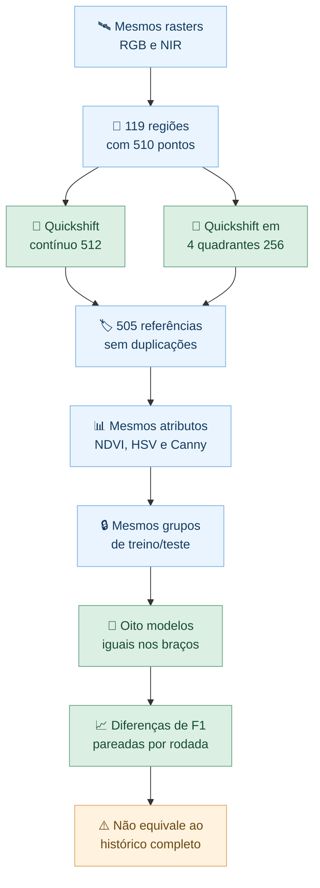

# E9 — Comparação controlada: segmentação contínua 512 versus quadrantes 256

**Estudo:** Area1, 01/11/2026. **Escopo:** comparação da **escala de segmentação**, não da totalidade do *pipeline* original.

## Problema

Os resultados históricos do Random Forest (acurácia 0,81 em 133 pares; 0,87 em 458 pares) não podem ser subtraídos dos resultados recentes: os segmentos, as amostras e a estratégia de validação mudaram. Este experimento isola uma diferença, usando os **mesmos pontos de referência, atributos, divisões de teste, modelos e métricas** em duas segmentações.

## Método efetivamente executado

- Quatro entradas já existentes na Area1: `AOI_RGB_NEW.tif`, `AOI_NEW_MULTI.tif`, `Arvores.gpkg` e `Grama.gpkg`.
- **119 regiões** de até 512 × 512 px contendo os mesmos 510 pontos de referência.
- **Braço A:** Quickshift contínuo em cada região 512. **Braço B:** Quickshift independente nos quatro quadrantes 256 da mesma região.
- **Quickshift idêntico:** `kernel_size=3`, `max_dist=5`, `ratio=0.04`, `rng=42`.
- Mapas pixel a pixel de NDVI, brilho HSV e Canny calculados uma vez por região 512; médias extraídas separadamente dos segmentos A e B.
- Após união e deduplicação de pontos compartilhando segmentos em qualquer braço: **505 referências comuns** (257 árvores, 248 gramíneas), **zero grupos com rótulos conflitantes**. Segmentos extraídos nos 119 domínios: **91.984 (A)** e **90.673 (B)**.
- **GroupShuffleSplit:** cinco divisões por blocos de 250 e 500 m, semente 2026, teste de 20% dos grupos; embargo opcional de **0 ou 25 m entre pontos de referência**, não entre contornos completos dos segmentos.
- Mesmos oito classificadores nos dois braços: RF (500), SVM RBF, regressão logística, Extra Trees, KNN (7), HistGradientBoosting, Naive Bayes e Dummy. Pipelines de escala padronizada ajustados exclusivamente no treino.
- **20 protocolos válidos, 320 avaliações executadas**, 160 para cada estratégia; acurácia, acurácia balanceada, F1-macro, F1 por classe, precisão/recall árvore e MCC.

## Resultado principal — F1-macro médio, embargo 25 m

| Blocos | Random Forest contínuo 512 | RF quadrantes 256 | Diferença (512 − 256) |
|---|---:|---:|---:|
| 250 m | **0,8906** | 0,8835 | **+0,0071** |
| 500 m | **0,8657** | 0,8566 | **+0,0091** |

**A diferença média não teve o mesmo sinal em todas as rodadas:** RF foi melhor com o contínuo em apenas 2 das 5 rodadas de cada escala. Não inferir superioridade estatística.

### O efeito depende do algoritmo

| Modelo | 250 m contínuo | 250 m quadrantes | 500 m contínuo | 500 m quadrantes |
|---|---:|---:|---:|---:|
| Random Forest | **0,8906** | 0,8835 | **0,8657** | 0,8566 |
| SVM RBF | 0,9157 | **0,9341** | 0,8518 | **0,8641** |
| Regressão logística | 0,9153 | **0,9157** | 0,8484 | **0,8685** |
| Extra Trees | **0,9064** | 0,8968 | **0,8747** | 0,8545 |
| KNN (7) | 0,8940 | **0,9009** | 0,8377 | **0,8486** |
| HistGradientBoosting | **0,8738** | 0,8714 | 0,8390 | **0,8411** |
| Gaussian Naive Bayes | **0,8894** | 0,8875 | **0,8573** | 0,8464 |
| Dummy | 0,2847 | 0,2847 | 0,2791 | 0,2791 |

Todos os resultados são **médias descritivas de cinco divisões por escala**, com os mesmos exemplos testados em cada par de modelos/segmentações. As rodadas compartilham amostras; não são cinco experimentos independentes.

## Diagrama dos protocolos

## Limites científicos e evidências

**Não foi reproduzido** o Quickshift monolítico de aproximadamente 50,6 milhões de pixels, a seleção global do **cluster 3 do K-Means**, nem a base histórica exata de **458 pares**. As regiões de 512 também são recortes. O embargo de 25 m aqui usa distâncias entre pontos, não geometrias completas. Os resultados são internos à única AOI, sem classe de fundo urbano ou dados de altura/cabos.

**Conclusão:** isolando a escala da segmentação, as métricas variaram de maneira distinta por classificador. O teste fortalece a avaliação comparativa, **sem demonstrar superioridade geral** de um pipeline completo.

**Reprodução:** o pacote `comparacao_controlada_512_vs_256_evidencias_2026-11-01.zip` contém o script Python efetivamente executado, CSVs, amostras comuns, folds, previsões RF, gráficos, log, relatório completo e manifestos de SHA-256. Os rasters originais permanecem na Area1; nenhum dado novo foi solicitado.
