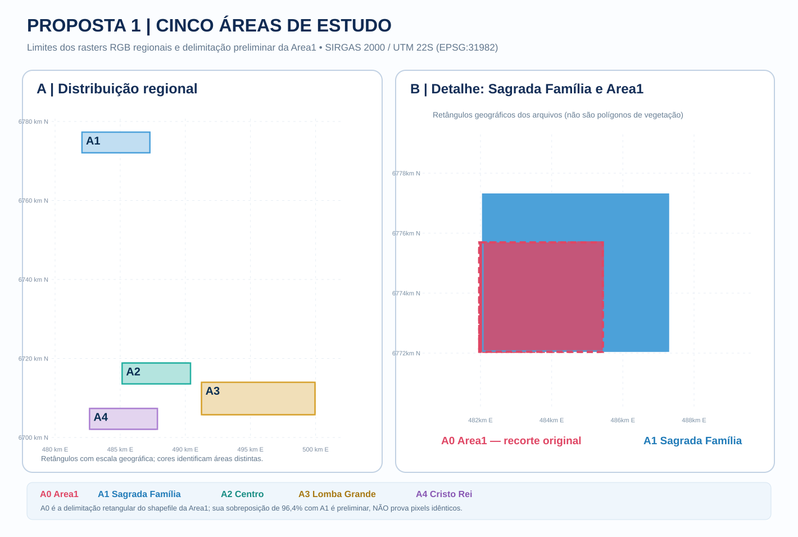

# Validação geográfica externa — implantação reprodutível

**Situação:** código implementado em branch isolada e **auditoria real de rasters executada nas quatro regiões** via GitHub Actions, incluindo leitura de metadados, alinhamento explícito em amostras e Quickshift em janelas de 256 × 256 pixels. **Nenhum F1-macro externo foi produzido**; o processamento supervisionado completo ainda depende de executar a Area1 privada e verificar NIR/rótulos.

**[Auditoria técnica executada em 12/11/2026 — quatro regiões, dimensões dos TIFFs, CRS e segmentos Quickshift em janelas reais](AUDITORIA_RASTERS_REAIS_2026-11-12.md)** · [Execução auditada no GitHub Actions](https://github.com/BrenoBragaGalvao/mestrado-arvores-urbanas/actions/runs/43292319271) — quatro jobs concluídos com sucesso.

**Não altera:** `README.md` principal, os notebooks antigos, a Area1, os gráficos, as tabelas históricas e a Proposta 2.

## Objetivo

Treinar os oito classificadores exclusivamente com **segmentos rotulados da Area1 (Caxias do Sul)**, selecionar regularização por **validação espacial interna** sobre esses dados e aplicar os modelos, **sem retreinamento nas regiões de teste**, a Centro e Lomba Grande (Novo Hamburgo) e Cristo Rei (São Leopoldo). Só calcular métricas externas se existirem rótulos locais independentes.

O nome `SAGRADA_FAMÍLIA_CAXIAS DO SUL.zip` **não prova** que seu conteúdo corresponda à Area1. Compare rasters, CRS, grade, cobertura e, quando possível, pixels.

## Cinco áreas, mapa geográfico e risco de sobreposição



| Código | Região | Papel no experimento |
|---|---|---|
| A0 | Area1 — Caxias do Sul | Fonte dos **510 pontos originais** (257 árvores + 253 gramíneas) para treinamento e validação espacial interna |
| A1 | Sagrada Família — Caxias do Sul | Região maior; verificar qual parcela corresponde a A0 e excluir sobreposição e buffer de qualquer teste independente |
| A2 | Centro — Novo Hamburgo | Aplicação externa dos modelos fixos; métricas somente com pontos independentes locais |
| A3 | Lomba Grande — Novo Hamburgo | Aplicação externa dos modelos fixos; métricas somente com pontos independentes locais |
| A4 | Cristo Rei — São Leopoldo | Aplicação externa dos modelos fixos; métricas somente com pontos independentes locais |

**Auditoria aprofundada com os arquivos originais:** [relatório de sobreposição Area1 × Sagrada e dos 510 pontos](AUDITORIA_SOBREPOSICAO_AREA1_SAGRADA_2026-11-12.md). Foram contabilizados **257 pontos de árvores e 253 de gramíneas**, todos os **510 dentro do polígono original Area1** e **também dentro da imagem RGB de Sagrada Família**. Aproximadamente **97,86% da área do polígono original** é coberta pelo RGB regional (comparação de limites, **sem demonstrar pixels idênticos**). A estimativa anterior de **96,44%** refere-se exclusivamente aos **retângulos delimitadores**; são medidas diferentes. Nenhum dos 510 pontos pode servir como teste independente do modelo treinado na Area1.

Para computar a sobreposição geográfica **do polígono real**, coordenadas dos 510 pontos e faixa de exclusão de 25 m na imagem de Sagrada Família, executar [`auditar_sobreposicao_area1.py`](auditar_sobreposicao_area1.py) no Colab, com os arquivos privados originais montados.

## Validação quantitativa da Area1

A implementação inclui dois procedimentos **distintos** e complementares: [`treinar_area1.py`](treinar_area1.py) escolhe receitas de regularização por validação espacial interna e produz os **oito modelos finais** para transferência geográfica; [`validar_area1_aninhada.py`](validar_area1_aninhada.py) realiza uma **nova avaliação aninhada com cinco divisões externas por escala (250 m e 500 m) e três divisões internas por conjunto de treinamento**. O embargo espacial é de 25 m. O script [`extrair_base_area1.py`](extrair_base_area1.py) agora reconstrói os polígonos georreferenciados dos segmentos rotulados para usar **distância geométrica real**, evitando depender apenas de centróides.

A reconstrução exige conferir os **505 segmentos únicos** da base original antes de treinar. A avaliação aninhada cria novos resultados com sementes/partições próprias; **não substitui a F1 histórica**, nem autoriza afirmar que houve generalização geográfica.

## Segmentação Quickshift integral nas regiões

A rotina [`segmentar_regiao_completa.py`](segmentar_regiao_completa.py) processa todos os pixels RGB de cada região em quadrantes de até 256 × 256, conta segmentos não rotulados e gera uma pré-visualização de fronteiras. A execução se dá no workflow [`quickshift-integral-quatro-regioes.yml`](../../.github/workflows/quickshift-integral-quatro-regioes.yml), que usa runners temporários e publica apenas CSV/JSON/PNG compactos como artefatos. **Segmentação integral não é aplicação supervisionada dos oito classificadores** e não gera métricas F1.

**Execução REAL concluída em 12/11/2026:** [relatório verificável com as quatro áreas e os arquivos ZIP depositados no Google Drive](RESULTADOS_QUICKSHIFT_INTEGRAL_2026-11-12.md). Foram processados integralmente **9.652 quadrantes** e gerados **2.764.496 segmentos não rotulados** nas quatro imagens RGB. Os quatro jobs da execução [43296756137](https://github.com/BrenoBragaGalvao/mestrado-arvores-urbanas/actions/runs/43296756137) terminaram com sucesso. A Area1 original (A0) mantém os números **históricos**, não reexecutados neste workflow: 812 quadrantes e 168.133 segmentos. A classificação supervisionada dos oito modelos e o F1-macro externo **ainda não foram realizados**.

## Fontes conectadas e checagens já feitas

- [Pasta das novas imagens no Google Drive](https://drive.google.com/drive/u/1/folders/1cUNFdo2w3V-ldPnxA9N_vnjmQtOrVHyd): quatro arquivos regionais de **1,56 GB a 3,12 GB** e um ZIP de imagens de baixa resolução. A listagem e seus tamanhos foram conferidos no Drive.
- [Dados originais da Area1](https://drive.google.com/drive/folders/1asqPz9xFr7dlnK1ggvrwftXEbkhvwjg6): foram verificados dois rasters, arquivos do AOI, arquivos de referências `Arvores.gpkg`, `Grama.gpkg` e `postes.gpkg`.
- [Fonte e tamanhos verificados](fontes_drive.json), [auditoria remota de ZIP/RAR](inspecionar_arquivos_remotos.py) e [auditoria dos GeoTIFFs reais](AUDITORIA_RASTERS_REAIS_2026-11-12.md): as quatro regiões têm arquivos RGB e 4 bandas; a auditoria das bandas/grades foi realmente executada; o canal NIR ainda precisa de confirmação espectral documental.
- Código existente: [notebook V2](../../Segmentacao_area_completa_v2_experimentos.ipynb), [receitas auditadas dos oito modelos](../v2_auditoria_regularizacao.py).

**Dados observados:** todos os quatro pacotes têm TIFF de 4 bandas e TIFF RGB, mas **não apresentam GeoPackage/Shapefile de rótulos árvore/grama**. A banda 4 **não está explicitamente identificada como NIR** nos metadados inspecionados. O Colab exige confirmação documental para chamá-la de NIR antes de executar a classificação final. Os rasters RGB e multiespectrais apresentam grades distintas e precisam de alinhamento registrado.

## Como executar — Google Colab

Abra [validacao_externa_colab.ipynb](validacao_externa_colab.ipynb) no Colab. Ele instala os requisitos, monta o Drive e apresenta as etapas na ordem correta. A conta de Google utilizada no Colab deve ter acesso aos arquivos: caso estejam apenas em «Compartilhados comigo», crie um **atalho em Meu Drive** e ajuste os caminhos. Os pacotes são grandes: selecione **uma região por vez**.

Procedimento na linha de comando, equivalente ao notebook:

### 1. Verificar o conteúdo antes de processar

```bash
python experimentos/validacao_externa_regioes/auditar_pacotes.py \
  --arquivos "/content/arquivos_novos" \
  --extraidos "/content/extraidos" \
  --extrair \
  --rgb-area1 "/content/drive/MyDrive/Projetos/Segmentacao_Breno/Area1/AOI_RGB_NEW.tif" \
  --out "/content/auditoria"
```

A auditoria:

- Lista membros de ZIP/RAR, tamanhos e extensões sem presumir a estrutura dos arquivos.
- Extrai em diretórios separados (ZIP com verificações de segurança; RAR exige ferramenta externa como `unrar`/`7z`).
- Inspeciona CRS, bandas, dimensões, resolução, geotransformação e geometrias.
- Para Sagrada Família, calcula correspondência de cobertura com a Area1; `--comparar-pixels` permite verificar se os valores de pixels coincidem em grades iguais. Identidade pelo nome não é aceita.

O relatório de auditoria deve ser **revisado antes de selecionar** os caminhos de RGB, RGB+NIR e AOI para as fases seguintes.

### 2. Treinar e congelar os modelos na Area1

Entrada original do notebook 812 quadrantes:

`/content/drive/MyDrive/Projetos/Segmentacao_Breno/outputs/v2_progressivo_256/rotulos_sem_duplicacao.csv`

Esse CSV **não apareceu nas pastas do Drive examinadas nem no GitHub**. O notebook Colab agora possui uma rota para **reconstruí-lo automaticamente**, utilizando os rasters e os pontos `Arvores.gpkg` e `Grama.gpkg` originais da Area1:

```bash
python experimentos/validacao_externa_regioes/extrair_base_area1.py \
  --area1 "/content/drive/MyDrive/Projetos/Segmentacao_Breno/Area1" \
  --out "/content/base_area1_reconstruida"
```

A reconstrução processa os quadrantes com referências conhecidas (o Quickshift é independente em cada quadrante), aplica a máscara AOI e calcula os atributos do notebook V2. Ela **confere se existem exatamente 505 segmentos únicos válidos**; se não houver concordância, interrompe a etapa seguinte e grava um arquivo de auditoria. Não substitui nem edita os CSVs históricos. Reinícios devem usar `--retomar` sem alterar entradas. Um CSV apenas de métricas não serve para treinar.

Use o CSV reconstruído em `--area1-csv` caso a base histórica não esteja disponível.

```bash
python experimentos/validacao_externa_regioes/treinar_area1.py \
  --area1-csv "/content/drive/MyDrive/Projetos/Segmentacao_Breno/outputs/v2_progressivo_256/rotulos_sem_duplicacao.csv" \
  --geometrias "/caminho/para/E3c_geometrias_rotuladas_812.gpkg" \
  --out "/content/modelos_area1"
```

- O arquivo de geometrias permite embargo de **25 m por geometria**. Se não estiver disponível, a opção `--permitir-embargo-centroides` habilita uma **aproximação diferente**, que será registrada no manifesto. Nunca apresentar os protocolos como idênticos.
- Para o modelo final de transferência, são feitos **3 sorteios internos por escala (250 m e 500 m)**, utilizando apenas a Area1, e selecionada uma das duas receitas históricas de regularização por classificador.
- Os 8 modelos finais são ajustados com os exemplos rotulados da Area1, depois da validação interna. O teste externo geográfico não participa do ajuste nem da escolha de parâmetros.
- O F1 interno dessa nova seleção **não substitui os F1 históricos**. O teste espacial histórico da Area1 também já foi visto durante o desenvolvimento e **não é teste cego**.

### 3. Aplicar à região (sem rótulos locais)

Após a auditoria, selecione manualmente o TIFF RGB e um TIFF de **pelo menos 4 bandas RGB+NIR**, garantindo a ordem das bandas.

```bash
python experimentos/validacao_externa_regioes/aplicar_regiao.py \
  --regiao centro_novo_hamburgo \
  --rgb "/caminho/rgb.tif" \
  --multi "/caminho/rgb_nir.tif" \
  --modelos "/content/modelos_area1" \
  --out "/content/resultados/centro"
```

A aplicação:

1. Processa raster em **janelas de até 256 × 256 pixels**, calculando automaticamente a quantidade de janelas (não são sempre 812).
2. Extrai média do brilho HSV, média de bordas Canny sobre **NIR/10000** e média de NDVI, seguindo o notebook dos quadrantes.
3. Executa os **oito modelos fixos** e exporta `classificacao_*.tif` por classificador, `segmento_id.tif`, `segmentos.csv.gz`, imagens RGB e sobreposições reduzidas e manifesto de execução.
4. Registra separadamente cada janela processada em `tiles/`. Se interromper, execute o **mesmo comando com `--retomar`** e sem mudar os rasters ou os modelos.
5. Se as grades raster forem diferentes, o script interrompe: usar `--alinhar-multiespectral` apenas depois da auditoria, registrando que ocorreu reprojeção/interpolação. Não tratar essa correção como transformação do protocolo original.

Se faltar NIR, **não substitua por valores fictícios** nem apresente métricas comparáveis. Um protocolo RGB-only precisaria de extração e treinamento próprios na Area1, incluindo a definição consistente de bordas sem NIR.

### 3.1. Mapas individuais e segmentos

Ao concluir a inferência, são criados os mapas completos `classificacao_*.tif` (árvore = 1, gramínea = 2, sem classe = 0) para os oito classificadores. Para inspeção visual, o script também salva `imagem_rgb_reduzida.png`, `quickshift_segmentos_reduzidos.png`, `arvores_*.png`, `gramineas_*.png` e `sobreposicao_*.png`. **As imagens reduzidas são apenas para visualização**; qualquer métrica deve usar os rasters e as referências geográficas, não a representação em PNG.

### 3.2. Se faltarem rótulos locais, preparar rotulação cega

Não usar os mapas dos classificadores como rótulos de verdade. O script abaixo sorteia pontos entre segmentos geográficos distintos, distribuídos por blocos de 250 m, **sem usar as previsões** dos modelos:

```bash
python experimentos/validacao_externa_regioes/preparar_rotulacao.py gerar \
  --segmentos "/content/resultados/centro/segmento_id.tif" \
  --n 200 --bloco-m 250 \
  --out "/content/rotulacao/centro"
```

Abra `amostras_para_anotar.gpkg` no QGIS, sobre o raster original. Interprete cada local e preencha manualmente a coluna **`classe_verificada`** com `arvore`, `grama` ou `incerto`. Não exiba o mapa classificado ao anotador. Depois:

```bash
python experimentos/validacao_externa_regioes/preparar_rotulacao.py exportar \
  --anotadas "/content/rotulacao/centro/amostras_para_anotar.gpkg" \
  --out "/content/rotulacao/centro/rotulos_verificados"
```

Os arquivos `Arvores.gpkg` e `Grama.gpkg` exportados podem alimentar `avaliar_regiao.py`. A quantidade de pontos realmente anotados, a seleção espacial e os locais incertos devem constar no relatório; a amostra com um candidato por bloco é **espacialmente distribuída, não necessariamente representativa da prevalência por pixel**.

### 4. Avaliar F1-macro quando houver rótulos locais independentes

```bash
python experimentos/validacao_externa_regioes/avaliar_regiao.py \
  --regiao centro_novo_hamburgo \
  --predicoes "/content/resultados/centro" \
  --arvores "/caminho/Arvores.gpkg" \
  --grama "/caminho/Grama.gpkg" \
  --out "/content/metricas/centro"
```

A avaliação georreferencia os pontos, identifica o segmento correspondente, remove referências conflitantes em um mesmo segmento e **deduplica por segmento** antes de calcular F1-macro, acurácia, acurácia balanceada, relatório por classe e matriz de confusão. Exige pelo menos 5 segmentos únicos por classe (mínimo técnico, **não garantia de validade estatística**). Registra exclusões e contagens. Se os rótulos faltarem, **nenhuma métrica externa é calculada**.

Os dados de referência das novas regiões **não podem** ser utilizados na seleção dos modelos da Area1.

### 5. Consolidar os resultados de várias regiões

Depois que os CSVs de métricas externas forem produzidos, execute:

```bash
python experimentos/validacao_externa_regioes/consolidar_resultados.py \
  --metricas-root "/content/metricas" \
  --baseline "docs/e4b_ablacao_aninhada_2026-11-03_tabelas.csv" \
  --out "/content/comparacao_regioes"
```

O script cria `status_regioes.csv` e `relatorio.md`. Quando existem métricas externas realmente validadas, cria `comparacao_externa_oito_modelos.csv` e `contexto_descritivo_area1_vs_externo.csv`. Se faltarem, marca a região como **não avaliada**, sem inventar F1. A diferença com o F1 histórico da Area1 é **apenas descritiva**, pois a avaliação de 250/500 m na Area1 e a transferência para outra cidade são protocolos não pareados.

### 6. Proposta 2, somente quando houver pontos de postes

Se, e somente se, a nova região possuir uma camada georreferenciada de **pontos de postes**, pode-se realizar a seguinte análise complementar **estritamente exploratória**:

```bash
python experimentos/validacao_externa_regioes/proximidade_postes_opcional.py \
  --predicoes "/content/resultados/centro" \
  --postes "/caminho/postes.gpkg" \
  --raio-m 10 \
  --out "/content/proximidade/centro"
```

O script mede a **distância horizontal 2D entre a posição do poste e o centro do pixel mais próximo classificado como árvore**, com contagens dentro de 1, 3 e 5 m, para cada um dos oito modelos. Trata-se de uma **aproximação raster**, diferente dos polígonos e dos índices históricos de porte. **Não há estimativa de altura nesta etapa e não é possível inferir proximidade real a cabos ou risco elétrico.** Caso não haja pontos de postes, não executar nem inventar distâncias.

## Organização gerada

| Saída | Significado |
|---|---|
| `auditoria_pacotes.json` | Conteúdo e metadados efetivamente inspecionados após acesso aos arquivos. |
| `modelos_area1/*.joblib` | Modelos treinados somente na Area1, com manifesto de parâmetros e origem. |
| `predicoes/REGIAO/classificacao_*.tif` | Predição por classificador (1 = árvore, 2 = gramínea, 0 = sem classificação). |
| `predicoes/REGIAO/segmento_id.tif` | IDs geográficos para vincular pontos a segmentos. |
| `predicoes/REGIAO/segmentos.csv.gz` | Características extraídas sem carregar a imagem inteira na RAM. |
| `predicoes/REGIAO/*reduzidos.png`, `arvores_*.png`, `gramineas_*.png` | Pré-visualizações por modelo e Quickshift; não são mapas para avaliação numérica. |
| `rotulacao/REGIAO/amostras_para_anotar.gpkg` | Pontos independentes para anotação cega quando não houver rótulos. |
| `metricas/REGIAO/metricas_externas.csv` | Métricas externas **somente se existirem referências independentes**. |
| `metricas/REGIAO/matrizes_confusao.csv` | Matriz por classificador e região, quando validada. |

## Limitações e próximas condições

1. **Auditoria real executada:** os ZIP/RAR foram lidos e as duas ortoimagens por região foram abertas no GitHub Actions (sem publicação do conteúdo raster). Falta confirmação formal da identidade espectral do quarto canal e processamento completo de toda a cobertura; não foram encontrados vetores de rótulos nos pacotes.
2. **Base de treinamento protegida:** os dados de origem da Area1 são privados no Google Drive e não são diretamente acessíveis a um runner GitHub sem autenticação. O notebook Colab pode reconstruir o CSV de 505 segmentos rotulados com os arquivos privados, desde que o usuário autorize o Drive.
3. **Sem métricas externas:** resultados antigos da Area1 não são novos testes externos.
4. **Sem projeção de porte ou risco elétrico nesta etapa:** a Proposta 2 permanece preservada; ela depende de dados de postes/alturas e não mede risco a cabos.
5. **Compatibilidade espectral:** a ordem RGB+NIR, calibração radiométrica, diferença de sensores, resolução e eventual alinhamento precisam ser auditados. Sem essa compatibilidade, a comparação direta do F1 pode não ser válida.
6. **Dados geográficos sensíveis a vazamento:** rótulos da região de teste não podem influenciar treinamento ou hiperparâmetros. As previsões da região podem ser geradas sem usar rótulos.

## Testes automatizados

```bash
python -m pip install -r experimentos/validacao_externa_regioes/requirements.txt
python -m compileall -q experimentos/validacao_externa_regioes
python -m pytest -q experimentos/validacao_externa_regioes/testes
```

Os testes geram **dados sintéticos**, apenas para conferir funcionamento de partes do código. Não representam resultados científicos em Novo Hamburgo, São Leopoldo ou Caxias.

**Critério de publicação:** acrescente ao README principal a seção «Validação da metodologia em outras regiões geográficas» *somente depois de processar os rasters, conferir os rótulos locais e verificar as métricas realmente obtidas*. Não altere os números do estudo original.
